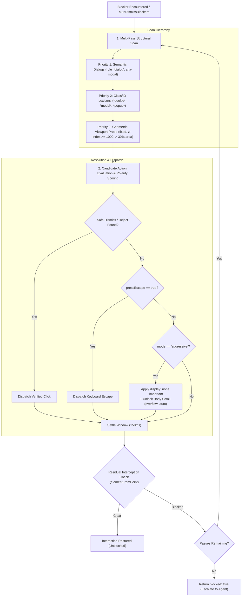

# Blocker & Overlay Remediation

> [!NOTE]
> When a website does not utilize a recognized enterprise Consent Management Platform (CMP) or presents non-consent overlays—such as promotional popups, newsletter signup walls, age verification gates, or translucent click-intercepting backdrops—Nova activates its active remediation tool: [`nova.dismiss_blockers`](../../../mcp-reference/tools/guarded-actions/nova-dismiss-blockers.md). It pairs multi-pass heuristic detection with automated scroll-lock recovery and guarded interaction healing.

---

## 1. Executive Summary & Core Mission

Visual obstructions and modal dialogs are among the primary causes of failure in automated web navigation. They intercept mouse clicks, freeze page scrolling via orphaned `overflow: hidden` rules, and shift keyboard focus away from target workflows.

Nova's Blocker Remediation architecture provides:
1. **Multi-Pass Structural Scanning:** Progressive DOM analysis evaluating semantic dialogs (`role="dialog"`), class/ID lexicons, and geometric overlay coverage ($> 30\%$ viewport).
2. **Conservative vs. Aggressive Modes:** Strict polarity-filtered reject clicks and Escape injection by default, escalating to forced CSS `display: none` and scroll unlocking when needed.
3. **Automated Scroll-Lock Recovery:** Automatic detection and removal of orphaned `overflow: hidden` and `position: fixed` styles on `body` and `html`.
4. **In-Flight Click Self-Healing:** Seamless resolution of click-intercepting backdrops directly inside [`nova.click_selector`](../../../mcp-reference/tools/browser-automation/nova-click-selector.md) via `autoDismissBlockers: true`.

---

## 2. Comprehensive Documentation Index

The Blocker and Overlay Remediation architecture is detailed across specialized subguides:

| Architecture Guide | Focus Areas & Key Invariants | Primary Components |
| :--- | :--- | :--- |
| **[Heuristic Detection & Remediation](heuristic-detection-and-remediation/README.md)** | Multi-pass remediation pipeline (maxPasses 1–5), structural scan hierarchy (semantic, lexical, geometric), conservative vs. aggressive modes, synthetic Escape key injection, and automated `overflow: hidden` body scroll restoration. | `nova.dismiss_blockers` `BlockerKindClassifier` `SyntheticEscape` `ScrollLockRecovery` |
| **[Guarded Click Integration](guarded-click-integration/README.md)** | In-flight self-healing via `autoDismissBlockers: true`, coordinate hit-testing mechanics (`elementFromPoint`), interception detection, automatic conservative remediation passes, and structured response transparency. | `autoDismissBlockers` `elementFromPoint` `nova.click_selector` `dismissedBlockersDetail` |

---

## 3. High-Level Remediation Architecture

---

## 4. Key Architectural Invariants

* **Non-Destructive Conservative Default:** In conservative mode, Nova relies exclusively on verified click actions and keyboard Escape. It does not inject CSS overrides or mutate DOM structures directly.
* **Scroll-Lock Restoration:** Any remediation pass that hides or dismisses an overlay evaluates the computed `overflow` style of `document.body` and `document.documentElement`, resetting `overflow: auto !important` if locked.
* **Hit-Test Validation:** Low-level clicks use `elementFromPoint(x, y)` to detect backdrops before dispatching physical events, invoking self-healing transparently when `autoDismissBlockers: true` is configured.

---

## Related Documentation

* [Heuristic Detection & Remediation Subguide](heuristic-detection-and-remediation/README.md)
* [Guarded Click Integration Subguide](guarded-click-integration/README.md)
* [Parent: Consent Management Architecture Overview](../README.md)
* [Programmatic CMP Vendor API Engine](../cmp-engine/README.md)
* [3-Stage Hijack & Dark Pattern Defense](../hijack-protection/README.md)
* [Tool Reference: `nova.dismiss_blockers`](../../../mcp-reference/tools/guarded-actions/nova-dismiss-blockers.md)
