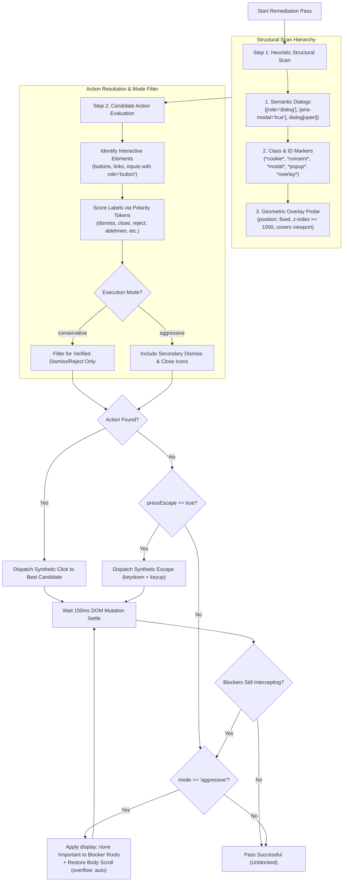
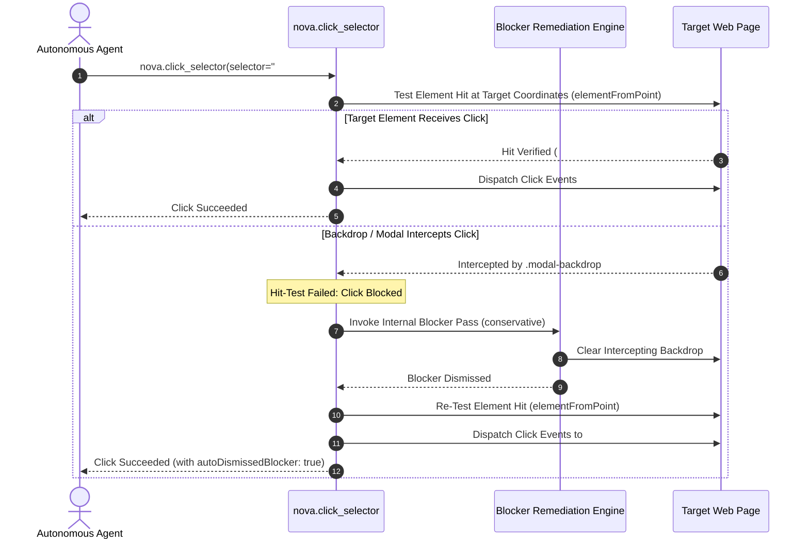

# Blocker & Overlay Remediation

> [!NOTE]
> When a website does not utilize a recognized enterprise Consent Management Platform (CMP) or presents non-consent overlays—such as promotional popups, newsletter signup walls, age verification gates, or translucent click-intercepting backdrops—Nova activates its active remediation tool: `nova.dismiss_blockers`. It pairs multi-pass heuristic detection with automated scroll-lock recovery and guarded interaction healing.

---

## 1. The Blocker Problem in Automated Web Navigation

Even when cookie consent is handled, modern web applications frequently display persistent overlays that halt autonomous agents:

```
┌────────────────────────────────────────────────────────────────────────┐
│                        Common Blocker Archetypes                       │
├──────────────────────────────────┬─────────────────────────────────────┤
│ Blocker Type                     │ Runtime Impact on Autonomous Agents │
├──────────────────────────────────┼─────────────────────────────────────┤
│ Translucent Modal Backdrops      │ A fixed <div> with high z-index and │
│ (e.g. .backdrop, .modal-mask)    │ pointer-events intercepts all mouse │
│                                  │ clicks intended for underlying UI.  │
├──────────────────────────────────┼─────────────────────────────────────┤
│ Newsletter & Promotional Popups  │ Dynamic dialogs appearing seconds   │
│                                  │ after page load, shifting focus.    │
├──────────────────────────────────┼─────────────────────────────────────┤
│ Body Scroll Lock Locks           │ CSS rule `overflow: hidden` applied │
│                                  │ to <body>, freezing all page scroll.│
├──────────────────────────────────┼─────────────────────────────────────┤
│ Custom Cookie Walls              │ Non-standard consent UI lacking a   │
│                                  │ recognized vendor JavaScript API.   │
└──────────────────────────────────┴─────────────────────────────────────┘
```

`nova.dismiss_blockers` provides a multi-stage active remediation engine designed to clear these barriers without breaking underlying Single-Page Application (SPA) routing or form state.

---

## 2. Multi-Pass Remediation Pipeline

When invoked, `nova.dismiss_blockers` executes up to `maxPasses` (default: 2, configurable 1–5) remediation passes. Each pass applies a three-tiered sequence:



---

## 3. Remediation Modes: Conservative vs. Aggressive

Nova provides two distinct operation modes to balance safety against thoroughness:

### A. Conservative Mode (`mode: "conservative"`)
* **Default Mode:** Recommended starting point for autonomous agents.
* **Target Elements:** Standard cookie consent dialogs, GDPR banners, and prominent modal containers.
* **Click Discipline:** Strictly refuses to click any button unless its label exhibits unambiguous dismissive or refusal semantics. If no safe button can be verified, it does not click.
* **Mutation Impact:** Relies solely on native UI controls and keyboard Escape. It does not tamper with DOM styles directly.

### B. Aggressive Mode (`mode: "aggressive"`)
* **Escalation Mode:** Used when conservative mode completes but the page remains blocked by stubborn backdrops or custom overlays.
* **Target Elements:** Extends scanning to arbitrary fixed-position `<div>`, `<section>`, and `<aside>` elements that cover more than 30% of the viewport.
* **Style Overrides:** For lingering blocker roots that do not dismiss via clicks or Escape, Nova injects inline CSS overrides:
  ```css
  element.style.setProperty('display', 'none', 'important');
  ```
* **Tagged Actions:** Injected overrides are recorded in the structured response as `aggressive_overlay_hide` actions.

---

## 4. Automated Scroll-Lock Recovery

A common failure mode of web modal dismissal is the **orphaned scroll lock**:
1. When opening a modal, web frameworks frequently inject CSS rules onto the root document:
   ```css
   body, html {
     overflow: hidden !important;
     position: fixed !important;
     width: 100%;
   }
   ```
2. If an overlay is closed or hidden without firing the site's native cleanup handler, `overflow: hidden` remains locked, leaving the user or agent unable to scroll the page.

Nova's blocker dismissal engine automatically detects this condition. In aggressive mode or when backdrop elements are cleared, Nova evaluates the computed style of `document.body` and `document.documentElement`. If an orphaned lock is detected, Nova restores interaction:

```javascript
// Automated scroll-lock restoration executed by Nova
if (getComputedStyle(document.body).overflow === 'hidden') {
    document.body.style.setProperty('overflow', 'auto', 'important');
}
if (getComputedStyle(document.documentElement).overflow === 'hidden') {
    document.documentElement.style.setProperty('overflow', 'auto', 'important');
}
if (document.body.style.position === 'fixed') {
    document.body.style.removeProperty('position');
}
```

This guarantees that following a blocker pass, vertical and horizontal scrolling via `nova.scroll_smart` or `nova.scroll_by` functions normally.

---

## 5. Integration with Guarded Interactions (`autoDismissBlockers`)

Manually checking for blockers before every single click introduces latency and unnecessary MCP round-trips. Nova integrates blocker remediation directly into its low-level browser interaction tools:

Passing `autoDismissBlockers: true` to [`nova.click_selector`](../../../mcp-reference/tools/browser-automation/nova-click-selector.md) activates **on-demand self-healing**:



---

## 6. Post-Hoc Hijack Assessment (`hijackProtection`)

When `nova.dismiss_blockers` executes candidate clicks, it returns an audit record in the `hijackProtection` field of the structured response.

This provides the agent with forensic visibility into whether the clicked button carried potential dark-pattern risks:

```json
{
  "ok": true,
  "status": "ok",
  "didDismiss": true,
  "blocked": false,
  "verdict": "SUCCESS",
  "actionsTriedTotal": 1,
  "hijackProtection": {
    "actionCount": 1,
    "actions": [
      {
        "label": "Ablehnen",
        "polarityDecision": "AllowRejectClick",
        "rejectScore": 1.0,
        "acceptScore": 0.0,
        "polarityMargin": 1.0
      }
    ],
    "clusterClassification": "RejectAcceptPair",
    "allowAutoApply": true,
    "hijackSuspected": false
  }
}
```

If `hijackSuspected: true` is reported, the agent is alerted that although a button was clicked, the surrounding label context suggests ambiguous or deceptive wording. The agent can then re-perceive the page using `nova.page_info` or `nova.perceive` to verify whether the intended state was achieved.

---

## Related Documentation

* [Consent Management Architecture Overview](../README.md)
* [Programmatic CMP Vendor API Engine](../cmp-engine/README.md)
* [3-Stage Hijack & Dark Pattern Defense](../hijack-protection/README.md)
* [Tool Reference: `nova.dismiss_blockers`](../../../mcp-reference/tools/guarded-actions/nova-dismiss-blockers.md)
* [Browser Interaction Architecture](../../browser-interaction/README.md)
