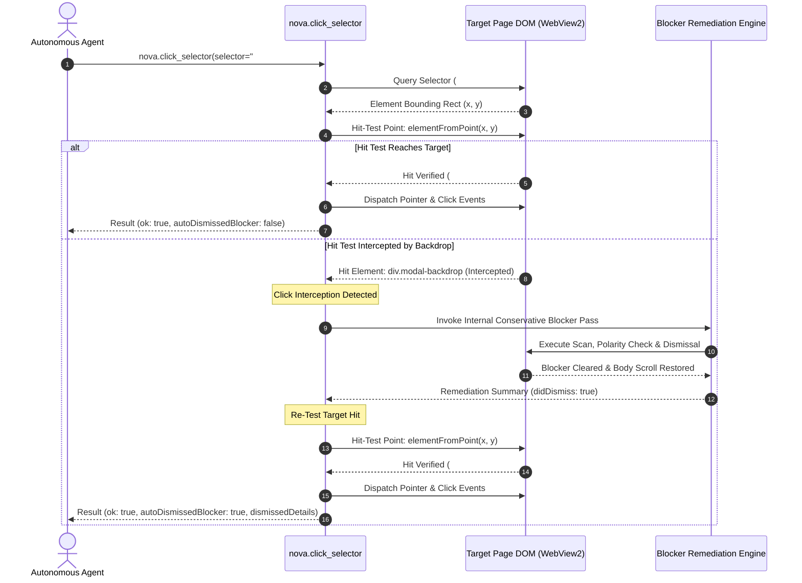

# Guarded Click & Blocker Integration

> [!IMPORTANT]
> Requiring autonomous agents to manually inspect and clear blockers before every single click introduces excessive latency, multiplies MCP round-trips, and complicates agent prompting. Nova AI Workspace solves this by embedding **in-flight blocker self-healing** directly into its browser interaction tools—most notably [`nova.click_selector`](../../../../mcp-reference/tools/browser-automation/nova-click-selector.md) and guarded action macros—via the `autoDismissBlockers` flag.

---

## 1. The Cost of Separate Blocker Checks

In naive agent implementations, handling modals and backdrops requires a repetitive, defensive polling loop:

```
[Agent Turn 1] nova.page_info()
[Agent Turn 2] Check for modal... None found.
[Agent Turn 3] nova.click_selector(selector="#checkout") -> FAILS (Click intercepted by .modal-backdrop)
[Agent Turn 4] nova.dismiss_blockers()
[Agent Turn 5] nova.click_selector(selector="#checkout") -> SUCCEEDS
```

This interaction pattern causes severe operational drawbacks:
* **Latency Inflation:** Adds 2–4 extra round-trips over the MCP transport.
* **Token Overhead:** Requires multiple prompt iterations to recognize the failure, diagnose the intercepting element, and issue remediation commands.
* **State Fragility:** Dynamic web pages may spawn popups milliseconds after `page_info` finishes, creating race conditions between perception and interaction.

Nova eliminates this friction by integrating hit-testing and blocker clearance directly into the low-level click pipeline.

---

## 2. In-Flight Self-Healing Architecture

When an agent invokes `nova.click_selector` with `autoDismissBlockers: true`, the interaction pipeline executes an automated detection and retry loop:



---

## 3. Hit-Testing Mechanics (`elementFromPoint`)

Before dispatching any physical or synthetic mouse event, Nova verifies that the target element actually occupies the coordinate plane at the calculated center point $(X, Y)$:

```javascript
// Internal hit-test validation executed before click dispatch
function verifyClickableTarget(targetElement) {
    const rect = targetElement.getBoundingClientRect();
    const centerX = rect.left + rect.width / 2;
    const centerY = rect.top + rect.height / 2;

    const hitElement = document.elementFromPoint(centerX, centerY);
    if (!hitElement) return { clickable: false, reason: "offscreen" };

    // Target is clickable if hitElement is the target or a descendant child
    const isDirectHit = (hitElement === targetElement || targetElement.contains(hitElement));
    return {
        clickable: isDirectHit,
        hitElementTag: hitElement.tagName,
        hitElementClass: hitElement.className,
        interceptingElement: isDirectHit ? null : hitElement
    };
}
```

If `clickable: false` and `interceptingElement` is identified (such as a fixed-position `.modal-backdrop`, `.cookie-banner`, or `.scrim`), Nova does not fail the click immediately. If `autoDismissBlockers: true` is active, it triggers the self-healing remediation cascade.

---

## 4. Integration Across Guarded Action Macros

The `autoDismissBlockers` capability is not limited to isolated selector clicks. It is built into Nova's guarded high-level action tools:

| Guarded MCP Tool | Self-Healing Capability | Common Interception Scenarios |
| :--- | :--- | :--- |
| [`nova.click_selector`](../../../../mcp-reference/tools/browser-automation/nova-click-selector.md) | Resolves backdrops intercepting interactive buttons, checkboxes, or tab controls. | Cookie banners, promotional dialogs, floating sticky bars. |
| [`nova.guarded_send_message`](../../../../mcp-reference/tools/guarded-actions/README.md) | Ensures chat input fields or send buttons are not shielded by welcome modals or survey popups. | Support chat widgets, AI assistant interfaces, conversational forms. |
| [`nova.guarded_submit_form`](../../../../mcp-reference/tools/guarded-actions/README.md) | Clears backdrop overlays intercepting primary form submission buttons. | Multi-step registration wizards, payment checkouts. |

---

## 5. Structured Response Payload

When a blocker is dismissed during an in-flight click, the tool returns full forensic transparency in its response payload:

```json
{
  "ok": true,
  "status": "ok",
  "selector": "#buy-btn",
  "autoDismissedBlocker": true,
  "dismissedBlockersDetail": {
    "passesRun": 1,
    "actionsExecuted": [
      {
        "type": "button_click",
        "label": "Nur notwendige akzeptieren",
        "polarityDecision": "AllowRejectClick",
        "clusterClassification": "RejectAcceptPair"
      }
    ],
    "scrollRestored": true
  },
  "clickCoordinates": { "x": 540, "y": 720 }
}
```

### Agent Operational Guidelines:
* **Zero Script Interruption:** The autonomous agent does not need to handle an error or retry the click. The original goal (`click_selector`) was fully accomplished.
* **Audit Awareness:** The agent can observe `autoDismissedBlocker: true` in its execution log to know that a modal was cleared and scroll recovery was executed.
* **Persistent Blockers:** If the blocker engine runs its maximum passes and the target element remains obscured, the tool returns `ok: false` with error `click_intercepted`, providing the selector and class name of the persistent blocking element so the agent can escalate to aggressive remediation or notify the operator.

---

## Related Documentation

* [Domain Hub: Blocker & Overlay Remediation](../README.md)
* [Subguide: Heuristic Detection & Blocker Remediation](../heuristic-detection-and-remediation/README.md)
* [Domain Hub: CMP Vendor API Engine](../../cmp-engine/README.md)
* [Domain Hub: 3-Stage Hijack & Dark Pattern Defense](../../hijack-protection/README.md)
* [Tool Reference: `nova.click_selector`](../../../../mcp-reference/tools/browser-automation/nova-click-selector.md)
