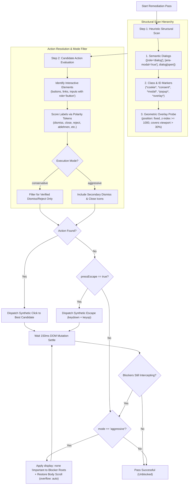
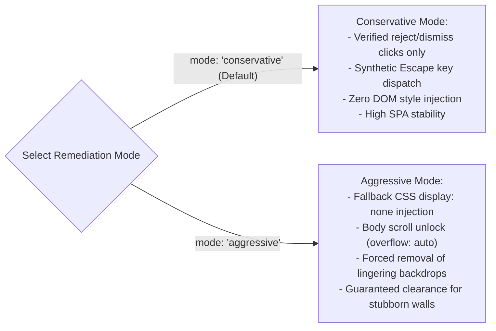

# Heuristic Detection & Blocker Remediation

> [!NOTE]
> When websites deploy non-standard consent dialogs, promotional overlays, newsletter subscription walls, or translucent backdrops lacking a recognized vendor runtime API, programmatic dispatch via `nova.cmp_apply` is impossible. Nova activates its intelligent fallback engine: [`nova.dismiss_blockers`](../../../../mcp-reference/tools/guarded-actions/nova-dismiss-blockers.md). It executes a multi-pass heuristic detection pipeline, deploys conservative vs. aggressive remediation strategies, and automatically repairs orphaned scroll locks.

---

## 1. The Overlay & Blocker Landscape

In modern automated browsing, visual overlays present severe operational hurdles for autonomous agents:

```
┌────────────────────────────────────────────────────────────────────────┐
│                        Common Blocker Archetypes                       │
├──────────────────────────────────┬─────────────────────────────────────┤
│ Blocker Type                     │ Runtime Impact on Autonomous Agents │
├──────────────────────────────────┼─────────────────────────────────────┤
│ Translucent Modal Backdrops      │ A fixed <div> with high z-index and │
│ (e.g. .backdrop, .modal-mask)    │ pointer-events intercepts all mouse │
│                                  │ clicks intended for underlying UI.  │
├──────────────────────────────────┼─────────────────────────────────────┤
│ Promotional & Newsletter Popups  │ Dynamic dialogs appearing seconds   │
│                                  │ after page load, shifting focus.    │
├──────────────────────────────────┼─────────────────────────────────────┤
│ Body Scroll Lock Locks           │ CSS rule `overflow: hidden` applied │
│                                  │ to <body>, freezing all page scroll.│
├──────────────────────────────────┼─────────────────────────────────────┤
│ Custom Cookie Walls              │ Non-standard consent UI lacking a   │
│                                  │ recognized vendor JavaScript API.   │
├──────────────────────────────────┼─────────────────────────────────────┤
│ Age Verification Gates           │ Full-screen barriers requiring      │
│                                  │ interaction before showing content. │
└──────────────────────────────────┴─────────────────────────────────────┘
```

The remediation engine must resolve these obstructions without crashing Single-Page Applications (SPAs) or corrupting underlying form states.

---

## 2. Multi-Pass Remediation Pipeline

When invoked, `nova.dismiss_blockers` executes up to `maxPasses` (default: 2, configurable 1–5) sequential remediation passes. Each pass executes a deterministic three-tier sequence:



---

## 3. Structural Scan Hierarchy

To avoid destroying essential site navigation or application forms, candidate blockers must satisfy strict structural criteria:

### Priority 1: Semantic Dialogs
Nova queries for standard W3C WAI-ARIA modal landmarks:
* `[role="dialog"]`
* `[role="alertdialog"]`
* `[aria-modal="true"]`
* `<dialog open>`

### Priority 2: Class & ID Lexicon Probes
If semantic landmarks are absent, the scanner probes container classes and IDs using add-only pattern lexicons:
* `*cookie*`, `*consent*`, `*gdpr*`, `*privacy*`
* `*modal*`, `*popup*`, `*overlay*`, `*dialog*`
* `*backdrop*`, `*scrim*`, `*interstitial*`

### Priority 3: Geometric Viewport Probing
For obfuscated or unclassed wrappers, Nova evaluates physical geometry via `getBoundingClientRect()`:
* **Position:** Computed CSS `position: fixed` or `position: absolute`.
* **Stacking Context:** `z-index >= 1000` or higher than the primary main content container.
* **Viewport Coverage:** Element area covers $> 30\%$ of the active viewport area ($W \times H$).
* **Hit-Testing Interception:** Calls `document.elementFromPoint(centerX, centerY)` to verify that the element intercepts pointer events directed at underlying content.

---

## 4. Remediation Modes: Conservative vs. Aggressive

Nova provides two distinct remediation modes to balance DOM stability against clearance success:



### 4.1 Conservative Mode (`mode: "conservative"`)
* **Default Mode:** Recommended starting point for all standard automated browsing flows.
* **Click Discipline:** Strictly refuses to click any button unless its label passes the 3-stage polarity scoring check (`AllowRejectClick`).
* **Zero Style Mutation:** Does not inject inline CSS or remove DOM nodes; relies purely on native UI triggers and keyboard events.
* **Best Suited For:** Legitimate news portals, e-commerce checkouts, and web apps where preserving JavaScript component state is critical.

### 4.2 Aggressive Mode (`mode: "aggressive"`)
* **Escalation Mode:** Activated when conservative mode reports `blocked: true` (e.g., persistent backdrops or paywalls).
* **Forced Display Overrides:** For blocker roots that do not dismiss via clicks or Escape, Nova injects inline CSS overrides:
  ```css
  element.style.setProperty('display', 'none', 'important');
  ```
* **Audit Tagging:** All modified elements are recorded in the structured response as `aggressive_overlay_hide` actions.
* **Best Suited For:** Aggressive marketing popups, dead overlay backdrops, and uncooperative cookie walls.

---

## 5. Synthetic Escape Key Injection (`pressEscape`)

Many modern web dialog libraries (Bootstrap, Tailwind UI, Material UI, React Modal) bind keyboard event listeners to the `Escape` key (`keyCode: 27`, `key: "Escape"`).

When enabled (`pressEscape: true`, default in conservative mode), Nova dispatches a full synthetic keyboard sequence targeting the active element or document root:

```javascript
// Synthetic Escape event dispatch sequence
const target = document.activeElement || document.body;
target.dispatchEvent(new KeyboardEvent('keydown', {
    key: 'Escape',
    code: 'Escape',
    keyCode: 27,
    which: 27,
    bubbles: true,
    cancelable: true
}));
target.dispatchEvent(new KeyboardEvent('keyup', {
    key: 'Escape',
    code: 'Escape',
    keyCode: 27,
    which: 27,
    bubbles: true,
    cancelable: true
}));
```

If the dialog dismisses in response to the Escape sequence, the engine registers `escape_pressed` and verifies that pointer events are restored.

---

## 6. Automated Scroll-Lock Recovery

A common failure mode of web modal dismissal is the **orphaned scroll lock**:

1. When a modal opens, frameworks frequently lock scrolling by modifying the root document styles:
   ```css
   body, html {
     overflow: hidden !important;
     position: fixed !important;
     width: 100%;
   }
   ```
2. If the overlay is dismissed via Escape or removed via aggressive `display: none`, the framework's cleanup routine may not fire, leaving the document frozen in place.
3. The agent is left unable to scroll the page using `nova.scroll_smart` or `nova.scroll_by`.

Nova's remediation engine detects this orphaned state automatically. In aggressive mode or when backdrop elements are cleared, Nova evaluates the computed styles of `document.body` and `document.documentElement`:

```javascript
// Automated scroll-lock restoration executed by Nova
if (window.getComputedStyle(document.body).overflow === 'hidden') {
    document.body.style.setProperty('overflow', 'auto', 'important');
}
if (window.getComputedStyle(document.documentElement).overflow === 'hidden') {
    document.documentElement.style.setProperty('overflow', 'auto', 'important');
}
if (document.body.style.position === 'fixed') {
    document.body.style.removeProperty('position');
}
```

This guarantees that following a blocker pass, vertical and horizontal scrolling functions normally.

---

## Related Documentation

* [Domain Hub: Blocker & Overlay Remediation](../README.md)
* [Subguide: Guarded Click & Blocker Integration](../guarded-click-integration/README.md)
* [Domain Hub: CMP Vendor API Engine](../../cmp-engine/README.md)
* [Domain Hub: 3-Stage Hijack & Dark Pattern Defense](../../hijack-protection/README.md)
* [Tool Reference: `nova.dismiss_blockers`](../../../../mcp-reference/tools/guarded-actions/nova-dismiss-blockers.md)
