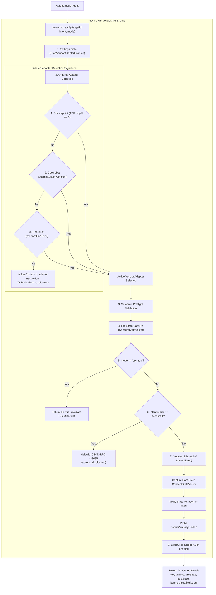

# Programmatic CMP Vendor API Engine

> [!NOTE]
> The Consent Management Platform (CMP) Engine powers [`nova.cmp_apply`](../../../mcp-reference/tools/guarded-actions/nova-cmp-apply.md). Rather than attempting to click buttons through arbitrary DOM selectors, the engine interfaces directly with the runtime JavaScript APIs of recognized enterprise consent providers (OneTrust, Sourcepoint / TCF v2, and Cookiebot). It enforces a strict 8-step execution pipeline, verifies ground truth through cryptographic state vectors, and prevents unauthorized consent escalation via autonomous safety gates.

---

## 1. Executive Summary & Core Mission

Enterprise websites deploy standardized Consent Management Platforms to comply with GDPR, ePrivacy, and CCPA regulations. These platforms maintain complex client-side state machines, register cryptographic consent strings, and gate analytics scripts behind legal status tokens.

Naive visual button-clicking frequently fails against these systems because DOM mutations do not guarantee internal state transitions, and dark patterns frequently mislead text-matching algorithms.

The Nova CMP Engine provides:
1. **Direct Runtime API Dispatch:** Direct invocation of vendor methods (`window.OneTrust.RejectAll()`, `__tcfapi('postRejectAll', 2, ...)`, `window.Cookiebot.submitCustomConsent()`).
2. **Deterministic 8-Step Pipeline:** Strict sequencing from settings evaluation and ordered adapter detection to settle debouncing and Serilog auditing.
3. **Cryptographic State Verification:** Capture and comparison of typed `ConsentStateVector` snapshots with anti-spoofing provenance validation.
4. **Autonomous Safety Gate:** Unconditional rejection of commercial tracking acceptance (`AcceptAll` error `-32035`).

---

## 2. Comprehensive Documentation Index

The CMP Engine architecture is detailed across specialized subguides:

| Architecture Guide | Focus Areas & Key Invariants | Primary Components |
| :--- | :--- | :--- |
| **[Execution Pipeline & Vendor Adapters](execution-pipeline-and-adapters/README.md)** | The 8-stage execution pipeline, ordered adapter detection priority (Sourcepoint $\rightarrow$ Cookiebot $\rightarrow$ OneTrust), runtime protocols, cryptographic TC string hashing, and event bus listener guards. | `McpCmpApplyHandler` `CmpAdapterRegistry` `SourcepointAdapter` `CookiebotAdapter` `OneTrustAdapter` |
| **[Consent State & Safety Gates](consent-state-and-safety-gates/README.md)** | Ground-truth verification via `ConsentStateVector`, anti-spoofing data provenance (`OneTrust.GetDomainData().Groups`), strongly-typed `ConsentIntent`, autonomous `AcceptAll` barrier (-32035), user choice preservation, and visual hidden probing. | `ConsentStateVector` `ConsentIntent` `OneTrustGroupsFromDomainData` `CmpHideList` `bannerVisuallyHidden` |

---

## 3. High-Level Engine Architecture

---

## 4. Key Architectural Invariants

* **Identity Gate Ordering:** The detection sequence must always prioritize cryptographic/registry gates (`Sourcepoint` cmpId=6) before general API objects (`Cookiebot`) and broad DOM markers (`OneTrust`). Unordered detection is strictly prohibited to prevent shadowing.
* **Anti-Spoofing Provenance:** Post-apply state verification for OneTrust strictly rejects global properties like `OptanonActiveGroups` and requires validation through internal engine models (`OneTrust.GetDomainData().Groups`).
* **Autonomous Tracking Protection:** Autonomous agents are barred from executing `AcceptAll`. Any attempt to accept commercial tracking without human operator authorization terminates immediately with error `-32035`.
* **State vs. Visibility Decoupling:** Verification measures underlying engine data. The companion probe `bannerVisuallyHidden` indicates whether visual backdrop cleanup is required via [`nova.dismiss_blockers`](../../../mcp-reference/tools/guarded-actions/nova-dismiss-blockers.md).

---

## Related Documentation

* [Execution Pipeline & Vendor Adapters Subguide](execution-pipeline-and-adapters/README.md)
* [Consent State & Safety Gates Subguide](consent-state-and-safety-gates/README.md)
* [Parent: Consent Management Architecture Overview](../README.md)
* [3-Stage Hijack & Dark Pattern Defense](../hijack-protection/README.md)
* [Blocker & Overlay Remediation](../blocker-dismissal/README.md)
* [Tool Reference: `nova.cmp_apply`](../../../mcp-reference/tools/guarded-actions/nova-cmp-apply.md)
