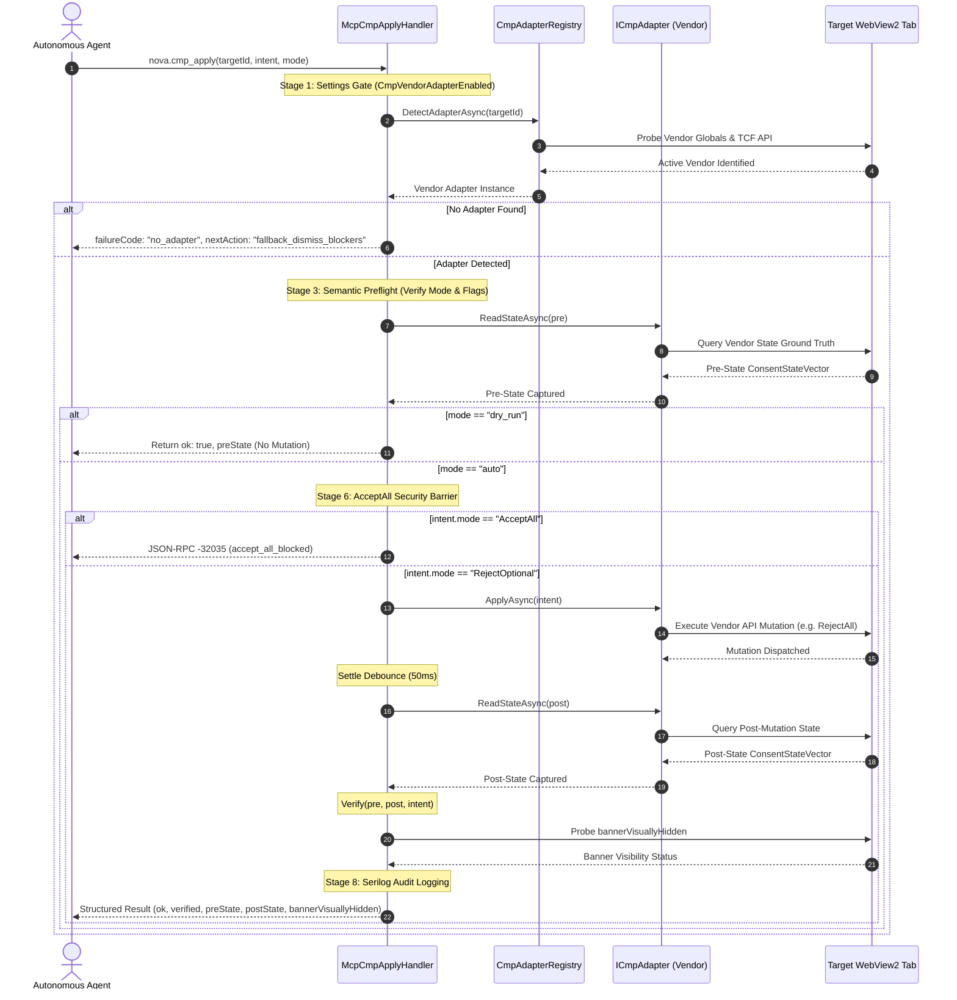

# Programmatic CMP Vendor API Engine

> [!NOTE]
> The Consent Management Platform (CMP) Engine powers `nova.cmp_apply`. Rather than attempting to click buttons through arbitrary DOM selectors, the engine interfaces directly with the runtime JavaScript APIs of recognized enterprise consent providers (OneTrust, Sourcepoint / TCF v2, and Cookiebot). It enforces a strict 8-step execution pipeline, verifies ground truth through cryptographic state vectors, and prevents unauthorized consent escalation.

---

## 1. The 8-Step Execution Pipeline

Every invocation of `nova.cmp_apply` passes through a deterministic eight-stage pipeline:



### The 8 Stages in Detail:

1. **Settings Gate:** Checks `AppSettings.CmpVendorAdapterEnabled`. If disabled by policy, execution halts with JSON-RPC error `-32002`.
2. **Ordered Adapter Detection:** Queries the target tab to locate an active, supported CMP runtime. If no registered adapter claims the page, the handler immediately returns `failureCode: "no_adapter"` with recommendation `nextAction: "fallback_dismiss_blockers"`.
3. **Semantic Preflight:** Validates the requested consent mode against adapter capabilities. Unknown or reserved modes (such as `OpenManage` or `Revoke` when unmapped) fail preflight cleanly.
4. **Pre-State Capture:** Queries the vendor's internal data structures to record a baseline `ConsentStateVector` prior to any mutation.
5. **Dry-Run Shortcut:** When invoked with `mode: "dry_run"`, the pipeline terminates immediately after pre-state capture, returning the existing consent vector without modifying page state.
6. **AcceptAll Security Barrier:** `intent.mode: "AcceptAll"` is blocked unconditionally for autonomous agents (error `-32035`, `accept_all_blocked`). Autonomous agents must never enable commercial tracking on behalf of the user.
7. **Mutation, Settle & Verification:** Dispatches the vendor-specific rejection call, waits for an internal 50ms settle window to allow asynchronous worker threads to persist changes, captures the post-state `ConsentStateVector`, and executes mathematical verification comparing pre-state, post-state, and intent.
8. **Audit Trail Logging:** Records the final outcome, latency, vendor identity, and state vector delta in the persistent Serilog audit stream.

---

## 2. Ordered Adapter Detection

In modern web development, websites frequently load multiple overlapping analytics and consent libraries. For instance, a site may include an older OneTrust DOM wrapper alongside a newer Sourcepoint TCF v2 integration.

If adapter detection were unordered or dictionary-based, a loose DOM-pattern adapter might match first, attempt to invoke a deprecated global, fail silently, and trap the agent in an apply-verify loop.

Nova's `CmpAdapterRegistry` enforces a **strict, ordered detection sequence**:

```
Priority 1: Sourcepoint Adapter (Strict Identity Gate: TCF cmpId == 6)
      │
      ▼ (if not matched)
Priority 2: Cookiebot Adapter (Strict Function Gate: window.Cookiebot.submitCustomConsent)
      │
      ▼ (if not matched)
Priority 3: OneTrust Adapter (DOM Pattern & window.OneTrust Global)
```

* **Strict Identity Gates First:** Adapters with cryptographic or IAB-registered identity indicators (such as TCF `cmpId = 6` for Sourcepoint) take precedence over general script markers.
* **Disjoint Globals:** Cookiebot and OneTrust expose mutually disjoint globals (`window.Cookiebot` vs `window.OneTrust`), ensuring deterministic resolution once identity gates pass.

---

## 3. Supported Vendor Adapters & Runtime Protocols

### A. Sourcepoint (IAB TCF v2.2)
* **Detection Mechanism:** Checks for the standard IAB Europe Transparency and Consent Framework API (`window.__tcfapi`) where `cmpId == 6` or Sourcepoint frame signatures are present.
* **Runtime Protocol:** Interacts with `__tcfapi('postRejectAll', 2, callback)` or invokes `_sp_.gdpr.postCustomConsent`.
* **Wire Format & Crypto Hashing:** Generates cryptographic hashes of vendor consent vectors using `crypto.subtle` SHA-256 (falling back to 96-bit FNV-1a on non-secure HTTP contexts).
* **Listener Guards:** Uses `postApplyIssued` state listeners to guarantee that the consent transaction was received and acknowledged by Sourcepoint's background event bus before concluding the tool call.

### B. Cookiebot
* **Detection Mechanism:** Verifies that `window.Cookiebot` is defined and exposes the callable function `submitCustomConsent`.
* **Runtime Protocol:** Dispatches:
  ```javascript
  window.Cookiebot.submitCustomConsent(
    /* preferences */ false,
    /* statistics */  false,
    /* marketing */   false
  );
  ```
* **State Mapping:** Maps internal state flags (`Cookiebot.consent.preferences`, `statistics`, `marketing`, `declined`) into typed boolean properties on the `ConsentStateVector`.

### C. OneTrust
* **Detection Mechanism:** Detects `window.OneTrust` and checks for the existence of `OneTrust.RejectAll` or group data arrays.
* **Runtime Protocol:** Executes `OneTrust.RejectAll()`, or dynamically toggles categories through `OptanonWrapper` when granular consent is required.
* **Group Mapping:** Tracks standard OneTrust category identifiers:
  * `C0001`: Strictly Necessary Cookies (kept `true`)
  * `C0002`: Performance & Analytics Cookies (mutated to `false`)
  * `C0003`: Functional & Preference Cookies (mutated to `false`)
  * `C0004`: Targeting & Advertising Cookies (mutated to `false`)

---

## 4. Ground-Truth Verification via `ConsentStateVector`

Many cookie banners remove their UI visually when any button is clicked, even if the backend rejected the action or saved an *"Accept All"* default. Nova refuses to trust visual absence alone.

Instead, Nova captures a strongly-typed `ConsentStateVector` before and after execution:

```json
{
  "framework": "TcfEu",
  "cmpVendor": "sourcepoint",
  "cmpId": "6",
  "cmpVersion": "2",
  "tcfPolicyVersion": 4,
  "gdprApplies": true,
  "eventStatus": "useractioncomplete",
  "purposeConsents": {
    "1": false,
    "2": false,
    "3": false,
    "4": false,
    "5": false
  },
  "vendorConsentsHash": "a1b2c3d4e5f6...",
  "tcStringHash": "e3b0c44298fc...",
  "capturedUtc": "2026-10-17T06:45:00Z"
}
```

### Anti-Spoofing & Trusted Data Sources

In OneTrust deployments, two sources of group state often exist:
1. `OneTrust.GetDomainData().Groups`: Internal, structured model maintained directly by the OneTrust core engine.
2. `OptanonActiveGroups`: A simple comma-delimited string (e.g. `",C0001,C0002,"`) attached to the global DOM window or cookie.

> [!WARNING]
> Malicious or deceptive websites can easily tamper with `OptanonActiveGroups` in the global scope to trick automated checkers into believing optional cookies are disabled.
>
> Nova mitigates this via `OneTrustGroupsFromDomainData`:
> * The pre-apply step accepts both sources for informational diagnostics.
> * The post-apply **Verify step strictly refuses to trust `OptanonActiveGroups`**. If group state cannot be verified directly through `OneTrust.GetDomainData().Groups`, Nova marks the verification as untrusted and alerts the agent.

---

## 5. Typed Consent Intent (`ConsentIntent`)

Nova models consent decisions as strongly-typed intent records rather than raw string commands:

| Field | Type | Default | Meaning & Semantics |
| :--- | :--- | :--- | :--- |
| `mode` | `string` | `"RejectOptional"` | High-level directive: `RejectOptional`, `AcceptAll`, `OpenManage`, `PreserveExisting`, `Revoke`. |
| `allowStrictNecessary` | `boolean` | `true` | Always preserved (`true`) to prevent breaking core site sessions, CSRF tokens, and shopping carts. |
| `allowPreferences` | `boolean` | `false` | Language and UI customizations. |
| `allowStatistics` | `boolean` | `false` | Telemetry, page analytics, performance monitoring. |
| `allowMarketing` | `boolean` | `false` | Retargeting, commercial ad networks, behavioral tracking. |
| `objectToLegitimateInterest` | `boolean` | `true` | Explicitly files GDPR Article 21 objections to vendor "Legitimate Interest" claims. |
| `userPolicyOrigin` | `string` | `"learned_default"` | Provenance marker: `learned_default`, `agent_task`, `user_global`, `user_per_site`. |

### The `AcceptAll` Safety Gate

When an agent passes `intent.mode: "AcceptAll"`, `McpCmpApplyHandler` intercepts the request and terminates with:
* JSON-RPC Error Code: `-32035`
* Failure Code: `"accept_all_blocked"`
* Next Action: `"escalate_to_user"`

Enabling third-party tracking requires human operator consent. An autonomous agent is not permitted to accept commercial tracking unilaterally.

---

## 6. User Choice Preservation

If a human operator previously navigated the site and explicitly opted into specific categories, Nova detects this prior choice during the pre-state read.

When an explicit human preference is identified for OneTrust or Cookiebot, Nova aborts the automated override and returns:
* `status: "ok"`
* `userChoicePresent: true`
* `nextAction: "none"`
* Outcome: `user_choice_preserved`

This ensures that automated background agent tasks do not wipe out deliberate operator preferences.

---

## 7. State-Verified vs. UI-Dismissed (`bannerVisuallyHidden`)

A critical edge case in automated browsing is the discrepancy between **state registration** and **DOM visibility**:

* Some CMP scripts register the rejection immediately in their in-memory data structures, but delay the CSS animation that removes the modal from the viewport by several seconds.
* Other poorly authored banners register the API call but leave an orphaned overlay backdrop in the DOM.

To resolve this, Nova executes a post-mutation hidden probe (`CmpHideList.BuildBannerHiddenProbeScript`):
* `bannerVisuallyHidden: true`: The consent state was registered **and** the modal DOM has been removed from the viewport. The agent can proceed immediately.
* `bannerVisuallyHidden: false`: The consent state was registered in the vendor API, but the visual backdrop remains. The agent receives an explicit hint to call `nova.dismiss_blockers` to clean up the residual overlay.

---

## Related Documentation

* [Consent Management Architecture Overview](../README.md)
* [3-Stage Hijack & Dark Pattern Defense](../hijack-protection/README.md)
* [Blocker & Overlay Remediation](../blocker-dismissal/README.md)
* [Tool Reference: `nova.cmp_apply`](../../../mcp-reference/tools/guarded-actions/nova-cmp-apply.md)
