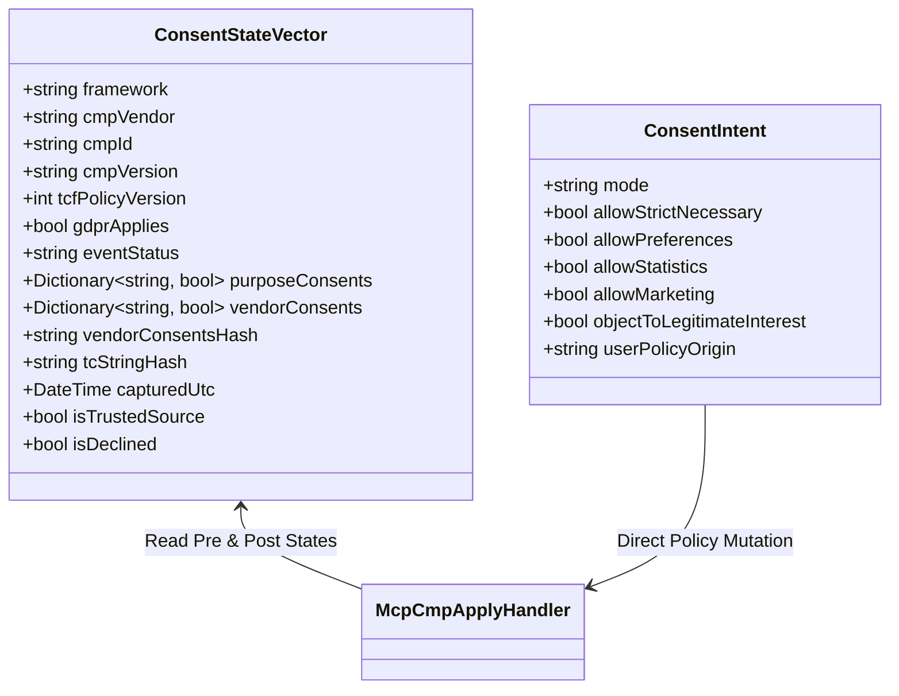
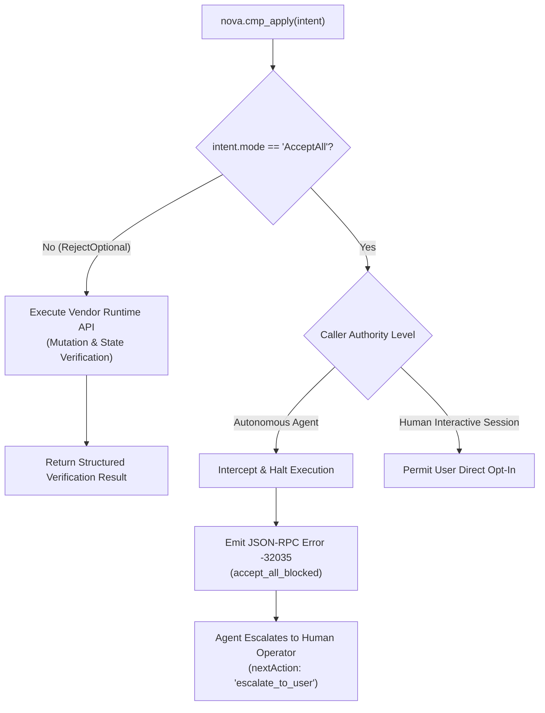
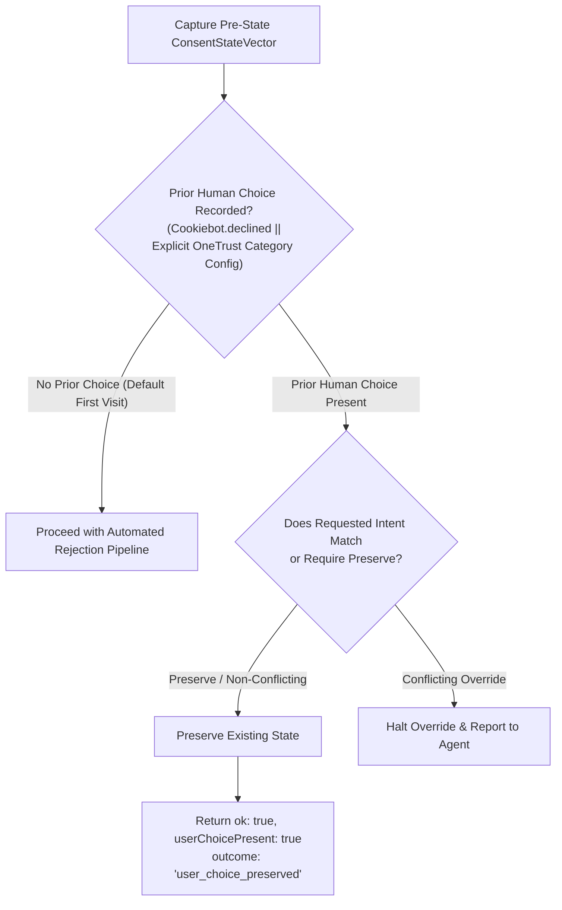

# Consent State Verification & Safety Gates

> [!IMPORTANT]
> Visual absence of a cookie banner does not prove that consent was legally or technically recorded. Deceptive websites often dismiss their banners visually while maintaining opt-in tracking defaults or tampering with global client-side variables. Nova AI Workspace enforces a rigorous **ground-truth state verification protocol** using typed `ConsentStateVector` models, strictly polices data provenance to defeat spoofing attacks, and guards against unauthorized consent escalation via autonomous safety gates.

---

## 1. Ground-Truth Verification via `ConsentStateVector`

Nova rejects superficial DOM checks (such as verifying that a modal's `display` property is `none`) as proof of consent compliance. Instead, Nova queries the CMP vendor's internal data structures to capture an immutable, strongly-typed snapshot before and after any mutation: the `ConsentStateVector`.



### Complete Schema Representation

```json
{
  "$schema": "https://json-schema.org/draft/2020-12/schema",
  "title": "ConsentStateVector",
  "type": "object",
  "properties": {
    "framework": {
      "type": "string",
      "enum": ["TcfEu", "OneTrustCustom", "CookiebotCustom", "Unknown"]
    },
    "cmpVendor": {
      "type": "string",
      "enum": ["sourcepoint", "onetrust", "cookiebot", "unknown"]
    },
    "cmpId": { "type": "string" },
    "cmpVersion": { "type": "string" },
    "tcfPolicyVersion": { "type": "integer" },
    "gdprApplies": { "type": "boolean" },
    "eventStatus": {
      "type": "string",
      "enum": ["tcloaded", "cmpuishown", "useractioncomplete"]
    },
    "purposeConsents": {
      "type": "object",
      "additionalProperties": { "type": "boolean" }
    },
    "vendorConsentsHash": { "type": "string" },
    "tcStringHash": { "type": "string" },
    "capturedUtc": { "type": "string", "format": "date-time" },
    "isTrustedSource": { "type": "boolean" },
    "isDeclined": { "type": "boolean" }
  },
  "required": ["framework", "cmpVendor", "capturedUtc", "isTrustedSource"]
}
```

### Verification Algorithm
Post-mutation verification follows a strict mathematical contract:
1. **Purpose Bitmask Check:** All non-essential purpose categories (e.g., TCF purposes 1 through 10, or OneTrust groups `C0002`–`C0005`) must resolve to `false`.
2. **Cryptographic String Delta:** In TCF environments, the post-mutation `tcStringHash` must diverge from any initial default opt-in string, proving that a fresh, legally binding consent string was generated.
3. **Immutability of Strictly Necessary:** The core session category (`C0001` or TCF purpose 1 under legitimate interest) remains intact to prevent breaking authentication cookies or shopping cart states.

---

## 2. Anti-Spoofing & Trusted Data Provenance

In OneTrust and multi-vendor environments, consent state is often exposed through multiple client-side channels. A critical vulnerability exists when automated tools rely on easily manipulated global variables rather than protected internal state engines.

```
┌────────────────────────────────────────────────────────────────────────┐
│                   Data Provenance Vulnerability Matrix                 │
├───────────────────────────────┬────────────────────────────────────────┤
│ Data Channel                  │ Security Level & Trust Rating          │
├───────────────────────────────┼────────────────────────────────────────┤
│ `OneTrust.GetDomainData()`    │ TRUSTED (Core Engine Model).           │
│ `.Groups`                     │ Managed within OneTrust runtime memory;│
│                               │ protected from trivial script tamper.  │
├───────────────────────────────┼────────────────────────────────────────┤
│ `OptanonActiveGroups`         │ UNTRUSTED (Global String Property).    │
│ (window or document cookie)   │ Can be modified via `window.` or       │
│                               │ `document.cookie` injection attacks.   │
├───────────────────────────────┼────────────────────────────────────────┤
│ `window.__tcfapi`             │ TRUSTED (Event Bus Callback).          │
│ `getTCData` callback          │ Verified against IAB European registry │
│                               │ specification and vendor `cmpId`.      │
├───────────────────────────────┼────────────────────────────────────────┤
│ Arbitrary DOM Checkboxes      │ UNTRUSTED (Visual DOM Elements).       │
│ (`input[type="checkbox"]`)    │ Visual status may diverge completely   │
│                               │ from internal vendor storage.          │
└───────────────────────────────┴────────────────────────────────────────┘
```

### The Provenance Invariant: `OneTrustGroupsFromDomainData`

Deceptive or misconfigured websites can inject a false `OptanonActiveGroups` string (e.g. `",C0001,"`) into `window` or `document.cookie` while leaving tracking active in the underlying SDK.

Nova neutralizes this attack through strict verification boundaries:
* **Pre-Apply Stage:** Nova inspects both `OneTrust.GetDomainData().Groups` and `OptanonActiveGroups` for diagnostic baseline evaluation.
* **Post-Apply Verification:** The verification engine **strictly refuses to trust `OptanonActiveGroups`**. If the state cannot be validated directly through `OneTrust.GetDomainData().Groups`, Nova marks the result as:
  ```json
  {
    "ok": true,
    "verified": false,
    "failureCode": "untrusted_state_source",
    "details": "Post-apply state could not be validated via OneTrust.GetDomainData().Groups."
  }
  ```
* This alerts the autonomous agent that the site may be employing anti-scraping counter-measures or consent spoofing.

---

## 3. Strongly-Typed Consent Intent (`ConsentIntent`)

Nova models consent decisions through strongly-typed intent objects. Rather than issuing arbitrary string commands, agents configure precise compliance boundaries:

| Field | Type | Default | Semantics & Behavioral Constraints |
| :--- | :--- | :---: | :--- |
| `mode` | `string` | `"RejectOptional"` | Primary compliance directive: `RejectOptional`, `AcceptAll`, `OpenManage`, `PreserveExisting`, `Revoke`. |
| `allowStrictNecessary` | `boolean` | `true` | Invariant: strictly necessary cookies are always permitted to maintain HTTP session tokens and anti-CSRF protection. |
| `allowPreferences` | `boolean` | `false` | Controls persistent UI customizations, language selectors, and regional themes. |
| `allowStatistics` | `boolean` | `false` | Controls performance monitoring, Google Analytics, telemetry beacons, and error reporting. |
| `allowMarketing` | `boolean` | `false` | Controls retargeting pixels, programmatic ad exchanges, cross-site trackers, and behavioral profiling. |
| `objectToLegitimateInterest` | `boolean` | `true` | Files formal GDPR Article 21 objections to vendor claims of "legitimate interest" for tracking purposes. |
| `userPolicyOrigin` | `string` | `"learned_default"` | Provenance marker: `learned_default`, `agent_task`, `user_global`, `user_per_site`. |

---

## 4. The Autonomous `AcceptAll` Safety Barrier

To protect user privacy and prevent autonomous agents from incurring unintended data tracking obligations, Nova implements an architectural safety barrier in `McpCmpApplyHandler`.



### Safety Gate Invariants:
1. **Error Code `-32035`:** Any invocation of `nova.cmp_apply` requesting `intent.mode: "AcceptAll"` by an autonomous agent fails immediately with JSON-RPC error code `-32035` (`accept_all_blocked`).
2. **Zero DOM or API Mutation:** The pipeline terminates during Stage 6 before any vendor runtime call or DOM interaction is dispatched.
3. **Escalation Protocol:** The tool response includes `"nextAction": "escalate_to_user"`. Autonomous agents must pause their workflow and prompt the human supervisor if a specific workflow strictly requires commercial tracking acceptance.

---

## 5. User Choice Preservation

Autonomous agents frequently operate in browser profiles where a human user has previously browsed and made deliberate, customized privacy selections. Overwriting a user's customized preferences without authorization violates user trust.

During Stage 4 (Pre-State Capture), Nova evaluates whether a prior human choice has been registered:



When an existing preference is detected:
* `status: "ok"`
* `userChoicePresent: true`
* `outcome: "user_choice_preserved"`
* `nextAction: "none"`

This guarantees that background agent operations do not reset or disrupt the user's customized browsing environment.

---

## 6. State-Verified vs. UI-Dismissed (`bannerVisuallyHidden`)

A major source of automated browsing flakiness is the physical discrepancy between **vendor state mutation** and **DOM animation lifecycles**:

1. **Delayed CSS Transitions:** Many CMP SDKs mutate internal state synchronously, but animate the modal away using CSS opacity transitions lasting 500ms–1500ms. If an agent attempts to click a page button immediately after state verification, the click hits the fading modal.
2. **Orphaned Modal Backdrops:** Defective CMP scripts clear the banner dialog but fail to remove the fixed-position `<div class="modal-backdrop">`, completely freezing pointer events on the page.

To solve this, Nova pairs API verification with an active DOM visibility probe (`CmpHideList.BuildBannerHiddenProbeScript`):

```javascript
// CmpHideList probe executed immediately after state verification
(() => {
    const bannerSelectors = [
        '#onetrust-banner-sdk',
        '#sp_message_container',
        '#CookiebotWidget',
        '.cmp-container',
        '[id*="sp_message_container"]'
    ];
    for (const sel of bannerSelectors) {
        const el = document.querySelector(sel);
        if (el) {
            const rect = el.getBoundingClientRect();
            const style = window.getComputedStyle(el);
            if (style.display !== 'none' && 
                style.visibility !== 'hidden' && 
                style.opacity !== '0' && 
                rect.width > 0 && rect.height > 0) {
                return false; // Banner still visually occupying viewport
            }
        }
    }
    return true; // Banner visually hidden
})();
```

### Operational Guidance for Agents:
* **`verified: true` AND `bannerVisuallyHidden: true`:** The ideal state. Both legal consent and physical DOM clearance are complete. The agent may proceed immediately to target interactions.
* **`verified: true` AND `bannerVisuallyHidden: false`:** Consent was successfully registered in the vendor engine, but the physical backdrop remains in the DOM. The agent should immediately invoke [`nova.dismiss_blockers`](../../../../mcp-reference/tools/guarded-actions/nova-dismiss-blockers.md) in conservative mode to tear down the orphaned overlay.

---

## Related Documentation

* [Domain Hub: CMP Engine Architecture](../README.md)
* [Subguide: CMP Execution Pipeline & Vendor Adapters](../execution-pipeline-and-adapters/README.md)
* [Domain Hub: 3-Stage Hijack & Dark Pattern Defense](../../hijack-protection/README.md)
* [Domain Hub: Blocker & Overlay Remediation](../../blocker-dismissal/README.md)
* [Tool Reference: `nova.cmp_apply`](../../../../mcp-reference/tools/guarded-actions/nova-cmp-apply.md)
