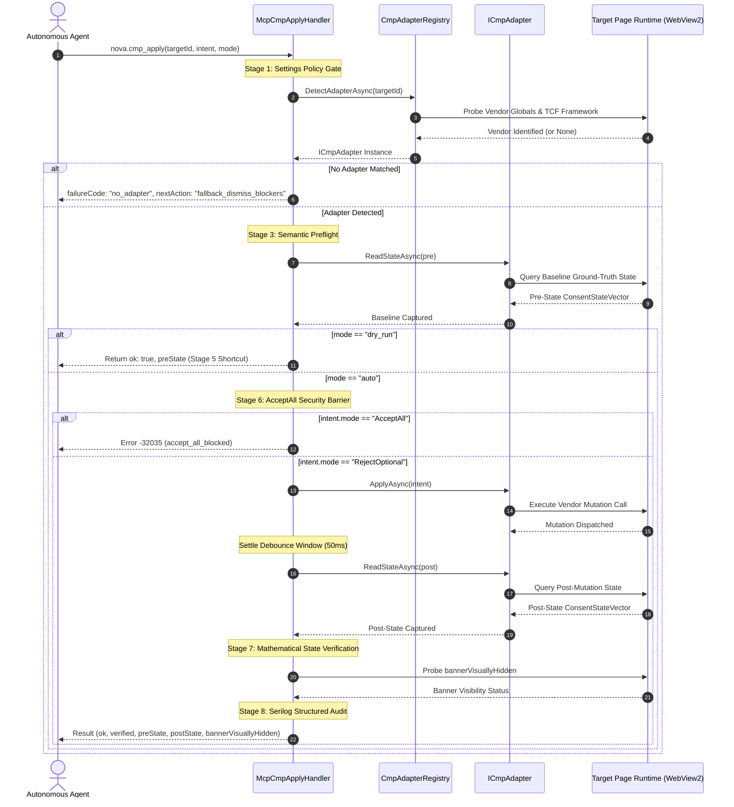
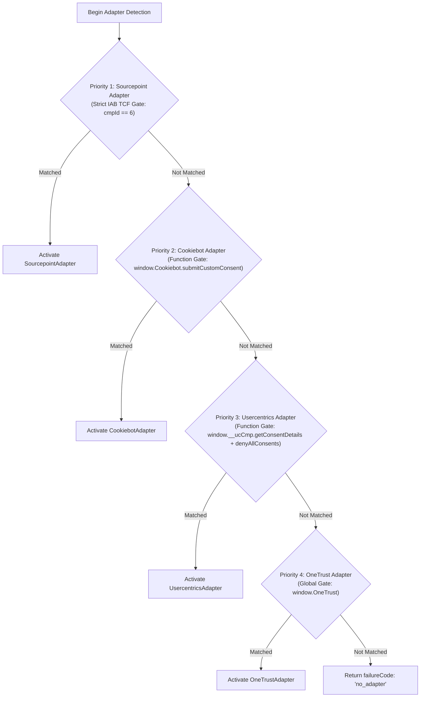
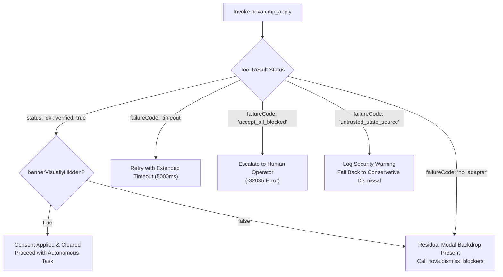

# CMP Execution Pipeline & Vendor Adapters

> [!NOTE]
> Autonomous agents cannot rely on ad-hoc DOM selector clicking to resolve enterprise cookie banners. Modern web properties deploy standardized Consent Management Platforms (CMPs) that execute complex client-side consent frameworks, maintain cryptographic consent strings, and gate API access behind legal compliance tokens. The Nova CMP Engine executes a deterministic **8-step execution pipeline** and queries a strictly ordered registry of vendor adapters—interfacing directly with vendor JavaScript runtime APIs to mutate and verify consent states without touching visual UI controls.

---

## 1. Architectural Motivation: Runtime APIs vs. DOM Click Scrapers

Traditional automated web scrapers attempt to clear cookie banners by locating DOM buttons matching labels such as *"Accept"* or *"Reject"*. In modern enterprise environments, this approach fails predictably due to four architectural barriers:

1. **DOM Teardown Asynchrony:** Clicking a DOM button often hides the visual modal immediately via CSS, but the underlying vendor SDK may fail to persist the preference if network requests or worker threads are throttled or if event listeners are unattached.
2. **Framework Decoupling:** Modern Single-Page Applications (SPAs) and micro-frontends decouple visual UI elements from the underlying privacy state. An agent may close the banner, yet downstream scripts remain blocked because no valid Transparency and Consent (TC) string was generated.
3. **Multi-Vendor Collisions:** Pages frequently bundle multiple legacy and current consent scripts (for example, an outdated OneTrust wrapper alongside an active Sourcepoint TCF v2 installation). Unordered DOM queries may trigger conflicting event handlers or invoke deprecated global functions.
4. **Dark Pattern Susceptibility:** Adversarial cookie banners employ misleading visual styling—such as styling an *"Accept All"* button as a secondary button or nesting *"Reject All"* within multi-level configuration accordions.

Nova eliminates these vulnerabilities by bypassing visual DOM controls entirely. The engine interfaces directly with the vendor's JavaScript runtime API (`window.OneTrust`, `window.Cookiebot`, `window.__tcfapi`), guaranteeing that privacy choices are executed atomically, verified cryptographically, and recorded in compliance with international privacy regulations.

---

## 2. The 8-Step Execution Pipeline

Every invocation of [`nova.cmp_apply`](../../../../mcp-reference/tools/guarded-actions/nova-cmp-apply.md) passes through an eight-stage sequential pipeline orchestrated by `McpCmpApplyHandler`:



### Detailed Pipeline Stages

#### Stage 1: Settings Policy Gate
Prior to executing any script evaluation in the target tab, `McpCmpApplyHandler` evaluates application settings:
* Validates `AppSettings.CmpVendorAdapterEnabled`.
* If administrative policy has disabled vendor adapters, execution halts immediately with JSON-RPC error code `-32002` (`OperationForbidden`).

#### Stage 2: Ordered Adapter Detection
The engine delegates tab inspection to `CmpAdapterRegistry.DetectAdapterAsync()`. The registry executes a deterministic probe sequence across registered vendor adapters. If no adapter claims the tab, execution terminates cleanly with:
```json
{
  "ok": false,
  "failureCode": "no_adapter",
  "nextAction": "fallback_dismiss_blockers",
  "details": "No recognized CMP vendor runtime detected on target page."
}
```
This instructs the agent to escalate immediately to heuristic overlay remediation via [`nova.dismiss_blockers`](../../../../mcp-reference/tools/guarded-actions/nova-dismiss-blockers.md).

#### Stage 3: Semantic Preflight
The handler verifies that the requested `intent.mode` is supported by the active adapter. Unmapped directives (such as requesting `OpenManage` on an adapter that only supports binary reject) fail preflight before altering page state.

#### Stage 4: Baseline Pre-State Capture
The detected adapter captures a comprehensive `ConsentStateVector` reflecting the target page's state before any mutation occurs. This includes vendor IDs, purpose consent bitmasks, cryptographic TC string hashes, and domain group configurations.

#### Stage 5: Dry-Run Shortcut
When invoked with `mode: "dry_run"`, the pipeline terminates after capturing the pre-state. The baseline `ConsentStateVector` is returned to the agent with `ok: true`, allowing agents to inspect active tracking permissions without modifying the page.

#### Stage 6: Autonomous AcceptAll Security Barrier
Nova enforces a strict security policy: autonomous agents are **unconditionally prohibited** from granting commercial tracking consent on behalf of the user. If `intent.mode == "AcceptAll"`, the handler aborts execution:
* JSON-RPC Error: `-32035`
* Failure Code: `"accept_all_blocked"`
* Next Action: `"escalate_to_user"`

#### Stage 7: Mutation, Settle Debounce & State Verification
For permitted intents (`RejectOptional`, `PreserveExisting`), the adapter executes the vendor-specific runtime mutation:
1. **Asynchronous Settle Window:** The engine waits for an internal 50ms settle debounce window to permit background Web Workers, IndexedDB commits, and CMP event listeners to process the state change.
2. **Post-State Capture:** The adapter reads the mutated `ConsentStateVector`.
3. **Mathematical Verification:** The engine compares `preState` and `postState` against the requested `intent`. If optional categories remain active, `verified` is set to `false`.
4. **Visual Teardown Check:** The engine evaluates `CmpHideList.BuildBannerHiddenProbeScript` to verify whether the visual banner DOM was removed alongside the state update.

#### Stage 8: Structured Serilog Audit Logging
Every execution logs an immutable structured telemetry event containing the target tab ID, vendor adapter name, execution latency, pre/post state hashes, and verification outcome.

---

## 3. Ordered Adapter Detection Architecture

Modern enterprise websites frequently accumulate legacy analytics scripts. An organization transitioning from OneTrust to Sourcepoint may leave residual OneTrust DOM wrappers or script stubs in their production HTML.

If an automated engine queried adapters using unordered dictionary traversal or loose CSS class selectors, it would risk selecting a dead legacy wrapper, invoking a broken method, and failing the clearance operation.

Nova's `CmpAdapterRegistry` solves this through **strictly ordered priority detection**:



### Priority Ranking Rationale

| Priority | Adapter | Primary Identification Gate | Isolation Mechanism |
| :---: | :--- | :--- | :--- |
| **1** | **Sourcepoint Adapter** | `window.__tcfapi` with `cmpId == 6` or Sourcepoint frame signatures. | Strict cryptographic and IAB European registry ID. Takes precedence over generic DOM markers. |
| **2** | **Cookiebot Adapter** | Callable function `window.Cookiebot.submitCustomConsent`. | Disjoint global object. Verified function presence ensures the runtime engine is ready for custom calls. |
| **3** | **Usercentrics Adapter** | Callable functions `window.__ucCmp.getConsentDetails` and `denyAllConsents` (Browser CMP v3). | Disjoint global object. A Usercentrics site in TCF mode also answers `__tcfapi`, but with its own CMP id, so the Sourcepoint gate passes it on. |
| **4** | **OneTrust Adapter** | Global object `window.OneTrust` and `OneTrust.RejectAll` or group arrays. | Broad enterprise deployment; ordered last to prevent shadowing dedicated TCF implementations. |

---

## 4. Supported Vendor Adapters & Runtime Protocols

### 4.1 Sourcepoint Adapter (IAB TCF v2.2)

Sourcepoint is a major enterprise CMP deployed across global media properties. It operates under the IAB Europe Transparency and Consent Framework (TCF v2.2).

#### Runtime Detection Script
```javascript
(() => {
    if (typeof window.__tcfapi === 'function') {
        let isSourcepoint = false;
        window.__tcfapi('getTCData', 2, (tcData, success) => {
            if (success && tcData && tcData.cmpId === 6) {
                isSourcepoint = true;
            }
        });
        if (isSourcepoint) return { detected: true, vendor: 'sourcepoint', cmpId: 6 };
    }
    if (window._sp_ && window._sp_.gdpr) {
        return { detected: true, vendor: 'sourcepoint', legacy: true };
    }
    return { detected: false };
})();
```

#### Mutation Protocol
The adapter executes standard TCF v2 commands or direct Sourcepoint GDPR endpoints:
* **TCF Endpoint:** `__tcfapi('postRejectAll', 2, (result) => { ... })`
* **Direct Script API:** `window._sp_.gdpr.postCustomConsent({ categories: [], vendors: [] })`

#### Cryptographic Consent String Hashing
To verify consent state immutability across page refreshes, the Sourcepoint adapter captures the raw base64-encoded TC string (e.g. `CP1234...`) and computes a SHA-256 digest via `crypto.subtle`:
```javascript
async function hashTcString(rawString) {
    if (window.crypto && window.crypto.subtle) {
        const msgUint8 = new TextEncoder().encode(rawString);
        const hashBuffer = await window.crypto.subtle.digest('SHA-256', msgUint8);
        const hashArray = Array.from(new Uint8Array(hashBuffer));
        return hashArray.map(b => b.toString(16).padStart(2, '0')).join('');
    }
    // Non-secure HTTP fallback: 96-bit FNV-1a hash
    return fnv1a96(rawString);
}
```

#### Event Bus Listener Guards
Sourcepoint processes consent asynchronously across iframe boundaries. The adapter registers a temporary listener for the `postApplyIssued` and `useractioncomplete` event signals, ensuring the mutation call has been acknowledged by the background event bus before Nova concludes the tool execution.

---

### 4.2 Cookiebot Adapter

Cookiebot by Usercentrics provides automated cookie categorization and banner injection.

#### Runtime Detection Script
```javascript
(() => {
    return (typeof window.Cookiebot === 'object' && 
            typeof window.Cookiebot.submitCustomConsent === 'function');
})();
```

#### Mutation Protocol
Cookiebot provides an explicit, programmatic method to submit granular category consents without navigating the UI:
```javascript
window.Cookiebot.submitCustomConsent(
    /* preferences: */ false,
    /* statistics:  */ false,
    /* marketing:   */ false
);
```

#### State Mapping
The adapter extracts runtime boolean flags from `window.Cookiebot.consent` and normalizes them into the standard vector:
* `Cookiebot.consent.necessary` $\rightarrow$ `allowStrictNecessary: true`
* `Cookiebot.consent.preferences` $\rightarrow$ `allowPreferences: false`
* `Cookiebot.consent.statistics` $\rightarrow$ `allowStatistics: false`
* `Cookiebot.consent.marketing` $\rightarrow$ `allowMarketing: false`
* `Cookiebot.declined` $\rightarrow$ `isDeclined: true`

---

### 4.3 Usercentrics Adapter (Browser CMP v3)

Usercentrics' current Browser CMP (loader `web.cmp.usercentrics.eu`) renders its banner inside the open shadow root of `<aside id="usercentrics-cmp-ui">` and exposes an asynchronous API as `window.__ucCmp`. The older v2 (`#usercentrics-root`) has no adapter; `nova.cmp_apply` answers `no_adapter` there.

#### Mutation Protocol
`denyAllConsents()` stores the decision immediately but leaves the dialog on screen, so the adapter closes it afterwards:
```javascript
await window.__ucCmp.denyAllConsents();
await window.__ucCmp.closeCmp();
```

#### State Mapping
The state comes from `await window.__ucCmp.getConsentDetails()`: `consent.status`, `consent.type`, `consent.required`, a consent hash, and the state of every non-essential category. A first visit already reads `ALL_DENIED` - but with `type: IMPLICIT` and `required: true`, meaning nobody has decided and the banner is open. Only an `EXPLICIT`, no-longer-required decision with every non-essential category `ALL_DENIED` counts as rejected; verification also requires the consent hash to change.

---

### 4.4 OneTrust Adapter

OneTrust is widely used across Fortune 500 portals, government institutions, and e-commerce applications.

#### Runtime Detection Script
```javascript
(() => {
    return (typeof window.OneTrust === 'object' && 
            (typeof window.OneTrust.RejectAll === 'function' || 
             Array.isArray(window.OneTrust.GetDomainData()?.Groups)));
})();
```

#### Mutation Protocol
Depending on the active OneTrust template and configuration:
1. **Primary Method:** `window.OneTrust.RejectAll()`
2. **Granular Fallback via `OptanonWrapper`:** If `RejectAll` is disabled by the tenant, the adapter updates category checkboxes and triggers the re-computation hook:
   ```javascript
   if (typeof window.OptanonWrapper === 'function') {
       window.OptanonWrapper();
   }
   ```

#### Category Mapping
OneTrust organizes cookies into standardized hierarchical group codes:
* **`C0001` (Strictly Necessary):** Preserved as `true`. Required for session authentication and CSRF validation.
* **`C0002` (Performance & Analytics):** Mutated to `false`.
* **`C0003` (Functional & Preferences):** Mutated to `false`.
* **`C0004` (Targeting & Advertising):** Mutated to `false`.
* **`C0005` (Social Media):** Mutated to `false`.

---

## 5. Failure Handling & Recovery Workflow

When `nova.cmp_apply` encounters anomalies during pipeline execution, it returns deterministic machine-readable status codes enabling autonomous self-correction:



### Deterministic Failure Codes

| Failure Code | Description | Autonomous Agent Next Action |
| :--- | :--- | :--- |
| `no_adapter` | No recognized vendor runtime was detected on the page. | Immediately invoke `nova.dismiss_blockers(mode="conservative")`. |
| `timeout` | Vendor API call did not resolve within the 3000ms deadline. | Retry once with `timeoutMs: 5000`. If it fails again, escalate to blocker dismissal. |
| `accept_all_blocked` | Autonomous agent requested commercial tracking consent. | Terminate task branch and request explicit human authorization. |
| `untrusted_state_source` | Post-apply verification detected state tampering in untrusted global objects. | Treat consent as unverified; record audit alert and isolate browser session. |
| `mutation_rejected` | Vendor API threw an internal runtime exception during call. | Fall back to visual rejection clicking via `nova.dismiss_blockers`. |

---

## Related Documentation

* [Domain Hub: CMP Engine Architecture](../README.md)
* [Subguide: Consent State Verification & Safety Gates](../consent-state-and-safety-gates/README.md)
* [Domain Hub: 3-Stage Hijack & Dark Pattern Defense](../../hijack-protection/README.md)
* [Domain Hub: Blocker & Overlay Remediation](../../blocker-dismissal/README.md)
* [Tool Reference: `nova.cmp_apply`](../../../../mcp-reference/tools/guarded-actions/nova-cmp-apply.md)
