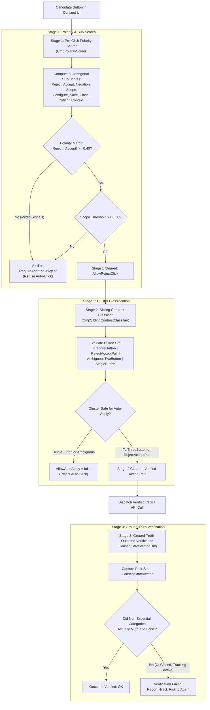

# 3-Stage Hijack & Dark Pattern Defense

> [!IMPORTANT]
> The modern web is saturated with aggressive cookie consent dark patterns. Buttons labeled *"Reject"* often disguise conditional clauses (such as *"Reject only non-essential cookies and continue"*), modal layouts invert visual contrast to mislead automated scrapers, and single-button dialogs force implicit tracking consent. Nova AI Workspace employs a **three-stage defense-in-depth pipeline** alongside **privileged cross-origin iframe boundaries** to ensure agents never fall victim to consent hijacking.

---

## 1. Executive Summary & Core Mission

When an autonomous agent interacts with web consent dialogs, deceptive visual styling and ambiguous language create severe compliance and security risks. Sites deliberately design banners to trick automated visitors into accepting commercial ad tracking, while isolating dialogs within third-party iframes to evade standard DOM traversal.

Nova's Hijack Defense architecture provides:
1. **Mathematical Polarity Scoring:** Pre-click text evaluation across 8 orthogonal dimensions in 5 European languages, enforcing a strict $\ge 0.40$ polarity margin.
2. **Cluster Contrast Classification:** Structural evaluation of neighboring button clusters, rejecting dangerous single-button and ambiguous layouts.
3. **Ground-Truth Outcome Verification:** Mathematical diffing of pre- and post-interaction `ConsentStateVector` snapshots to detect deceptive visual dismissals.
4. **Hardened Cross-Origin Boundaries:** Host-only matching and explicit administrative gates for third-party iframe CMPs.

---

## 2. Comprehensive Documentation Index

The Hijack and Dark Pattern Defense architecture is detailed across specialized subguides:

| Architecture Guide | Focus Areas & Key Invariants | Primary Components |
| :--- | :--- | :--- |
| **[Polarity Scoring & Contrast](polarity-scoring-and-contrast/README.md)** | The consent hijack threat model, 3-stage validation cascade, `CmpPolarityScorer` (8 sub-scores in 5 languages), polarity margin $\ge 0.40$, scope threshold $\ge 0.50$, and `CmpSiblingContrastClassifier` cluster taxonomy (`TcfThreeButton`, `RejectAcceptPair`, `SingleButton`, `AmbiguousTwoButton`). | `CmpPolarityScorer` `CmpSiblingContrastClassifier` `CmpIndicatorTokens` `CmpClusterClassification` |
| **[Cross-Origin & Privilege Boundaries](cross-origin-and-privilege-boundaries/README.md)** | Third-party iframe isolation (Sourcepoint, Didomi), `PrivilegedCrossOriginCmpInteractionEnabled` policy gate, strict `Uri.Host` matching against substring exploits, symmetric frame routing, and persistent security audit trails. | `PrivilegedCrossOriginCmpInteractionEnabled` `SourcepointFramePatterns` `IsAuthorizedVendorFrame` `Serilog Audit Trail` |

---

## 3. High-Level Defense Architecture

---

## 4. Key Architectural Invariants

* **Polarity Margin Differential:** An automated rejection click is authorized only if $\text{RejectScore} - \text{AcceptScore} \ge 0.40$ and $\text{ScopeScore} \ge 0.50$. Mixed or ambiguous phrasing fails unconditionally.
* **Single-Button Prohibition:** Banners containing only a single action button (e.g. *"Got it"*, *"Continue"*) are classified as `SingleButton` and blocked (`AllowAutoApply = false`) to avoid implied consent.
* **Host-Only Matching:** Cross-origin iframe authorization evaluates strictly against `Uri.Host`. Substring or path matching is strictly prohibited to prevent cross-frame injection attacks.
* **Symmetric Execution Context:** Pre-state reading, mutation dispatch, and post-state verification must execute within the exact same frame ID.

---

## Related Documentation

* [Polarity Scoring & Contrast Subguide](polarity-scoring-and-contrast/README.md)
* [Cross-Origin & Privilege Boundaries Subguide](cross-origin-and-privilege-boundaries/README.md)
* [Parent: Consent Management Architecture Overview](../README.md)
* [Programmatic CMP Vendor API Engine](../cmp-engine/README.md)
* [Blocker & Overlay Remediation](../blocker-dismissal/README.md)
* [Agent Security: Defense Against Content Manipulation](../../agent-security/README.md)
