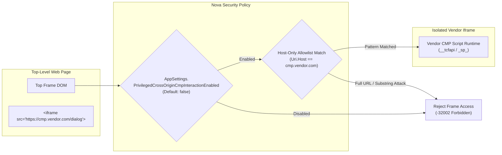

# 3-Stage Hijack & Dark Pattern Defense

> [!IMPORTANT]
> The modern web is saturated with aggressive cookie consent dark patterns. Buttons labeled *"Reject"* often disguise conditional clauses (such as *"Reject only non-essential cookies and continue"*), modal layouts invert visual contrast to mislead automated scrapers, and single-button dialogs force implicit tracking consent. Nova AI Workspace employs a **three-stage defense-in-depth pipeline** alongside **privileged cross-origin iframe boundaries** to ensure agents never fall victim to consent hijacking.

---

## 1. The Consent Hijack Threat Model

When an autonomous agent attempts to clear a cookie banner using traditional DOM heuristics, it encounters sophisticated deceptive techniques:

```
┌────────────────────────────────────────────────────────────────────────┐
│                        Typical Dark Pattern Traps                      │
├──────────────────────────────────┬─────────────────────────────────────┤
│ Dark Pattern Technique           │ Risk to Autonomous Agent            │
├──────────────────────────────────┼─────────────────────────────────────┤
│ Swapped Label Polarity           │ Button text contains "Reject" but   │
│ ("Reject only essential cookies  │ actually acts as an opt-in or       │
│ and continue to accept ads")     │ partial consent switch.             │
├──────────────────────────────────┼─────────────────────────────────────┤
│ Asymmetric Visual Prominence     │ "Accept All" is styled as a large,  │
│                                  │ primary button; "Reject" is tiny,   │
│                                  │ low-contrast text or hidden.        │
├──────────────────────────────────┼─────────────────────────────────────┤
│ Single-Button Forced Consent     │ Only an "Agree & Continue" button   │
│ ("By clicking OK, you consent")  │ exists; clicking it grants full     │
│                                  │ commercial tracking rights.         │
├──────────────────────────────────┼─────────────────────────────────────┤
│ Ambiguous Action Pairs           │ Modal offers "OK" and "More Info"   │
│                                  │ with no clear rejection pathway.    │
├──────────────────────────────────┼─────────────────────────────────────┤
│ Cross-Origin Iframe Masking      │ Banner runs in a third-party domain │
│ (Sourcepoint, Didomi iframes)    │ to evade standard DOM selectors.    │
└──────────────────────────────────┴─────────────────────────────────────┘
```

To eliminate these vulnerabilities, Nova does not rely on a single heuristic. It executes a **three-stage validation cascade**:


---

## 2. Stage 1: Pre-Click Polarity Scoring

The `CmpPolarityScorer` is a pure mathematical scoring engine that analyzes button text and accessibility attributes before any click occurs.

### Multi-Lingual Token Lexicon (`CmpIndicatorTokens`)
Nova maintains an add-only token dictionary covering five European languages:
* **English:** `reject`, `decline`, `refuse`, `deny`, `disagree`, `opt out`, `essential only`
* **German:** `ablehnen`, `nicht zustimmen`, `widersprechen`, `nur essenzielle`, `nur notwendige`
* **French:** `refuser`, `rejeter`, `continuer sans accepter`, `uniquement essentiels`
* **Spanish:** `rechazar`, `denegar`, `no aceptar`, `solo necesarias`
* **Italian:** `rifiuta`, `nega`, `rifiutare`, `solo necessari`

### The 8 Sub-Scores
Rather than a naive keyword search, the scorer extracts eight independent dimensions normalized to the range $[0.0, 1.0]$:

1. **Reject Score:** Saturation-scored occurrences of explicit refusal tokens.
2. **Accept Score:** Saturation-scored occurrences of acceptance tokens (*"agree"*, *"accept"*, *"zustimmen"*).
3. **Negation Score:** Detection of negation qualifiers (*"not"*, *"nicht"*, *"sans"*) that invert semantic meaning.
4. **Scope Score:** Evaluates whether the rejection is categorical (*"reject all"*, *"alle ablehnen"*) versus partial.
5. **Configure Score:** Identifies preference center links (*"settings"*, *"manage"*, *"einstellungen"*).
6. **Save Score:** Identifies preference confirmation buttons (*"save choices"*, *"auswahl speichern"*).
7. **Close Score:** Evaluates standard dismissal glyphs (*"✕"*, *"close"*, *"schließen"*).
8. **Sibling Context Score:** Contextual score derived from neighboring buttons in the same container.

### The Polarity Margin Rule
Auto-click authorization requires a strict polarity differential:

$$\text{PolarityMargin} = \text{RejectScore} - \text{AcceptScore} \ge 0.40$$

If a button contains mixed wording (such as *"Reject only essential cookies and accept marketing"*), the presence of accept-friendly tokens elevates the `AcceptScore`, reducing the margin below $0.40$. The scorer immediately downgrades the verdict to `RequireAdapterOrAgent`, preventing an automated misclick.

---

## 3. Stage 2: Sibling Contrast Classification

Even if an individual button passes polarity scoring, analyzing it in isolation is insufficient. Deceptive layouts often feature a single button or paired buttons with asymmetrical semantics.

The `CmpSiblingContrastClassifier` inspects the entire button group and assigns one of five structural classifications:

| Cluster Classification | Layout Structure | Auto-Apply Allowed? | Architectural Action |
| :--- | :--- | :---: | :--- |
| **`TcfThreeButton`** | Three-button cluster: explicit Reject, Accept, and Manage/Settings. | **Yes** | Optimal standard layout. Verified reject button is clicked safely. |
| **`RejectAcceptPair`** | Two-button pair: clear binary choice between Reject and Accept. | **Yes** | High confidence. Reject button clicked after polarity confirmation. |
| **`SingleButton`** | Single action button in a modal (*"Got it"*, *"Continue"*, *"OK"*). | **No** | **Blocked (`AllowAutoApply = false`).** Clicking a lone button frequently commits implied consent. Requires operator review. |
| **`AmbiguousTwoButton`** | Two buttons with unclear or non-contrasting semantics. | **No** | **Blocked (`AllowAutoApply = false`).** Ambiguous choices are halted to prevent accidental opt-in. |
| **`ConfigureOnly`** | Only a settings/configuration link is present. | **No** | Requires navigation to the preference center. |

---

## 4. Stage 3: Ground-Truth Outcome Verification

Visual disappearance of a modal does not prove consent was registered correctly. Stage 3 operates after the click or API call:

1. **Pre/Post Delta Analysis:** Nova compares the pre-state `ConsentStateVector` with the post-state vector.
2. **Mathematical Verification:**
   * In OneTrust: Are groups `C0002`, `C0003`, and `C0004` explicitly set to `false` in `OneTrust.GetDomainData().Groups`?
   * In Sourcepoint / TCF: Does the decoded TC string confirm that purpose consent bits 1 through 10 are cleared?
   * In Cookiebot: Is `Cookiebot.consent.marketing == false` and `Cookiebot.consent.statistics == false`?
3. **Hijack Alert:** If the modal disappeared from the DOM but the post-state vector still shows active tracking consents, Nova flags the outcome as `verification_failed` and reports potential consent hijacking to the agent.

---

## 5. Privileged Cross-Origin Iframe Boundaries

Enterprise CMPs frequently host their consent dialogs inside third-party iframes (such as `cmp.heise.de` or `consent-cdn.zeit.de`) to isolate their runtime code from the host page.

Allowing autonomous agents unconstrained access to execute scripts across arbitrary iframes creates severe security vulnerabilities (cross-frame script injection, token theft). Nova manages this through a hardened security boundary:



### Security Invariants:

1. **Explicit Setting Gate:** Third-party iframe interaction is gated behind `AppSettings.PrivilegedCrossOriginCmpInteractionEnabled` (default: `false`). When disabled, no cross-origin iframe execution is permitted.
2. **Host-Only Matching:** Hostname validation evaluates strictly against `Uri.Host`. Matching against the full URL, path, or query string is strictly prohibited:
   * **Allowed:** Matching against `cmp.heise.de` or `consent-cdn.zeit.de`.
   * **Prohibited:** Substring matches like `*cmp*` in URL paths, which would allow an attacker to bypass the gate by serving an iframe from `evil.com/fake/cmp/dialog`.
3. **Adapter-Specific Frame Patterns:** Each vendor adapter maintains its own explicit allowlist (such as `SourcepointAdapter.SourcepointFramePatterns`). Universal wildcards do not exist.
4. **Per-Call Resolution:** Settings are resolved dynamically per invocation. Toggling the setting off takes effect immediately without application restart.
5. **Symmetric Routing:** Detection, pre-state reading, mutation apply, and post-state verification must target the exact same frame instance. Capturing pre-state in an iframe and verifying in the top frame is blocked to prevent false verification signals.

---

## Related Documentation

* [Consent Management Architecture Overview](../README.md)
* [Programmatic CMP Vendor API Engine](../cmp-engine/README.md)
* [Blocker & Overlay Remediation](../blocker-dismissal/README.md)
* [Agent Security: Defense Against Content Manipulation](../../agent-security/README.md)
