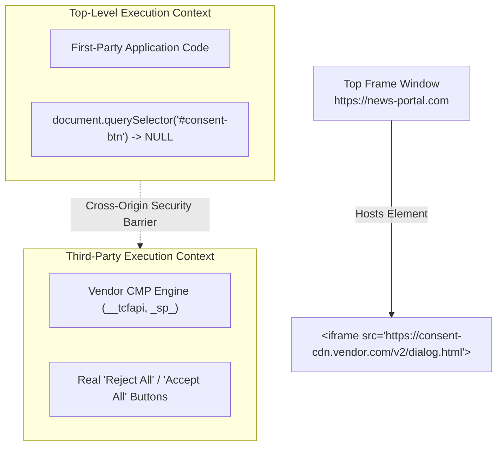
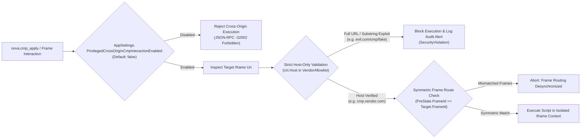

# Cross-Origin Iframe & Privilege Boundaries

> [!CAUTION]
> Modern enterprise Consent Management Platforms (such as Sourcepoint, Didomi, and Usercentrics) frequently host their dialogs inside isolated third-party iframes (e.g. `cmp.vendor.com` or `consent-cdn.media-network.de`). Granting autonomous agents unconstrained execution rights across arbitrary cross-origin frames opens severe security vulnerabilities, including cross-frame script injection, credential theft, and sandbox escalation. Nova AI Workspace enforces a **hardened privilege boundary** with explicit administrative policy gates, strict host-only matching, and symmetric frame routing.

---

## 1. The Cross-Origin CMP Challenge

To prevent host page scripts from tampering with consent logs or ad exchange credentials, enterprise publishers isolate CMP dialogs within third-party `<iframe>` elements:



### The Architectural Dilemma:
* **If blocked entirely:** Autonomous agents cannot read or click cookie consent dialogs hosted in third-party iframes, causing navigation to hang behind un-dismissed modals.
* **If permitted without constraints:** Any malicious webpage could embed an iframe pointing to an internal portal, an administrative dashboard, or an OAuth provider, and trick the agent into executing privileged script injections or clicking sensitive buttons across frames.

Nova resolves this dilemma by implementing **Privileged Cross-Origin CMP Boundaries**.

---

## 2. Hardened Security Architecture

Privileged cross-origin frame interaction is governed by five mandatory security invariants:



---

## 3. The 5 Security Invariants

### Invariant 1: Explicit Administrative Policy Gate
Cross-origin frame execution is disabled by default:
* Controlled by `AppSettings.PrivilegedCrossOriginCmpInteractionEnabled` (default: `false`).
* When disabled, any attempt to evaluate scripts or dispatch events across cross-origin iframes is blocked immediately with JSON-RPC error code `-32002` (`OperationForbidden`).
* **Dynamic Per-Call Resolution:** Settings are resolved dynamically per invocation. Toggling this policy does not require restarting the browser process or recreating tabs.

### Invariant 2: Strict Host-Only Matching (Anti-Substring Exploit)
When evaluating whether an iframe URL belongs to a recognized CMP vendor, validation evaluates strictly against `System.Uri.Host`:

```csharp
// Architectural Invariant: Host-Only Validation
public static bool IsAuthorizedVendorFrame(Uri frameUri, IReadOnlySet<string> allowedHosts)
{
    if (frameUri == null || !frameUri.IsAbsoluteUri)
        return false;

    // STRICT: Match only against Uri.Host
    // NEVER match against AbsoluteUri, PathAndQuery, or raw substrings
    return allowedHosts.Contains(frameUri.Host);
}
```

#### Why Substring Matching is Strictly Prohibited
Consider an adversary attempting to bypass a naive regex match like `*cmp*`:
* **Attacker URL:** `https://attacker-controlled.site/exploits/cmp/login-overlay.html`
* **Substring Evaluation:** Contains `"cmp"`, incorrectly granting script execution.
* **Nova Host-Only Evaluation:** `Uri.Host` is `attacker-controlled.site`. The host is not in the vendor allowlist. Access is blocked immediately.

### Invariant 3: Adapter-Specific Allowlist Registry
Universal cross-origin wildcards (such as `*` or `*.com`) are strictly forbidden. Each adapter maintains an explicit, hardened set of authorized hostnames:

| Adapter | Authorized Hostname Signatures | Frame Type |
| :--- | :--- | :--- |
| **Sourcepoint** | `notice.sp-prod.net`, `cdn.privacy-mgmt.com`, `sp-prod.net` | Dedicated TCF v2 dialog frame |
| **Didomi** | `consent.didomi.io`, `sdk.didomi.io` | Preference center iframe |
| **Usercentrics** | `app.usercentrics.eu`, `privacy.usercentrics.eu` | Embed dialog container |

### Invariant 4: Symmetric Frame Routing
In automated testing and production clearance, all phases of the consent lifecycle must execute against the **exact same frame execution context**:

1. **Detection Phase:** Identifies the vendor runtime inside Frame $F_A$.
2. **Pre-State Capture:** Queries baseline `ConsentStateVector` within Frame $F_A$.
3. **Mutation Apply:** Dispatches `postRejectAll` within Frame $F_A$.
4. **Post-State Verification:** Re-queries `ConsentStateVector` within Frame $F_A$.

If frame context switches between pre-state capture and post-state verification (e.g., if a subframe navigates or reloads), Nova detects the asymmetric frame token, aborts verification, and returns `verified: false`.

### Invariant 5: Persistent Security Audit Trail
Every attempt to cross an iframe origin boundary is recorded in the structured Serilog audit stream:
* Host page URL (`TopOrigin`)
* Target iframe URL (`FrameOrigin`)
* Resolved `Uri.Host`
* Evaluation verdict (`Allowed`, `PolicyDisabled`, or `HostMismatch`)
* Invoking MCP tool and agent session token

---

## 4. Operational Configuration

To enable privileged cross-origin frame clearance for automated browsing tasks on enterprise domains, configure the runtime setting via MCP:

```json
{
  "settingName": "PrivilegedCrossOriginCmpInteractionEnabled",
  "value": true
}
```

> [!WARNING]
> Only enable `PrivilegedCrossOriginCmpInteractionEnabled` when navigating trusted enterprise publishers known to utilize third-party iframe CMPs. Never enable this setting in unconstrained crawling environments where malicious or untrusted third-party domains may be encountered.

---

## Related Documentation

* [Domain Hub: Hijack & Dark Pattern Defense](../README.md)
* [Subguide: Polarity Scoring & Sibling Contrast Classification](../polarity-scoring-and-contrast/README.md)
* [Domain Hub: CMP Vendor API Engine](../../cmp-engine/README.md)
* [Parent: Consent Management Architecture Overview](../../README.md)
* [Agent Security: Defense Against Content Manipulation](../../../agent-security/README.md)
