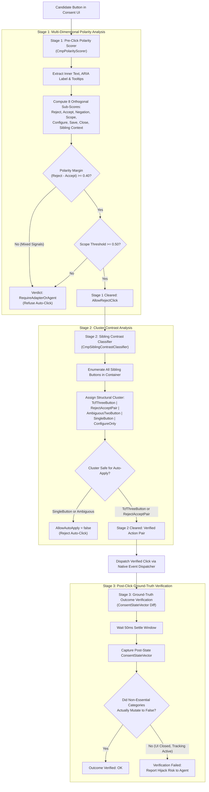
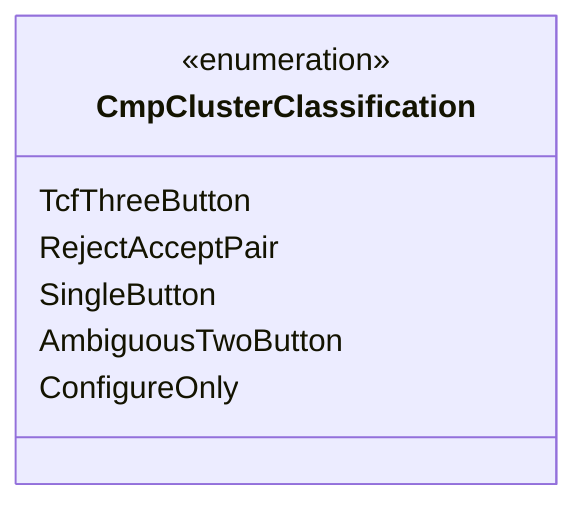

# Polarity Scoring & Sibling Contrast Classification

> [!IMPORTANT]
> Modern web consent dialogs frequently employ manipulative dark patterns designed to trick automated agents and human users alike into granting commercial tracking rights. Deceptive UI patterns invert button semantics, apply high-contrast styling to opt-in buttons while hiding rejection links, and utilize single-button confirmations that legally bind visitors to implied consent. Nova AI Workspace defends against these traps through a rigorous **three-stage mathematical validation cascade** comprising algorithmic polarity scoring, cluster contrast classification, and post-click ground-truth verification.

---

## 1. The Consent Hijack Threat Model

When an autonomous agent clears a cookie modal, relying on naive substring matching (e.g., checking if button text contains the word *"Reject"*) exposes the agent to multiple deceptive exploits:

```
┌────────────────────────────────────────────────────────────────────────┐
│                        Typical Dark Pattern Traps                      │
├──────────────────────────────────┬─────────────────────────────────────┤
│ Dark Pattern Technique           │ Risk to Autonomous Agent            │
├──────────────────────────────────┼─────────────────────────────────────┤
│ Swapped Label Polarity           │ Button text contains "Reject" but   │
│ ("Reject only essential cookies  │ actually acts as an opt-in or       │
│ and continue to accept ads")     │ partial consent switch.             │
├──────────────────────────────────┼─────────────────────────────────────┤
│ Asymmetric Visual Prominence     │ "Accept All" is styled as a large,  │
│                                  │ high-contrast button; "Reject" is   │
│                                  │ low-contrast text or hidden.        │
├──────────────────────────────────┼─────────────────────────────────────┤
│ Single-Button Forced Consent     │ Only an "Agree & Continue" button   │
│ ("By clicking OK, you consent")  │ exists; clicking it grants full     │
│                                  │ commercial tracking rights.         │
├──────────────────────────────────┼─────────────────────────────────────┤
│ Ambiguous Action Pairs           │ Modal offers "OK" and "More Info"   │
│                                  │ with no clear rejection pathway.    │
├──────────────────────────────────┼─────────────────────────────────────┤
│ Deceptive Reversal Pairs         │ Left button is traditionally Reject │
│                                  │ but swapped to Accept All.          │
└──────────────────────────────────┴─────────────────────────────────────┘
```

To eliminate these vulnerabilities, Nova processes every candidate button through a multi-stage validation cascade before any mouse event is dispatched.

---

## 2. The 3-Stage Validation Cascade



---

## 3. Stage 1: Pre-Click Polarity Scoring (`CmpPolarityScorer`)

`CmpPolarityScorer` is a pure mathematical scoring engine. It inspects candidate elements using an add-only multilingual lexicon and extracts eight orthogonal sub-score dimensions normalized to $[0.0, 1.0]$.

### 3.1 Multi-Lingual Indicator Lexicon (`CmpIndicatorTokens`)

The lexicon covers five major European languages, enforcing word boundary matching and accent normalization:

| Language | Reject Tokens | Accept Tokens | Negation & Modifiers | Scope Tokens |
| :--- | :--- | :--- | :--- | :--- |
| **English** | `reject`, `decline`, `refuse`, `deny`, `disagree`, `opt out` | `accept`, `agree`, `allow`, `consent`, `enable` | `not`, `without`, `except`, `essential only`, `strictly` | `all`, `everything`, `total`, `entirely` |
| **German** | `ablehnen`, `verweigern`, `widersprechen`, `nicht zustimmen` | `zustimmen`, `akzeptieren`, `einverstanden`, `erlauben` | `nur`, `ohne`, `ausschließlich`, `notwendige`, `essenziell` | `alle`, `alles`, `gesamte`, `vollständig` |
| **French** | `refuser`, `rejeter`, `décliner`, `interdire` | `accepter`, `autoriser`, `d'accord`, `consentir` | `sans`, `uniquement`, `seulement`, `strictement` | `tout`, `tous`, `toutes` |
| **Spanish** | `rechazar`, `denegar`, `declinar`, `no aceptar` | `aceptar`, `consentir`, `permitir`, `de acuerdo` | `solo`, `únicamente`, `solamente`, `esenciales` | `todos`, `todas`, `todo` |
| **Italian** | `rifiuta`, `rifiutare`, `nega`, `negare`, `non accettare` | `accetta`, `accettare`, `consenti`, `d'accordo` | `solo`, `soltanto`, `necessari`, `essenziali` | `tutti`, `tutte`, `tutto` |

### 3.2 The 8 Orthogonal Sub-Scores

Each candidate label is evaluated across eight distinct mathematical dimensions:

1. **Reject Score ($S_{\text{rej}}$):** Saturation-scored occurrences of explicit rejection tokens.
2. **Accept Score ($S_{\text{acc}}$):** Saturation-scored occurrences of acceptance or consent tokens.
3. **Negation Score ($S_{\text{neg}}$):** Identifies grammatical modifiers that invert semantic polarity (e.g., *"not"* preceding *"agree"*).
4. **Scope Score ($S_{\text{scp}}$):** Measures whether the statement is comprehensive (*"all"*, *"alle"*, *"tout"*) versus partial (*"some"*, *"selected"*).
5. **Configure Score ($S_{\text{cfg}}$):** Identifies preference management links (*"settings"*, *"manage"*, *"customise"*, *"einstellungen"*).
6. **Save Score ($S_{\text{sav}}$):** Evaluates confirmation actions in configuration panels (*"save choices"*, *"auswahl speichern"*).
7. **Close Score ($S_{\text{cls}}$):** Evaluates neutral modal exit glyphs (*"✕"*, *"close"*, *"schließen"*, *"fermer"*).
8. **Sibling Context Score ($S_{\text{sib}}$):** Weighted contextual score derived from the presence of opposing action buttons in the immediate DOM parent.

### 3.3 The Polarity Margin Rule

To qualify for an automated rejection click, a button must satisfy two mathematical thresholds:

$$\text{PolarityMargin} = S_{\text{rej}} - S_{\text{acc}} \ge 0.40$$

$$\text{ScopeScore} \ge 0.50$$

#### Neutralizing Mixed-Signal Dark Patterns
Consider a deceptive button labeled:
> *"Reject only essential cookies and accept personalized advertising"*

* **Naive Scraper:** Detects *"Reject"* and clicks the button.
* **Nova Polarity Scorer:**
  * Matches *"reject"* ($S_{\text{rej}} = 0.65$)
  * Matches *"accept"*, *"advertising"* ($S_{\text{acc}} = 0.70$)
  * $\text{PolarityMargin} = 0.65 - 0.70 = -0.05 < 0.40$
  * Margin check fails immediately. Verdict: `RequireAdapterOrAgent`. The automated click is blocked.

---

## 4. Stage 2: Sibling Contrast Classification (`CmpSiblingContrastClassifier`)

Evaluating a button in isolation is insufficient; manipulative layouts exploit button group geometry. `CmpSiblingContrastClassifier` enumerates all actionable siblings within the container and categorizes the group into a structural cluster:



### Cluster Taxonomy & Invariants

| Cluster Type | Typical Layout Composition | Auto-Apply Permitted? | Architectural Action |
| :--- | :--- | :---: | :--- |
| **`TcfThreeButton`** | 3 buttons: explicit Reject All, Accept All, and Manage Preferences. | **YES** | Standard IAB Europe layout. The button passing Stage 1 polarity scoring is safely clicked. |
| **`RejectAcceptPair`** | 2 buttons: a clear binary choice between Reject and Accept. | **YES** | Sibling polarity contrast confirmed. The verified reject candidate is clicked. |
| **`SingleButton`** | 1 button: *"Got it"*, *"Continue"*, *"OK"*, or *"I Agree"*. | **NO** | **Strictly Blocked (`AllowAutoApply = false`).** Clicking a solitary button frequently commits implied consent. Requires operator review. |
| **`AmbiguousTwoButton`** | 2 buttons: non-contrasting semantics (e.g. *"OK"* and *"Learn More"*). | **NO** | **Strictly Blocked (`AllowAutoApply = false`).** Ambiguous choices are halted to prevent inadvertent tracking opt-in. |
| **`ConfigureOnly`** | Links or buttons directing strictly to a secondary settings panel. | **NO** | Requires multi-step preference navigation rather than direct clearance. |

---

## 5. Stage 3: Ground-Truth Outcome Verification

Visual dismissal does not prove legal rejection. Stage 3 operates post-interaction to detect deceptive banners that disappear while keeping trackers active:

1. **Pre/Post State Comparison:** Nova captures the post-mutation `ConsentStateVector` and computes the delta against the pre-state snapshot.
2. **Deceptive Teardown Detection:** If the modal DOM elements disappear (`bannerVisuallyHidden: true`), but the post-state vector reveals active purpose consents or untrusted global flags:
   * Verification Status: `verified: false`
   * Alert Flag: `hijackSuspected: true`
   * Diagnostic Record: Added to `hijackProtection` audit block.
3. **Agent Visibility:** The calling agent receives an explicit alert indicating that visual clearance succeeded, but legal tracking was not refused—enabling the agent to halt navigation or notify the human operator.

---

## Related Documentation

* [Domain Hub: Hijack & Dark Pattern Defense](../README.md)
* [Subguide: Cross-Origin Iframe & Privilege Boundaries](../cross-origin-and-privilege-boundaries/README.md)
* [Domain Hub: CMP Vendor API Engine](../../cmp-engine/README.md)
* [Subguide: Consent State Verification & Safety Gates](../../cmp-engine/consent-state-and-safety-gates/README.md)
* [Tool Reference: `nova.dismiss_blockers`](../../../../mcp-reference/tools/guarded-actions/nova-dismiss-blockers.md)
