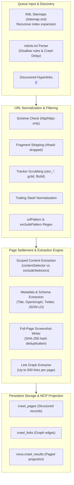
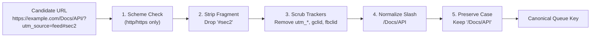

# Crawler Extraction, Sitemaps & Results Projection

Beyond raw HTML page downloads, the Nova embedded crawler extracts structured content, normalizes hyperlinks, adheres to web standards, and projects relational link topologies into persistent SQLite storage (`crawl.db`).



---

## 1. Standards Compliance: Robots.txt & XML Sitemaps

Nova provides first-class support for established web crawler standards:

### Robots.txt Compliance (`respectRobotsTxt`)
When `respectRobotsTxt: true` is configured:
* The crawler fetches `/robots.txt` from the origin root before processing queued URLs.
* Evaluates `User-agent: *` and Nova-specific user-agent blocks per RFC 9309.
* Respects `Disallow:` path prefixes, `Allow:` overrides, and `Crawl-Delay:` directives.
* If a path is disallowed, it is dropped from the queue with status `blocked_by_robots`.
* *Default:* `false`. By default, robots directives are inspected for telemetry and displayed in `nova.crawl_status`, but enforcement is opt-in to support authorized administrative audits, security reviews, and internal staging exploration.

### XML Sitemap Discovery & Expansion (`useSitemap`)
When `useSitemap: true` is specified:
1. **Discovery Vectors:** Nova attempts to locate sitemaps via:
   * Direct standard paths: `/sitemap.xml`, `/sitemap_index.xml`, `/sitemap-index.xml`.
   * Declarations in `robots.txt`: parses all `Sitemap: https://...` directives.
2. **Recursive Sitemap Indexes:** If the resolved sitemap is an XML sitemap index (`<sitemapindex>`), Nova recursively fetches child sitemaps.
3. **Queue Ingestion:** Extracts all valid `<loc>` URLs, passes them through the URL canonicalizer, and enqueues them into the breadth-first traversal queue at `depth = 1`.

---

## 2. Traversal Queue & Canonical URL Normalization

To prevent infinite loops, crawler traps, and duplicate page processing, all candidate links pass through five strict normalization rules before entering the breadth-first priority queue:



### The Five Normalization Rules

1. **Scheme Validation:** Only absolute `http://` and `https://` URLs are permitted. Internal and client-side protocols (`javascript:`, `mailto:`, `tel:`, `data:`, `file:`, `about:`) are rejected immediately.
2. **Fragment Stripping:** Anchor identifiers (`#section-2`, `#/deep/link`) are stripped, ensuring that the primary resource document is fetched once.
3. **Tracking Parameter Scrubbing:** Common marketing and telemetry parameters (`utm_source`, `utm_medium`, `utm_campaign`, `gclid`, `fbclid`, `mc_eid`, `_ga`) are purged. Functional query parameters altering server responses (e.g., `?page=2`, `?id=456`) are strictly preserved.
4. **Trailing Slash Deduplication:** Paths are normalized so that `/docs` and `/docs/` resolve to an identical canonical queue identity.
5. **Path Case Preservation:** While domain hostnames are lowercased per RFC 3986, path components preserve their exact casing (e.g., `/API/v2/Endpoints` is not lowercased), avoiding 404 errors on case-sensitive web servers.

---

## 3. Scoped Content & Metadata Extraction

Once a page satisfies the settlement heuristic, Nova extracts structured text and machine-readable metadata:

### Scoped Selectors
* **`contentSelector`:** Restricts extracted body text to a specific CSS selector (e.g., `main`, `article`, `.documentation-content`). Boilerplate elements outside this selector are ignored.
* **`excludeSelectors`:** Strips specific distracting or repetitive elements (e.g., `nav`, `footer`, `.cookie-banner`, `.advertisement`, `.sidebar`) from the extracted text payload.

### Metadata Extraction
Nova automatically captures and structures page-level metadata into the crawl record:
* Document title and meta description.
* Open Graph tags: `og:title`, `og:description`, `og:image`, `og:url`.
* Twitter Card metadata: `twitter:card`, `twitter:title`, `twitter:image`.
* Structured Data: Embedded JSON-LD schema blocks (`<script type="application/ld+json">`).
* Content Hashes: Computes a SHA-256 hash of the extracted text payload (`page_hash`), enabling downstream generational change detection in `nova.crawl_diff`.

### Full-Page Screenshots
When `captureScreenshots: true` is configured:
* The worker captures a high-resolution PNG or JPEG viewport/full-page image.
* Screenshots are saved under `workspaces/crawls/screenshots/` in the local application data directory.
* Files are indexed by their SHA-256 image hash, preventing redundant disk writes when pages share identical visual layouts.

---

## 4. Hyperlink Graph Extraction

During settlement, Nova extracts outgoing hyperlinks (up to a safety cap of 500 links per page) using an in-page DOM script:
* **Link Types:** Classifies links into `same_origin`, `same_domain`, `external`, `anchor`, and `scheme_specific`.
* **Anchor Text:** Captures the link's visible label and title attribute.
* **Graph Edges:** Writes directed edges into the `crawl_links` table (`source_page_id` $\to$ `target_url`), enabling complete site topology reconstruction.

---

## 5. Result Projection with `nova.crawl_results`

Agents inspect crawled pages and extracted knowledge through [`nova.crawl_results`](../../../../mcp-reference/tools/crawler-and-discovery/nova-crawl-results.md):

```json
{
  "name": "nova.crawl_results",
  "arguments": {
    "crawlId": "crawl_20261018_01",
    "limit": 10,
    "offset": 0,
    "statusFilter": "success",
    "includeContent": true,
    "includeLinks": true
  }
}
```

### Result Schema

```json
{
  "crawlId": "crawl_20261018_01",
  "totalResults": 38,
  "returnedResults": 10,
  "pages": [
    {
      "url": "https://docs.example.com/api/authentication",
      "canonicalUrl": "https://docs.example.com/api/authentication",
      "httpStatus": 200,
      "title": "API Authentication Guide",
      "depth": 1,
      "contentHash": "e3b0c44298fc1c149afbf4c8996fb92427ae41e4649b934ca495991b7852b855",
      "screenshotPath": "screenshots/e3b0c442.png",
      "text": "Authentication is performed using API Bearer tokens...",
      "links": [
        {
          "targetUrl": "https://docs.example.com/api/tokens",
          "text": "Generate API Tokens",
          "isInternal": true
        }
      ]
    }
  ]
}
```

---

## 6. Related Documentation

* [Autonomous Breadth-First Crawler Overview](../README.md)
* [Worker Pool, Profile Binding & Job Lifecycle](../worker-pool-and-lifecycle/README.md)
* [Settlement Detection, Pacing & Resilience](../settlement-pacing-and-resilience/README.md)
* [Crawl Diffs & History Verification](../../diff-and-verification/README.md)
