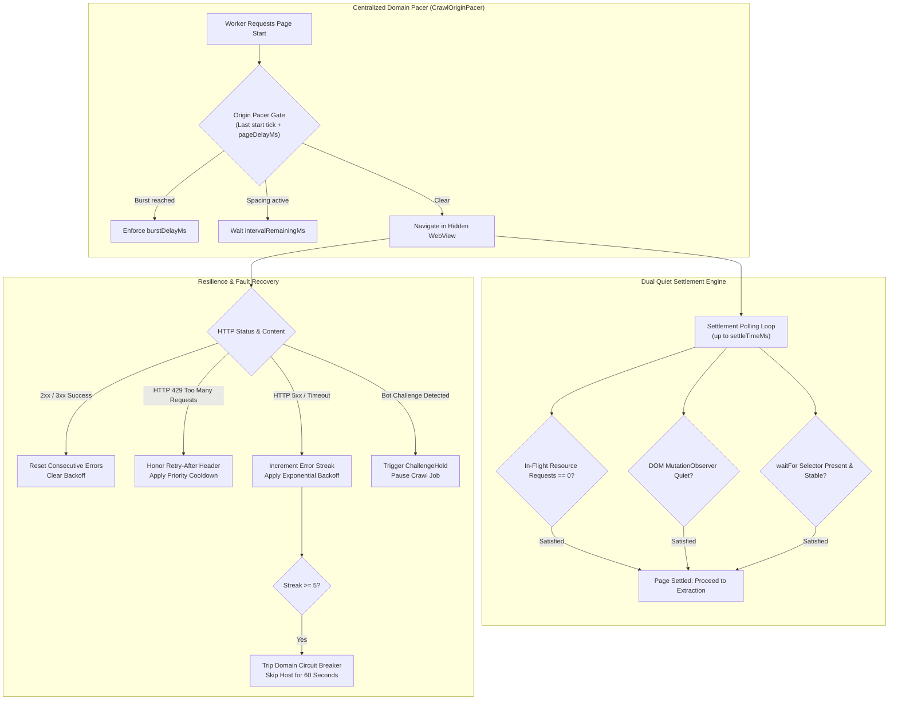
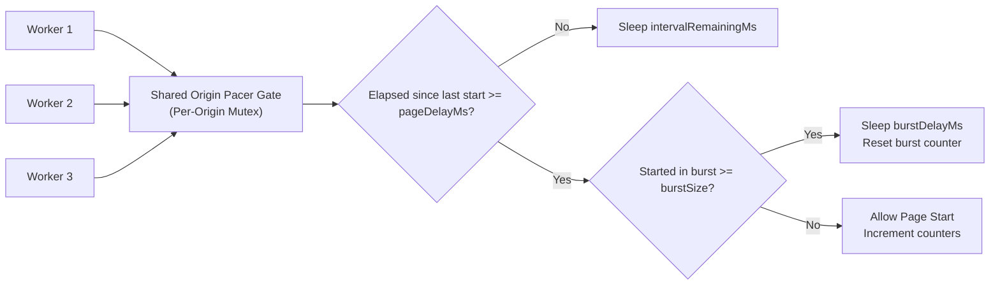

# Crawler Settlement Detection, Domain Pacing & Resilience

Modern single-page applications and enterprise websites present substantial challenges to automated crawling: heavy asynchronous client rendering, dynamic hydration route shifts, aggressive rate limits, and Cloudflare or bot verification barriers.

Nova addresses these challenges with a dual quiet settlement detector, an in-memory hydration drift observer, a centralized multi-worker origin pacer, and an automated circuit breaker.



---

## 1. Dual Quiet Settlement Detection

Client-side frameworks (React, Vue, Angular, Svelte, Next.js) return minimal HTML shells (`<div id="root"></div>`) that dynamically fetch data and render markup after execution. Capturing the document upon initial HTTP completion results in empty pages and missed links.

### The Settlement Algorithm
Nova injects an ES5-compatible settlement script evaluated via CDP `Runtime.evaluate` with `awaitPromise=true`:

1. **DOM Mutation Silence:** An active `MutationObserver` monitors subtree mutations, child additions, and attribute modifications. Settlement requires a continuous quiet window where no DOM mutations occur (default quiet threshold: 1,500 ms).
2. **Network Resource Idle:** Evaluates `performance.getEntriesByType('resource')`. The detector verifies that zero resource downloads are active and that no HTTP responses finished within the last 500 ms.
3. **Semantic Completion Overrides (`waitFor`):** When a specific selector is provided (e.g., `article.content` or `#search-results`), Nova switches completion basis from global DOM quiet to `readiness_and_network_idle`. The target selector must match at least `readinessMinMatches` (default 1) and remain stable for at least 750 ms (`readinessStableForMs`). This prevents infinite animations or background ticker clocks from blocking settlement.

### Settlement Diagnostic Outcomes

| Completion Basis | Reason Code | Meaning |
| :--- | :--- | :--- |
| `readiness_and_network_idle` | *null* | Target selector rendered, stabilized, and network quiet period elapsed. |
| `dom_quiet_heuristic` | *null* | DOM tree and network requests ceased activity within quiet threshold. |
| `readiness_and_network_idle` | `navigation.settlement_readiness_timeout` | The maximum `settleTimeMs` expired without the `waitFor` selector appearing. |
| `dom_quiet_heuristic` | `navigation.settlement_timeout` | The maximum `settleTimeMs` elapsed while active network requests or DOM mutations were still occurring. |
| *any* | `navigation.settlement_invalid_selector` | The provided `waitFor` CSS selector was syntactically invalid. |

---

## 2. Hydration Drift Detection & PKS Learning

Single-Page Applications frequently rewrite the browser address bar immediately post-hydration (e.g., redirecting `/products` to `/products/` or stripping trailing fragments). If an automation engine treats every client-side URL mutation as an unexpected redirect, crawl queues become desynchronized.

```mermaid
sequenceDiagram
    autonumber
    participant Engine as Crawl Engine
    participant Probe as window.__novaHydrationDriftProbe
    participant History as Browser History API
    participant PKS as Phenomenological Knowledge Store

    Engine->>Probe: Install route observer before navigation
    Probe->>History: Intercept pushState, replaceState, hashchange, popstate
    Engine->>Engine: Dispatch navigation to requested URL
    Engine->>Probe: Read observed URL after settlement
    alt Canonical-Equivalent Difference (slash, fragment, tracker)
        Engine->>Engine: Normalize URL; treat as successful route
    else Genuine SPA Route Shift
        Engine->>PKS: Record hydration drift rule for domain
        Engine->>Engine: Enqueue genuine destination route
    end
```

### Observer Mechanics
Nova installs an in-page observer (`window.__novaHydrationDriftProbe`) that intercepts `history.pushState`, `history.replaceState`, `hashchange`, and `popstate` events:
* **Canonical-Equivalent Equivalence:** Trailing slashes, marketing parameter scrub, and anchor fragment changes are recognized as canonical equivalents. The original requested route is marked successful, and the normalized URL is persisted.
* **Genuine SPA Shifts:** When client hydration genuinely shifts to a distinct logical route (e.g., `/app` immediately transitions to `/app/dashboard/overview`), Nova records the transition and learns the domain pattern into the Phenomenological Knowledge Store (PKS), optimizing future traversals.

---

## 3. Centralized Origin Pacing (`CrawlOriginPacer`)

To protect target servers from denial-of-service conditions and avoid triggering bot countermeasures, Nova coordinates page starts across all workers through a unified, thread-safe origin pacer:



### Pacing Parameters & Invariants

* **`pageDelayMs` (Default: 500 ms, Range: 200–5000 ms):** Enforces a minimum time interval between consecutive page starts to the same HTTP authority (`scheme://host:port`). Parallel workers processing the same domain are serialized according to this delay.
* **`burstSize` (Default: 5 requests, Range: 1–20):** Allows an initial rapid burst of requests up to the threshold.
* **`burstDelayMs` (Default: 2000 ms, Range: 500–10000 ms):** Enforced cooling delay following a completed burst before normal pacing resumes.
* **Starts vs. Completions:** The pacer spaces **page starts**, not page completions. This ensures that a slow, heavy page taking 10 seconds to render does not accumulate an artificial backlog of rapid requests when it finally finishes.

---

## 4. Adaptive Backoff, Circuit Breakers & Bot Holds

When encountering remote infrastructure failures or rate-limiting responses, Nova automatically applies defensive recovery mechanisms:

### Adaptive Backoff Strategies
Configurable via crawl options:
* **`exponential` (Default):** Doubles request delays upon consecutive network or server errors, capped at `maxBackoffMs` (default 10,000 ms):
  $$\text{Delay} = \min(\text{pageDelayMs} \times 2^{\text{errors}}, \text{maxBackoffMs})$$
* **`linear`:** Increases delay incrementally by fixed steps.
* **`none`:** Enforces constant spacing without backoff adjustments.

### HTTP 429 `Retry-After` Cooldowns
When an origin responds with HTTP 429 (`Too Many Requests`), Nova reads the standard `Retry-After` HTTP response header (expressed in either seconds or an HTTP-date timestamp) and pauses all queued requests for that origin until the cooldown expires.

### Domain Circuit Breaker
If a target domain accumulates 5 consecutive failures (`maxConsecutiveErrors: 5`)—such as continuous HTTP 500/503 errors, socket resets, or DNS timeouts—Nova trips the circuit breaker for that domain:
* Subsequent queued URLs for that origin are skipped for 60 seconds.
* Prevents spending crawl quotas and worker time against dead or crashing hosts.
* Workers remain active, processing URLs for other domains if present in the queue.

### Bot Challenge Hold (`ChallengeHold`)
When a worker encounters a bot mitigation wall (such as Cloudflare Turnstile, Cloudflare 1020/503 challenge pages, or Google reCAPTCHA):
* Nova immediately halts new navigation attempts across all workers for that crawl job.
* The job transitions to the `paused` state with diagnostic event `challenge_hold`.
* Prevents the crawler from hammering security firewalls and generating IP bans, allowing the human operator to solve the challenge interactively in an open tab before resuming.

---

## 5. Related Documentation

* [Autonomous Breadth-First Crawler Overview](../README.md)
* [Worker Pool, Profile Binding & Job Lifecycle](../worker-pool-and-lifecycle/README.md)
* [Extraction, Sitemaps & Results Projection](../extraction-sitemaps-and-results/README.md)
* [Surface Explorer & Interactive In-Page States](../../surface-explorer/README.md)
