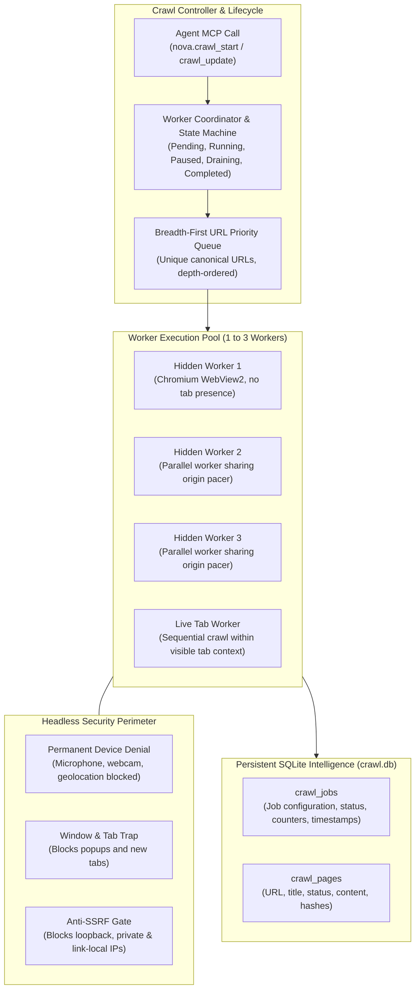
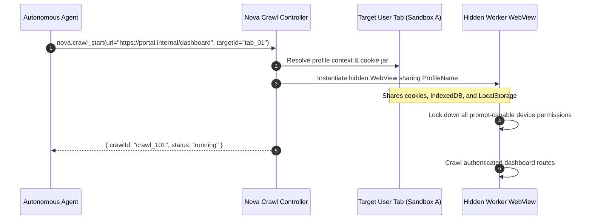
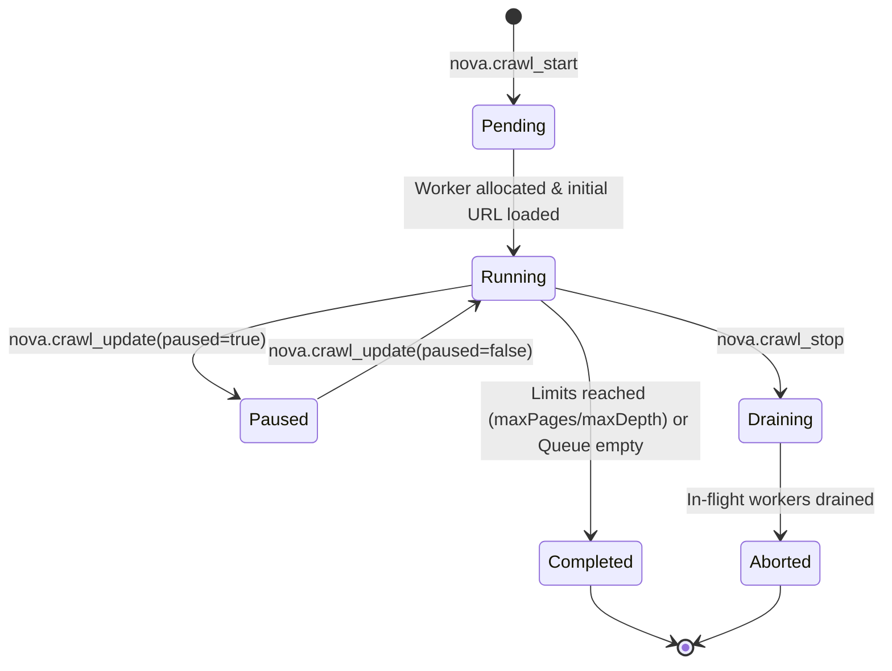

# Crawler Worker Pool, Profile Binding & Job Lifecycle

The autonomous crawler in Nova AI Workspace operates independent background worker instances designed for deep website discovery, content extraction, and persistent route indexing without polluting the user's visible tabs.



---

## 1. Crawl Execution Modes

Nova provides two distinct crawl execution paradigms depending on isolation and context requirements:

| Dimension | `crawlMode = 'hidden'` (Default) | `crawlMode = 'live_tab'` |
| :--- | :--- | :--- |
| **Worker Surface** | 1 to 3 hidden background WebViews (`parallel: 1..3`). | An existing, visible user browser tab (`parallel: 1`). |
| **Tab Bar Presence** | Completely invisible; does not appear in `nova.tabs`. | Visible in the tab strip; active page changes as crawl advances. |
| **Profile & Storage** | Isolated default profile or inherits a specified tab profile (`targetId`). | Strictly uses the active tab's profile, cookies, and session state. |
| **Concurrency** | True parallel execution across up to 3 independent workers. | Sequential only; each route is visited sequentially within the tab. |
| **SPA Context** | Independent navigation instances for each URL. | Preserves client-side Single-Page Application (SPA) memory across same-document routes. |
| **Robots & Sitemaps** | Supported (`respectRobotsTxt`, `useSitemap`). | Disabled; live tab crawling relies solely on discovered links. |
| **Screenshots & Diff** | Full screenshot and delta capture supported. | Screenshots and delta mode are disabled in live tab mode. |

---

## 2. Target-Bound Profile & Sandbox Inheritance

When executing hidden crawls against authenticated intranets, staging portals, or personalized web applications, agents can supply `targetId` to bind background workers to an existing browser tab or sandbox profile (`A`, `B`, etc.):



### Profile Parity Invariants

1. **Shared Cookie Jar & Session Storage:** The hidden worker reuses the target's underlying WebView2 user data profile. It inherits active authentication cookies, session tokens, and local storage without re-authenticating.
2. **Zero Tab Pollution:** Background WebViews have no presence in the WinUI 3 tab strip. They do not trigger tab selection events, do not alter the user's active viewport, and do not appear in `nova.tabs`.
3. **Headless Permission Lockdown:** Although the worker shares authenticated session state, all prompt-capable peripheral permissions (camera, microphone, speaker selection, geolocation, screen sharing, window management) are permanently blocked. Any script attempting to request device access fails closed immediately.

---

## 3. Worker Concurrency & Gating

Nova enforces strict concurrency controls to prevent background crawler traffic from exhausting host CPU, RAM, or network sockets:

* **Worker Cap (`parallel`):** Hidden crawls can allocate between 1 and 3 concurrent WebViews (`parallel: 1..3`). Allocating more than 3 workers is rejected with error `-32602`.
* **Global Crawl Concurrency Gate:** Nova allows at most 2 concurrent crawl jobs across the entire application runtime. Attempting to start a third crawl returns error `-32001` (`Maximum concurrent crawls reached. Stop an existing crawl first.`).
* **Shared Host Pacing:** Even when running 3 parallel workers, all workers share a unified origin pacer. Concurrency allows processing distinct domains in parallel or multiplexing queue retrieval, but will not violate the configured `pageDelayMs` for any single host.

---

## 4. Job State Machine & Lifecycle Operations

Crawl jobs advance through a deterministic state machine recorded in `crawl.db`:



### Lifecycle States

* **`pending`:** The job record has been created in `crawl_jobs`, the URL priority queue has been initialized with the seed URL, and workers are booting.
* **`running`:** Active workers are actively navigating, evaluating settlement, extracting content, and enqueuing links.
* **`paused`:** Navigation is temporarily suspended via `nova.crawl_update(paused=true)` or triggered automatically by a `ChallengeHold` (bot verification barrier). In-flight requests finish, but no new URLs are dequeued.
* **`draining`:** Cancellation has been requested via `nova.crawl_stop`. Active workers finish their current page settlement and shut down safely without corrupting SQLite transactions.
* **`completed`:** The crawl finished normally because all discovered links within `maxDepth` were visited, `maxPages` was reached, or the queue was exhausted.
* **`aborted`:** The job was stopped prematurely by an agent call, user cancellation, or unrecoverable error.

---

## 5. MCP Tool Contracts

Agents manage active and completed crawls through the `crawler_ops` MCP tool bundle:

### 1. `nova.crawl_start`
Initiates a new autonomous crawl traversal:

```json
{
  "name": "nova.crawl_start",
  "arguments": {
    "url": "https://docs.example.com",
    "maxDepth": 2,
    "maxPages": 30,
    "parallel": 2,
    "pageDelayMs": 500,
    "settleTimeMs": 3000,
    "crawlMode": "hidden",
    "respectRobotsTxt": true,
    "useSitemap": true,
    "contentSelector": "article.markdown",
    "captureScreenshots": true
  }
}
```

### 2. `nova.crawl_status`
Queries real-time execution telemetry and progress counters:

```json
{
  "name": "nova.crawl_status",
  "arguments": {
    "crawlId": "crawl_20261018_01"
  }
}
```

**Diagnostic Output:**
```json
{
  "crawlId": "crawl_20261018_01",
  "status": "running",
  "pagesCrawled": 14,
  "queueSize": 28,
  "activeWorkers": 2,
  "errorCount": 0,
  "elapsedSeconds": 18,
  "currentDomain": "docs.example.com",
  "robotsTxtLoaded": true,
  "sitemapDiscovered": true
}
```

### 3. `nova.crawl_update`
Modifies pacing thresholds, limits, or pause state dynamically on a running job:

```json
{
  "name": "nova.crawl_update",
  "arguments": {
    "crawlId": "crawl_20261018_01",
    "paused": true,
    "maxPages": 50,
    "pageDelayMs": 1000
  }
}
```

### 4. `nova.crawl_stop`
Initiates a graceful shutdown of all active workers:

```json
{
  "name": "nova.crawl_stop",
  "arguments": {
    "crawlId": "crawl_20261018_01"
  }
}
```

---

## 6. Related Documentation

* [Autonomous Breadth-First Crawler Overview](../README.md)
* [Settlement Detection, Pacing & Resilience](../settlement-pacing-and-resilience/README.md)
* [Extraction, Sitemaps & Results Projection](../extraction-sitemaps-and-results/README.md)
* [Crawler & Discovery Architecture Hub](../../README.md)
