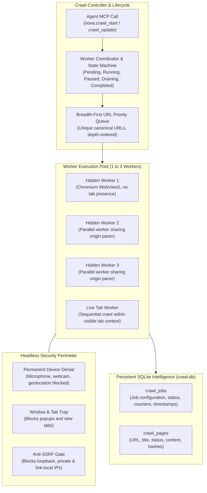
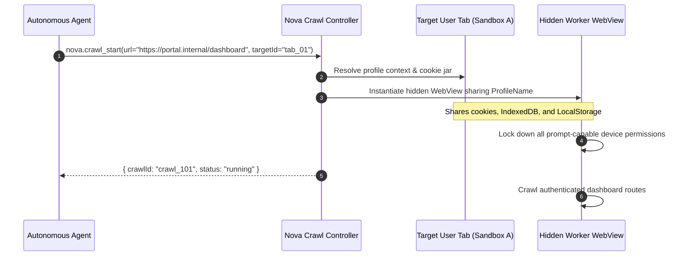
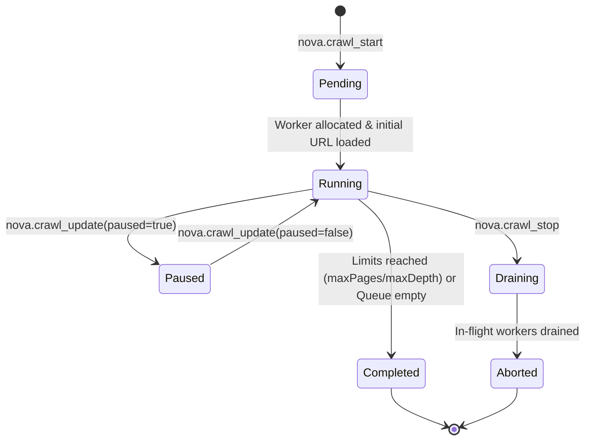

# Crawler Worker Pool, Profile Binding & Job Lifecycle

The autonomous crawler in Nova AI Workspace operates independent background worker instances designed for deep website discovery, content extraction, and persistent route indexing without polluting the user's visible tabs.



---

## 1. Crawl Execution Modes

Nova provides two distinct crawl execution paradigms depending on isolation and context requirements:

| Dimension | `crawlMode = 'hidden'` (Default) | `crawlMode = 'live_tab'` |
| :--- | :--- | :--- |
| **Worker Surface** | 1 to 3 hidden background WebViews (`parallel: 1..3`). | An existing, visible user browser tab (`parallel: 1`). |
| **Tab Bar Presence** | Completely invisible; does not appear in `nova.tabs`. | Visible in the tab strip; active page changes as crawl advances. |
| **Profile & Storage** | Isolated default profile or inherits a specified tab profile (`targetId`). | Strictly uses the active tab's profile, cookies, and session state. |
| **Concurrency** | True parallel execution across up to 3 independent workers. | Sequential only; each route is visited sequentially within the tab. |
| **SPA Context** | Independent navigation instances for each URL. | Preserves client-side Single-Page Application (SPA) memory across same-document routes. |
| **Robots & Sitemaps** | Supported (`respectRobotsTxt`, `useSitemap`). | Disabled; live tab crawling relies solely on discovered links. |
| **Screenshots & Diff** | Full screenshot and delta capture supported. | Screenshots and delta mode are disabled in live tab mode. |

---

## 2. Target-Bound Profile & Sandbox Inheritance

When executing hidden crawls against authenticated intranets, staging portals, or personalized web applications, agents can supply `targetId` to bind background workers to an existing browser tab or sandbox profile (`A`, `B`, etc.):



### Profile Parity Invariants

1. **Shared Cookie Jar & Session Storage:** The hidden worker reuses the target's underlying WebView2 user data profile. It inherits active authentication cookies, session tokens, and local storage without re-authenticating.
2. **Zero Tab Pollution:** Background WebViews have no presence in the WinUI 3 tab strip. They do not trigger tab selection events, do not alter the user's active viewport, and do not appear in `nova.tabs`.
3. **Headless Permission Lockdown:** Although the worker shares authenticated session state, all prompt-capable peripheral permissions (camera, microphone, speaker selection, geolocation, screen sharing, window management) are permanently blocked. Any script attempting to request device access fails closed immediately.

---

## 3. Worker Concurrency & Gating

Nova enforces strict concurrency controls to prevent background crawler traffic from exhausting host CPU, RAM, or network sockets:

* **Worker Cap (`parallel`):** Hidden crawls can allocate between 1 and 3 concurrent WebViews (`parallel: 1..3`). Allocating more than 3 workers is rejected with error `-32602`.
* **Global Crawl Concurrency Gate:** Nova allows at most 2 concurrent crawl jobs across the entire application runtime. Attempting to start a third crawl returns error `-32001` (`Maximum concurrent crawls reached. Stop an existing crawl first.`).
* **Shared Host Pacing:** Even when running 3 parallel workers, all workers share a unified origin pacer. Concurrency allows processing distinct domains in parallel or multiplexing queue retrieval, but will not violate the configured `pageDelayMs` for any single host.

---

## 4. Job State Machine & Lifecycle Operations

Crawl jobs advance through a deterministic state machine recorded in `crawl.db`:



### Lifecycle States

* **`pending`:** The job record has been created in `crawl_jobs`, the URL priority queue has been initialized with the seed URL, and workers are booting.
* **`running`:** Active workers are actively navigating, evaluating settlement, extracting content, and enqueuing links.
* **`paused`:** Navigation is temporarily suspended via `nova.crawl_update(paused=true)` or triggered automatically by a `ChallengeHold` (bot verification barrier). In-flight requests finish, but no new URLs are dequeued.
* **`draining`:** Cancellation has been requested via `nova.crawl_stop`. Active workers finish their current page settlement and shut down safely without corrupting SQLite transactions.
* **`completed`:** The crawl finished normally because all discovered links within `maxDepth` were visited, `maxPages` was reached, or the queue was exhausted.
* **`aborted`:** The job was stopped prematurely by an agent call, user cancellation, or unrecoverable error.

---

## 5. Complete Crawler Lifecycle & MCP Operations

Autonomous agents manage active and completed crawls through the crawler toolchain:

### 5.1 `nova.crawl_start`: Background Traversal & Early Failure Detection
Initiates a new autonomous crawl traversal. It starts the background BFS queue and immediately verifies startup health:

```json
{
  "name": "nova.crawl_start",
  "arguments": {
    "startUrl": "https://docs.example.com",
    "maxDepth": 2,
    "maxPages": 30,
    "parallel": 2,
    "pageDelayMs": 500,
    "settleTimeMs": 3000,
    "crawlMode": "hidden",
    "respectRobotsTxt": true,
    "useSitemap": true,
    "contentSelector": "article.markdown",
    "captureScreenshots": true,
    "screenshotFormat": "jpeg",
    "screenshotQuality": 75
  }
}
```

#### Early-Failure Detection Gate (~300 ms Window)
A major risk in autonomous workflows is polling a crawl that died immediately on startup. `nova.crawl_start` launches the background job, pauses for ~300 ms, and evaluates if the job already terminated:
* **Terminal Launch:** If the start page fails immediately (e.g., DNS resolution failure, private IP/loopback SSRF block, or instant network drop), `status` reflects the terminal state (e.g. `"failed"`), `earlyResult` contains `{ visited: 0, error: "...", detail: "..." }`, and `pollAfterMs` is `null`.
* **Actionable Agent Contract:** Agents should **always check `earlyResult`** upon return. If `earlyResult` is populated, abort the polling loop immediately and address the target or network issue.
* **Fail-Closed Persistence Guard:** If the initial `crawl_jobs` start record cannot be queued to `crawl.db`, `crawl_start` fails closed with `reasonCode='crawl.persistence_unavailable'` rather than returning a misleading, unresumable job ID.

### 5.2 `nova.crawl_status`: Telemetry, Rate Control & Challenge Holds
Queries real-time execution telemetry, active pacing metrics, and automated surface signals:

```json
{
  "name": "nova.crawl_status",
  "arguments": {
    "crawlId": "crawl_20261018_01",
    "outputDetail": "summary"
  }
}
```

#### Projection Modes (`outputDetail`)
* **`minimal`:** Lightweight heartbeat returning identity, status, visited/queued counters, watermark sequence, and compact origin rate state. Recommended for tight polling loops.
* **`summary`:** Adds compact configuration, session counters, settlement readiness, and script completion stats. Custom script bodies are projected as SHA-256 digests and character counts.
* **`full`:** Complete diagnostic payload including full configuration, settlement advisories, and per-origin telemetry.

#### The `challengeHold` Anti-Bot Barrier
When a crawler worker encounters an anti-bot challenge (such as Cloudflare Turnstile, Cloudflare 1020/503 challenge pages, or Google reCAPTCHA), Nova does not hammer the firewall:
1. The crawl pauses immediately at the first hit across all workers.
2. `crawl_status` reports `status: "paused"` with an active `challengeHold` block containing `{ host, url, holdSinceUtc }`.
3. The autonomous agent notifies the human operator to solve the challenge in the visible browser.
4. Once solved, the agent resumes the crawl via `nova.crawl_update(crawlId="...", paused=false)`.

#### Per-Origin `siteArchitecture` Signals
When available, `crawl_status` projects discovered per-origin automation surfaces:
* **Direct MCP Endpoints:** Discovered `/.well-known/mcp.json` or `mcp-server` headers.
* **Server & Agent Cards:** AI agent protocol cards (`/.well-known/agent.json`).
* **Machine Documentation:** Discovered `/llms.txt` and `/llms-full.txt` catalogs.
* **OAuth Protected-Resource Metadata:** OAuth 2.0 authorization server endpoints.

### 5.3 `nova.crawl_results`: Token-Efficient Pagination & Incremental Cursor
Retrieves discovered pages, extracted content, link graphs, and screenshot artifacts from `crawl.db`:

```json
{
  "name": "nova.crawl_results",
  "arguments": {
    "crawlId": "crawl_20261018_01",
    "limit": 20,
    "sortBy": "sequence",
    "sortOrder": "asc",
    "screenshotDetail": "meta",
    "outputDetail": "summary"
  }
}
```

#### Token-Saving Aggregate Mode (`summary: true`)
For large sites, retrieving hundreds of full page objects burns excessive LLM context. Passing `summary: true` returns aggregate statistics without individual page text:
* Framework breakdown (React, Vue, Next.js, Angular, Svelte, etc.).
* Depth distribution, average confidence scores, and load latencies.
* Duplicate content detection and screenshot coverage metrics.

#### Stable Incremental Polling (`sinceSequence`)
When polling a running crawl, standard `offset`-based pagination suffers from race conditions as newly discovered URLs are enqueued and sorted. Nova provides a stable cursor:
* Pass `sortBy: "sequence"`, `sortOrder: "asc"`, and `sinceSequence: <lastSeenSequence>`.
* Returns only pages with `sequence > sinceSequence`, guaranteeing zero duplicate reads and zero skipped pages.

#### Screenshot Payload Control (`screenshotDetail`)
* **`meta` (Default):** Returns screenshot status, dimensions, and local artifact path without inline base64 data.
* **`full`:** Inlines the full base64 image payload (use only when image analysis is required).
* **`off`:** Omits screenshot fields entirely.

### 5.4 `nova.crawl_stop`: Graceful Drain & Result Persistence
Requests safe cancellation of a running crawl job:

```json
{
  "name": "nova.crawl_stop",
  "arguments": {
    "crawlId": "crawl_20261018_01"
  }
}
```

* **Graceful Worker Unwind:** The job transitions to `status: "cancelling"`. In-flight page settlement finishes cleanly to prevent SQLite corruption.
* **Finalizing Linger:** Once workers unwind, the job transitions to terminal `cancelled`. If already finishing naturally, crawl_stop reports the completed state without rewriting it.
* **Durable Results:** All pages, links, and text persisted prior to stopping remain fully accessible through `nova.crawl_results`.

### 5.5 `nova.crawl_update`: Mid-Flight Parameter Mutation
Modifies limits, pacing rates, or pause status dynamically while a crawl is running:

```json
{
  "name": "nova.crawl_update",
  "arguments": {
    "crawlId": "crawl_20261018_01",
    "maxPages": 50,
    "pageDelayMs": 1000,
    "paused": true
  }
}
```

* Only supplied parameters are altered; omitted parameters maintain their current value.
* Updated limits apply before the next URL is dequeued from the BFS queue.
* Setting `paused: false` resumes a paused crawl or clears a `challengeHold`.

### 5.6 `nova.crawl_links`: Instant In-Tab Link Extraction
Extracts and classifies all hyperlinks on an active browser tab or sandbox without creating a background crawl job:

```json
{
  "name": "nova.crawl_links",
  "arguments": {
    "targetId": "active",
    "sameScopeOnly": true,
    "includeText": true,
    "deep": true
  }
}
```

* Returns `links[]` categorized by navigation type, visible link text, and `count`.
* Traverses open shadow DOM roots and same-origin iframes when `deep: true`.
* Projects `pageSignals` (title, language, canonical URL, robots meta directives, authentication assessment) and per-origin `agentSignals`.

---

## 6. Related Documentation

* [Autonomous Breadth-First Crawler Overview](../README.md)
* [Settlement Detection, Pacing & Resilience](../settlement-pacing-and-resilience/README.md)
* [Extraction, Sitemaps & Results Projection](../extraction-sitemaps-and-results/README.md)
* [Crawler & Discovery Architecture Hub](../../README.md)
