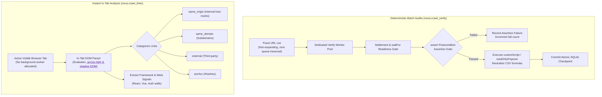
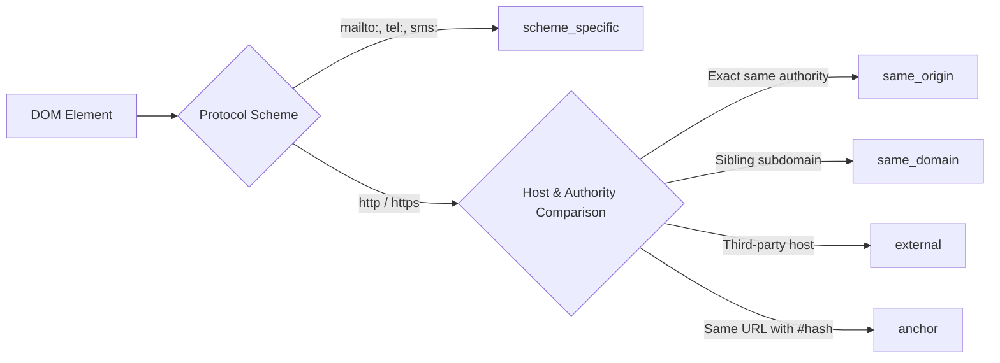

# Batch URL Verification & In-Tab Link Analysis

Web intelligence and QA workflows often require surgical precision rather than exploratory breadth-first traversal. Agents frequently need to audit a strictly defined list of URLs against semantic assertion gates, execute research extraction scripts without following external links, or instantly classify hyperlinks on an active browser tab without background queue overhead.

Nova AI Workspace provides two specialized tools for these operations: [`nova.crawl_verify`](../../../../mcp-reference/tools/crawler-and-discovery/nova-crawl-verify.md) for deterministic batch auditing, and [`nova.crawl_links`](../../../../mcp-reference/tools/crawler-and-discovery/nova-crawl-links.md) for immediate in-tab link analysis.



---

## 1. Deterministic Batch Verification with `nova.crawl_verify`

Unlike `nova.crawl_start` (which traverses outgoing links), `nova.crawl_verify` operates strictly on a **fixed, non-expanding list of URLs**:

```json
{
  "name": "nova.crawl_verify",
  "arguments": {
    "urls": [
      "https://example.com/checkout/cart",
      "https://example.com/settings/billing",
      "https://example.com/api/v2/health"
    ],
    "waitFor": ".status-indicator-ready",
    "viewportMode": "desktop",
    "extractContent": true
  }
}
```

### Key Differences from Standard Crawling

| Feature | Autonomous Crawler (`crawl_start`) | Batch Verifier (`crawl_verify`) |
| :--- | :--- | :--- |
| **Queue Expansion** | **Dynamic:** Follows discovered links breadth-first. | **Fixed:** Exactly the supplied URL list is visited. |
| **Semantic Readiness** | General DOM quiet + network idle heuristic. | Explicit `waitFor` selector must be visible before verification begins. |
| **Assertions** | None (best-effort traversal). | Declarative postcondition assertions (`assert`). |
| **Research Extraction** | Standard Markdown/Text extraction. | Custom CDP script execution (`customScript`) and read-only popover extraction. |
| **Export Safety** | SQLite raw text storage. | Automatic CSV formula neutralization (`=`, `@`, `+`, `-`). |

### Research Automation & Script Invariants
* **Custom Extraction Scripts (`customScript`):** Agents can execute isolated scripts evaluated inside each page context. The script must return typed objects `{ state, records }`. Keys are validated against strict alphanumeric contracts before storage.
* **Read-Only Popover Extraction (`readOnlyPopover`):** Reads transient tooltip and popover text through selector and attribute inspection without dispatching synthetic pointer events or mutating UI focus.
* **CSV Formula Neutralization:** When exporting verification data to spreadsheets, all cell values starting with formula control characters (`=`, `+`, `-`, `@`, `\t`, `\r`) are automatically neutralized to prevent formula injection attacks.
* **Atomic SQLite Checkpoints:** Results commit inside atomic transactions in `crawl.db`. If a batch is interrupted by a system crash, completed page records remain durable and resumable.

---

## 2. Instant In-Tab Link Analysis with `nova.crawl_links`

When an agent is already viewing a web page in an active tab and needs to inspect available links before deciding whether to navigate or crawl, [`nova.crawl_links`](../../../../mcp-reference/tools/crawler-and-discovery/nova-crawl-links.md) extracts and categorizes all hyperlinks in milliseconds:

```json
{
  "name": "nova.crawl_links",
  "arguments": {
    "targetId": "active",
    "urlPattern": "^https://docs\\.example\\.com/api/",
    "sameDomainOnly": true,
    "includeText": true,
    "deep": false
  }
}
```

### Advantages Over Crawling
1. **Zero Worker Allocation:** Operates directly on the leased tab's existing DOM; allocates zero background WebViews.
2. **Dynamic DOM Accuracy:** Evaluates links dynamically injected by client-side JavaScript frameworks after hydration.
3. **Regex Filtering:** The `urlPattern` regex filter is evaluated within a 200 ms timeout window, protecting against regex denial-of-service (ReDoS) patterns.
4. **Deep Shadow DOM Support:** When `deep: true` is configured, the link extractor traverses through open Shadow DOM roots, cataloging links hidden within web components.

### Link Categorization Taxonomy



### Response Schema

```json
{
  "targetId": "tab_01",
  "currentUrl": "https://docs.example.com/overview",
  "totalLinks": 34,
  "frameworkHint": "Next.js",
  "links": {
    "sameOrigin": [
      {
        "href": "https://docs.example.com/api/v2/authentication",
        "text": "Authentication Guide",
        "title": "API v2 Auth"
      }
    ],
    "external": [
      {
        "href": "https://github.com/example/api-sdk",
        "text": "Official Node.js SDK"
      }
    ],
    "anchor": [
      {
        "href": "#installation",
        "text": "Jump to Installation"
      }
    ]
  }
}
```

---

## 3. Related Documentation

* [Crawl Diffs & Verification Overview](../README.md)
* [Crawl History & Generational Diffs](../generational-diffs-and-history/README.md)
* [Autonomous Breadth-First Crawler](../../crawler/README.md)
* [Crawl Verify MCP Tool Reference](../../../../mcp-reference/tools/crawler-and-discovery/nova-crawl-verify.md)
* [Crawl Links MCP Tool Reference](../../../../mcp-reference/tools/crawler-and-discovery/nova-crawl-links.md)
