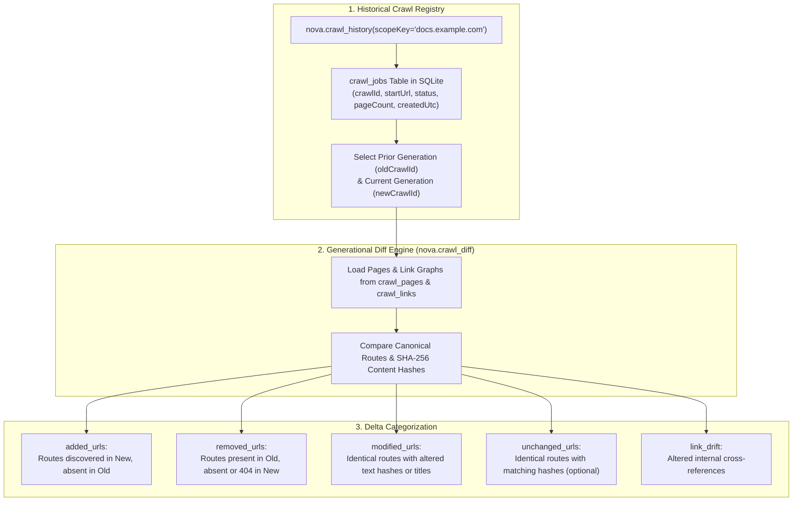
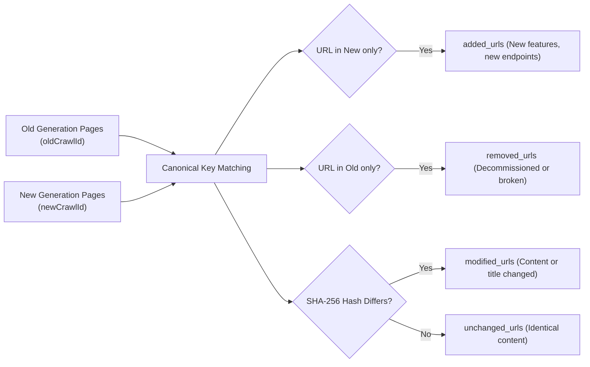

# Crawl History, Generational Diffs & Change Detection

Websites continuously evolve: new API endpoints are launched, documentation sections are updated, legacy paths are deprecated, and broken internal links appear. Detecting structural and content changes over time requires comparing discrete crawl generations without re-reading thousands of web pages manually.

Nova AI Workspace provides longitudinal change detection through [`nova.crawl_history`](../../../../mcp-reference/tools/crawler-and-discovery/nova-crawl-history.md) and [`nova.crawl_diff`](../../../../mcp-reference/tools/crawler-and-discovery/nova-crawl-diff.md), backed by content-hashed page snapshots in SQLite (`crawl.db`).



---

## 1. Historical Job Inspection with `nova.crawl_history`

Agents inspect past crawl executions using [`nova.crawl_history`](../../../../mcp-reference/tools/crawler-and-discovery/nova-crawl-history.md):

```json
{
  "name": "nova.crawl_history",
  "arguments": {
    "scopeKey": "docs.example.com",
    "status": "completed",
    "limit": 10
  }
}
```

### Response Schema

```json
{
  "scopeKey": "docs.example.com",
  "totalJobs": 4,
  "jobs": [
    {
      "crawlId": "crawl_20261018_01",
      "startUrl": "https://docs.example.com",
      "status": "completed",
      "pagesCrawled": 42,
      "maxDepth": 2,
      "createdUtc": "2026-10-18T04:00:00Z",
      "finishedUtc": "2026-10-18T04:08:30Z",
      "elapsedSeconds": 510
    },
    {
      "crawlId": "crawl_20261001_01",
      "startUrl": "https://docs.example.com",
      "status": "completed",
      "pagesCrawled": 39,
      "maxDepth": 2,
      "createdUtc": "2026-10-01T08:00:00Z",
      "finishedUtc": "2026-10-01T08:07:15Z",
      "elapsedSeconds": 435
    }
  ]
}
```

---

## 2. Generational Change Detection with `nova.crawl_diff`

By supplying two distinct `crawlId` identifiers, [`nova.crawl_diff`](../../../../mcp-reference/tools/crawler-and-discovery/nova-crawl-diff.md) computes exact structural and content deltas:

```json
{
  "name": "nova.crawl_diff",
  "arguments": {
    "oldCrawlId": "crawl_20261001_01",
    "newCrawlId": "crawl_20261018_01",
    "includeUnchanged": false,
    "limit": 50
  }
}
```

### The Delta Taxonomy



1. **`added_urls`:** Routes discovered in the new crawl that were not present in the old crawl. Indicates newly published documentation, changelog entries, or API endpoints.
2. **`removed_urls`:** Routes that existed in the old crawl but were not found or returned HTTP 404 in the new crawl. Useful for broken link detection and deprecation audits.
3. **`modified_urls`:** Routes present in both crawls whose page title, body text, or SHA-256 content hash (`page_hash`) changed between runs.
4. **`unchanged_urls`:** Pages whose content and metadata remained byte-for-byte identical. Omitted by default to conserve agent tokens; included when `includeUnchanged: true`.

### Diff Response Schema

```json
{
  "oldCrawlId": "crawl_20261001_01",
  "newCrawlId": "crawl_20261018_01",
  "summary": {
    "addedCount": 3,
    "removedCount": 0,
    "modifiedCount": 2,
    "unchangedCount": 37
  },
  "addedUrls": [
    {
      "url": "https://docs.example.com/api/v2/webhooks",
      "title": "Event Webhooks Guide",
      "status": 200
    }
  ],
  "modifiedUrls": [
    {
      "url": "https://docs.example.com/api/v2/authentication",
      "title": "API v2 Authentication & Security",
      "oldHash": "a1b2c3d4...",
      "newHash": "f9e8d7c6...",
      "status": 200
    }
  ]
}
```

---

## 3. Related Documentation

* [Crawl Diffs & Verification Overview](../README.md)
* [Batch Verification & In-Tab Link Analysis](../batch-verification-and-link-analysis/README.md)
* [Autonomous Breadth-First Crawler](../../crawler/README.md)
* [Crawl Diff MCP Tool Reference](../../../../mcp-reference/tools/crawler-and-discovery/nova-crawl-diff.md)
* [Crawl History MCP Tool Reference](../../../../mcp-reference/tools/crawler-and-discovery/nova-crawl-history.md)
