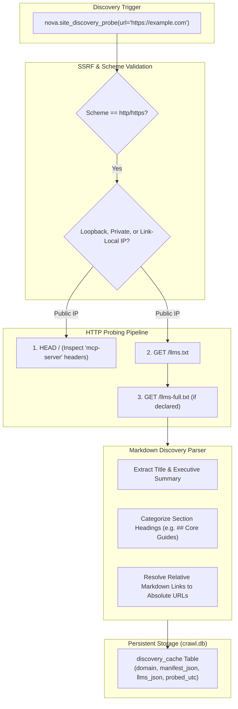
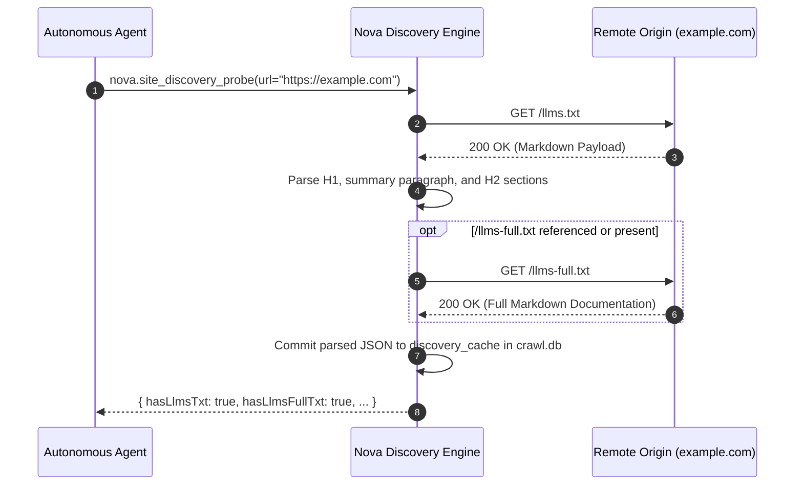

# AI Discovery, llms.txt Parsing & Knowledge Caching

As websites evolve from purely human-oriented graphical interfaces toward agent-accessible platforms, modern web origins increasingly publish machine-readable discovery files. The `llms.txt` convention allows documentation platforms, developer portals, and open-source libraries to provide concise, clean Markdown documentation tailored specifically for AI context windows.

Nova AI Workspace provides built-in discovery probes that automatically detect, parse, and cache `llms.txt` and `llms-full.txt` endpoints in persistent SQLite storage (`crawl.db`).



---

## 1. The `llms.txt` Specification

The `llms.txt` file format is a proposed standard for exposing concise, human-and-machine-readable Markdown documentation at the root of a domain:

* **File Location:** Placed at `/llms.txt` on the domain root (e.g., `https://docs.example.com/llms.txt`).
* **Format:** Standard GitHub Flavored Markdown (GFM).
* **Core Components:**
  1. **Title & Summary:** An `H1` project title followed by a concise 1–3 sentence architectural summary.
  2. **Categorized Link Directories:** Markdown lists grouped under `H2` section headings (e.g., `## Guides`, `## API Reference`), where each item includes an absolute or relative link and a brief explanatory note.
  3. **Full Reference Declarations:** An optional link to `/llms-full.txt`, concatenating the entire documentation tree into a single file for deep-context LLM ingestion.

---

## 2. Nova's Parsing & Ingestion Pipeline

When an agent issues [`nova.site_discovery_probe`](../../../../mcp-reference/tools/external-mcp/nova-site-discovery-probe.md), Nova's discovery parser processes the response:



### Parsing Invariants
1. **Absolute URL Expansion:** Relative Markdown links (e.g., `[Auth Guide]` pointing to path `/docs/auth.md`) are automatically absolutized against the target origin (`https://example.com/docs/auth.md`).
2. **Untrusted Content Sanitization:** Raw Markdown is parsed in an isolated data structure. Script tags, HTML comments, and potentially malicious prompt injection vectors are neutralized before schema projection.
3. **Cache Storage:** Parsed records are stored in the `discovery_cache` table of `crawl.db`, indexed by domain. Subsequent lookups via [`nova.site_discovery_get`](../../../../mcp-reference/tools/external-mcp/nova-site-discovery-get.md) return in sub-milliseconds without network roundtrips.

---

## 3. Tool Contracts

### 1. `nova.site_discovery_probe`
Actively probes a web origin for discovery endpoints over the network:

```json
{
  "name": "nova.site_discovery_probe",
  "arguments": {
    "url": "https://docs.anthropic.com",
    "forceRefresh": false
  }
}
```

**Response Payload:**
```json
{
  "domain": "docs.anthropic.com",
  "probedUtc": "2026-10-18T05:30:00Z",
  "hasLlmsTxt": true,
  "hasLlmsFullTxt": true,
  "hasMcp": false,
  "llmsTxt": {
    "title": "Anthropic Claude Documentation",
    "summary": "Official guides, prompt engineering tutorials, and API reference documentation for Claude.",
    "sections": [
      {
        "name": "Getting Started",
        "linkCount": 6,
        "links": [
          {
            "title": "Quickstart Guide",
            "url": "https://docs.anthropic.com/en/docs/initial-setup",
            "description": "API keys and your first request"
          }
        ]
      }
    ]
  }
}
```

### 2. `nova.site_discovery_get`
Retrieves previously cached discovery knowledge without emitting network traffic:

```json
{
  "name": "nova.site_discovery_get",
  "arguments": {
    "domain": "docs.anthropic.com"
  }
}
```

---

## 4. Related Documentation

* [AI & Website MCP Discovery Overview](../README.md)
* [Remote MCP Web Discovery & OAuth Negotiation](../mcp-web-discovery-and-oauth/README.md)
* [Site URL Index Architecture](../../site-url-index/README.md)
* [Site Discovery Probe MCP Tool Reference](../../../../mcp-reference/tools/external-mcp/nova-site-discovery-probe.md)
