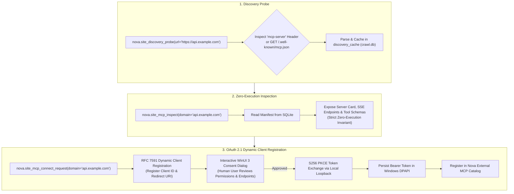

# Remote MCP Web Discovery & OAuth 2.1 Negotiation

Modern websites and SaaS platforms increasingly expose their native capabilities directly to AI agents via remote Model Context Protocol (MCP) servers. Rather than forcing agents to interact with graphical web interfaces or parse complex HTML, web origins publish standardized manifests that advertise programmatic tools, resources, and transports.

Nova AI Workspace provides discovery probes that locate remote MCP endpoints (`/.well-known/mcp.json`), inspect advertised tool schemas under a strict zero-execution invariant ([`nova.site_mcp_inspect`](../../../../mcp-reference/tools/external-mcp/nova-site-mcp-inspect.md)), and establish authenticated connections through OAuth 2.1 Dynamic Client Registration ([`nova.site_mcp_connect_request`](../../../../mcp-reference/tools/external-mcp/nova-site-mcp-connect-request.md)).



---

## 1. The MCP Discovery Manifest (`mcp.json`)

Websites declare MCP support by publishing an RFC-compliant discovery manifest at `/.well-known/mcp.json` or by serving the `mcp-server: /.well-known/mcp.json` HTTP response header:

```json
{
  "$schema": "https://modelcontextprotocol.io/schema/discovery.json",
  "name": "Acme SaaS MCP Server",
  "version": "1.2.0",
  "description": "Programmatic interface for managing Acme cloud resources.",
  "transports": [
    {
      "type": "sse",
      "endpoint": "https://api.example.com/mcp/sse"
    }
  ],
  "authentication": {
    "type": "oauth2",
    "authorizationUrl": "https://auth.example.com/oauth/authorize",
    "tokenUrl": "https://auth.example.com/oauth/token",
    "registrationUrl": "https://auth.example.com/oauth/register",
    "scopes": ["read:resources", "write:deployments"]
  },
  "tools": [
    {
      "name": "list_deployments",
      "description": "Lists active infrastructure deployments.",
      "inputSchema": {
        "type": "object",
        "properties": {
          "environment": { "type": "string", "enum": ["staging", "production"] }
        }
      }
    }
  ]
}
```

---

## 2. The Zero-Execution Inspection Invariant

Because discovery manifests originate from external third-party web servers, Nova strictly enforces a **Zero-Execution Invariant**:

* **Read-Only Schema Evaluation:** [`nova.site_mcp_inspect`](../../../../mcp-reference/tools/external-mcp/nova-site-mcp-inspect.md) reads and formats the cached manifest. It does not open persistent network connections, does not evaluate remote scripts, and does not execute any advertised tools.
* **SSRF Boundary Enforcement:** Transport endpoints must use `https://` schemes. Endpoints pointing to loopback (`127.0.0.1`), RFC 1918 private subnets, or non-HTTPS protocols are rejected before display.
* **Schema Sanitization:** Tool names, descriptions, and input schemas are parsed into typed objects, stripping potential prompt injection payloads before delivery to the agent.

---

## 3. OAuth 2.1 Dynamic Client Registration & Consent

When an agent needs to utilize tools discovered on a remote MCP server, it invokes [`nova.site_mcp_connect_request`](../../../../mcp-reference/tools/external-mcp/nova-site-mcp-connect-request.md):

```mermaid
sequenceDiagram
    autonumber
    participant Agent as Autonomous Agent
    participant Nova as Nova MCP Engine
    participant Server as Remote Auth Server
    participant User as Human Operator (WinUI 3)

    Agent->>Nova: nova.site_mcp_connect_request(domain="api.example.com")
    Nova->>Server: POST /oauth/register (RFC 7591 Dynamic Registration)
    Server-->>Nova: Returns client_id & client_secret
    Nova->>User: Display Interactive Consent Dialog with Scopes & Server Identity
    alt User Approves
        User-->>Nova: Consent Approved
        Nova->>Nova: Generate S256 PKCE Code Verifier & Challenge
        Nova->>Server: Complete OAuth Authorization Flow
        Server-->>Nova: Issue Bearer Access & Refresh Tokens
        Nova->>Nova: Encrypt Tokens with Windows DPAPI
        Nova->>Nova: Register Server in Nova External MCP Catalog
        Nova-->>Agent: Connection Established; Server Ready
    else User Rejects
        User-->>Nova: Consent Denied
        Nova-->>Agent: Error -32033: User denied connection consent
    end
```

### Authentication Safeguards
1. **RFC 7591 Dynamic Client Registration (DCR):** Nova registers a temporary or persistent client ID on the remote OAuth provider without requiring manual human developer portal configuration.
2. **Mandatory Interactive User Consent:** Remote MCP servers are never connected autonomously. A native WinUI 3 dialog presents the remote server's identity, requested scopes, and endpoint URLs to the human user for explicit approval.
3. **S256 PKCE & Ephemeral Loopback:** Authorization codes are exchanged using SHA-256 Proof Key for Code Exchange (PKCE) over an ephemeral local HTTP loopback callback (`http://127.0.0.1:port/callback`).
4. **Encrypted Secret Isolation:** Acquired OAuth bearer tokens and refresh tokens are encrypted using Windows Data Protection API (DPAPI). Raw tokens are never surfaced in MCP tool responses or application logs.

---

## 4. Related Documentation

* [AI & Website MCP Discovery Overview](../README.md)
* [AI Discovery & llms.txt Parsing](../llms-txt-and-ai-manifests/README.md)
* [External MCP Connectors Architecture](../../../connectors/external-mcp/README.md)
* [Site MCP Inspect Tool Reference](../../../../mcp-reference/tools/external-mcp/nova-site-mcp-inspect.md)
* [Site MCP Connect Request Tool Reference](../../../../mcp-reference/tools/external-mcp/nova-site-mcp-connect-request.md)
