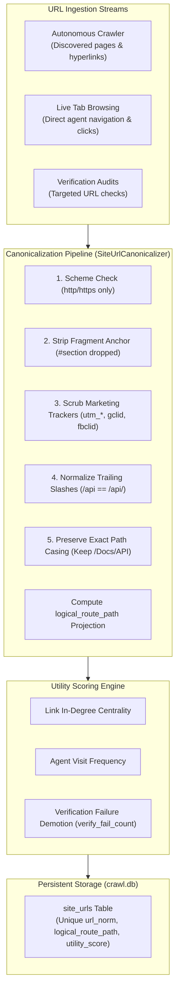
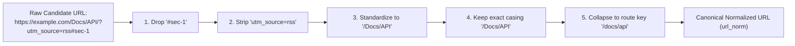

# Site URL Canonicalization, Utility Scoring & Schema Architecture

The **Site URL Index** functions as Nova AI Workspace's persistent routing memory. Instead of forcing autonomous agents to perform repetitive, token-expensive, and rate-limited crawls to locate specific documentation pages or API endpoints, Nova maintains a structured atlas of known URLs, HTTP status observations, and relevance scores in a persistent SQLite database (`crawl.db`).



---

## 1. Index-First Navigation vs. Brute-Force Re-Crawling

When an autonomous agent needs to consult product guides, documentation, or administrative dashboards, traditional web automation approaches suffer from severe inefficiencies:

| Operational Metric | Brute-Force Re-Crawling | Index-First Navigation in Nova |
| :--- | :--- | :--- |
| **Time to First Action** | **Slow:** Minutes spent waiting for queue crawlers to reach deep links. | **Instant:** Sub-millisecond SQLite query via [`nova.site_urls`](../../../../mcp-reference/tools/crawler-and-discovery/nova-site-urls.md). |
| **LLM Token Consumption** | **High:** Thousands of tokens consumed parsing intermediate navigation menus. | **Zero:** Directly returns the canonical target route. |
| **Network & Server Load** | **High:** Bursts of requests triggering bot mitigations or 429 rate limits. | **Zero Network Traffic:** Evaluated purely against local storage. |
| **Cross-Session Memory** | **Lost:** Ephemeral; discarded as soon as the automation script exits. | **Persistent:** Survives browser restarts and multi-agent task handoffs. |

---

## 2. The Five Canonicalization Rules

Websites frequently serve identical documents across hundreds of cosmetic URL permutations (referral parameters, session IDs, trailing slashes, anchor tags). Ingesting raw URLs causes index fragmentation, inaccurate statistics, and duplicate visits.

Nova cleans every URL string before committing it to the index:



1. **Fragment Stripping:** In-page anchor fragments (`#overview`, `#/spa/route`) are stripped from server-side route records so the primary document is indexed once.
2. **Tracker & Telemetry Parameter Scrubbing:** Automatically removes tracking query parameters (`utm_source`, `utm_medium`, `utm_campaign`, `gclid`, `fbclid`, `mc_eid`, `_ga`) while preserving functional parameters that alter returned content (e.g., `?id=123`, `?page=2`, `?category=hardware`).
3. **Trailing Slash Deduplication:** Standardizes route paths so that `/docs` and `/docs/` resolve to the same unique index row.
4. **Strict Path-Case Preservation:** Hostnames are lowercased per RFC 3986, but path components preserve their exact casing. Converting paths to lowercase breaks case-sensitive server routing (e.g., `/Wiki/Special_Pages` vs `/wiki/special_pages`).
5. **Logical Route Path Collapsing:** Nova calculates `logical_route_path`, collapsing cosmetic query-string variants under a unified logical route identity for reporting and navigation planning.

---

## 3. Route Utility Scoring Engine

Every route in the index is assigned a dynamic floating-point `utility_score` (ranging from `1.0` to `10.0`):

$$\text{Utility Score} = \text{Base} + w_{\text{centrality}} \cdot \ln(\text{in\_links} + 1) + w_{\text{visits}} \cdot \ln(\text{visits} + 1) - w_{\text{fails}} \cdot \text{verify\_fail\_count}$$

* **Link Centrality:** Pages referenced frequently across internal site links receive higher baseline relevance scores.
* **Visit Reinforcement:** Routes successfully navigated and utilized during agent tasks have their scores boosted.
* **Failure Penalty (`verify_fail_count`):** When targeted audits or live navigation attempts return HTTP 404, 410, or connection timeouts, `verify_fail_count` increments. High-failure routes are demoted in search rankings and filtered out of recommendation sets.

---

## 4. SQLite Schema (`site_urls`)

The `site_urls` table in `crawl.db` is indexed for rapid path prefix queries and domain lookups:

```sql
CREATE TABLE site_urls (
    site_url_id         TEXT PRIMARY KEY,
    domain              TEXT NOT NULL,
    scope_key           TEXT NOT NULL,
    origin              TEXT NOT NULL,
    url                 TEXT NOT NULL,
    url_norm            TEXT NOT NULL UNIQUE,
    logical_route_path  TEXT NOT NULL,
    http_status         INTEGER,
    title               TEXT,
    utility_score       REAL DEFAULT 1.0,
    visit_count         INTEGER DEFAULT 0,
    verify_fail_count   INTEGER DEFAULT 0,
    exploration_state   TEXT DEFAULT 'UNEXPLORED',
    lifecycle_state     TEXT DEFAULT 'active',
    last_observed_utc   DATETIME,
    last_explored_utc   DATETIME
);

CREATE INDEX idx_site_urls_domain_prefix ON site_urls(domain, logical_route_path);
CREATE INDEX idx_site_urls_utility ON site_urls(domain, utility_score DESC);
```

### Exploration & Lifecycle States
* **`exploration_state`:** Tracks whether the route has undergone interactive [Surface Exploration](../../surface-explorer/README.md) (`UNEXPLORED`, `DISCOVERED`, `EXPLORED`).
* **`lifecycle_state`:** Flags the operational availability of the route:
  - `active`: Verified accessible route (HTTP 200–399, or authenticated 401/403).
  - `dead`: Broken or decommissioned endpoint (HTTP 404, 410, 451).
  - `stale`: Long unvisited route requiring re-verification.

---

## 5. Related Documentation

* [Site URL Index Architecture Overview](../README.md)
* [Querying, Reporting & Scope Eviction](../querying-reporting-and-scope-eviction/README.md)
* [Surface Explorer & Interactive States](../../surface-explorer/README.md)
* [Site URLs MCP Tool Reference](../../../../mcp-reference/tools/crawler-and-discovery/nova-site-urls.md)
