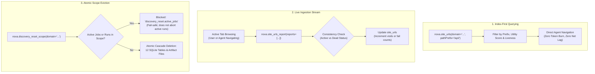
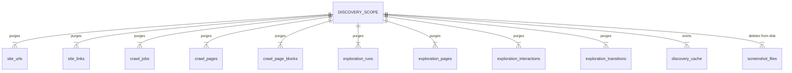

# Site URL Querying, Live Reporting & Scope Eviction

The persistent **Site URL Index** provides autonomous agents with three fundamental capabilities: querying known routes without issuing network requests ([`nova.site_urls`](../../../../mcp-reference/tools/crawler-and-discovery/nova-site-urls.md)), reporting live browsing discoveries and broken links ([`nova.site_urls_report`](../../../../mcp-reference/tools/crawler-and-discovery/nova-site-urls-report.md)), and executing atomic scope evictions when website structures change ([`nova.discovery_reset_scope`](../../../../mcp-reference/tools/crawler-and-discovery/nova-discovery-reset-scope.md)).



---

## 1. Index-First Querying with `nova.site_urls`

Agents query known endpoints by domain and path prefix before deciding to navigate:

```json
{
  "name": "nova.site_urls",
  "arguments": {
    "domain": "docs.example.com",
    "pathPrefix": "/api/v2/",
    "limit": 20,
    "includeDead": false
  }
}
```

### Result Schema

```json
{
  "domain": "docs.example.com",
  "scopeQuery": "docs.example.com",
  "totalMatches": 18,
  "urls": [
    {
      "url": "https://docs.example.com/api/v2/authentication",
      "logicalRoute": "/api/v2/authentication",
      "title": "API v2 Authentication & Security",
      "status": 200,
      "utilityScore": 8.7,
      "explorationState": "EXPLORED",
      "lifecycleState": "active"
    },
    {
      "url": "https://docs.example.com/api/v2/webhooks",
      "logicalRoute": "/api/v2/webhooks",
      "title": "Configuring Event Webhooks",
      "status": 200,
      "utilityScore": 7.4,
      "explorationState": "UNEXPLORED",
      "lifecycleState": "active"
    }
  ]
}
```

---

## 2. Live Navigation Ingestion with `nova.site_urls_report`

The index does not rely solely on crawler runs. As agents browse websites, inspect links, or encounter redirects, they stream observations into the index using [`nova.site_urls_report`](../../../../mcp-reference/tools/crawler-and-discovery/nova-site-urls-report.md):

```json
{
  "name": "nova.site_urls_report",
  "arguments": {
    "reports": [
      {
        "url": "https://docs.example.com/api/v2/billing",
        "kind": "new_page",
        "title": "Billing & Subscriptions API",
        "httpStatus": 200
      },
      {
        "url": "https://docs.example.com/v1/deprecated",
        "kind": "not_found",
        "httpStatus": 404
      },
      {
        "url": "https://docs.example.com/docs/auth",
        "kind": "redirect",
        "targetUrl": "https://docs.example.com/api/v2/authentication",
        "httpStatus": 301
      }
    ]
  }
}
```

### Observation Kinds & Consistency Rules

| Report Kind | Purpose | HTTP Status Validation | Database Action |
| :--- | :--- | :--- | :--- |
| **`new_page`** | Registers a previously unindexed route found in HTML markup or script navigation. | Requires HTTP 200–399, or 401/403. | Inserts canonical URL, sets `lifecycleState = 'active'`, initializes utility score. |
| **`not_found`** | Flags broken, deleted, or removed links. | Requires HTTP 404, 410, or 451. | Sets `lifecycleState = 'dead'`, increments `verify_fail_count`. |
| **`redirect`** | Documents HTTP 301/302 redirects. | Requires HTTP 301, 302, 307, or 308. | Maps source route to target destination; preserves canonical link graphs. |
| **`canonical`** | Reports explicit `<link rel="canonical">` tags found in page headers. | *Optional* | Updates alias mappings to point to the author's declared canonical route. |

---

## 3. Atomic Scope Eviction with `nova.discovery_reset_scope`

When a website undergoes a structural redesign, changes its domain routing, or when an agent requires a completely clean slate for verification testing, [`nova.discovery_reset_scope`](../../../../mcp-reference/tools/crawler-and-discovery/nova-discovery-reset-scope.md) wipes all accumulated intelligence for that scope:

```json
{
  "name": "nova.discovery_reset_scope",
  "arguments": {
    "domain": "staging.example.com"
  }
}
```

### Concurrency Safety Barrier
Nova protects running processes from destructive data loss:
* If an active crawl job or surface exploration run is currently operating within the target domain scope, Nova immediately refuses the reset.
* Returns `status = 'blocked'` with `reasonCode = 'discovery_reset.active_jobs'`.
* The agent must stop running crawls (`nova.crawl_stop`) or close exploration sessions before the scope can be purged.

### Cascading Deletion Scope
When cleared, Nova executes an atomic transaction in `crawl.db` that cascades across 12 distinct data stores and caches:



### Result Schema
```json
{
  "status": "ok",
  "scopeQuery": "staging.example.com",
  "deleted": {
    "siteUrls": 84,
    "siteLinks": 210,
    "crawlJobs": 2,
    "crawlPages": 84,
    "crawlPageBlocks": 120,
    "explorationRuns": 1,
    "surfaceStates": 6,
    "surfaceTriggers": 14,
    "surfaceTransitions": 8,
    "artifactFiles": 6,
    "runtimeCrawlEntries": 2
  }
}
```

---

## 4. Related Documentation

* [Site URL Index Architecture Overview](../README.md)
* [Canonicalization, Utility Scoring & Schema](../canonicalization-and-utility-scoring/README.md)
* [Autonomous Breadth-First Crawler](../../crawler/README.md)
* [Discovery Reset Scope MCP Tool Reference](../../../../mcp-reference/tools/crawler-and-discovery/nova-discovery-reset-scope.md)
