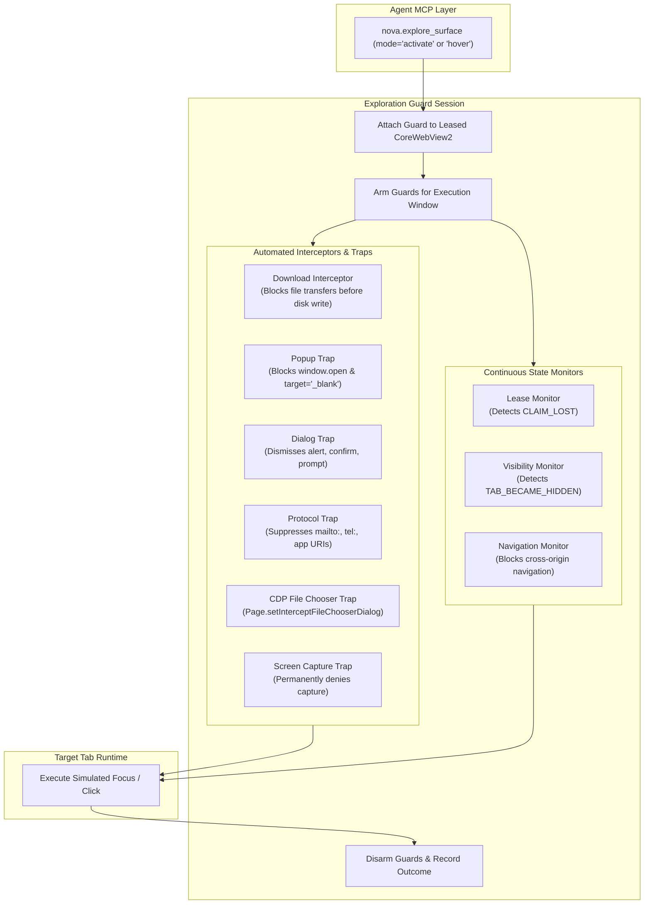
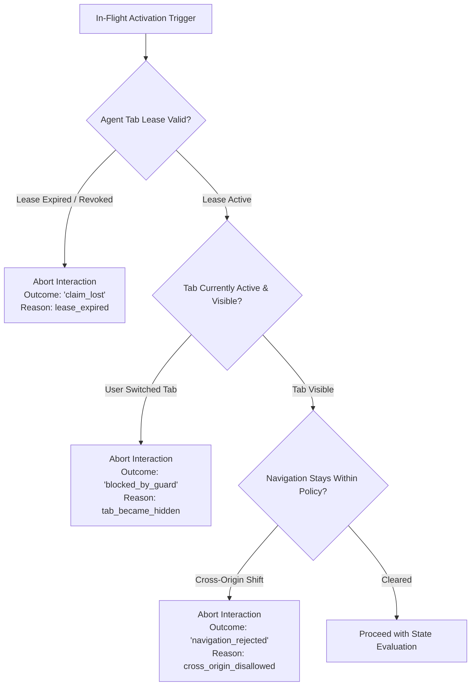

# Surface Explorer Guard Session, Invariants & Failure Modes

When an agent interacts with live web pages, synthetic pointer clicks and keyboard inputs can inadvertently trigger unwanted side effects: opening unconstrained popup tabs, triggering native file downloads, executing destructive form posts, launching external OS protocol handlers, or hanging the browser process with unhandled JavaScript dialogs.

Nova guarantees safe, deterministic in-page exploration by attaching an airtight, multi-layered guard session to the browser tab runtime during all surface interactions.



---

## 1. The Guard Session Lifecycle

A guard session is bound to an active tab leased by the calling agent:

1. **Attachment (`discover` mode):** When `nova.explore_surface(mode='discover')` is called, Nova binds an exploration guard to the target tab. Event listeners are wired to intercept downloads, new windows, permissions, script dialogs, and navigation.
2. **Arming (`activate` / `hover` modes):** Immediately before dispatching a synthetic pointer or keyboard event, the guard arms its network mutation and navigation traps (`_armed = true`).
3. **Execution Window:** The simulated input is dispatched to the target DOM element. Any asynchronous side effects triggered by the page within the execution window encounter the armed traps.
4. **Disarming & Incident Recording:** Once the post-interaction settlement check completes, the guard is disarmed. Any intercepted events are packaged into `GuardIncident` records and reflected in the tool result.
5. **Teardown (`close` mode):** When exploration is complete, `nova.explore_surface(mode='close')` detaches all CDP interceptors, unhooks native event listeners, and flushes runtime caches.

---

## 2. The Seven Protective Invariants

During active exploration, Nova enforces seven strict invariants:

| # | Guard Invariant | Mechanism | Failure Action |
| :-: | :--- | :--- | :--- |
| **1** | **Download Trap** | Intercepts `DownloadStarting` events at the WebView2 engine layer. | Cancels the download immediately before any bytes reach disk; marks interaction as `blocked_by_guard`. |
| **2** | **Popup & New Window Trap** | Intercepts `NewWindowRequested` events (`window.open()`, `target="_blank"`). | Sets `Handled = true`; suppresses new window/tab creation entirely. |
| **3** | **External Protocol Suppression** | Intercepts `LaunchingExternalUriScheme` events (`mailto:`, `tel:`, custom URI protocols). | Cancels launcher execution, preventing external native applications from opening. |
| **4** | **Script Dialog Auto-Dismissal** | Intercepts `ScriptDialogOpening` events (`alert`, `confirm`, `prompt`, `beforeunload`). | Automatically dismisses the dialog with non-mutating defaults (e.g., Cancel / OK), preventing browser thread deadlocks. |
| **5** | **File Chooser Containment** | Attaches Chrome DevTools Protocol (CDP) handler `Page.setInterceptFileChooserDialog`. | Traps file upload prompts and cancels them with `Page.handleFileChooser(action='cancel')`. |
| **6** | **Screen Capture Suppression** | Intercepts `ScreenCaptureStarting` events. | Denies permission immediately, preventing scripts from requesting host desktop capture. |
| **7** | **Baseline Network Mutation Guard** | Captures baseline traffic patterns and monitors outgoing `POST`, `PUT`, `DELETE`, and `PATCH` requests during activation. | Intercepts unexpected mutating requests and logs network mutation incidents. |

---

## 3. Lease & Visibility Failure Modes

Autonomous agents operate in a shared browser environment alongside human users. If an agent interacts with a tab while a user is actively typing or switching views, race conditions and unexpected state mutations can occur.

Nova continuously verifies tab ownership throughout exploration:



### 1. Tab Lease Revocation (`claim_lost`)
* Before every activation, Nova verifies that the calling agent holds an active tab claim (`tab_claim`).
* If the lease expired, was released, or was claimed by another agent, the interaction aborts immediately with outcome `claim_lost`. The agent must re-acquire the claim before further interactions are permitted.

### 2. User Visibility Switching (`tab_became_hidden`)
* If the human user switches away to a different tab, switches sandbox profiles, or minimizes the browser window during an in-flight trigger activation, Nova raises `TAB_BECAME_HIDDEN`.
* The action is aborted immediately. Nova never manipulates hidden or background tabs under an active surface exploration lease, preventing invisible clicks on user workspaces.

### 3. Navigation Policy Rejection (`navigation_rejected`)
* If an interactive control attempts to force a cross-origin navigation to an unapproved external domain, Nova traps the navigation attempt before the document unloads.
* The tab remains on the current document, and the interaction returns outcome `navigation_rejected`.

---

## 4. Diagnostic Incident Reporting

When a guard intervenes, details are structured in the `incidents` array of the interaction response:

```json
{
  "triggerId": "trg_upload_btn",
  "outcome": "blocked_by_guard",
  "incidents": [
    {
      "guard": "fileChooserTrap",
      "reason": "Trapped native file chooser dialog triggered by input[type='file']",
      "timestampUtc": "2026-10-18T05:22:10Z"
    }
  ],
  "deltaObserved": false
}
```

---

## 5. Related Documentation

* [Surface Explorer Architecture Overview](../README.md)
* [Trigger Classification, State Loss & Graph Modeling](../trigger-classification-and-transitions/README.md)
* [Agent Awareness Gates (AAG)](../../../agent-awareness-gates-aag/README.md)
* [Surface Explorer MCP Tool Specification](../../../../mcp-reference/tools/crawler-and-discovery/nova-explore-surface.md)
