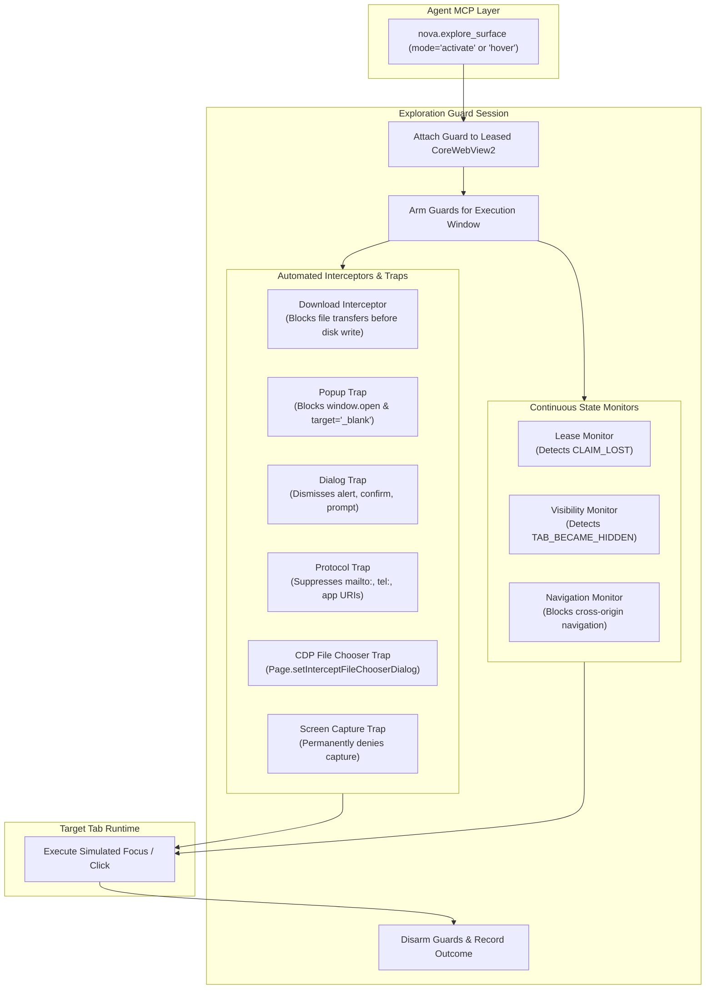
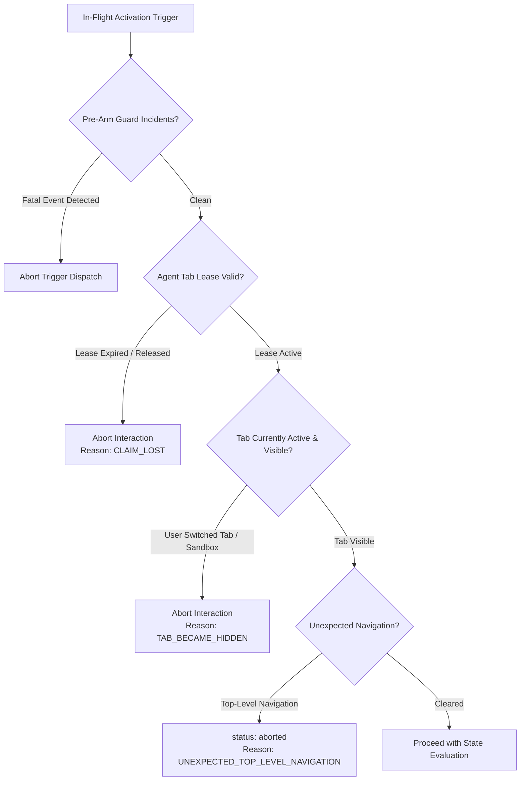

# Surface Explorer Guard Session, Invariants & Failure Modes

When an agent interacts with live web pages, synthetic pointer clicks and keyboard inputs can inadvertently trigger unwanted side effects: opening unconstrained popup tabs, triggering native file downloads, executing destructive form posts, launching external OS protocol handlers, or hanging the browser process with unhandled JavaScript dialogs.

Nova guarantees safe, deterministic in-page exploration by attaching an airtight, multi-layered guard session to the browser tab runtime during all surface interactions.



---

## 1. The Guard Session Lifecycle

A guard session is bound to an active tab leased by the calling agent:

1. **Attachment (`discover` mode):** When `nova.explore_surface(mode='discover')` is called, Nova binds an exploration guard to the target tab. Event listeners are wired to intercept downloads, new windows, permissions, script dialogs, and navigation.
2. **Arming (`activate` / `hover` modes):** Immediately before dispatching a synthetic pointer or keyboard event, the guard switches from observing to enforcing.
3. **Execution Window:** The simulated input is dispatched to the target DOM element. Any asynchronous side effects triggered by the page within the execution window encounter the armed traps.
4. **Disarming & Incident Recording:** Once the post-interaction settlement check completes, the guard is disarmed. Every intercepted event is reported in the tool result under `guardIncidents`.
5. **Teardown (`close` mode):** When exploration is complete, `nova.explore_surface(mode='close')` detaches all CDP interceptors, unhooks native event listeners, and flushes runtime caches.

---

## 2. The Seven Protective Invariants

During active exploration, Nova enforces seven strict invariants:

| # | Guard Invariant | Mechanism | Failure Action |
| :-: | :--- | :--- | :--- |
| **1** | **Download Trap** | Intercepts `DownloadStarting` events at the WebView2 engine layer. | Cancels the download before any bytes reach disk; the interaction ends with `status: "blocked"` and reason code `DOWNLOAD_BLOCKED`. |
| **2** | **Popup & New Window Trap** | Intercepts `NewWindowRequested` events (`window.open()`, `target="_blank"`). | Sets `Handled = true`; suppresses new window/tab creation entirely. |
| **3** | **External Protocol Suppression** | Intercepts `LaunchingExternalUriScheme` events (`mailto:`, `tel:`, custom URI protocols). | Cancels launcher execution, preventing external native applications from opening. |
| **4** | **Script Dialog Auto-Dismissal** | Intercepts `ScriptDialogOpening` events (`alert`, `confirm`, `prompt`, `beforeunload`). | Automatically dismisses the dialog with non-mutating defaults (e.g., Cancel / OK), preventing browser thread deadlocks. |
| **5** | **File Chooser Containment** | Attaches Chrome DevTools Protocol (CDP) handler `Page.setInterceptFileChooserDialog`. | Traps file upload prompts and cancels them with `Page.handleFileChooser(action='cancel')`. |
| **6** | **Screen Capture Suppression** | Intercepts `ScreenCaptureStarting` events. | Denies permission immediately, preventing scripts from requesting host desktop capture. |
| **7** | **Strict Network Mutation Guard** | Captures baseline traffic patterns and monitors outgoing HTTP requests during activation. | Immediately blocks on the **first non-GET/HEAD request** (`POST`, `PUT`, `DELETE`, `PATCH`), preventing accidental server state mutation. |

---

## 3. Lease & Visibility Failure Modes

Autonomous agents operate in a shared browser environment alongside human users. If an agent interacts with a tab while a user is actively typing or switching views, race conditions and unexpected state mutations can occur.

Nova continuously verifies tab ownership throughout exploration:



### 1. Tab Lease Revocation (`CLAIM_LOST`)
* Before every activation, Nova verifies that the calling agent holds an active tab claim (`tab_claim`).
* If the claim expired or was released while the interaction runs, Nova immediately raises `CLAIM_LOST`.
* Activation or teardown under a stale claim is prohibited, preventing orphaned agents from executing actions without authorization.

### 2. User Visibility Switching (`TAB_BECAME_HIDDEN`)
* If the user switches to a different tab or sandbox while a trigger activation is in flight, Nova immediately raises `TAB_BECAME_HIDDEN`.
* The action is aborted immediately. Nova never manipulates hidden or background tabs under an active surface exploration lease, preventing invisible clicks on user workspaces.

### 3. Pre-Arm Incident Preservation
* Fatal guard events (such as claim loss or user interference) raised while the guard attaches and prepares the activation are kept when the guard arms.
* Nova checks these incidents before dispatching the simulated focus, keyboard, or mouse trigger, ensuring that compromised runs abort cleanly before any DOM input is emitted.

### 4. Unexpected Navigation (`UNEXPECTED_TOP_LEVEL_NAVIGATION`)
* If a control that was not classified as navigation leaves the document, the interaction ends with `status: "aborted"` and reason code `UNEXPECTED_TOP_LEVEL_NAVIGATION` (or `UNEXPECTED_SAME_DOCUMENT_ROUTE_CHANGE` for an unplanned route change inside the page).
* Nova then closes the exploration run; start a new `discover` run on the page you want to explore.

---

## 4. Diagnostic Incident Reporting

When a guard intervenes, the interaction result carries `status: "blocked"`, the reason codes and the `guardIncidents` list:

```json
{
  "status": "blocked",
  "reasonCodes": ["FILE_CHOOSER_BLOCKED"],
  "guardIncidents": [
    {
      "guard": "fileChooserGuard",
      "state": "enforce",
      "action": "blocked",
      "reasonCode": "FILE_CHOOSER_BLOCKED",
      "observed": "..."
    }
  ]
}
```

The possible `status` values are `activated`, `no_delta`, `blocked`, `failed` and `aborted`.

---

## 5. Related Documentation

* [Surface Explorer Architecture Overview](../README.md)
* [Trigger Classification, State Loss & Graph Modeling](../trigger-classification-and-transitions/README.md)
* [Agent Awareness Gates (AAG)](../../../agent-awareness-gates-aag/README.md)
* [Surface Explorer MCP Tool Specification](../../../../mcp-reference/tools/crawler-and-discovery/nova-explore-surface.md)
