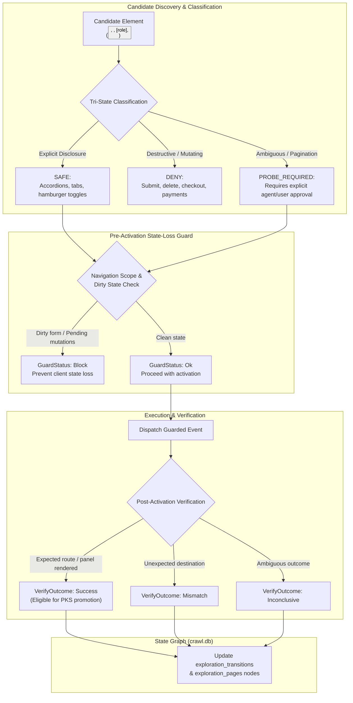
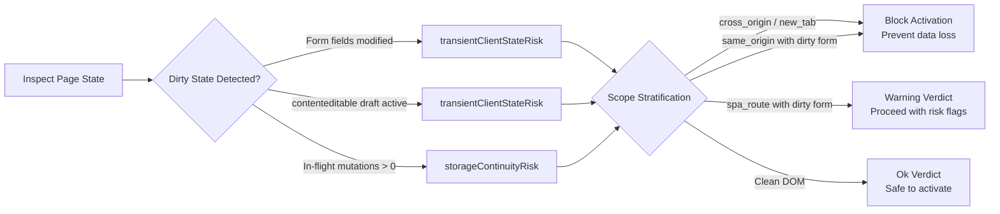
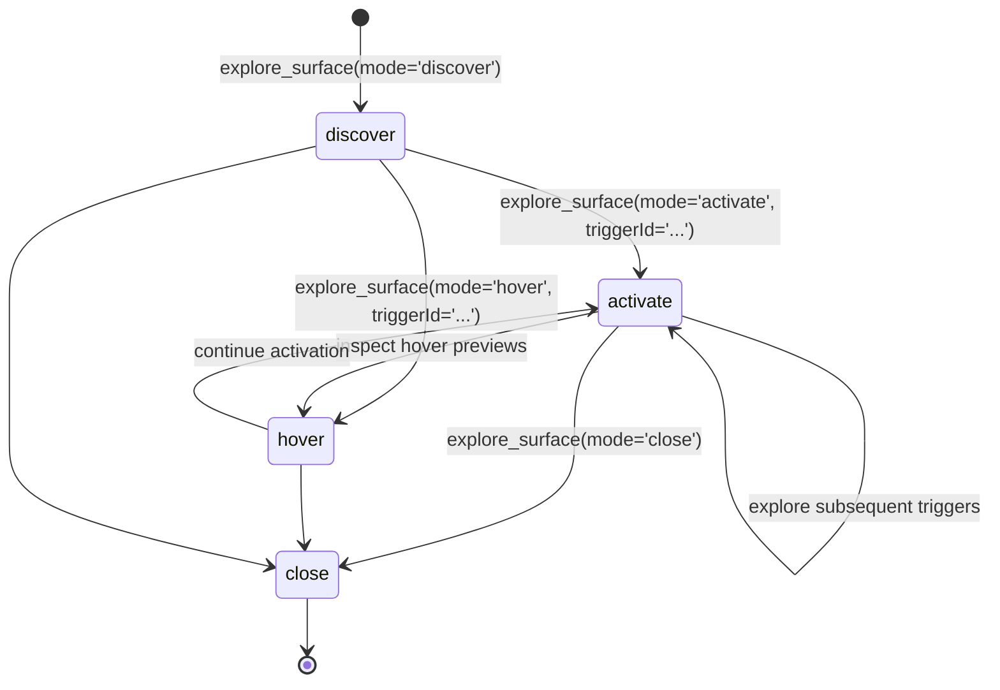
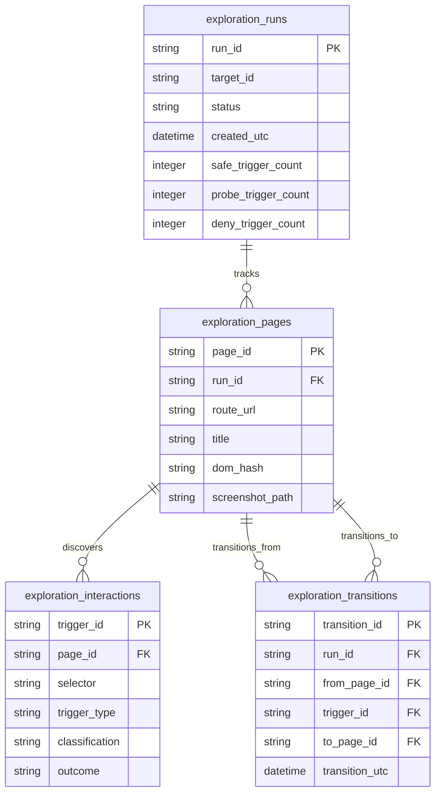

# Surface Explorer Trigger Classification, State Loss & Graph Modeling

Single-Page Applications and dynamic web portals frequently hide core interface surfaces behind interactive controls. However, blindly clicking on interactive DOM elements introduces significant risks: an agent might unintentionally submit a live form, delete a user record, trigger a payment transaction, or discard in-progress draft content.

Nova addresses this through an automated **Tri-State Trigger Classification Engine**, a **Pre-Activation State-Loss Guard**, a **Post-Activation Verification Engine**, and persistent **State Graph Modeling** in SQLite (`crawl.db`).

---

## 1. Tri-State Trigger Classification Engine

When scanning an active document in `discover` mode, Nova evaluates interactive controls across three strict tiers:

| Classification | Definition & Criteria | Examples | Execution Policy |
| :--- | :--- | :--- | :--- |
| **`SAFE`** | Explicit disclosure controls that toggle visibility without server-side mutations or navigation. | `

`, elements with `aria-expanded="false"`, `role="tab"`, menu toggle buttons. | Eligible for automated activation under standard exploration policies. |
| **`PROBE_REQUIRED`** | Controls that appear to be read-only expansion or navigation, but lack explicit ARIA disclosure markers. | "Load more comments" buttons, pagination controls ("Page 2", "Next"), clickable preview cards. | Requires explicit agent opt-in or human confirmation; cannot be triggered silently. |
| **`DENY`** | Elements that submit forms, initiate state-mutating actions, handle authentication, or navigate off-site. | `<button type="submit">`, "Delete", "Confirm Purchase", payment buttons, external links. | **Strictly blocked.** The engine refuses to activate these elements under any circumstance. |

---

## 2. Pre-Activation State-Loss Guard

Before activating an interactive control that might navigate or reload parts of the page, Nova evaluates whether the action would destroy uncommitted client state:

### Scope Stratification
Nova stratifies risk based on navigation scope:
1. **`cross_origin` (Strict):** If the trigger points to a different origin, full document loss is guaranteed. Any dirty form or pending mutation causes an immediate `Block` verdict.
2. **`new_tab`:** Opening a separate context risks splitting user attention and session flow. Evaluated with high strictness.
3. **`same_origin`:** Potential full document reload. Blocks if uncommitted form input is present; issues a `Warning` if mutations are pending.
4. **`spa_route` (Lax):** Client-side view swaps within a single application framework. Emits a `Warning` when dirty forms exist, allowing the agent to decide whether to proceed.

---

## 3. Post-Activation Verification Engine

A click dispatch is not assumed to have succeeded simply because no JavaScript error was thrown. Nova verifies the outcome against expected state transitions:

$$\text{Post-Activation Outcome} \in \{\text{Success}, \text{Mismatch}, \text{Inconclusive}\}$$

* **`Success`:** The expected destination URL, panel element, or view state was reached. This verified evidence is a prerequisite before a discovered pattern can be promoted into the Phenomenological Knowledge Store (PKS).
* **`Mismatch`:** The trigger navigated to a different origin or unexpected path (e.g., clicking a link expected to open a help popup instead redirected to an external vendor login).
* **`Inconclusive`:** Insufficient evidence to prove navigation (e.g., an in-page modal opened without altering the browser URL or document title).

---

## 4. The Four Operational Modes

Surface Explorer provides four decoupled lifecycle modes via [`nova.explore_surface`](../../../../mcp-reference/tools/crawler-and-discovery/nova-explore-surface.md):

1. **`discover` (Non-Mutating Inventory):**
   * Catalogs all candidate triggers on the current document without dispatching clicks.
   * Classifies controls into `SAFE`, `PROBE_REQUIRED`, and `DENY`.
   * Optionally persists the run into `crawl.db` when `persistRun: true`.
2. **`activate` (Guarded Execution):**
   * Arms the exploration guard session, executes the pre-activation state-loss check, and dispatches the interaction.
   * Compares pre- and post-interaction DOM trees to capture mutations and visual deltas.
3. **`hover` (Visual Peeks):**
   * Positions the virtual pointer over hover-dependent UI elements (tooltips, flyout previews) without clicking.
   * Evaluates whether new content became visible and records visual evidence.
4. **`close` (Idempotent Teardown):**
   * Disarms the guard session, unhooks CDP listeners, flushes temporary caches, and finalizes run metrics in SQLite.

---

## 5. State Graph Persistence in SQLite (`crawl.db`)

Surface exploration models an application's dynamic interface as a directed state graph stored within `crawl.db`:

* **Nodes (`exploration_pages`):** Represent distinct visual or DOM states of the application. Expanding an accordion or opening a drawer generates a new state node.
* **Edges (`exploration_transitions`):** Directed connections documenting that trigger $T$ caused the interface to move from State $S_A$ to State $S_B$.
* **UI Visualization:** The resulting graph is rendered natively in Nova's **Website Discovery Explorer View**, displaying state topologies, trigger catalogs, and side-by-side screenshot comparisons.

---

## 6. Related Documentation

* [Surface Explorer Architecture Overview](../README.md)
* [Guard Session, Invariants & Failure Modes](../guard-session-and-invariants/README.md)
* [Phenomenological Knowledge Store (PKS)](../../../learning/phenomenological-knowledge-store-pks/README.md)
* [Surface Explorer Tool Specification](../../../../mcp-reference/tools/crawler-and-discovery/nova-explore-surface.md)
