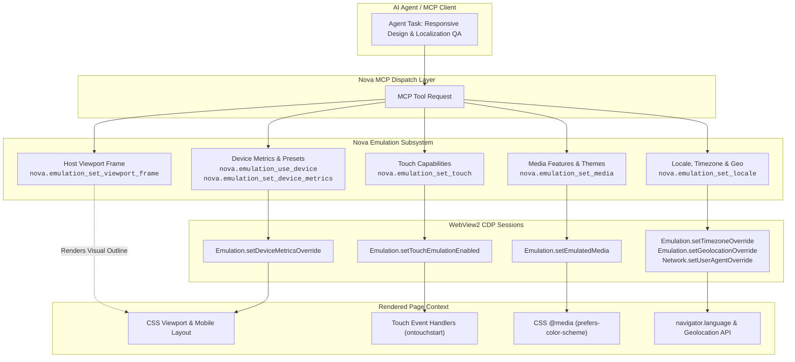
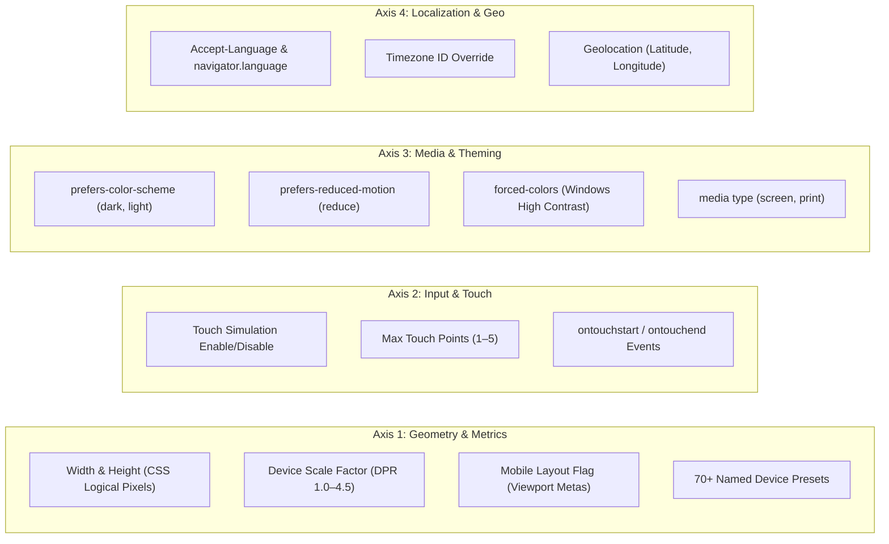

# Device Emulation & Responsive Testing

> **Mobile viewport simulation, 70+ Playwright-compatible device presets, touch emulation, CSS media features, and localized geo/timezone overrides.**

---

## 1. Overview & Architectural Vision

Modern responsive web applications must function seamlessly across diverse hardware form factors: high-DPI smartphones, foldables, tablets, and ultra-wide desktop monitors. Furthermore, applications adapt dynamically to user preferences: dark mode, reduced motion, high-contrast themes, local languages, and geographic locations.

Automating responsive and visual quality testing within autonomous agents requires more than resizing the desktop window:
* Resizing a desktop window does not trigger mobile viewport meta tags (`<meta name="viewport" content="width=device-width">`).
* Desktop browsers do not emit touch events (`touchstart`, `touchend`), meaning mobile gestures and drawer navigations cannot be tested.
* Testing dark mode or high-contrast styles traditionally required changing the entire operating system's theme.
* Testing localized content (such as Right-to-Left Arabic/Hebrew layouts or geo-fenced payment methods) required configuring external VPNs and operating system locales.

Nova AI Workspace provides an **in-engine Device Emulation Subsystem**. Built directly atop Microsoft WebView2 and the Chrome DevTools Protocol (CDP), Nova exposes fine-grained control over layout metrics, touch simulation, CSS media features, user agent strings, and localization without altering the host OS or restarting the browser process.

---

## 2. The Four Emulation Axes

### 1. Viewport Geometry & Device Presets
* **`nova.emulation_use_device`:** Applies complete device profiles (viewport, DPR, mobile layout, touch points, and user-agent string) in a single atomic call using Playwright-standard device names (`"iPhone 15"`, `"Pixel 8"`, `"iPad Pro 11"`, `"Desktop Chrome"`).
* **`nova.emulation_set_device_metrics`:** Configures custom responsive dimensions, custom DPR (1.0 to 8.0), and mobile layout behavior.
* **`nova.emulation_clear_device_metrics`:** Restores standard window-sized rendering.

### 2. Touch Simulation
* **`nova.emulation_set_touch`:** Injects synthetic touch capabilities into the page. When enabled, Chromium emits standard W3C Touch Events (`touchstart`, `touchmove`, `touchend`) alongside mouse events, enabling testing of mobile swipe gestures and touch menus.

### 3. Media Features & Theme Emulation
* **`nova.emulation_set_media`:** Controls CSS `@media` queries without changing operating system settings:
  - `prefers-color-scheme`: Verify dark mode vs. light mode color palettes and contrast.
  - `prefers-reduced-motion`: Verify that vestibular motion triggers (parallax, autoplay animations) are suppressed.
  - `forced-colors`: Audit high-contrast mode compliance.
  - `media: "print"`: Inspect print stylesheets and PDF rendering output.
* **Additive State Merge:** Unlike raw CDP calls (which overwrite all media features), Nova merges newly specified features over active ones, preserving multi-feature testing states.
* **`nova.emulation_clear_media`:** Resets all media features to the host environment defaults.

### 4. Localization, Timezone & Geolocation
* **`nova.emulation_set_locale`:** Simulates international browsing contexts across three independent levers:
  - Language: Sets `Accept-Language` headers and `navigator.language` to test localized strings and RTL layouts.
  - Timezone: Sets `timezoneId` (e.g. `"Europe/Berlin"`, `"America/New_York"`) to test date formatting and scheduling widgets.
  - Geolocation: Injects simulated GPS coordinates (`latitude`, `longitude`, `accuracy`) for map navigation and store locators.
* **`nova.emulation_clear_locale`:** Restores original host language and system coordinates.

---

## 3. Dedicated Architectural Guides

| Guide | Description | Primary MCP Tools |
| :--- | :--- | :--- |
| **[Device Presets, Metrics & Touch](device-presets-and-metrics/README.md)** | Over 70+ built-in presets (iPhone, Pixel, Galaxy, Tablets, Desktops), logical CSS pixels vs. physical DPR, mobile layout flag, touch event simulation, and host viewport frame rendering. | [`nova.emulation_use_device`](../../mcp-reference/tools/device-emulation/nova-emulation-use-device.md), [`nova.emulation_set_device_metrics`](../../mcp-reference/tools/device-emulation/nova-emulation-set-device-metrics.md), [`nova.emulation_clear_device_metrics`](../../mcp-reference/tools/device-emulation/nova-emulation-clear-device-metrics.md), [`nova.emulation_set_touch`](../../mcp-reference/tools/device-emulation/nova-emulation-set-touch.md), [`nova.emulation_set_viewport_frame`](../../mcp-reference/tools/device-emulation/nova-emulation-set-viewport-frame.md) |
| **[Media Features, Dark Mode & Themes](media-features-and-themes/README.md)** | CSS `@media` emulation, additive feature merging, dark/light theme switching, reduced motion, forced colors, and print media verification. | [`nova.emulation_set_media`](../../mcp-reference/tools/device-emulation/nova-emulation-set-media.md), [`nova.emulation_clear_media`](../../mcp-reference/tools/device-emulation/nova-emulation-clear-media.md) |
| **[Locale, Timezone & Geolocation](locale-timezone-and-geolocation/README.md)** | Localization testing, RTL layout simulation, dual-lever Accept-Language implementation, timezone overrides, geolocation coordinates, and ICU process boundaries. | [`nova.emulation_set_locale`](../../mcp-reference/tools/device-emulation/nova-emulation-set-locale.md), [`nova.emulation_clear_locale`](../../mcp-reference/tools/device-emulation/nova-emulation-clear-locale.md) |

---

## 4. MCP Tool Inventory (Device Emulation)

The subsystem provides 10 dedicated MCP tools:

| Tool | Category | Capability Bundle | Primary Role |
| :--- | :--- | :--- | :--- |
| **[`nova.emulation_use_device`](../../mcp-reference/tools/device-emulation/nova-emulation-use-device.md)** | `safe` | `device_emulation` | Applies a named device preset (viewport, DPR, touch, user agent) in a single atomic call. |
| **[`nova.emulation_set_device_metrics`](../../mcp-reference/tools/device-emulation/nova-emulation-set-device-metrics.md)** | `safe` | `device_emulation` | Overrides viewport dimensions (`width`, `height`), device scale factor (DPR), and mobile layout behavior. |
| **[`nova.emulation_clear_device_metrics`](../../mcp-reference/tools/device-emulation/nova-emulation-clear-device-metrics.md)** | `safe` | `device_emulation` | Clears viewport metrics overrides, restoring normal window-sized rendering. |
| **[`nova.emulation_set_touch`](../../mcp-reference/tools/device-emulation/nova-emulation-set-touch.md)** | `safe` | `device_emulation` | Enables or disables touch event simulation and configures max touch points. |
| **[`nova.emulation_set_media`](../../mcp-reference/tools/device-emulation/nova-emulation-set-media.md)** | `safe` | `device_emulation` | Overrides CSS media features: dark/light scheme, reduced motion, forced colors, and media type. |
| **[`nova.emulation_clear_media`](../../mcp-reference/tools/device-emulation/nova-emulation-clear-media.md)** | `safe` | `device_emulation` | Clears all emulated CSS media features, reverting to host system settings. |
| **[`nova.emulation_set_locale`](../../mcp-reference/tools/device-emulation/nova-emulation-set-locale.md)** | `safe` | `device_emulation` | Emulates browser locale (`Accept-Language`), timezone ID, and GPS coordinates. |
| **[`nova.emulation_clear_locale`](../../mcp-reference/tools/device-emulation/nova-emulation-clear-locale.md)** | `safe` | `device_emulation` | Clears all locale, timezone, and geolocation overrides. |
| **[`nova.emulation_set_user_agent`](../../mcp-reference/tools/device-emulation/nova-emulation-set-user-agent.md)** | `safe` | `device_emulation` | Explicitly overrides the HTTP User-Agent header, `navigator.userAgent`, and platform. |
| **[`nova.emulation_set_viewport_frame`](../../mcp-reference/tools/device-emulation/nova-emulation-set-viewport-frame.md)** | `safe` | `device_emulation` | Configures the visual outline rendered around an emulated device viewport in the host UI. |

---

## 5. Architectural Invariants & Guarantees

1. **Independent CDP Override Axes:**
   In Chrome DevTools Protocol, device metrics, touch capabilities, user-agent overrides, and emulated media are distinct sub-domains. Calling `nova.emulation_clear_device_metrics` clears viewport dimensions, but intentionally leaves an active touch simulation or custom user-agent intact. Each axis has its own dedicated clear tool.
2. **Visual Viewport Frame Outline:**
   When an emulated viewport is smaller than the browser window, Nova centers the emulated page within the tab canvas and draws an accent outline (`nova.emulation_set_viewport_frame`). This ensures that full-window screenshots clearly distinguish emulated device bounds from dead margins.
3. **Additive Media Merging:**
   `nova.emulation_set_media` preserves previously emulated features unless explicitly overridden or cleared via `nova.emulation_clear_media`. Setting `colorScheme: "dark"` and subsequently `reducedMotion: "reduce"` results in both features being active simultaneously.
4. **DevTools Panel Conflict Warning:**
   If a user opens the Chromium F12 DevTools panel on a tab where Nova is applying emulation, DevTools may fight over viewport overrides. Nova detects this condition (`isDevToolsOpenForTarget`) and appends an explicit advisory note to the tool response.
5. **Localization Dual-Lever Delivery:**
   Because Chromium's `Emulation.setLocaleOverride` is ignored for `navigator.language` in WebView2, Nova simultaneously sets the `Accept-Language` header on `Network.setUserAgentOverride`. This ensures that both server-side content negotiation and client-side JavaScript property reads reflect the emulated language.

---

## 6. Related Documentation

* [MCP Tool Group Reference: Device Emulation](../../mcp-reference/tools/device-emulation/README.md)
* [Layout Quality, Automated Accessibility & Core Web Vitals](../layout-and-web-vitals/README.md)
* [Visual Evidence & Responsive Screenshots](../../mcp-reference/tools/visual-evidence/nova-responsive-screenshots.md)
* [Fingerprint Protection & Privacy](../privacy/README.md)
* [Master MCP Tool Catalog](../../mcp-reference/tool-catalog.md)
