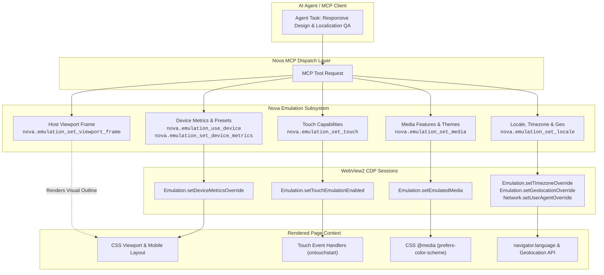
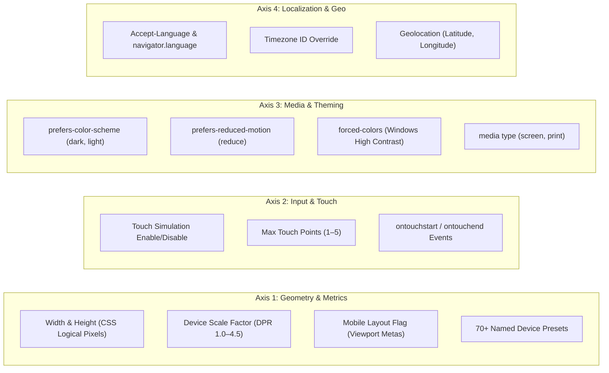

# Device Emulation & Responsive Testing

> **Mobile viewport simulation, 70+ Playwright-compatible device presets, touch emulation, CSS media features, and localized geo/timezone overrides.**

---

## 1. Overview & Architectural Vision

Modern responsive web applications must function seamlessly across diverse hardware form factors: high-DPI smartphones, foldables, tablets, and ultra-wide desktop monitors. Furthermore, applications adapt dynamically to user preferences: dark mode, reduced motion, high-contrast themes, local languages, and geographic locations.

Automating responsive and visual quality testing within autonomous agents requires more than resizing the desktop window:
* Resizing a desktop window does not trigger mobile viewport meta tags (`<meta name="viewport" content="width=device-width">`).
* Desktop browsers do not emit touch events (`touchstart`, `touchend`), meaning mobile gestures and drawer navigations cannot be tested.
* Testing dark mode or high-contrast styles traditionally required changing the entire operating system's theme.
* Testing localized content (such as Right-to-Left Arabic/Hebrew layouts or geo-fenced payment methods) required configuring external VPNs and operating system locales.

Nova AI Workspace provides an **in-engine Device Emulation Subsystem**. Built directly atop Microsoft WebView2 and the Chrome DevTools Protocol (CDP), Nova exposes fine-grained control over layout metrics, touch simulation, CSS media features, user agent strings, and localization without altering the host OS or restarting the browser process.



---

## 2. The Four Emulation Axes



---

## 3. Comprehensive Documentation Index

The Device Emulation architecture is organized into three primary domains and six specialized deep-dive architecture subguides:

```
device-emulation/
├── README.md                                                       # Master Architectural Hub
├── device-presets-and-metrics/                                     # Domain 1: Device Presets, Viewport Metrics & Touch
│   ├── README.md                                                   # Domain Hub
│   ├── preset-catalog-and-viewport-metrics/
│   │   └── README.md                                               # 70+ presets, DPR scaling, mobile layout, viewport framing
│   └── touch-simulation-and-gestures/
│       └── README.md                                               # Touch event pipeline, touch cursor overlay, OOPIF mirroring
├── locale-timezone-and-geolocation/                                # Domain 2: Locale, Timezone & Geolocation
│   ├── README.md                                                   # Domain Hub
│   ├── language-and-rtl-simulation/
│   │   └── README.md                                               # Dual-lever locale mechanism, ICU boundary, RTL layout audits
│   └── timezone-and-geolocation-overrides/
│       └── README.md                                               # IANA timezones, Date offsets, HTML5 GPS coordinate spoofing
└── media-features-and-themes/                                      # Domain 3: CSS Media Features, Dark Mode & Themes
    ├── README.md                                                   # Domain Hub
    ├── color-schemes-and-accessibility/
    │   └── README.md                                               # Additive state merge, dark mode contrast, reduced motion
    └── print-media-and-pdf-synthesis/
        └── README.md                                               # Screen vs. print media, @media print preview, save_pdf
```

### Complete Guide Reference Table

| Domain Area | Specialized Architecture Guide | Key Focus Areas & Technical Invariants |
| :--- | :--- | :--- |
| **Device Presets & Metrics**<br>([Domain Hub](device-presets-and-metrics/README.md)) | **[Preset Catalog & Viewport Metrics](device-presets-and-metrics/preset-catalog-and-viewport-metrics/README.md)** | Over 70+ Playwright-compatible presets (iPhones, Pixels, Galaxy, Tablets, 4K Desktops), tolerant canonical matching, logical CSS pixels vs. physical DPR, mobile layout flag, Chromium engine identity invariants (`engineIdentityMismatch`), and host viewport framing outlines. |
| | **[Touch Simulation & Gestures](device-presets-and-metrics/touch-simulation-and-gestures/README.md)** | Synthetic touch capabilities (`Emulation.setTouchEmulationEnabled`), W3C touch event pipeline (`touchstart`, `touchend`), feature detection (`'ontouchstart' in window`), visual touch cursor overlays (`EmulationTouchCursor`), mouse-as-touch translation, and OOPIF touch mirroring. |
| **Locale, Timezone & Geo**<br>([Domain Hub](locale-timezone-and-geolocation/README.md)) | **[Language, Locale & RTL Simulation](locale-timezone-and-geolocation/language-and-rtl-simulation/README.md)** | Content negotiation vs. client-side DOM localization, the dual-lever locale mechanism (`Network.setUserAgentOverride` + `Emulation.setLocaleOverride`), the ICU process boundary, Right-to-Left (RTL) layout verification, and logical property audits. |
| | **[Timezone & Geolocation Overrides](locale-timezone-and-geolocation/timezone-and-geolocation-overrides/README.md)** | IANA Timezone ID overrides, JavaScript `Intl` and `Date.getTimezoneOffset` behavior, HTML5 Geolocation API spoofing (`latitude`, `longitude`, `accuracy`), coordinate pair invariants, and regional testing recipes. |
| **Media Features & Themes**<br>([Domain Hub](media-features-and-themes/README.md)) | **[Color Schemes & Accessibility](media-features-and-themes/color-schemes-and-accessibility/README.md)** | CSS Media Queries Level 5, the additive state merge contract, dark mode contrast auditing (WCAG 2.2 AA $4.5:1$), vestibular motion safety (`prefers-reduced-motion: reduce`), and Windows High Contrast Mode (`forced-colors: active`). |
| | **[Print Media & PDF Synthesis](media-features-and-themes/print-media-and-pdf-synthesis/README.md)** | Screen vs. print media layout models, live DOM `@media print` transformation, header/footer suppression, print layout overflow detection, high-fidelity vector PDF generation (`nova.save_pdf`), and screen mode restoration. |

---

## 4. MCP Tool Inventory (Device Emulation)

The subsystem provides 10 dedicated MCP tools:

| Tool | Category | Capability Bundle | Primary Role |
| :--- | :--- | :--- | :--- |
| **[`nova.emulation_use_device`](../../mcp-reference/tools/device-emulation/nova-emulation-use-device.md)** | `safe` | `device_emulation` | Applies a named device preset (viewport, DPR, touch, user agent) in a single atomic call. |
| **[`nova.emulation_set_device_metrics`](../../mcp-reference/tools/device-emulation/nova-emulation-set-device-metrics.md)** | `safe` | `device_emulation` | Overrides viewport dimensions (`width`, `height`), device scale factor (DPR), and mobile layout behavior. |
| **[`nova.emulation_clear_device_metrics`](../../mcp-reference/tools/device-emulation/nova-emulation-clear-device-metrics.md)** | `safe` | `device_emulation` | Clears viewport metrics overrides, restoring normal window-sized rendering. |
| **[`nova.emulation_set_touch`](../../mcp-reference/tools/device-emulation/nova-emulation-set-touch.md)** | `safe` | `device_emulation` | Enables or disables touch event simulation and configures max touch points. |
| **[`nova.emulation_set_media`](../../mcp-reference/tools/device-emulation/nova-emulation-set-media.md)** | `safe` | `device_emulation` | Overrides CSS media features: dark/light scheme, reduced motion, forced colors, and media type. |
| **[`nova.emulation_clear_media`](../../mcp-reference/tools/device-emulation/nova-emulation-clear-media.md)** | `safe` | `device_emulation` | Clears all emulated CSS media features, reverting to host system settings. |
| **[`nova.emulation_set_locale`](../../mcp-reference/tools/device-emulation/nova-emulation-set-locale.md)** | `safe` | `device_emulation` | Emulates browser locale (`Accept-Language`), timezone ID, and GPS coordinates. |
| **[`nova.emulation_clear_locale`](../../mcp-reference/tools/device-emulation/nova-emulation-clear-locale.md)** | `safe` | `device_emulation` | Clears all locale, timezone, and geolocation overrides. |
| **[`nova.emulation_set_user_agent`](../../mcp-reference/tools/device-emulation/nova-emulation-set-user-agent.md)** | `safe` | `device_emulation` | Explicitly overrides the HTTP User-Agent header, `navigator.userAgent`, and platform. |
| **[`nova.emulation_set_viewport_frame`](../../mcp-reference/tools/device-emulation/nova-emulation-set-viewport-frame.md)** | `safe` | `device_emulation` | Configures the visual outline rendered around an emulated device viewport in the host UI. |

---

## 5. Architectural Invariants & Guarantees

1. **Independent CDP Override Axes:**
   In Chrome DevTools Protocol, device metrics, touch capabilities, user-agent overrides, and emulated media are distinct sub-domains. Calling `nova.emulation_clear_device_metrics` clears viewport dimensions, but intentionally leaves an active touch simulation or custom user-agent intact. Each axis has its own dedicated clear tool.
2. **Visual Viewport Frame Outline:**
   When an emulated viewport is smaller than the browser window, Nova centers the emulated page within the tab canvas and draws an accent outline (`nova.emulation_set_viewport_frame`). This ensures that full-window screenshots clearly distinguish emulated device bounds from dead margins.
3. **Additive Media Merging:**
   `nova.emulation_set_media` preserves previously emulated features unless explicitly overridden or cleared via `nova.emulation_clear_media`. Setting `colorScheme: "dark"` and subsequently `reducedMotion: "reduce"` results in both features being active simultaneously.
4. **DevTools Panel Conflict Warning:**
   If a user opens the Chromium F12 DevTools panel on a tab where Nova is applying emulation, DevTools may fight over viewport overrides. Nova detects this condition (`isDevToolsOpenForTarget`) and appends an explicit advisory note to the tool response.
5. **Localization Dual-Lever Delivery:**
   Because Chromium's `Emulation.setLocaleOverride` is ignored for `navigator.language` in WebView2, Nova simultaneously sets the `Accept-Language` header on `Network.setUserAgentOverride`. This ensures that both server-side content negotiation and client-side JavaScript property reads reflect the emulated language.

---

## 6. Related Documentation

* [MCP Tool Group Reference: Device Emulation](../../mcp-reference/tools/device-emulation/README.md)
* [Layout Quality, Automated Accessibility & Core Web Vitals](../layout-and-web-vitals/README.md)
* [Visual Evidence & Responsive Screenshots](../../mcp-reference/tools/visual-evidence/nova-responsive-screenshots.md)
* [Fingerprint Protection & Privacy](../privacy/README.md)
* [Master MCP Tool Catalog](../../mcp-reference/tool-catalog.md)
