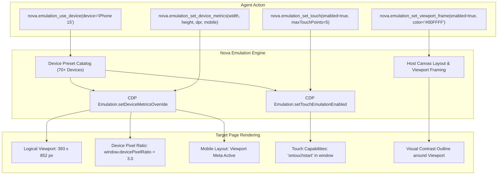

# Device Presets, Viewport Metrics & Touch Simulation

> [!NOTE]
> Testing modern responsive web applications requires evaluating layouts under authentic mobile hardware constraints: mobile viewport meta tags, high Device Pixel Ratios (DPR $\ge 2.0$), and W3C Touch Event listeners. Nova AI Workspace provides an in-engine hardware simulation suite powered by over **70+ Playwright-compatible device presets**, fine-grained viewport metrics, synthetic touch simulation, and host viewport framing.

---

## 1. Executive Summary & Core Mission

Standard desktop browser window resizing fails to accurately test mobile web applications because desktop engines do not enforce viewport meta tags, ignore high-DPI `@2x`/`@3x` media assets, and omit mobile touch gestures.

Nova's Device Presets & Metrics subsystem provides:
1. **Curated Preset Catalog:** Over 70+ built-in presets (iPhone 8–16, Google Pixel, Samsung Galaxy, Foldables, Tablets, and 4K Desktops) applied in a single atomic call via [`nova.emulation_use_device`](../../../mcp-reference/tools/device-emulation/nova-emulation-use-device.md).
2. **Granular Metrics Overrides:** Explicit control over logical CSS viewport dimensions, device scale factors (DPR 1.0 to 8.0), and mobile layout processing via [`nova.emulation_set_device_metrics`](../../../mcp-reference/tools/device-emulation/nova-emulation-set-device-metrics.md).
3. **Synthetic Touch Capabilities:** Full W3C Touch Event dispatching (`touchstart`, `touchmove`, `touchend`), touch cursor overlays, and OOPIF event mirroring via [`nova.emulation_set_touch`](../../../mcp-reference/tools/device-emulation/nova-emulation-set-touch.md).
4. **Host Viewport Framing:** Visual contrast outlines rendered on the host WinUI 3 canvas via [`nova.emulation_set_viewport_frame`](../../../mcp-reference/tools/device-emulation/nova-emulation-set-viewport-frame.md) to clearly delineate device boundaries in automated screenshots.

---

## 2. Comprehensive Documentation Index

The Device Presets, Viewport Metrics & Touch subsystem is detailed across specialized subguides:

| Architecture Guide | Focus Areas & Technical Invariants | Primary Components |
| :--- | :--- | :--- |
| **[Preset Catalog & Viewport Metrics](preset-catalog-and-viewport-metrics/README.md)** | Over 70+ Playwright-compatible presets (iPhones, Pixels, Galaxy, Tablets, 4K Desktops), tolerant canonical matching, logical CSS pixels vs. physical DPR, mobile layout flag, Chromium engine identity invariants (`engineIdentityMismatch`), and host viewport framing outlines. | `nova.emulation_use_device` `nova.emulation_set_device_metrics` `nova.emulation_clear_device_metrics` `nova.emulation_set_viewport_frame` `DevicePresetCatalog` |
| **[Touch Simulation & Gestures](touch-simulation-and-gestures/README.md)** | Synthetic touch capabilities (`Emulation.setTouchEmulationEnabled`), W3C touch event pipeline (`touchstart`, `touchend`), feature detection (`'ontouchstart' in window`), visual touch cursor overlays (`EmulationTouchCursor`), mouse-as-touch translation, and OOPIF touch mirroring. | `nova.emulation_set_touch` `EmulationTouchCursor` `MouseAsTouch` `OopifEmulationMirror` `navigator.maxTouchPoints` |

---

## 3. High-Level Emulation Pipeline

---

## 4. Key Architectural Invariants

* **Independent CDP Override Axes:** Viewport metrics, touch capabilities, user-agent overrides, and emulated media operate in independent CDP domains. Clearing device metrics does not disable active touch simulation.
* **Engine Identity Consistency:** Nova runs on Microsoft Edge (WebView2). Android presets deliver consistent Edge for Android identities. Emulating iOS Safari or Firefox updates the `User-Agent` string for layout verification, but flags `engineIdentityMismatch: true` for bot-protection awareness.
* **Zero DOM Viewport Framing:** Viewport frames are rendered natively on the host WinUI 3 XAML canvas. They do not inject DOM nodes or modify web stylesheets.
* **OOPIF Touch Mirroring:** Touch emulation attaches to Out-of-Process Iframes (OOPIF) dynamically, ensuring embedded maps and payment widgets respond to touch gestures.

---

## Related Documentation

* [Preset Catalog & Viewport Metrics Subguide](preset-catalog-and-viewport-metrics/README.md)
* [Touch Simulation & Gestures Subguide](touch-simulation-and-gestures/README.md)
* [Parent: Device Emulation Architecture Overview](../README.md)
* [CSS Media Features, Dark Mode & Themes](../media-features-and-themes/README.md)
* [Locale, Timezone & Geolocation](../locale-timezone-and-geolocation/README.md)
* [Tool Catalog: Device Emulation](../../../mcp-reference/tools/device-emulation/README.md)
