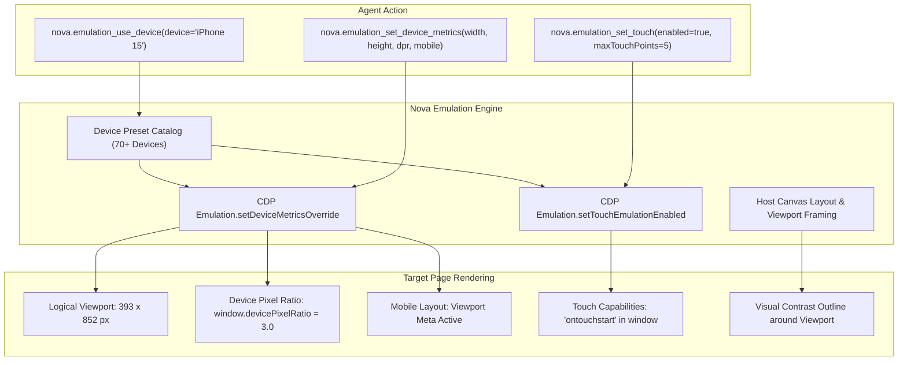
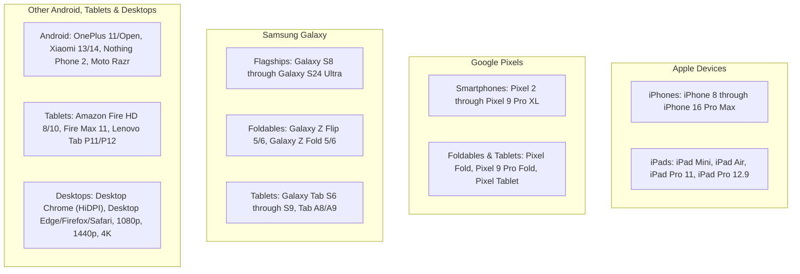
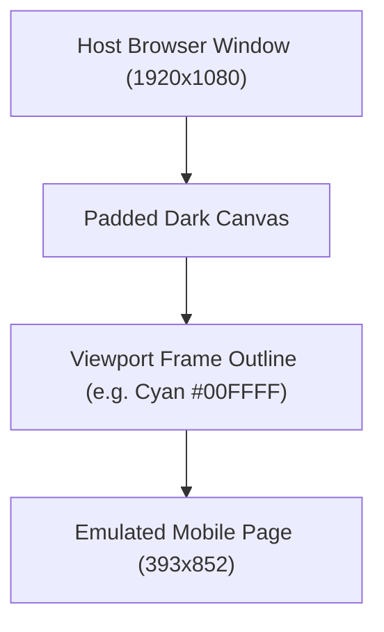
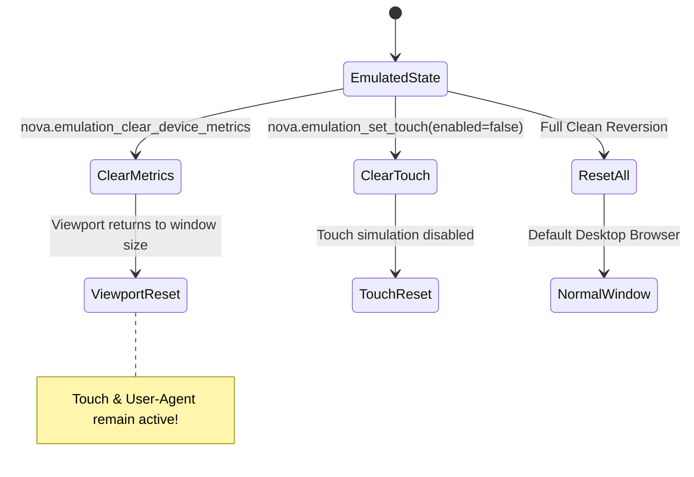

# Device Presets, Viewport Metrics & Touch Simulation

> **Over 70+ Playwright-compatible device presets, logical CSS viewport dimensions vs. DPR scaling, mobile layout emulation, touch event injection, and host viewport framing.**

---

## 1. Overview & Motivation

Testing responsive web design requires evaluating applications under realistic screen constraints:
* **The Resolution Trap:** A 4K desktop monitor rendered at $3840 \times 2160$ pixels cannot accurately represent how an iPhone renders a $393 \times 852$ layout.
* **The DPR Difference:** Modern mobile screens feature high Device Pixel Ratios (DPR $\ge 2.0$ or $3.0$). High-DPI screens render sharper SVG vectors and load high-resolution `@2x`/`@3x` media assets via `srcset`.
* **The Viewport Meta Tag:** Desktop browsers ignore `<meta name="viewport" content="width=device-width">`. Without explicit mobile layout emulation, mobile pages render zoomed out as tiny desktop replicas.
* **Touch Event APIs:** JavaScript navigation menus and carousel components frequently listen for W3C Touch Events (`touchstart`, `touchend`). A desktop mouse click will not activate touch-only gesture listeners.

Nova provides **`nova.emulation_use_device`**, **`nova.emulation_set_device_metrics`**, and **`nova.emulation_set_touch`** to provide instant, deterministic hardware emulation directly within the WebView2 renderer.



---

## 2. The Built-in Device Preset Catalog

Nova provides over **70+ curated device presets** modeled after official Playwright device descriptors. Calling `nova.emulation_use_device(device="iPhone 15")` atomically applies:
1. Viewport `width` and `height` in logical CSS pixels.
2. `deviceScaleFactor` (DPR).
3. `mobile` layout flag.
4. `hasTouch` capabilities.
5. Matching mobile or tablet `UserAgent` and `Platform` strings.

> [!TIP]
> **Tolerant Identifier Matching:** Presets are case-insensitive and ignore dashes or extra spaces. `"iPhone 15"`, `"iphone-15"`, and `"IPHONE 15"` all resolve to the same canonical preset.

### Curated Device Overview



| Category | Representative Devices | Viewport (CSS px) | DPR | Mobile | Touch |
| :--- | :--- | :---: | :---: | :---: | :---: |
| **iPhones** | `iPhone SE` / `iPhone 8` | $375 \times 667$ | 2.0 | Yes | Yes |
| | `iPhone 13 Mini` / `iPhone 12 Mini` | $375 \times 812$ | 3.0 | Yes | Yes |
| | `iPhone 13` / `iPhone 14` / `iPhone 12` | $390 \times 844$ | 3.0 | Yes | Yes |
| | `iPhone 14 Pro` / `iPhone 15` / `iPhone 16` | $393 \times 852$ | 3.0 | Yes | Yes |
| | `iPhone 15 Pro Max` / `iPhone 14 Pro Max` | $430 \times 932$ | 3.0 | Yes | Yes |
| | `iPhone 16 Pro Max` | $440 \times 956$ | 3.0 | Yes | Yes |
| **Pixels** | `Pixel 7` / `Pixel 8` | $412 \times 915$ | 2.625 | Yes | Yes |
| | `Pixel 8 Pro` | $448 \times 998$ | 2.625 | Yes | Yes |
| | `Pixel 9 Pro Fold` (unfolded) | $768 \times 900$ | 2.625 | Yes | Yes |
| **Galaxy** | `Galaxy S22` / `Galaxy S23` / `Galaxy S24` | $360 \times 780$ | 3.0 | Yes | Yes |
| | `Galaxy S24 Ultra` | $384 \times 824$ | 3.75 | Yes | Yes |
| | `Galaxy Z Fold 6` (unfolded) | $776 \times 918$ | 2.625 | Yes | Yes |
| **Tablets** | `iPad Mini` | $768 \times 1024$ | 2.0 | Yes | Yes |
| | `iPad Air` / `iPad (gen 10)` | $820 \times 1180$ | 2.0 | Yes | Yes |
| | `iPad Pro 11` | $834 \times 1194$ | 2.0 | Yes | Yes |
| | `iPad Pro 12.9` | $1024 \times 1366$ | 2.0 | Yes | Yes |
| | `Galaxy Tab S9` | $800 \times 1280$ | 2.25 | Yes | Yes |
| **Desktops** | `Desktop Chrome` | $1280 \times 720$ | 1.0 | No | No |
| | `Desktop Chrome HiDPI` | $1280 \times 720$ | 2.0 | No | No |
| | `Laptop` | $1366 \times 768$ | 1.0 | No | No |
| | `Desktop 1080p` | $1920 \times 1080$ | 1.0 | No | No |
| | `Desktop 1440p` | $2560 \times 1440$ | 1.0 | No | No |
| | `Desktop 4K` | $3840 \times 2160$ | 1.0 | No | No |

---

## 3. Logical CSS Pixels vs. Physical Device Pixels (DPR)

A common point of confusion in web automation is the distinction between **CSS logical pixels** and **hardware physical pixels**:
* **CSS Pixels:** Used in CSS rules (`width: 393px`), media queries (`@media (max-width: 600px)`), and DOM layout APIs (`window.innerWidth`, `element.getBoundingClientRect()`).
* **Physical Pixels:** The actual diodes on the physical OLED/LCD panel. Physical pixels equal:

$$\text{Physical Pixels} = \text{CSS Pixels} \times \text{Device Scale Factor (DPR)}$$

For example, an **iPhone 15 Pro** has a logical CSS viewport of **$393 \times 852$** and a DPR of **$3.0$**. The GPU renders this at $1179 \times 2556$ physical device pixels.
* CSS layouts, flexboxes, and grid breakpoints calculate based on **393 px**.
* Image loaders evaluate `` and select the **3x** high-resolution asset.

Nova allows customizing the scale factor via `nova.emulation_set_device_metrics`:
```json
{
  "width": 393,
  "height": 852,
  "deviceScaleFactor": 3.0,
  "mobile": true
}
```

---

## 4. The Mobile Layout Flag

Setting `mobile: true` instructs Chromium to engage mobile layout processing:
1. **Viewport Meta Tag Enforcement:** The browser parses and respects `<meta name="viewport" content="width=device-width, initial-scale=1.0">`. If missing, Chromium uses the mobile virtual viewport fallback (typically 980px).
2. **Overlay Scrollbars:** Scrollbars are rendered as mobile semi-transparent overlays rather than desktop fixed-width gutter scrollbars that steal horizontal layout width.
3. **Text Auto-Sizing:** Enables font boosting on legacy non-responsive web pages.

---

## 5. Touch Event Simulation (`nova.emulation_set_touch`)

Desktop browsers only fire standard Mouse and Pointer events. To test touch-specific gesture components:

```json
// nova.emulation_set_touch
{
  "enabled": true,
  "maxTouchPoints": 5
}
```

### What Touch Emulation Activates
* **W3C Touch Events:** Dispatches `touchstart`, `touchmove`, `touchend`, and `touchcancel`.
* **Feature Detection:** `'ontouchstart' in window` evaluates to `true`.
* **Touch Points:** `navigator.maxTouchPoints` reports the configured value (default: 5), satisfying frameworks (like Leaflet, Swiper.js, or OpenLayers) that check hardware touch capability before enabling touch drag interactions.

---

## 6. The Host Viewport Frame Outline (`nova.emulation_set_viewport_frame`)

When an agent emulates a smartphone ($393 \times 852$) inside a $1920 \times 1080$ desktop window, the emulated page occupies only a portion of the window. In full-window screenshots or human review, the boundary between the emulated device and surrounding empty canvas can be difficult to distinguish.

Nova renders a **customizable visual outline** directly on the host WinUI 3 canvas around the emulated viewport:



### Configuring the Viewport Frame
```json
// nova.emulation_set_viewport_frame
{
  "enabled": true,
  "color": "#00FFFF"
}
```

* **Color Contrast:** If an emulated website has a dark background, a bright cyan (`#00FFFF`) or yellow (`#FFFF00`) frame clearly delineates the mobile display area in automated screenshots.
* **Non-CDP Host Setting:** Unlike viewport metrics, this is a host-UI setting that does not modify the webpage DOM or trigger web event listeners.

---

## 7. Independent Clear Operations & State Reset

In Chrome DevTools Protocol, device metrics, touch emulation, and user-agent overrides live in distinct subsystems:



* **`nova.emulation_clear_device_metrics`**: Clears viewport dimensions and DPR. If touch or user-agent overrides were also set, the tool response explicitly reminds the agent that those axes remain active.
* **Disabling Touch:** Call `nova.emulation_set_touch(enabled: false)` to revert to mouse-only interaction.

---

## 8. Practical Agent Recipes

### Recipe 1: Atomic Mobile Emulation via Preset
Instantly emulate an iPhone 15 Pro for mobile testing:

```json
// nova.emulation_use_device
{
  "device": "iPhone 15 Pro"
}
```

### Recipe 2: Custom Responsive Breakpoint Testing
Test a specific tablet breakpoint:

```json
// nova.emulation_set_device_metrics
{
  "width": 768,
  "height": 1024,
  "deviceScaleFactor": 2.0,
  "mobile": true
}
```

### Recipe 3: Clean Reversion to Desktop
Restore standard desktop browsing after completing mobile verification:

1. Clear device metrics:
   ```json
   // nova.emulation_clear_device_metrics
   {}
   ```
2. Disable touch:
   ```json
   // nova.emulation_set_touch
   { "enabled": false }
   ```

---

## 9. Related Tools & Documentation

* [`nova.emulation_use_device` Tool Reference](../../../mcp-reference/tools/device-emulation/nova-emulation-use-device.md)
* [`nova.emulation_set_device_metrics` Tool Reference](../../../mcp-reference/tools/device-emulation/nova-emulation-set-device-metrics.md)
* [`nova.emulation_set_touch` Tool Reference](../../../mcp-reference/tools/device-emulation/nova-emulation-set-touch.md)
* [`nova.emulation_set_viewport_frame` Tool Reference](../../../mcp-reference/tools/device-emulation/nova-emulation-set-viewport-frame.md)
* [Media Features, Dark Mode & Themes](../media-features-and-themes/README.md)
* [Locale, Timezone & Geolocation](../locale-timezone-and-geolocation/README.md)
