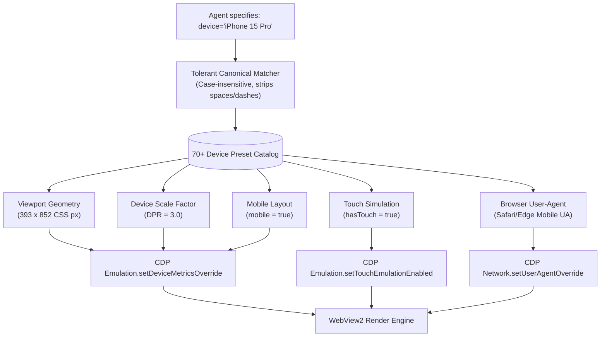
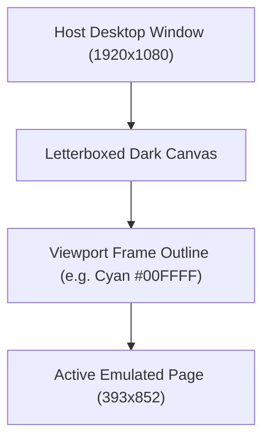

# Device Preset Catalog & Viewport Metrics

> [!NOTE]
> Responsive design verification requires testing web applications under authentic hardware constraints. Simply resizing a desktop browser window fails because desktop engines ignore viewport meta tags, omit high-DPI scaling factors, and deliver desktop user-agent strings. Nova AI Workspace provides over **70+ curated, Playwright-compatible device presets** and granular viewport metrics overrides via [`nova.emulation_use_device`](../../../../mcp-reference/tools/device-emulation/nova-emulation-use-device.md) and [`nova.emulation_set_device_metrics`](../../../../mcp-reference/tools/device-emulation/nova-emulation-set-device-metrics.md).

---

## 1. Architectural Motivation: The Resolution Trap

Modern web development presents a significant discrepancy between desktop monitors and mobile devices:

```
┌────────────────────────────────────────────────────────────────────────┐
│                   Desktop Window vs. Mobile Emulation                  │
├──────────────────────────────────┬─────────────────────────────────────┤
│ Dimension                        │ Desktop Window Resize Only          │
├──────────────────────────────────┼─────────────────────────────────────┤
│ Viewport Meta Handling           │ Ignored. Page renders zoomed out as │
│ (`<meta name="viewport">`)       │ a tiny, illegible desktop replica.  │
├──────────────────────────────────┼─────────────────────────────────────┤
│ Device Pixel Ratio (DPR)         │ Fixed at 1.0 (or host display DPI). │
│                                  │ Cannot test @2x/@3x high-DPI assets.│
├──────────────────────────────────┼─────────────────────────────────────┤
│ Scrollbar Rendering              │ Fixed-width desktop gutter (17px)   │
│                                  │ steals horizontal layout width.     │
├──────────────────────────────────┼─────────────────────────────────────┤
│ Dimension                        │ Nova Viewport Metrics Emulation     │
├──────────────────────────────────┼─────────────────────────────────────┤
│ Viewport Meta Handling           │ Fully enforced (`mobile: true`).    │
│                                  │ Renders mobile-first CSS grids.     │
├──────────────────────────────────┼─────────────────────────────────────┤
│ Device Pixel Ratio (DPR)         │ Explicitly emulated (1.0 to 8.0).   │
│                                  │ Evaluates `srcset` and SVG sharpness│
├──────────────────────────────────┼─────────────────────────────────────┤
│ Scrollbar Rendering              │ Mobile overlay scrollbars; zero     │
│                                  │ layout width encroachment.          │
└──────────────────────────────────┴─────────────────────────────────────┘
```

Nova interfaces directly with Chromium's `Emulation.setDeviceMetricsOverride` CDP domain to control layout dimensions, pixel density, and mobile layout behavior without altering the host operating system display settings.

---

## 2. The 70+ Curated Device Preset Catalog

Nova's device catalog models industry-standard Playwright device descriptors. Calling `nova.emulation_use_device(device="iPhone 15 Pro")` atomically applies:
1. **Logical CSS Viewport:** `width` and `height` in CSS pixels ($393 \times 852$).
2. **Device Scale Factor:** `deviceScaleFactor` (3.0).
3. **Mobile Layout Flag:** `mobile: true`.
4. **Touch Capabilities:** `hasTouch: true` (dispatches touch events).
5. **Browser Identity:** Matching mobile `User-Agent` and `Platform` headers.



### 2.1 Tolerant Identifier Matching
Preset resolution is resilient to formatting discrepancies:
* `"iPhone 15 Pro"`, `"iphone-15-pro"`, `"IPHONE 15 PRO"`, and `"iphone15pro"` all resolve to the same canonical descriptor.
* Partial searches or common abbreviations (e.g. `"Pixel 8"`, `"S24 Ultra"`, `"iPad Pro"`) match their respective device profiles.

### 2.2 Representative Device Preset Matrix

| Category | Representative Presets | Logical Viewport | DPR | Mobile Flag | Touch |
| :--- | :--- | :---: | :---: | :---: | :---: |
| **iPhones** | `iPhone SE` / `iPhone 8` | $375 \times 667$ | 2.0 | Yes | Yes |
| | `iPhone 13 Mini` / `iPhone 12 Mini` | $375 \times 812$ | 3.0 | Yes | Yes |
| | `iPhone 13` / `iPhone 14` / `iPhone 12` | $390 \times 844$ | 3.0 | Yes | Yes |
| | `iPhone 14 Pro` / `iPhone 15` / `iPhone 16` | $393 \times 852$ | 3.0 | Yes | Yes |
| | `iPhone 15 Pro Max` / `iPhone 16 Pro Max` | $440 \times 956$ | 3.0 | Yes | Yes |
| **Google Pixels** | `Pixel 7` / `Pixel 8` | $412 \times 915$ | 2.625 | Yes | Yes |
| | `Pixel 8 Pro` / `Pixel 9 Pro XL` | $448 \times 998$ | 2.625 | Yes | Yes |
| | `Pixel 9 Pro Fold` (unfolded tablet mode) | $768 \times 900$ | 2.625 | Yes | Yes |
| **Samsung Galaxy** | `Galaxy S23` / `Galaxy S24` | $360 \times 780$ | 3.0 | Yes | Yes |
| | `Galaxy S24 Ultra` | $384 \times 824$ | 3.75 | Yes | Yes |
| | `Galaxy Z Fold 6` (unfolded) | $776 \times 918$ | 2.625 | Yes | Yes |
| **Tablets** | `iPad Mini` | $768 \times 1024$ | 2.0 | Yes | Yes |
| | `iPad Air` / `iPad (10th gen)` | $820 \times 1180$ | 2.0 | Yes | Yes |
| | `iPad Pro 11` | $834 \times 1194$ | 2.0 | Yes | Yes |
| | `iPad Pro 12.9` | $1024 \times 1366$ | 2.0 | Yes | Yes |
| **Desktops** | `Desktop Chrome` | $1280 \times 720$ | 1.0 | No | No |
| | `Desktop Chrome HiDPI` | $1280 \times 720$ | 2.0 | No | No |
| | `Desktop 1080p` | $1920 \times 1080$ | 1.0 | No | No |
| | `Desktop 4K` | $3840 \times 2160$ | 1.0 | No | No |

---

## 3. Logical CSS Pixels vs. Physical Device Pixels (DPR)

A critical concept in responsive engineering is the distinction between **CSS logical pixels** and **hardware physical pixels**:

$$\text{Physical Pixels} = \text{CSS Logical Pixels} \times \text{Device Pixel Ratio (DPR)}$$

* **CSS Pixels ($W \times H$):** Governs media query evaluation (`@media (max-width: 600px)`), DOM element positioning (`rect.width`), and typography units (`rem`, `px`).
* **Device Pixel Ratio (DPR):** Instructs the browser engine on bitmap scaling. An iPhone 15 Pro with a logical width of 393px and DPR 3.0 triggers:
  1. High-resolution rasterization of vector graphics and WebGL canvases.
  2. Responsive image selection:
     ```html
     
     ```
     Chromium evaluates DPR 3.0 and fetches `avatar@3x.png`.

---

## 4. The Chromium Engine Identity Invariant

Nova is powered by Microsoft Edge (WebView2), a Chromium-based browser engine. When emulating non-Chromium devices (such as iOS Safari or Firefox), important behavioral boundaries apply:

> [!IMPORTANT]
> **The Engine Stays Chromium:**
> * Android presets present authentic Edge/Chrome for Android user agents matching the Chromium version, ensuring full identity consistency.
> * Presets for `iPhone`, `iPad`, `Desktop Safari`, and `Desktop Firefox` update the `User-Agent` string to test layout and UA-sniffing scripts. However, the underlying JavaScript engine remains V8, and the rendering engine remains Blink.
> * Sophisticated anti-bot protection systems (e.g. Cloudflare, DataDome) may detect discrepancies between V8 runtime internals and WebKit/Gecko user-agent claims.
> * When this occurs, Nova flags `engineIdentityMismatch: true` in the tool response. For bot-protected sites, use an Android preset (e.g. `Pixel 8`) to maintain full engine identity alignment.

---

## 5. Host Viewport Frame Outline (`nova.emulation_set_viewport_frame`)

When a mobile device ($393 \times 852$) is emulated within a large desktop application window ($1920 \times 1080$), the page renders centered within the canvas, surrounded by letterboxed background margins.

To clearly distinguish emulated device boundaries in visual evidence and screenshots:



### Visual Contrast Outlines:
* Tool: [`nova.emulation_set_viewport_frame`](../../../../mcp-reference/tools/device-emulation/nova-emulation-set-viewport-frame.md)
* Parameters: `enabled: true`, `color: "#00FFFF"` (or any hex color).
* **Zero DOM Impact:** The viewport frame outline is rendered directly on the host WinUI 3 XAML canvas. It does not inject DOM elements, modify CSS stylesheets, or interfere with page hit-testing.
* **Screenshot Integrity:** In automated full-window captures, the colored outline ensures operators can immediately verify where the mobile screen ends and desktop padding begins.

---

## 6. Granular Metric Overrides & Reset Workflows

Agents can configure custom viewport dimensions without choosing a preset via [`nova.emulation_set_device_metrics`](../../../../mcp-reference/tools/device-emulation/nova-emulation-set-device-metrics.md):

```json
{
  "width": 640,
  "height": 960,
  "deviceScaleFactor": 2.0,
  "mobile": true
}
```

### Resetting Viewport Metrics
When testing completes, calling [`nova.emulation_clear_device_metrics`](../../../../mcp-reference/tools/device-emulation/nova-emulation-clear-device-metrics.md) restores normal window-sized rendering:
```json
{}
```

*Note on Axis Independence:* Clearing device metrics resets viewport width, height, and DPR, but intentionally preserves touch simulation or custom user-agents if they were enabled independently.

---

## Related Documentation

* [Domain Hub: Device Presets, Viewport Metrics & Touch](../README.md)
* [Subguide: Touch Simulation & Gestures](../touch-simulation-and-gestures/README.md)
* [Master Hub: Device Emulation Architecture](../../README.md)
* [CSS Media Features & Theme Emulation](../../media-features-and-themes/README.md)
* [Tool Reference: `nova.emulation_use_device`](../../../../mcp-reference/tools/device-emulation/nova-emulation-use-device.md)
