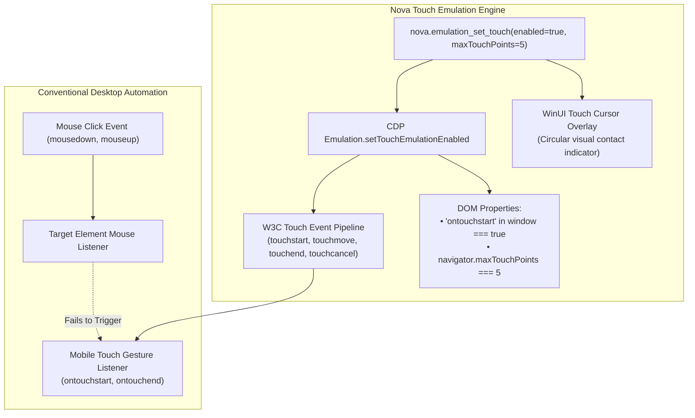
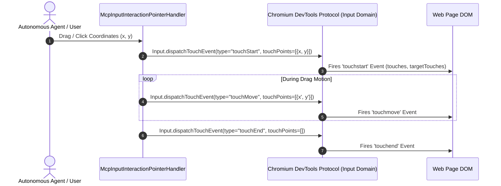
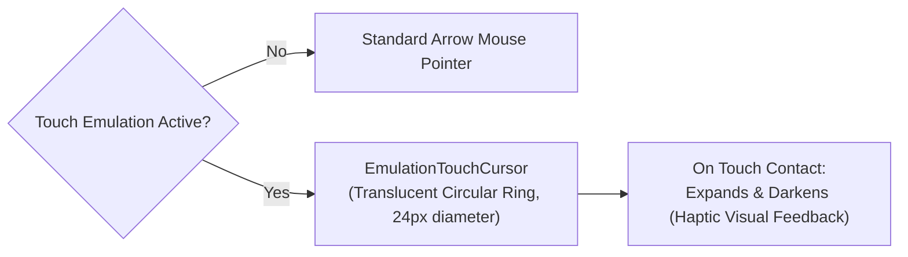

# Touch Simulation, Touch Cursors & Gesture Dispatch

> [!IMPORTANT]
> Modern mobile web frameworks (such as Swiper.js, Leaflet, and OpenLayers) bind their navigation and interactive carousels exclusively to W3C Touch Events (`touchstart`, `touchmove`, `touchend`). On standard desktop automation drivers, mouse clicks fail to trigger these components. Nova AI Workspace provides **synthetic touch emulation** via [`nova.emulation_set_touch`](../../../../mcp-reference/tools/device-emulation/nova-emulation-set-touch.md), visual **touch cursor overlays** (`EmulationTouchCursor`), mouse-as-touch event translation, and seamless Out-of-Process Iframe (OOPIF) touch routing.

---

## 1. Architectural Motivation: Why Mouse Clicks Fail on Mobile Web

Mobile web applications distinguish sharply between mouse pointer events and physical touch contacts:



### Critical Touch Failures in Standard Browsers:
1. **Carousel & Drawer Lockup:** Components like mobile sliding navigation drawers and image carousels ignore `mousedown` and wait for `touchstart`. A desktop agent attempting to drag a carousel with standard mouse drags fails to move the slider.
2. **Feature Detection Gating:** Libraries inspect `navigator.maxTouchPoints > 0` or `'ontouchstart' in window`. If false, touch-optimized UI controls are never initialized in the DOM.
3. **Pinch-to-Zoom & Multitouch:** Mapping complex multi-point gestures requires explicit support for multi-contact touch coordinate arrays.

---

## 2. Enabling Touch Emulation (`nova.emulation_set_touch`)

Nova activates touch capabilities using `nova.emulation_set_touch`:

```json
{
  "enabled": true,
  "maxTouchPoints": 5
}
```

### Parameter Reference

| Parameter | Type | Default | Valid Range | Architectural Role |
| :--- | :--- | :---: | :---: | :--- |
| `enabled` | `boolean` | `true` | `true`, `false` | Toggles touch emulation on the target tab. |
| `maxTouchPoints` | `integer` | `5` | `1` to `5` | Sets the hardware multi-touch capability reported by `navigator.maxTouchPoints`. |
| `targetId` | `string` | `"active"` | Tab ID | Target browser tab identifier. |

---

## 3. The W3C Touch Event Pipeline

When touch emulation is enabled, Chromium's input pipeline translates pointer interactions into standard W3C Touch Events:



### Touch Event Properties Dispatched:
* **`touches`:** Array of all currently active touch contact points on the screen.
* **`targetTouches`:** Array of touch contacts that originated on the target DOM element.
* **`changedTouches`:** Array of touch contacts whose positions or activation states changed during the event.
* **Dual Event Compatibility:** Chromium dispatches synthesized mouse events (`mousedown`, `mouseup`, `click`) following `touchend` unless `event.preventDefault()` was called by the touch handler—ensuring compatibility with hybrid websites.

---

## 4. Visual Touch Cursor Overlay (`EmulationTouchCursor`)

When touch emulation is active, standard arrow cursors misrepresent how human mobile interactions appear. Nova injects a specialized **touch cursor overlay**:



### Design & Behavior:
* **Visual Appearance:** A semi-transparent circular touch disc (24px diameter) with a soft outer ring, mimicking the fingertip contact area on physical capacitive touchscreens.
* **Contact State:** When a touch down is initiated, the cursor ring scales down and increases opacity, providing clear visual evidence of contact in session recordings and automated video streams.
* **Zero DOM Footprint:** Rendered as an overlay layer in Nova's native WinUI 3 XAML host chrome (`EmulationTouchCursor`), avoiding interference with web page layout or CSS selectors.

---

## 5. Mouse-As-Touch Translation & OOPIF Mirroring

Two advanced subsystems ensure seamless touch operation across complex web pages:

### 5.1 Mouse-As-Touch Translation (`MouseAsTouch`)
Through internal mouse-as-touch gesture translation, Nova automatically translates standard mouse drag commands (`nova.input_drag`, `nova.input_drag_humanized`) into `touchmove` sequences when touch emulation is enabled. Autonomous agents do not need separate tool calls for touch dragging versus mouse dragging; the platform translates gestures transparently based on active tab capabilities.

### 5.2 Out-of-Process Iframe (OOPIF) Mirroring (`OopifEmulationMirror`)
Modern web pages frequently embed third-party widgets (e.g. payment forms, maps, authentication frames) in Out-of-Process Iframes (OOPIF). In standard Chromium, CDP emulation commands dispatched to the main frame do not always propagate automatically to child OOPIF processes.

Nova's `OopifEmulationMirror` monitors target creation events:
* When an OOPIF attaches to a tab with active touch emulation, Nova attaches a secondary CDP session to the child target.
* Replicates `Emulation.setTouchEmulationEnabled` into the child frame context.
* Guarantees that embedded mobile maps and payment sliders respond to touch gestures identically to the parent document.

---

## 6. Disabling Touch Simulation

When mobile testing concludes, calling `nova.emulation_set_touch` with `enabled: false` cleanly deactivates touch emulation:

```json
{
  "enabled": false
}
```

* **DOM Clean-up:** `'ontouchstart' in window` returns `false` on subsequent checks.
* **Cursor Reset:** Reverts the host canvas pointer back to the standard desktop mouse arrow.
* **Metric Independence:** Deactivating touch does not alter active viewport dimensions; viewport metrics can be cleared separately via `nova.emulation_clear_device_metrics`.

---

## Related Documentation

* [Domain Hub: Device Presets, Viewport Metrics & Touch](../README.md)
* [Subguide: Preset Catalog & Viewport Metrics](../preset-catalog-and-viewport-metrics/README.md)
* [Master Hub: Device Emulation Architecture](../../README.md)
* [Browser Interaction & Input Simulation](../../../browser-interaction/README.md)
* [Tool Reference: `nova.emulation_set_touch`](../../../../mcp-reference/tools/device-emulation/nova-emulation-set-touch.md)
