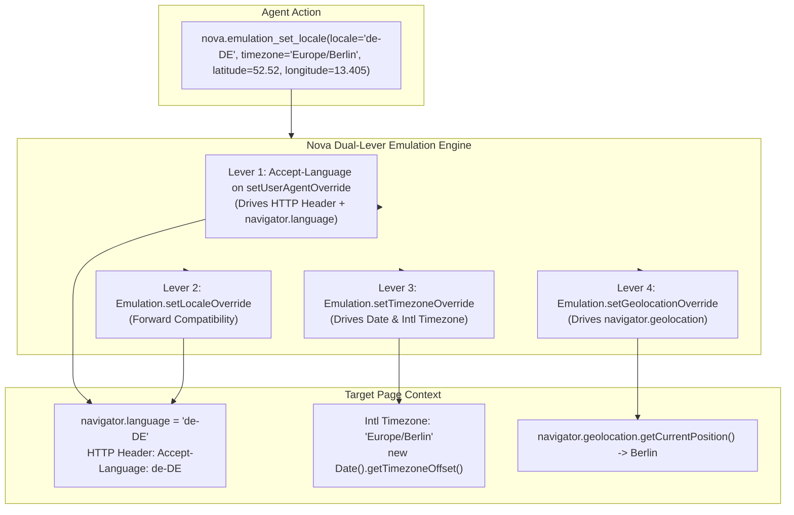
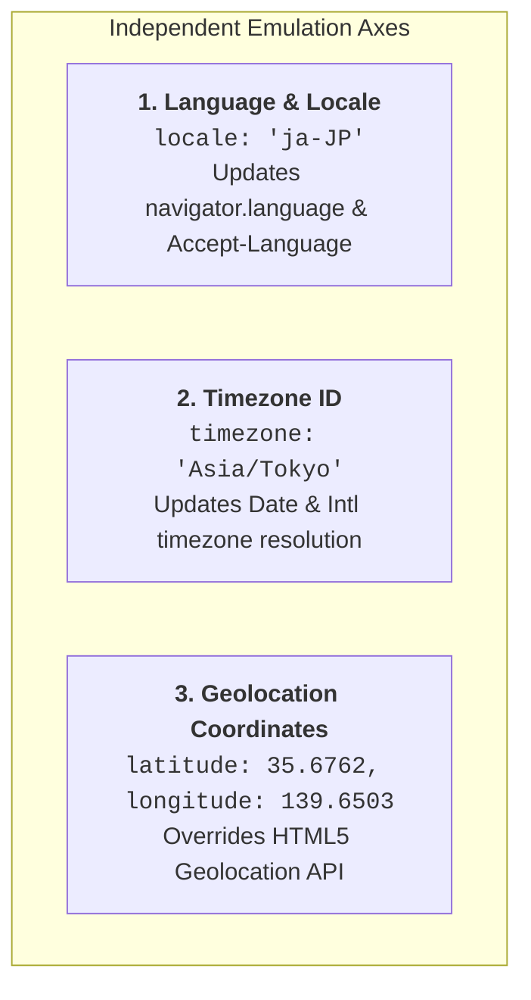

# Locale, Timezone & Geolocation Emulation

> **Testing internationalization, localized content, and regional behaviors — Accept-Language injection, timezone offsets, GPS coordinate spoofing, and ICU runtime boundaries.**

---

## 1. Overview & Architectural Vision

Modern web applications adapt their content, layouts, and business logic based on user locale and geography:
* **Localization & Translation:** Server-side frameworks read the `Accept-Language` header to deliver localized HTML, while client-side libraries inspect `navigator.language` to switch copy.
* **Bi-directional & RTL Layouts:** Languages like Arabic (`ar-SA`) and Hebrew (`he-IL`) flip the entire layout into Right-to-Left (RTL) mode, reversing flexbox directions, margins, and icons.
* **Timezone-Sensitive Scheduling:** Booking widgets, flight calendars, and webinar tools evaluate client timezones via `Intl.DateTimeFormat().resolvedOptions().timeZone` to display local times.
* **Geolocation & Geofencing:** Store locators, weather widgets, and regional compliance gates query the HTML5 Geolocation API (`navigator.geolocation.getCurrentPosition`).

Testing these behaviors previously required routing traffic through physical regional VPNs or changing host operating system timezones and locales.

Nova provides **`nova.emulation_set_locale`** and **`nova.emulation_clear_locale`**, enabling autonomous agents to emulate specific languages, timezones, and geographic coordinates on individual browser tabs without modifying the host machine or restarting the browser process.



---

## 2. The Three Localization & Geographic Axes

`nova.emulation_set_locale` accepts one, two, or all three axes in a single call:



### 1. Locale (`locale`)
Sets the language and regional formatting token (e.g. `"en-US"`, `"de-DE"`, `"fr-FR"`, `"ja-JP"`, `"ar-SA"`).
* Informs server-side content negotiation via the `Accept-Language` HTTP header.
* Sets client-side JavaScript properties: `navigator.language` and `navigator.languages`.

### 2. Timezone (`timezone`)
Sets the IANA timezone identifier (e.g. `"America/New_York"`, `"Europe/Berlin"`, `"Asia/Tokyo"`, `"UTC"`).
* Directly modifies `Intl.DateTimeFormat().resolvedOptions().timeZone`.
* Adjusts JavaScript date calculation offsets (`new Date().getTimezoneOffset()`).

### 3. Geolocation (`latitude`, `longitude`, `accuracy`)
Injects simulated GPS coordinates.
* **Coordinate Validation:** `latitude` must be between $-90$ and $90$; `longitude` must be between $-180$ and $180$.
* **Coordinate Pair Invariant:** Latitude and longitude must be provided together. Supplying one without the other returns error `-32602`.
* `accuracy`: Optional accuracy radius in meters (defaults to 100m).

---

## 3. Technical Implementation: The Dual-Lever Locale Mechanism

In Microsoft WebView2 and Chromium, overriding the browser's language at runtime involves a known architectural constraint:

> [!NOTE]
> Calling `Emulation.setLocaleOverride` alone is a verified no-op in WebView2. It changes neither `navigator.language` nor the HTTP `Accept-Language` header.

To ensure reliable locale emulation, Nova uses a **dual-lever strategy**:
1. **Lever 1 (HTTP & DOM Engine):** Nova reads the tab's current effective User-Agent and reasserts it with the emulated `Accept-Language` parameter via `Emulation.setUserAgentOverride`. This is the authoritative Chromium mechanism that successfully drives:
   - `navigator.language` (e.g. `"ja-JP"`)
   - `navigator.languages` (e.g. `["ja-JP", "ja"]`)
   - The outbound `Accept-Language` HTTP header on all network requests.
2. **Lever 2 (Forward Compatibility):** Nova also dispatches `Emulation.setLocaleOverride` so that future Chromium servicing updates that activate this API are immediately supported.

### The ICU Process Boundary
Chromium fixes its default ICU (International Components for Unicode) formatting locale once at process launch via the command-line switch `--lang`. Because WebView2 is a shared multi-process runtime that cannot be restarted per tab, **native C++ number and date formatting via `Intl` defaults reflect the host process launch language**. However, web applications determine localized text, currencies, and layout direction through `navigator.language` and `Accept-Language`, which Nova overrides completely.

---

## 4. Parameter Reference & Schema

The tool is invoked via [`nova.emulation_set_locale`](../../../mcp-reference/tools/device-emulation/nova-emulation-set-locale.md):

| Parameter | Type | Required | Range / Format | Description |
| :--- | :--- | :---: | :--- | :--- |
| `targetId` | `string` | No | `"active"` | Target tab identifier from `nova.tabs`. |
| `locale` | `string` | No | BCP 47 (e.g. `"de-DE"`) | Language and region code. |
| `timezone` | `string` | No | IANA ID (e.g. `"Europe/Berlin"`) | Timezone identifier. |
| `latitude` | `number` | No | -90.0 to 90.0 | Latitude coordinate in degrees. Requires `longitude`. |
| `longitude`| `number` | No | -180.0 to 180.0 | Longitude coordinate in degrees. Requires `latitude`. |
| `accuracy` | `number` | No | Positive number | Geolocation accuracy in meters (default: 100). |

> [!IMPORTANT]
> `nova.emulation_set_locale` requires at least one of `locale`, `timezone`, or `latitude`+`longitude`. Setting none returns error `-32602`. To reset, use `nova.emulation_clear_locale`.

---

## 5. Clean Restoration (`nova.emulation_clear_locale`)

When an agent finishes testing a regional workflow, calling `nova.emulation_clear_locale` cleanly restores the tab's original settings:
1. Re-asserts the original pre-override `navigator.languages` list that Nova captured prior to the first override.
2. Clears the timezone override by sending `timezoneId: ""` to CDP.
3. Clears geolocation coordinates via `Emulation.clearGeolocationOverride`.

```json
// nova.emulation_clear_locale
{}
```

Response:
```json
{
  "content": [
    {
      "type": "text",
      "text": "Locale, timezone, and geolocation overrides cleared: reverted to host system settings."
    }
  ],
  "structuredContent": {
    "targetId": "tab-1",
    "cleared": {
      "locale": true,
      "timezone": true,
      "geolocation": true
    }
  }
}
```

---

## 6. Practical Agent Recipes

### Recipe 1: Right-to-Left (RTL) Layout Verification
Verify that an Arabic locale properly activates RTL layouts:

1. Set Arabic locale:
   ```json
   // nova.emulation_set_locale
   { "locale": "ar-SA" }
   ```
2. Reload page to trigger server-side content negotiation:
   ```json
   // nova.reload
   {}
   ```
3. Inspect document direction:
   ```json
   // nova.get_computed_style
   { "selector": "html", "properties": ["direction"] }
   ```
   Assert that `requested.direction === "rtl"`.
4. Scan for broken layout or clipping:
   ```json
   // nova.detect_overflow
   { "selector": "body" }
   ```

### Recipe 2: Geofenced Store Locator Test
Verify that a retail store locator centers on Tokyo, Japan:

```json
// nova.emulation_set_locale
{
  "locale": "ja-JP",
  "timezone": "Asia/Tokyo",
  "latitude": 35.6762,
  "longitude": 139.6503,
  "accuracy": 50
}
```

---

## 7. Related Tools & Documentation

* [`nova.emulation_set_locale` Tool Reference](../../../mcp-reference/tools/device-emulation/nova-emulation-set-locale.md)
* [`nova.emulation_clear_locale` Tool Reference](../../../mcp-reference/tools/device-emulation/nova-emulation-clear-locale.md)
* [Device Presets, Viewport Metrics & Touch](../device-presets-and-metrics/README.md)
* [CSS Media Features, Dark Mode & Themes](../media-features-and-themes/README.md)
* [Fingerprint Protection & Privacy](../../privacy/README.md)
