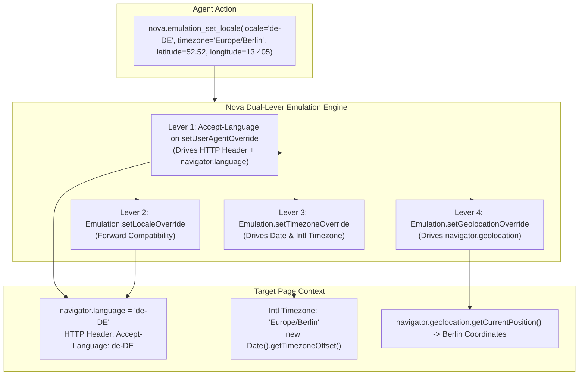

# Locale, Timezone & Geolocation Emulation

> [!NOTE]
> Testing modern web applications requires verifying localized copy, Right-to-Left (RTL) reading layouts, regional currency formatting, timezone-sensitive appointment booking, and geofenced features. Nova AI Workspace provides **per-tab internationalization and geographic simulation** via [`nova.emulation_set_locale`](../../../mcp-reference/tools/device-emulation/nova-emulation-set-locale.md) and [`nova.emulation_clear_locale`](../../../mcp-reference/tools/device-emulation/nova-emulation-clear-locale.md), eliminating the need for regional VPN tunnels or operating system reconfiguration.

---

## 1. Executive Summary & Core Mission

Standard browser automation frameworks face severe hurdles when validating international web applications:
* Overriding only the HTTP `Accept-Language` header leaves client-side DOM properties (`navigator.language`) in English, causing hydration errors.
* Timezone-sensitive scheduling tools calculate dates using the host machine's local clock, making overseas appointment testing difficult.
* Geolocation prompts either block autonomous execution or require mock GPS injection.

Nova's Localization Subsystem provides:
1. **Dual-Lever Language Delivery:** Simultaneously drives the HTTP `Accept-Language` header and client-side `navigator.language` / `navigator.languages` properties.
2. **Instant Timezone Shifting:** Reconfigures JavaScript `Intl` and `Date` offsets immediately without requiring a page reload.
3. **HTML5 Geolocation Spoofing:** Injects simulated latitude, longitude, and accuracy coordinates while transparently fulfilling location permission checks.
4. **RTL Layout Verification:** Enables comprehensive Right-to-Left layout testing for Arabic, Hebrew, and Persian scripts.

---

## 2. Comprehensive Documentation Index

The Locale, Timezone & Geolocation subsystem is detailed across specialized subguides:

| Architecture Guide | Focus Areas & Technical Invariants | Primary Components |
| :--- | :--- | :--- |
| **[Language, Locale & RTL Simulation](language-and-rtl-simulation/README.md)** | Content negotiation vs. client-side DOM localization, the dual-lever locale mechanism (`Network.setUserAgentOverride` + `Emulation.setLocaleOverride`), the ICU process boundary, Right-to-Left (RTL) layout verification, and logical property audits. | `nova.emulation_set_locale` `DualLeverLocale` `AcceptLanguage` `navigator.language` `RTLLayoutVerification` |
| **[Timezone & Geolocation Overrides](timezone-and-geolocation-overrides/README.md)** | IANA Timezone ID overrides, JavaScript `Intl` and `Date.getTimezoneOffset` behavior, HTML5 Geolocation API spoofing (`latitude`, `longitude`, `accuracy`), coordinate pair invariants, and regional testing recipes. | `nova.emulation_set_locale` `nova.emulation_clear_locale` `TimezoneOverride` `GeolocationOverride` `CoordinatePairInvariant` |

---

## 3. High-Level Localization Pipeline

---

## 4. Key Architectural Invariants

* **Dual-Lever Necessity:** Calling `Emulation.setLocaleOverride` alone is a known no-op in Microsoft WebView2. Nova couples this with `Network.setUserAgentOverride` to reliably drive both server-side content negotiation and client-side JavaScript property reads.
* **Coordinate Pair Requirement:** `latitude` and `longitude` must always be supplied together. Omitting one returns parameter error `-32602`.
* **Zero Host Alteration:** All overrides are scoped strictly to the target browser tab. The host operating system's locale, timezone, and GPS settings remain completely untouched.
* **Clean Baseline Restoration:** Calling `nova.emulation_clear_locale` restores the exact pre-override `navigator.languages` array captured during initial tab attachment.

---

## Related Documentation

* [Language, Locale & RTL Simulation Subguide](language-and-rtl-simulation/README.md)
* [Timezone & Geolocation Overrides Subguide](timezone-and-geolocation-overrides/README.md)
* [Parent: Device Emulation Architecture Overview](../README.md)
* [Device Presets, Viewport Metrics & Touch](../device-presets-and-metrics/README.md)
* [CSS Media Features, Dark Mode & Themes](../media-features-and-themes/README.md)
* [Tool Reference: `nova.emulation_set_locale`](../../../mcp-reference/tools/device-emulation/nova-emulation-set-locale.md)
