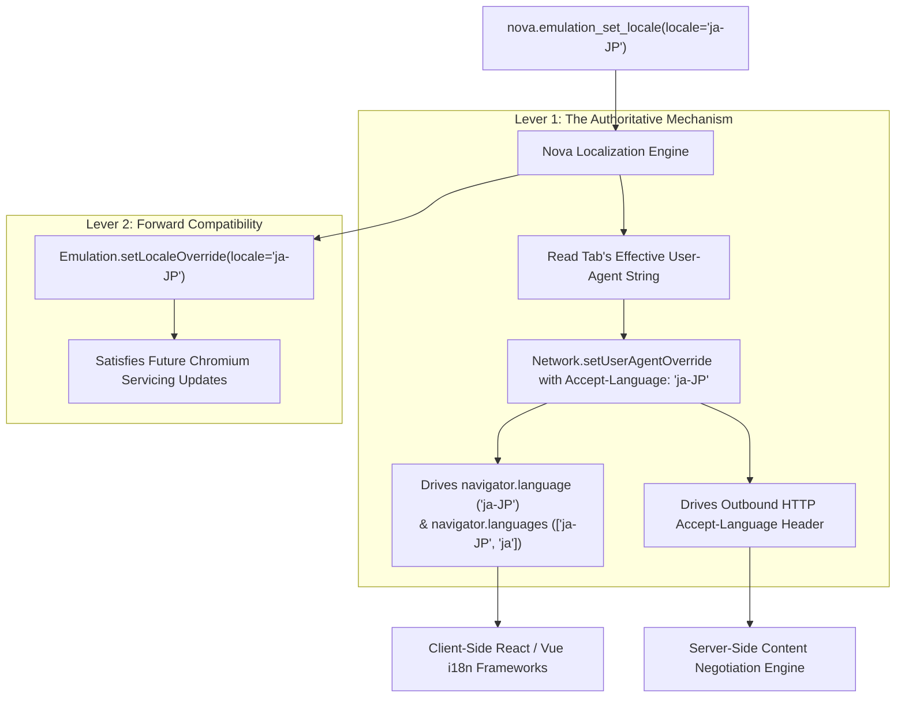
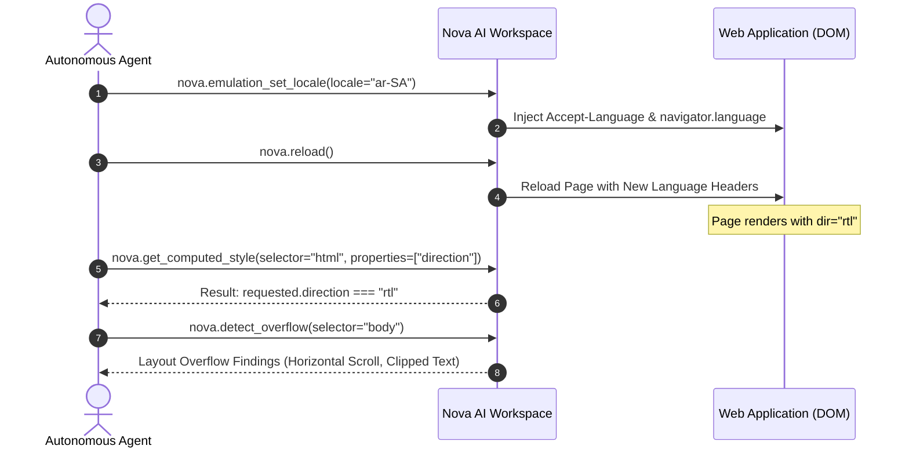

# Language, Locale & RTL Layout Simulation

> [!NOTE]
> Modern web applications dynamically tailor their copy, currency displays, and layout geometry based on client language preferences. Languages such as Arabic (`ar-SA`) and Hebrew (`he-IL`) invert entire page structures into Right-to-Left (RTL) orientation. Testing these internationalization features traditionally required configuring separate regional operating systems or external proxies. Nova AI Workspace provides **in-engine locale and RTL simulation** via [`nova.emulation_set_locale`](../../../../mcp-reference/tools/device-emulation/nova-emulation-set-locale.md), solving runtime constraints through a **dual-lever delivery mechanism**.

---

## 1. Architectural Motivation: Content Negotiation vs. DOM Localization

Web internationalization operates across two distinct protocol layers:

```
┌────────────────────────────────────────────────────────────────────────┐
│                   Internationalization Execution Layers                │
├───────────────────┬────────────────────────────────────────────────────┤
│ Protocol Layer    │ Target Mechanism & Impact                          │
├───────────────────┼────────────────────────────────────────────────────┤
│ HTTP Egress       │ The `Accept-Language` request header informs the   │
│ (Server-Side)     │ origin server which language template to serve     │
│                   │ (e.g. `Accept-Language: de-DE, de;q=0.9`).         │
├───────────────────┼────────────────────────────────────────────────────┤
│ JavaScript DOM    │ Client-side frameworks (i18next, react-intl) query │
│ (Client-Side)     │ `navigator.language` and `navigator.languages` to   │
│                   │ switch runtime dictionary strings and currencies.  │
├───────────────────┼────────────────────────────────────────────────────┤
│ CSS Rendering     │ RTL languages trigger `html[dir="rtl"]`, inverting │
│ (Visual Layout)   │ flexbox orders, text alignment, and icon margins.  │
└───────────────────┴────────────────────────────────────────────────────┘
```

A common failure mode in browser automation is overriding only the HTTP header or only the JavaScript property, leading to desynchronized state where the server renders English but client components attempt to hydrate German.

---

## 2. Technical Implementation: The Dual-Lever Locale Mechanism

In Microsoft WebView2 and Chromium, modifying browser locale at runtime involves a known platform limitation:

> [!WARNING]
> Calling `Emulation.setLocaleOverride` alone is a verified no-op in Microsoft WebView2. It mutates neither `navigator.language` nor the outbound HTTP `Accept-Language` header.

To ensure deterministic, end-to-end locale overrides, Nova employs a **dual-lever coordination architecture**:



### Why Lever 1 Works:
In Chromium's network and DOM architecture, passing `acceptLanguage` inside `Network.setUserAgentOverride` simultaneously rewrites the outbound HTTP request headers **and** updates the DOM `navigator.language` and `navigator.languages` properties.

---

## 3. The ICU Process Boundary

A subtle constraint of Chromium's internal architecture is its International Components for Unicode (ICU) engine:

* **Process-Wide Launch Language:** Chromium initializes its default ICU formatting locale once at process startup using the `--lang` command-line switch.
* **Shared Runtime Constraint:** Because WebView2 processes are shared across tabs and cannot be restarted per tab, native C++ date and number formatters in `Intl` that do not receive an explicit locale argument may default to the host process launch language.
* **Web Framework Resilience:** Modern web frameworks (such as Moment.js, Day.js, and FormatJS) explicitly pass `navigator.language` to `Intl.DateTimeFormat(navigator.language)`, ensuring that Nova's dual-lever override successfully drives client-side formatting.

---

## 4. Right-to-Left (RTL) Layout Verification

Languages like Arabic (`ar-SA`), Hebrew (`he-IL`), Persian (`fa-IR`), and Urdu (`ur-PK`) mandate Right-to-Left visual reading order.

When testing RTL layouts, autonomous agents should execute a systematic three-stage validation loop:



### Common RTL Regressions Detected:
1. **Unflipped Horizontal Margins:** Elements styled with legacy `margin-left: 20px` rather than CSS Logical Properties (`margin-inline-start: 20px`) remain anchored to the left, colliding with text.
2. **Directional Icon Inversions:** Back-arrows and navigation chevrons that must point right in RTL layouts remain pointed left.
3. **Horizontal Viewport Spill:** Fixed-width sidebars anchored to the right frequently cause horizontal scrollbar spill, detected immediately via [`nova.detect_overflow`](../../../../mcp-reference/tools/layout-and-qa/nova-detect-overflow.md).

---

## 5. Clean Restoration (`nova.emulation_clear_locale`)

When international testing concludes, calling [`nova.emulation_clear_locale`](../../../../mcp-reference/tools/device-emulation/nova-emulation-clear-locale.md) cleanly restores the tab's original environment:

```json
{}
```

### Restoration Sequence:
1. **Baseline Reassertion:** Nova re-asserts the original pre-override `navigator.languages` list that was captured when the tab first attached.
2. **Header Reversion:** Clears custom `Accept-Language` values from `Network.setUserAgentOverride`.
3. **Status Confirmation:** Reports `cleared: { locale: true }` in the structured response payload.

---

## Related Documentation

* [Domain Hub: Locale, Timezone & Geolocation](../README.md)
* [Subguide: Timezone & Geolocation Overrides](../timezone-and-geolocation-overrides/README.md)
* [Master Hub: Device Emulation Architecture](../../README.md)
* [Layout Quality, Overflow & Accessibility](../../../layout-and-web-vitals/README.md)
* [Tool Reference: `nova.emulation_set_locale`](../../../../mcp-reference/tools/device-emulation/nova-emulation-set-locale.md)
