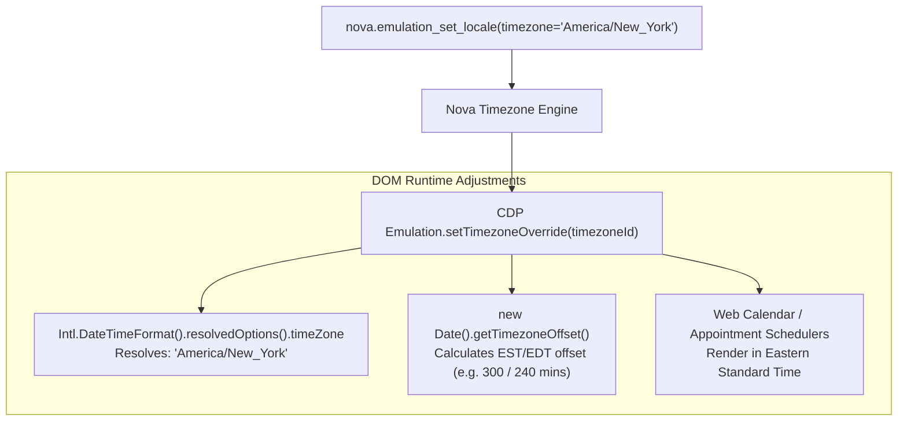
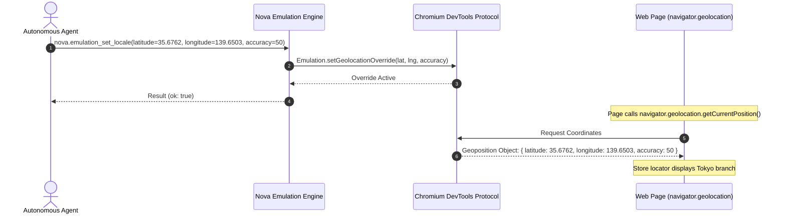

# Timezone & Geolocation Overrides

> [!NOTE]
> Modern web applications tailor business workflows, date scheduling, currency formats, and physical store locators based on the user's geographic location and local clock. Testing regional restrictions, flight booking systems, or geofenced payment gateways previously required physical VPN tunnels and operating system clock manipulation. Nova AI Workspace provides **per-tab timezone and GPS coordinate spoofing** via [`nova.emulation_set_locale`](../../../../mcp-reference/tools/device-emulation/nova-emulation-set-locale.md).

---

## 1. Architectural Overview & Regional Vectors

Regional adaptation in modern web applications relies on two core browser APIs:

```
┌────────────────────────────────────────────────────────────────────────┐
│                   Regional Adaptation APIs in Web Browsers             │
├───────────────────┬────────────────────────────────────────────────────┤
│ Dimension         │ Timezone Emulation                                 │
├───────────────────┼────────────────────────────────────────────────────┤
│ Query API         │ `Intl.DateTimeFormat().resolvedOptions().timeZone` │
│ Offset Method     │ `new Date().getTimezoneOffset()`                   │
│ Target Use Cases  │ Calendar scheduling, daylight saving calculations, │
│                   │ appointment booking widgets, auction countdowns.   │
├───────────────────┼────────────────────────────────────────────────────┤
│ Dimension         │ Geolocation Emulation                              │
├───────────────────┼────────────────────────────────────────────────────┤
│ Query API         │ `navigator.geolocation.getCurrentPosition()`       │
│ Stream API        │ `navigator.geolocation.watchPosition()`            │
│ Target Use Cases  │ Store locators, local delivery radii, geofenced    │
│                   │ tax calculation, regional streaming licenses.      │
└───────────────────┴────────────────────────────────────────────────────┘
```

Nova provides direct programmatic control over both dimensions on individual tabs without altering the host operating system clock or network interfaces.

---

## 2. Timezone Emulation

Timezone emulation is controlled via the `timezone` parameter:

```json
{
  "timezone": "Asia/Tokyo"
}
```



### 2.1 IANA Timezone Identifiers
Nova accepts standard IANA Timezone Database identifiers:
* `"UTC"` / `"Etc/UTC"`
* `"America/New_York"`, `"America/Chicago"`, `"America/Los_Angeles"`
* `"Europe/London"`, `"Europe/Berlin"`, `"Europe/Paris"`
* `"Asia/Tokyo"`, `"Asia/Dubai"`, `"Asia/Kolkata"`
* `"Australia/Sydney"`

### 2.2 Instant JavaScript Evaluation
The timezone override takes effect immediately in JavaScript memory without requiring a page reload. Existing `Date` objects and newly instantiated `Intl` formatters immediately reflect the emulated timezone offset.

---

## 3. Geolocation Coordinate Spoofing

HTML5 Geolocation allows websites to request physical GPS coordinates from the device. Nova overrides this API via `latitude`, `longitude`, and optional `accuracy`:

```json
{
  "latitude": 35.6762,
  "longitude": 139.6503,
  "accuracy": 50
}
```



### 3.1 Architectural Invariants:
1. **Coordinate Pair Invariant:** `latitude` and `longitude` must be provided together. Supplying one without the other triggers an immediate parameter validation error (`-32602`).
2. **Value Boundaries:**
   * `latitude`: Valid range between $-90.0$ and $+90.0$ degrees.
   * `longitude`: Valid range between $-180.0$ and $+180.0$ degrees.
   * `accuracy`: Non-negative floating point number representing meters (defaults to 100m).
3. **Permission Interception:** In standard browsers, querying geolocation raises a native UI prompt. In Nova, if geolocation emulation is explicitly armed via MCP, Chromium bypasses the prompt and supplies the emulated coordinates immediately.

---

## 4. Multi-Axis Testing Recipes

### Recipe 1: Simulating an Australian User (Sydney)
Configures English language, Sydney timezone, and geographic coordinates for a retail checkout flow:

```json
{
  "locale": "en-AU",
  "timezone": "Australia/Sydney",
  "latitude": -33.8688,
  "longitude": 151.2093,
  "accuracy": 20
}
```

### Recipe 2: Clearing Regional Overrides
Restores the host operating system's native timezone and GPS providers:

```json
// nova.emulation_clear_locale
{}
```

Response confirms restoration:
```json
{
  "structuredContent": {
    "targetId": "tab-1",
    "cleared": {
      "locale": true,
      "timezone": true,
      "geolocation": true
    }
  }
}
```

---

## Related Documentation

* [Domain Hub: Locale, Timezone & Geolocation](../README.md)
* [Subguide: Language, Locale & RTL Simulation](../language-and-rtl-simulation/README.md)
* [Master Hub: Device Emulation Architecture](../../README.md)
* [Site Data Management & Permissions](../../../site-data-management/README.md)
* [Tool Reference: `nova.emulation_set_locale`](../../../../mcp-reference/tools/device-emulation/nova-emulation-set-locale.md)
