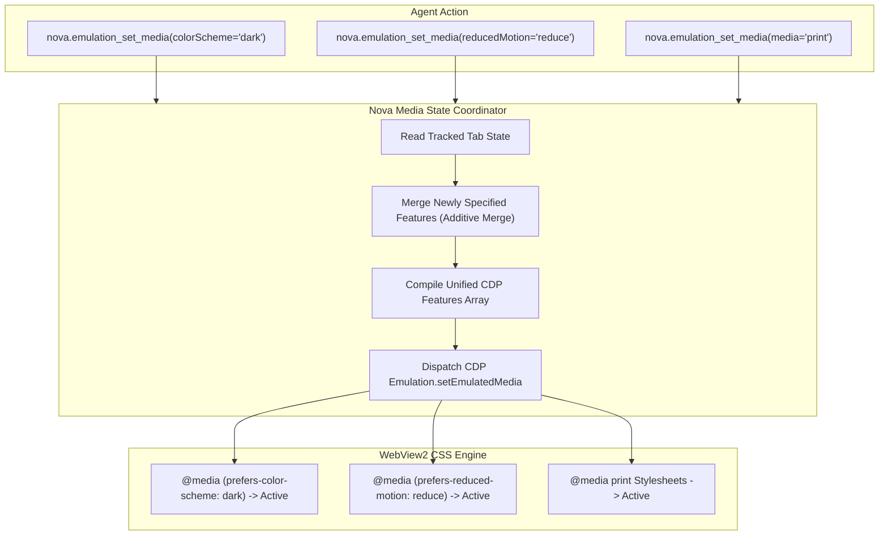

# CSS Media Features, Dark Mode & Theme Emulation

> [!NOTE]
> Modern web applications adapt their appearance dynamically using CSS Media Queries Level 5: switching between dark and light palettes, suppressing animations for users with vestibular motion sensitivity, applying Windows High Contrast themes, and formatting documents for print. Nova AI Workspace provides **per-tab CSS media feature emulation** via [`nova.emulation_set_media`](../../../mcp-reference/tools/device-emulation/nova-emulation-set-media.md) and [`nova.emulation_clear_media`](../../../mcp-reference/tools/device-emulation/nova-emulation-clear-media.md), backed by an **additive state merge coordinator**.

---

## 1. Executive Summary & Core Mission

Testing responsive themes and accessibility states previously required modifying operating system settings or restarting browser processes. Furthermore, raw Chrome DevTools Protocol calls replace all media features on every invocation, causing previous overrides to be wiped out silently.

Nova's Media Features Subsystem provides:
1. **The Additive State Merge Contract:** Maintains an internal per-tab media state coordinator, ensuring partial overrides merge seamlessly without dropping previously emulated features.
2. **Comprehensive Accessibility Vector Controls:** Explicit toggling for `@media (prefers-color-scheme)`, `@media (prefers-reduced-motion)`, `@media (forced-colors)`, and `@media (prefers-contrast)`.
3. **Print Media Transformation:** Instantly switches the live DOM from `@media screen` to `@media print` for layout overflow verification and archival vector PDF synthesis via [`nova.save_pdf`](../../../mcp-reference/tools/visual-evidence/nova-save-pdf.md).
4. **Clean Baseline Reversion:** Full atomic restoration to host system defaults via [`nova.emulation_clear_media`](../../../mcp-reference/tools/device-emulation/nova-emulation-clear-media.md).

---

## 2. Comprehensive Documentation Index

The CSS Media Features, Dark Mode & Theme Emulation subsystem is detailed across specialized subguides:

| Architecture Guide | Focus Areas & Technical Invariants | Primary Components |
| :--- | :--- | :--- |
| **[Color Schemes & Accessibility](color-schemes-and-accessibility/README.md)** | CSS Media Queries Level 5, the additive state merge contract, dark mode contrast auditing (WCAG 2.2 AA $4.5:1$), vestibular motion safety (`prefers-reduced-motion: reduce`), and Windows High Contrast Mode (`forced-colors: active`). | `nova.emulation_set_media` `AdditiveStateMerge` `prefers-color-scheme` `prefers-reduced-motion` `forced-colors` |
| **[Print Media & PDF Synthesis](print-media-and-pdf-synthesis/README.md)** | Screen vs. print media layout models, live DOM `@media print` transformation, header/footer suppression, print layout overflow detection, high-fidelity vector PDF generation (`nova.save_pdf`), and screen mode restoration. | `nova.emulation_set_media` `nova.save_pdf` `nova.detect_overflow` `printBackground` `MediaPrint` |

---

## 3. High-Level Media Emulation Pipeline

---

## 4. Key Architectural Invariants

* **Additive Merging Guarantee:** Raw CDP replaces all emulated media features on every call. Nova's coordinator merges new features into active ones, allowing agents to combine dark mode with reduced motion in successive tool calls.
* **Zero Host Alteration:** All media overrides apply strictly to the target tab's CSS engine. The host machine's Windows theme, high-contrast settings, and display settings remain untouched.
* **Vector PDF Fidelity:** When in print mode, [`nova.save_pdf`](../../../mcp-reference/tools/visual-evidence/nova-save-pdf.md) outputs vector typography and background graphics matching the emulated `@media print` layout.

---

## Related Documentation

* [Color Schemes & Accessibility Subguide](color-schemes-and-accessibility/README.md)
* [Print Media & PDF Synthesis Subguide](print-media-and-pdf-synthesis/README.md)
* [Parent: Device Emulation Architecture Overview](../README.md)
* [Device Presets, Viewport Metrics & Touch](../device-presets-and-metrics/README.md)
* [Locale, Timezone & Geolocation](../locale-timezone-and-geolocation/README.md)
* [Tool Reference: `nova.emulation_set_media`](../../../mcp-reference/tools/device-emulation/nova-emulation-set-media.md)
