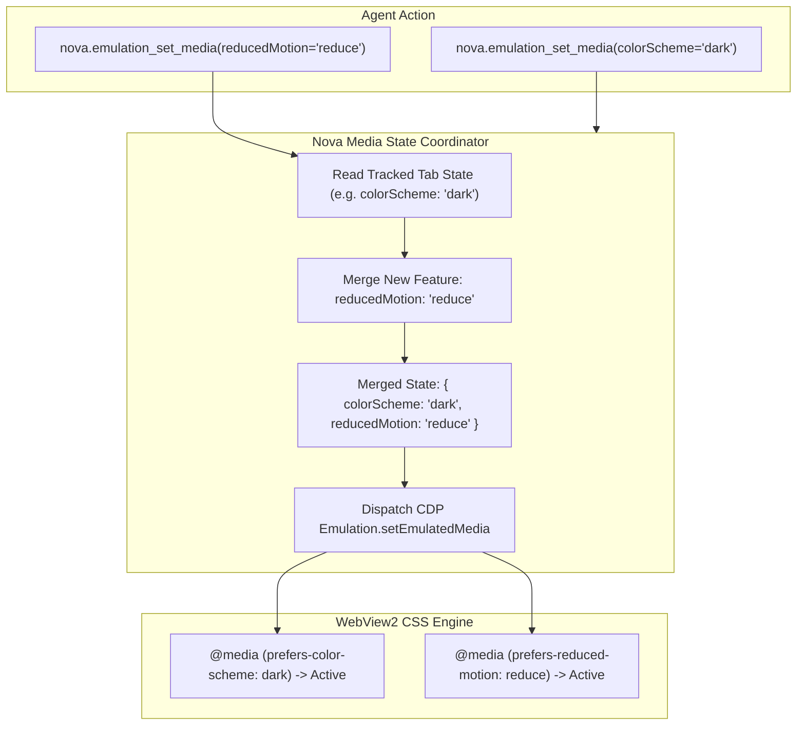
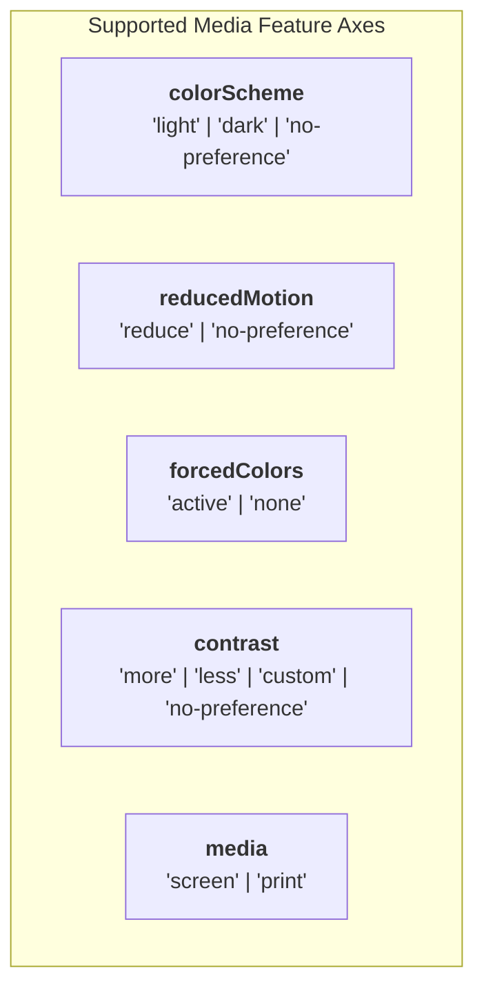

# CSS Media Features, Dark Mode & Theme Emulation

> **Testing responsive themes and accessibility modes — additive media feature merging, dark/light color schemes, reduced motion, Windows high-contrast mode, and print media verification.**

---

## 1. Overview & Architectural Vision

Modern web applications increasingly rely on CSS Media Queries Level 5 to adapt their visual presentation to user capabilities and operating system preferences:
* **Dark Mode:** `@media (prefers-color-scheme: dark)` activates dark background palettes, requiring corresponding typography contrast adjustments.
* **Vestibular Motion Safety:** `@media (prefers-reduced-motion: reduce)` signals that the user experiences motion sickness or vertigo, requiring the web page to disable parallax scrolling, smooth scrolling, and autoplay animations (WCAG 2.2 SC 2.3.3).
* **High Contrast Mode:** `@media (forced-colors: active)` indicates Windows High Contrast mode, forcing the browser to override page colors with system-defined semantic tokens.
* **Print Stylesheets:** `@media print` reformats web pages into document-friendly layouts, removing navigation headers, expanding accordions, and adjusting page break boundaries.

Testing these states in automated pipelines has historically been cumbersome because changing media preferences required altering operating system registry settings or restarting the browser.

Nova provides **`nova.emulation_set_media`** and **`nova.emulation_clear_media`**, allowing agents to override CSS media features dynamically on individual browser tabs without touching the host operating system.



---

## 2. The Additive State Merge Contract

In the raw Chrome DevTools Protocol (CDP), calling `Emulation.setEmulatedMedia` **replaces the entire set of emulated media features**. If an agent executes:
1. `Emulation.setEmulatedMedia({ features: [{ name: "prefers-color-scheme", value: "dark" }] })`
2. Followed by: `Emulation.setEmulatedMedia({ features: [{ name: "prefers-reduced-motion", value: "reduce" }] })`

Raw CDP drops `prefers-color-scheme`, silently reverting the page to light mode.

### Nova's Additive Merging
Nova maintains an internal per-tab media state tracker. When `nova.emulation_set_media` is called:
* Any feature specified in the call updates the tracked state.
* Any feature **omitted** from the call retains its previously emulated value.
* The merged state is compiled and dispatched to CDP atomically.

This guarantees that multi-feature testing behaves intuitively: an agent can configure dark mode, perform a check, enable reduced motion, and evaluate both features active simultaneously.

---

## 3. Supported Media Features & Value Spaces



| Parameter | Type | Allowed Values | CSS Media Query | Description |
| :--- | :--- | :--- | :--- | :--- |
| `colorScheme` | `string` | `"light"`, `"dark"`, `"no-preference"` | `@media (prefers-color-scheme)` | Emulates OS-level light or dark appearance. |
| `reducedMotion` | `string` | `"reduce"`, `"no-preference"` | `@media (prefers-reduced-motion)` | Signals preference to minimize non-essential motion. |
| `forcedColors` | `string` | `"active"`, `"none"` | `@media (forced-colors)` | Emulates Windows High Contrast Mode. |
| `contrast` | `string` | `"more"`, `"less"`, `"custom"`, `"no-preference"` | `@media (prefers-contrast)` | Emulates high or low contrast visual preferences. |
| `media` | `string` | `"screen"`, `"print"` | `@media screen` / `@media print` | Toggles rendering engine between display screen and print output. |

---

## 4. Deep Dives: Accessibility & Visual Verification

### 4.1. Dark Mode Contrast Auditing
Web pages frequently introduce severe contrast regressions when implementing dark themes: text that was readable against white backgrounds becomes muddy gray against charcoal cards.

Agents can combine dark mode emulation with Nova's accessibility auditor:
1. Enable dark mode:
   ```json
   // nova.emulation_set_media
   { "colorScheme": "dark" }
   ```
2. Run contrast audit:
   ```json
   // nova.audit_accessibility
   {
     "selector": "main",
     "includeContrast": true,
     "includeTargetSize": false,
     "includeLabels": false
   }
   ```
Any text failing WCAG 2.2 Level AA ($4.5:1$) in dark mode is immediately flagged.

### 4.2. Print Media Verification & PDF Generation
Web applications frequently format invoices, boarding passes, and receipts using `@media print` stylesheets that hide navigation chrome and reformat tables.

Agents can verify and capture print output:
1. Emulate print media:
   ```json
   // nova.emulation_set_media
   { "media": "print" }
   ```
2. Verify layout geometry and detect overflow:
   ```json
   // nova.detect_overflow
   { "selector": "body" }
   ```
3. Export high-fidelity vector PDF:
   ```json
   // nova.save_pdf
   { "printBackground": true }
   ```
4. Restore standard screen media:
   ```json
   // nova.emulation_clear_media
   {}
   ```

---

## 5. Clearing Emulated Media (`nova.emulation_clear_media`)

Calling `nova.emulation_clear_media` sends an empty features array and empty media string to CDP, resetting the tab's media query evaluation back to the real host system settings.

```json
// nova.emulation_clear_media
{}
```

Response:
```json
{
  "content": [
    {
      "type": "text",
      "text": "Emulated media features cleared: reverted to the page's real media settings."
    }
  ],
  "structuredContent": {
    "targetId": "tab-1",
    "cleared": true
  }
}
```

---

## 6. Practical Agent Recipes

### Recipe 1: Comprehensive Accessibility Verification
Verify that a newly developed UI component complies with both dark mode and reduced motion requirements:

```json
// nova.emulation_set_media
{
  "colorScheme": "dark",
  "reducedMotion": "reduce"
}
```

Verify that animations have stopped (e.g. via [`nova.measure_web_vitals`](../../../mcp-reference/tools/layout-and-qa/nova-measure-web-vitals.md) to check layout stability) and verify typography with [`nova.audit_accessibility`](../../../mcp-reference/tools/layout-and-qa/nova-audit-accessibility.md).

### Recipe 2: Windows High-Contrast Mode Smoke Test
Verify that custom buttons remain legible in Windows High Contrast mode:

```json
// nova.emulation_set_media
{
  "forcedColors": "active"
}
```

Inspect computed button borders and text color with [`nova.get_computed_style`](../../../mcp-reference/tools/layout-and-qa/nova-get-computed-style.md).

---

## 7. Related Tools & Documentation

* [`nova.emulation_set_media` Tool Reference](../../../mcp-reference/tools/device-emulation/nova-emulation-set-media.md)
* [`nova.emulation_clear_media` Tool Reference](../../../mcp-reference/tools/device-emulation/nova-emulation-clear-media.md)
* [Device Presets, Viewport Metrics & Touch](../device-presets-and-metrics/README.md)
* [Locale, Timezone & Geolocation](../locale-timezone-and-geolocation/README.md)
* [Automated Accessibility (a11y) Engine](../../layout-and-web-vitals/accessibility-audit/README.md)
