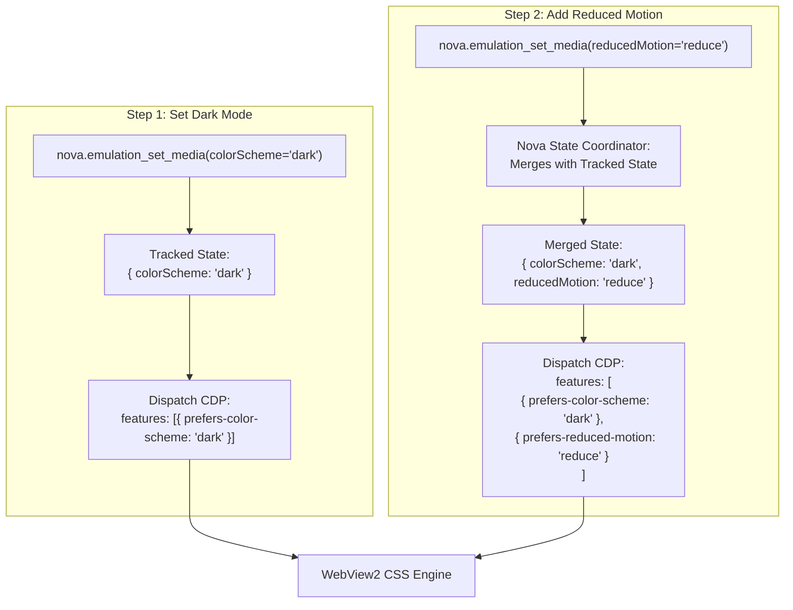
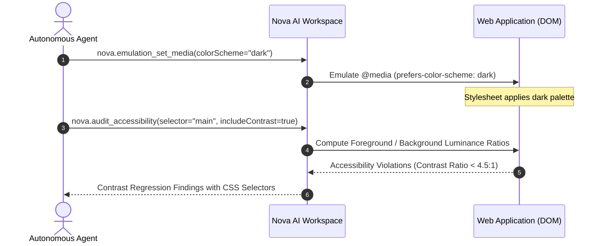

# CSS Color Schemes, Reduced Motion & Accessibility Emulation

> [!NOTE]
> Modern web applications increasingly rely on CSS Media Queries Level 5 to adapt typography, color palettes, and motion graphics to user preferences and accessibility needs. Evaluating dark mode legibility, vestibular motion safety, and Windows High Contrast compatibility has historically required changing the entire operating system's settings. Nova AI Workspace provides **per-tab CSS media feature emulation** via [`nova.emulation_set_media`](../../../../mcp-reference/tools/device-emulation/nova-emulation-set-media.md), backed by an **additive state merge contract**.

---

## 1. Architectural Motivation: Accessibility Compliance & Theming

User experience and accessibility standards (WCAG 2.2) mandate that applications respect user preferences:

```
┌────────────────────────────────────────────────────────────────────────┐
│                   CSS Media Feature Accessibility Vectors              │
├───────────────────┬────────────────────────────────────────────────────┤
│ Media Feature     │ WCAG Criterion & Engineering Objective             │
├───────────────────┼────────────────────────────────────────────────────┤
│ `colorScheme`     │ Audits dark mode color inversion to prevent muddy  │
│ (`prefers-color-  │ typography contrast regressions failing WCAG 2.2   │
│ scheme: dark`)    │ Level AA (4.5:1 for normal text).                  │
├───────────────────┼────────────────────────────────────────────────────┤
│ `reducedMotion`   │ WCAG 2.2 SC 2.3.3 (Animation from Interactions).   │
│ (`prefers-reduced-│ Disables vestibular triggers: parallax scrolling,   │
│ motion: reduce`)  │ smooth auto-scrolls, and autoplay video/canvas.    │
├───────────────────┼────────────────────────────────────────────────────┤
│ `forcedColors`    │ Windows High Contrast Mode. Forces custom UI to    │
│ (`forced-colors:  │ render clear borders and system semantic colors.   │
│ active`)          │                                                    │
├───────────────────┼────────────────────────────────────────────────────┤
│ `contrast`        │ Audits layouts under `@media (prefers-contrast:    │
│ (`prefers-        │ more)` for visually impaired users.                │
│ contrast: more`)  │                                                    │
└───────────────────┴────────────────────────────────────────────────────┘
```

Nova allows autonomous agents to toggle and combine these features on individual browser tabs without modifying the Windows host registry or restarting the browser.

---

## 2. Technical Implementation: The Additive State Merge Contract

In the raw Chrome DevTools Protocol (CDP), invoking `Emulation.setEmulatedMedia` suffers from an architectural limitation: **it replaces the entire array of emulated media features**.

If an agent executes:
1. `Emulation.setEmulatedMedia({ features: [{ name: "prefers-color-scheme", value: "dark" }] })`
2. Followed by: `Emulation.setEmulatedMedia({ features: [{ name: "prefers-reduced-motion", value: "reduce" }] })`

The second CDP call completely wipes out `prefers-color-scheme`, silently resetting the page to light mode!

### Nova's Additive Coordinator
Nova resolves this by maintaining an internal, per-tab state coordinator:



### Merging Rules:
* Any feature specified in a tool call updates that feature's value in the tab's tracked state.
* Any feature omitted from the call retains its previously active emulated value.
* The merged state is dispatched to CDP atomically.
* Both dark mode and reduced motion remain active simultaneously, allowing multi-condition accessibility audits.

---

## 3. Dark Mode Contrast Auditing

When dark mode is activated, websites frequently introduce severe contrast regressions—such as placing dark gray text (`#71717A`) against a dark background (`#18181B`), yielding a contrast ratio of $1.8:1$ (failing WCAG AA).

Autonomous agents can combine media emulation with Nova's automated accessibility auditor:



---

## 4. Vestibular Safety: Verifying Reduced Motion

Users with vestibular disorders experience dizziness or nausea from unexpected motion. Web applications must comply with WCAG 2.2 SC 2.3.3 by silencing non-essential animations when `prefers-reduced-motion: reduce` is detected:

```css
@media (prefers-reduced-motion: reduce) {
  *, *::before, *::after {
    animation-duration: 0.01ms !important;
    animation-iteration-count: 1 !important;
    transition-duration: 0.01ms !important;
    scroll-behavior: auto !important;
  }
}
```

### Verification Recipe:
1. Enable reduced motion:
   ```json
   {
     "reducedMotion": "reduce"
   }
   ```
2. Measure layout stability using [`nova.measure_web_vitals`](../../../../mcp-reference/tools/layout-and-qa/nova-measure-web-vitals.md) to assert that Cumulative Layout Shift (CLS) remains at `0.0`.
3. Inspect computed CSS animation properties using [`nova.get_computed_style`](../../../../mcp-reference/tools/layout-and-qa/nova-get-computed-style.md).

---

## 5. Windows High-Contrast Mode (`forcedColors`)

Windows High Contrast mode overrides website styling with user-defined system palette tokens:
* Backgrounds become solid black.
* Text becomes pure white or yellow.
* Transparent buttons lose background styling, rendering them invisible unless explicit CSS borders are defined.

Enabling `forcedColors: "active"` allows agents to audit whether custom buttons, form inputs, and interactive badges maintain clear, visible outlines when author-defined background colors are stripped:

```json
{
  "forcedColors": "active"
}
```

---

## 6. Resetting Emulated Media (`nova.emulation_clear_media`)

When accessibility testing completes, calling [`nova.emulation_clear_media`](../../../../mcp-reference/tools/device-emulation/nova-emulation-clear-media.md) resets the tab's media state back to the host operating system defaults:

```json
{}
```

Response confirms complete clearing:
```json
{
  "structuredContent": {
    "targetId": "tab-1",
    "cleared": true
  }
}
```

---

## Related Documentation

* [Domain Hub: CSS Media Features & Theme Emulation](../README.md)
* [Subguide: Print Media & PDF Synthesis](../print-media-and-pdf-synthesis/README.md)
* [Master Hub: Device Emulation Architecture](../../README.md)
* [Automated Accessibility (a11y) Engine](../../../layout-and-web-vitals/accessibility-audit/README.md)
* [Tool Reference: `nova.emulation_set_media`](../../../../mcp-reference/tools/device-emulation/nova-emulation-set-media.md)
