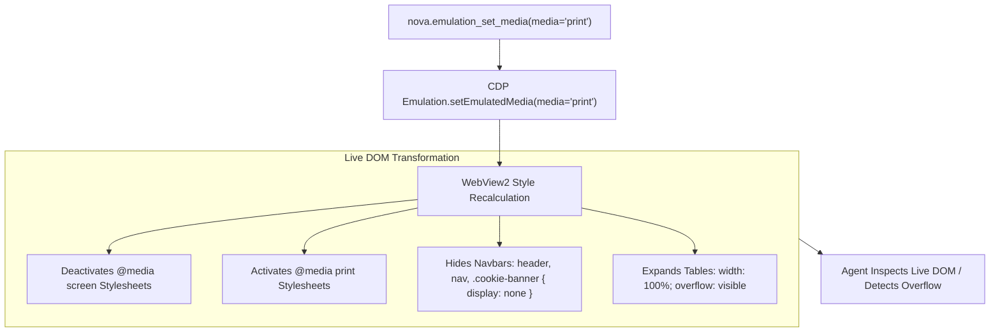
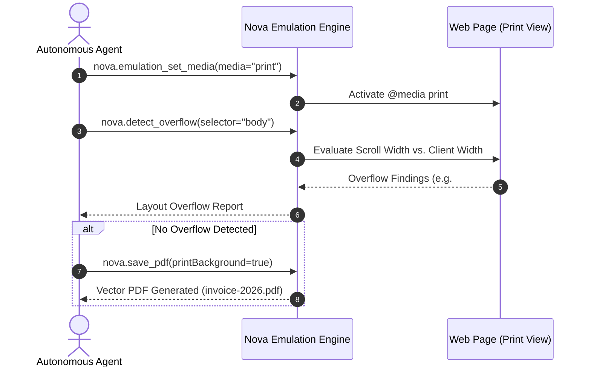

# Print Media Stylesheets & High-Fidelity PDF Synthesis

> [!NOTE]
> Web applications frequently generate invoices, boarding passes, healthcare records, and legal contracts designed for physical print or PDF archiving. These documents rely on `@media print` CSS stylesheets that suppress navigation headers, reformat data tables, and control page-break boundaries. Nova AI Workspace enables autonomous agents to **preview print stylesheets in-browser** via [`nova.emulation_set_media`](../../../../mcp-reference/tools/device-emulation/nova-emulation-set-media.md) and capture pixel-perfect vector documents via [`nova.save_pdf`](../../../../mcp-reference/tools/visual-evidence/nova-save-pdf.md).

---

## 1. Architectural Motivation: Screen vs. Print Media

Web browsers render documents across two primary media types:

```
┌────────────────────────────────────────────────────────────────────────┐
│                      Screen Media vs. Print Media                      │
├───────────────────┬────────────────────────────────────────────────────┤
│ Dimension         │ Screen Media (`@media screen`)                     │
├───────────────────┼────────────────────────────────────────────────────┤
│ Viewport Model    │ Continuous scrolling canvas with fixed headers,    │
│                   │ interactive navigation sidebars, and sticky footers│
├───────────────────┼────────────────────────────────────────────────────┤
│ Page Boundaries   │ Infinite vertical height; no page break logic.     │
├───────────────────┼────────────────────────────────────────────────────┤
│ Dimension         │ Print Media (`@media print`)                       │
├───────────────────┼────────────────────────────────────────────────────┤
│ Viewport Model    │ Paged media format (e.g. A4, Letter, Legal) with   │
│                   │ explicit margins (top, right, bottom, left).       │
├───────────────────┼────────────────────────────────────────────────────┤
│ Content Filtering │ Navigation bars, cookie banners, chat widgets, and │
│                   │ background videos are suppressed (`display: none`).│
├───────────────────┼────────────────────────────────────────────────────┤
│ Pagination Rules  │ Controls page breaks (`break-inside: avoid;`,      │
│                   │ `page-break-after: always;`) to prevent split rows.│
└───────────────────┴────────────────────────────────────────────────────┘
```

Without print media emulation, testing print layouts required printing physical paper or opening external PDF viewer applications. Nova allows agents to switch the live browser renderer into print mode instantly.

---

## 2. Emulating Print Media in the Live DOM

Agents switch the rendering engine to print mode using `nova.emulation_set_media`:

```json
{
  "media": "print"
}
```



### Immediate Visual Feedback:
* Navigation bars, promotional banners, and floating action buttons disappear.
* Content expands to standard printable widths.
* Background colors may convert to grayscale or transparent depending on CSS `@media print` rules.

---

## 3. Detecting Print Layout Regressions (`nova.detect_overflow`)

Print stylesheets frequently introduce severe layout defects:
* Fixed-width tables that spill past standard A4 printable margins (210mm).
* Text blocks clipped by unexpanded containers.
* Orphaned headers positioned at the bottom of pages.

While in print media mode, agents can run layout audits:



---

## 4. Vector PDF Synthesis (`nova.save_pdf`)

Once the print layout has been verified in the live DOM, agents can export an archival-grade vector PDF via [`nova.save_pdf`](../../../../mcp-reference/tools/visual-evidence/nova-save-pdf.md):

```json
{
  "printBackground": true,
  "paperWidth": 8.27,
  "paperHeight": 11.69,
  "marginTop": 0.4,
  "marginBottom": 0.4,
  "marginLeft": 0.4,
  "marginRight": 0.4
}
```

### Key PDF Generation Parameters:
* **`printBackground`:** When `true`, preserves CSS background colors and images (essential for branded invoices and colored status chips).
* **Dimensions:** Standard DIN A4 dimensions ($8.27 \times 11.69$ inches) or US Letter ($8.5 \times 11$ inches).
* **Vector Text:** Text is preserved as selectable, searchable vector glyphs rather than rasterized bitmap images.

---

## 5. Clean Reversion to Screen Media

When document verification or PDF export completes, the agent must restore standard screen rendering so subsequent browser automation tasks function normally:

```json
// nova.emulation_clear_media
{}
```

Alternatively, the agent can explicitly restore screen mode while maintaining any active theme overrides:
```json
// nova.emulation_set_media
{
  "media": "screen"
}
```

---

## Related Documentation

* [Domain Hub: CSS Media Features & Theme Emulation](../README.md)
* [Subguide: Color Schemes & Accessibility](../color-schemes-and-accessibility/README.md)
* [Master Hub: Device Emulation Architecture](../../README.md)
* [Layout Quality, Overflow & Accessibility](../../../layout-and-web-vitals/README.md)
* [Tool Reference: `nova.save_pdf`](../../../../mcp-reference/tools/visual-evidence/nova-save-pdf.md)
