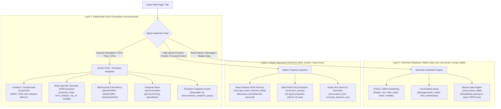

# DOM Perception, Structured Reading & Spatial Vision

> [!IMPORTANT]
> Modern web applications are not flat, static documents. They are reactive, component-driven interfaces featuring encapsulated Shadow DOM boundaries, virtualized infinite feeds, asynchronous client-side rendering, and complex CSS layouts. Dumping raw HTML or flat `innerText` overwhelms LLM context windows and destroys spatial hierarchy. Nova AI Workspace resolves this through a **three-layer perception architecture**: multimodal fusion perception (`nova.perceive`), semantic landmark partitioning (`nova.read_text_structured`, `nova.extract_table`), and deep shadow-piercing element inspection (`nova.dom_extract`, `nova.get_active_element_deep`).

---

## 1. Overview & Architectural Philosophy

When an autonomous AI agent inspects a web page, conventional scrapers and headless browser wrappers introduce severe operational bottlenecks:

1. **Context Window Flooding:** A full HTML dump of a modern Single Page Application (SPA) frequently exceeds 150,000 characters (35,000+ tokens), the vast majority of which consists of boilerplate markup, SVG paths, inline CSS, and client-side tracking scripts.
2. **Loss of Spatial & Visual Context:** Standard DOM queries discard geometric layout. An agent reading a flat text stream cannot tell whether a button is prominent and centered above the fold or buried inside an invisible, off-screen drawer.
3. **Shadow DOM & Web Component Opacity:** Enterprise portals (such as Salesforce Lightning, Workday, and Lit components) isolate internal templates inside Shadow Roots. Standard `document.querySelector` fails to penetrate these boundaries, leaving agents blind to interactive inputs.
4. **Virtualization Blindness:** Long feeds and reverse-scroll chat surfaces (Slack, ChatGPT, Teams) virtualize their DOM nodes, unmounting elements that scroll out of view. Without fold metrics, an agent cannot know whether unrendered messages exist above or below the viewport.

Nova addresses these challenges through a coordinated **Three-Layer Perception Stack**:



---

## 2. The Three-Layer Perception Stack

Nova organizes its DOM and reading capabilities into three distinct operational layers:

| Layer | Primary Tools | Operational Purpose | Output Format | Token Footprint |
| :--- | :--- | :--- | :--- | :--- |
| **Layer 1: Multimodal Fusion Perception** | [`nova.perceive`](../../mcp-reference/tools/dom-and-reading/nova-perceive.md)<br>[`nova.perceive_snapshot_query`](../../mcp-reference/tools/dom-and-reading/nova-perceive-snapshot-query.md) | Coordinated visual snapshot + structured semantic page model. | JPEG/PNG image + JSON semantic tree | Medium (500–2,500 tokens) |
| **Layer 2: Semantic Reading & Tables** | [`nova.read_text_structured`](../../mcp-reference/tools/dom-and-reading/nova-read-text-structured.md)<br>[`nova.extract_table`](../../mcp-reference/tools/dom-and-reading/nova-extract-table.md)<br>[`nova.read_text`](../../mcp-reference/tools/dom-and-reading/nova-read-text.md) | Token-efficient text extraction partitioned by HTML5 landmark regions, conversation logs, or tabular data. | Structured JSON (`regions`, `messages`, `tables`) or clean text | Minimal (200–1,500 tokens) |
| **Layer 3: Deep Traversal & Geometry** | [`nova.dom_extract`](../../mcp-reference/tools/dom-and-reading/nova-dom-extract.md)<br>[`nova.get_active_element_deep`](../../mcp-reference/tools/dom-and-reading/nova-get-active-element-deep.md)<br>[`nova.search_text`](../../mcp-reference/tools/dom-and-reading/nova-search-text.md)<br>[`nova.get_element_rect`](../../mcp-reference/tools/dom-and-reading/nova-get-element-rect.md) | Targeted property inspection, shadow DOM penetration, exact bounding box calculation, and text search. | Strongly-typed property arrays & bounding geometry | Micro (<100 tokens) |

---

## 3. Subsystem Architecture

The perception subsystem is broken down into three specialized architectural areas:

| Subsystem Guide | Scope & Key Concepts | Primary MCP Tools |
| :--- | :--- | :--- |
| **[Multimodal Fusion Perception](multimodal-perception/README.md)** | Atomic coordination of visual pixels and semantic structure, 6 specialized perception modes (`summary`, `state`, `form_analysis`, `cta_detection_v3`, `modals`, `full`), bidirectional fold accounting (`aboveFoldPx`/`belowFoldPx`), CTA delta sync (`sinceRev`), temporal capture skew detection, and snapshot caching. | `nova.perceive`<br>`nova.perceive_snapshot_query` |
| **[Semantic Landmark Reading & Tabular Extraction](semantic-reading/README.md)** | Regional HTML5/ARIA text partitioning (`header`, `nav`, `main`, `aside`, `footer`, `modals`), subtree scoping via ` >>> `, conversation feed extraction with role normalization, tabular data parsing (`nova.extract_table`), and clean Markdown extraction. | `nova.read_text_structured`<br>`nova.extract_table`<br>`nova.read_text` |
| **[Deep Element Traversal & Geometry](element-inspection/README.md)** | Piercing open Shadow DOM boundaries, innermost focused element resolution (`nova.get_active_element_deep`), safe native property extraction without JS execution (`nova.dom_extract`), visual text search with traversal paths, and layout viewport metrics. | `nova.dom_extract`<br>`nova.get_active_element_deep`<br>`nova.search_text`<br>`nova.get_element_rect`<br>`nova.get_layout_metrics` |

---

## 4. Tool Selection Matrix for Autonomous Agents

Choosing the optimal read tool depends on the agent's current task phase:

```
┌────────────────────────────────────────────────────────────────────────┐
│                      Perception Tool Selection Guide                   │
├───────────────────────────────┬────────────────────────────────────────┤
│ Operational Scenario          │ Recommended Tool & Mode                │
├───────────────────────────────┼────────────────────────────────────────┤
│ Initial page navigation or    │ nova.perceive                          │
│ general post-click review     │ mode="summary", deep=true              │
├───────────────────────────────┼────────────────────────────────────────┤
│ Preparing form completion or  │ nova.perceive                          │
│ checkout data entry           │ mode="form_analysis"                   │
├───────────────────────────────┼────────────────────────────────────────┤
│ Rapid polling / waiting for   │ nova.perceive                          │
│ state transition without text │ mode="state", responseDetail="essential"│
├───────────────────────────────┼────────────────────────────────────────┤
│ Reading an article, blog post │ nova.read_text_structured              │
│ or documentation page         │ mode="landmarks" (inspect main region) │
├───────────────────────────────┼────────────────────────────────────────┤
│ Auditing chat history or      │ nova.read_text_structured              │
│ comment thread                │ mode="conversation", selector="..."    │
├───────────────────────────────┼────────────────────────────────────────┤
│ Extracting financial metrics, │ nova.extract_table                     │
│ pricing tiers or schedules    │ selector="table.data-grid"             │
├───────────────────────────────┼────────────────────────────────────────┤
│ Checking focused element in   │ nova.get_active_element_deep           │
│ Salesforce / Lit component    │                                        │
├───────────────────────────────┼────────────────────────────────────────┤
│ Reading 50 product links &    │ nova.dom_extract                       │
│ prices without running JS     │ properties=["text", "href", "rect"]    │
└───────────────────────────────┴────────────────────────────────────────┘
```

---

## Related Documentation

* [Multimodal Fusion Perception Architecture](multimodal-perception/README.md)
* [Semantic Landmark Reading & Tabular Extraction](semantic-reading/README.md)
* [Deep Element Traversal & Geometry](element-inspection/README.md)
* [Browser Interaction Architecture](../browser-interaction/README.md)
* [Consent Management & Blocker Clearance](../consent-management/README.md)
* [Tool Catalog: DOM Perception & Semantic Extraction](../../mcp-reference/tools/dom-and-reading/README.md)
