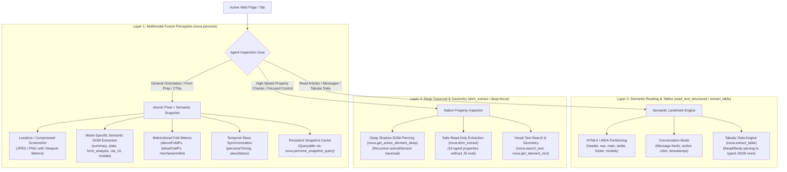

# DOM Perception, Structured Reading & Spatial Vision

> [!IMPORTANT]
> Modern web applications are not flat, static documents. They are reactive, component-driven interfaces featuring encapsulated Shadow DOM boundaries, virtualized infinite feeds, asynchronous client-side rendering, and complex CSS layouts. Dumping raw HTML or flat `innerText` overwhelms LLM context windows and destroys spatial hierarchy. Nova AI Workspace resolves this through a **three-layer perception architecture**: multimodal fusion perception (`nova.perceive`), semantic landmark partitioning (`nova.read_text_structured`, `nova.extract_table`), and deep shadow-piercing element inspection (`nova.dom_extract`, `nova.get_active_element_deep`).

---

## 1. Overview & Architectural Philosophy

When an autonomous AI agent inspects a web page, conventional scrapers and headless browser wrappers introduce severe operational bottlenecks:

1. **Context Window Flooding:** A full HTML dump of a modern Single Page Application (SPA) frequently exceeds 150,000 characters (35,000+ tokens), the vast majority of which consists of boilerplate markup, SVG paths, inline CSS, and client-side tracking scripts.
2. **Loss of Spatial & Visual Context:** Standard DOM queries discard geometric layout. An agent reading a flat text stream cannot tell whether a button is prominent and centered above the fold or buried inside an invisible, off-screen drawer.
3. **Shadow DOM & Web Component Opacity:** Enterprise portals (such as Salesforce Lightning, Workday, and Lit components) isolate internal templates inside Shadow Roots. Standard `document.querySelector` fails to penetrate these boundaries, leaving agents blind to interactive inputs.
4. **Virtualization Blindness:** Long feeds and reverse-scroll chat surfaces (Slack, ChatGPT, Teams) virtualize their DOM nodes, unmounting elements that scroll out of view. Without fold metrics, an agent cannot know whether unrendered messages exist above or below the viewport.

Nova addresses these challenges through a coordinated **Three-Layer Perception Stack**:



---

## 2. The Three-Layer Perception Stack

Nova organizes its DOM and reading capabilities into three distinct operational layers:

| Layer | Primary Tools | Operational Purpose | Output Format | Token Footprint |
| :--- | :--- | :--- | :--- | :--- |
| **Layer 1: Multimodal Fusion Perception** | [`nova.perceive`](../../mcp-reference/tools/dom-and-reading/nova-perceive.md)<br>[`nova.perceive_snapshot_query`](../../mcp-reference/tools/dom-and-reading/nova-perceive-snapshot-query.md) | Coordinated visual snapshot + structured semantic page model. | JPEG/PNG image + JSON semantic tree | Medium (500–2,500 tokens) |
| **Layer 2: Semantic Reading & Tables** | [`nova.read_text_structured`](../../mcp-reference/tools/dom-and-reading/nova-read-text-structured.md)<br>[`nova.extract_table`](../../mcp-reference/tools/dom-and-reading/nova-extract-table.md)<br>[`nova.read_text`](../../mcp-reference/tools/dom-and-reading/nova-read-text.md) | Token-efficient text extraction partitioned by HTML5 landmark regions, conversation logs, or tabular data. | Structured JSON (`regions`, `messages`, `tables`) or clean text | Minimal (200–1,500 tokens) |
| **Layer 3: Deep Traversal & Geometry** | [`nova.dom_extract`](../../mcp-reference/tools/dom-and-reading/nova-dom-extract.md)<br>[`nova.get_active_element_deep`](../../mcp-reference/tools/dom-and-reading/nova-get-active-element-deep.md)<br>[`nova.search_text`](../../mcp-reference/tools/dom-and-reading/nova-search-text.md)<br>[`nova.get_element_rect`](../../mcp-reference/tools/dom-and-reading/nova-get-element-rect.md) | Targeted property inspection, shadow DOM penetration, exact bounding box calculation, and text search. | Strongly-typed property arrays & bounding geometry | Micro (<100 tokens) |

---

## 3. Comprehensive Documentation Index

The perception subsystem is organized into three specialized architectural areas and six deep-dive technical guides:

```
public/docs/core-features/dom-perception/
├── README.md                                         # This master hub
├── multimodal-perception/
│   ├── README.md                                     # Multimodal fusion perception hub
│   ├── fusion-pipeline-and-modes/
│   │   └── README.md                                 # Fusion pipeline, perceiveTiming, skew detection, and 6 perception modes
│   └── fold-metrics-and-snapshots/
│       └── README.md                                 # Bidirectional fold metrics, CTA delta sync, and snapshot caching
├── semantic-reading/
│   ├── README.md                                     # Semantic landmark reading & tabular extraction hub
│   ├── landmark-and-conversation-reading/
│   │   └── README.md                                 # HTML5/ARIA landmark slicing, conversation mode, reply-watch continuation
│   └── tabular-data-extraction/
│       └── README.md                                 # Native C# table parser, header auto-detection, empty cell alignment
└── element-inspection/
    ├── README.md                                     # Deep element traversal, geometry & shadow boundaries hub
    ├── shadow-dom-and-deep-focus/
    │   └── README.md                                 # Shadow DOM piercing, get_active_element_deep, >>> combinator, 16 typed properties
    └── geometry-and-visual-search/
        └── README.md                                 # nova.search_text, get_element_rect center points, and get_layout_metrics
```

| Area | Architecture Guide | Scope & Key Concepts | Primary Components |
| :--- | :--- | :--- | :--- |
| **Multimodal Perception** | **[Multimodal Fusion Perception Hub](multimodal-perception/README.md)** | Architectural role, atomic coordination concept, temporal skew synchronization, and persistent snapshot caching overview. | `McpPerceiveHandler`<br>`nova.perceive`<br>`PerceiveSnapshotStore` |
| | **[Multimodal Fusion Pipeline & Modes](multimodal-perception/fusion-pipeline-and-modes/README.md)** | Single-phase pixel + DOM fusion pipeline, temporal capture skew synchronization (`perceiveTiming`), `skewStatus` thresholds, and the 6 specialized perception modes (`summary`, `state`, `form_analysis`, `cta_detection_v3`, `modals`, `full`). | `McpPerceiveHandler`<br>`perceiveTiming`<br>`skewStatus`<br>`mode="summary"`<br>`mode="state"` |
| | **[Fold Metrics, Virtualization & Snapshots](multimodal-perception/fold-metrics-and-snapshots/README.md)** | Bidirectional fold accounting (`aboveFoldPx`/`belowFoldPx`), handling reverse-scroll chat windows and virtualized feeds, CTA prominence scoring with stable handles (`ctaRef`), delta synchronization (`sinceRev`), cross-origin frame isolation (`opaqueFrames[]`), and persistent offline snapshot caching (`nova.perceive_snapshot_query`). | `completeness`<br>`aboveFoldPx`<br>`belowFoldPx`<br>`cta_detection_v3`<br>`nova.perceive_snapshot_query` |
| **Semantic Reading** | **[Semantic Reading & Tables Hub](semantic-reading/README.md)** | Role of semantic text extraction, the problem of flat text dumps, and regional partitioning architecture. | `McpServer.ReadTextStructured`<br>`TableExtractor`<br>`nova.read_text` |
| | **[Landmark-Scoped & Conversational Reading](semantic-reading/landmark-and-conversation-reading/README.md)** | Partitioning page text by WAI-ARIA and HTML5 landmarks (`header`, `nav`, `main`, `aside`, `footer`, `modals`), token reduction up to 75%, per-region character caps (`maxCharsPerRegion`), Shadow DOM piercing via ` >>> `, conversational message extraction (`mode: "conversation"`), and clean Markdown extraction (`nova.read_text`). | `LandmarkExtractor`<br>`ConversationProjector`<br>`replyWatchId`<br>`maxCharsPerRegion` |
| | **[Tabular Data Extraction Engine](semantic-reading/tabular-data-extraction/README.md)** | Native C# HTML table parser (`nova.extract_table`), automatic column header discovery (`<thead>` / leading `<th>`), synthetic column fallbacks, row cell alignment with empty cell preservation (`""`), cell normalization, and container-scoped table extraction. | `TableExtractor`<br>`nova.extract_table`<br>`headers[]`<br>`rows[][]`<br>`maxCellChars` |
| **Element Inspection** | **[Deep Element Traversal & Geometry Hub](element-inspection/README.md)** | Shadow DOM barrier overview, deep element resolution concept, and native property inspection advantages. | `McpServer.DomExtract`<br>`DeepActiveElementResolver`<br>`nova.search_text` |
| | **[Shadow DOM Piercing & Deep Focus](element-inspection/shadow-dom-and-deep-focus/README.md)** | Piercing open Shadow Roots, innermost focus discovery (`nova.get_active_element_deep`), `shadowChain` hierarchy, the ` >>> ` combinator across selectors, and safe strongly-typed native property extraction (`nova.dom_extract`) across 16 properties without JS execution. | `nova.get_active_element_deep`<br>`ShadowCombinator`<br>`nova.dom_extract`<br>`properties[]` |
| | **[Geometry, Viewport Metrics & Visual Search](element-inspection/geometry-and-visual-search/README.md)** | Visual text search in live DOM (`nova.search_text`), selector synthesis with Shadow DOM paths, exact element bounding client geometry (`nova.get_element_rect`), automated center coordinate calculation, and layout/visual viewport metrics (`nova.get_layout_metrics`). | `nova.search_text`<br>`nova.get_element_rect`<br>`nova.get_layout_metrics`<br>`ViewportMetrics` |

---

## 4. Tool Selection Matrix for Autonomous Agents

Choosing the optimal read tool depends on the agent's current task phase:

```
┌────────────────────────────────────────────────────────────────────────┐
│                      Perception Tool Selection Guide                   │
├───────────────────────────────┬────────────────────────────────────────┤
│ Operational Scenario          │ Recommended Tool & Mode                │
├───────────────────────────────┼────────────────────────────────────────┤
│ Initial page navigation or    │ nova.perceive                          │
│ general post-click review     │ mode="summary", deep=true              │
├───────────────────────────────┼────────────────────────────────────────┤
│ Preparing form completion or  │ nova.perceive                          │
│ checkout data entry           │ mode="form_analysis"                   │
├───────────────────────────────┼────────────────────────────────────────┤
│ Rapid polling / waiting for   │ nova.perceive                          │
│ state transition without text │ mode="state", responseDetail="essential"│
├───────────────────────────────┼────────────────────────────────────────┤
│ Reading an article, blog post │ nova.read_text_structured              │
│ or documentation page         │ mode="landmarks" (inspect main region) │
├───────────────────────────────┼────────────────────────────────────────┤
│ Auditing chat history or      │ nova.read_text_structured              │
│ comment thread                │ mode="conversation", selector="..."    │
├───────────────────────────────┼────────────────────────────────────────┤
│ Extracting financial metrics, │ nova.extract_table                     │
│ pricing tiers or schedules    │ selector="table.data-grid"             │
├───────────────────────────────┼────────────────────────────────────────┤
│ Checking focused element in   │ nova.get_active_element_deep           │
│ Salesforce / Lit component    │                                        │
├───────────────────────────────┼────────────────────────────────────────┤
│ Reading 50 product links &    │ nova.dom_extract                       │
│ prices without running JS     │ properties=["text", "href", "rect"]    │
└───────────────────────────────┴────────────────────────────────────────┘
```

---

## Related Documentation

* [Multimodal Fusion Perception Architecture](multimodal-perception/README.md)
* [Semantic Landmark Reading & Tabular Extraction](semantic-reading/README.md)
* [Deep Element Traversal & Geometry](element-inspection/README.md)
* [Browser Interaction Architecture](../browser-interaction/README.md)
* [Consent Management & Blocker Clearance](../consent-management/README.md)
* [Tool Catalog: DOM Perception & Semantic Extraction](../../mcp-reference/tools/dom-and-reading/README.md)
