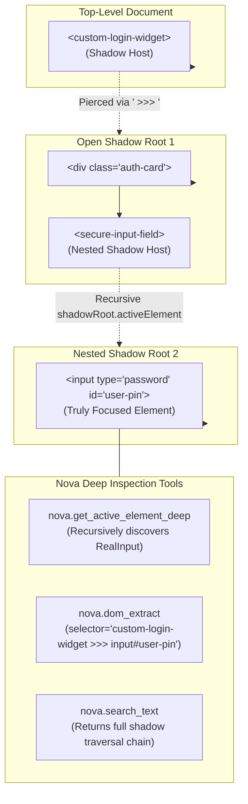

# Deep Element Traversal, Geometry & Shadow Boundaries

> [!NOTE]
> Modern enterprise portals—such as Salesforce Lightning, ServiceNow, Workday, and interfaces built with Lit or Web Components—encapsulate their internal UI within Shadow DOM trees. Standard DOM queries stop at the host element, leaving autonomous agents unable to inspect focused inputs or extract component properties. Nova AI Workspace resolves this through deep Shadow-Root traversal, native read-only property extraction (`nova.dom_extract`), and spatial coordinate metrics.

---

## 1. The Shadow DOM Encapsulation Barrier

When an element resides inside an open Shadow Root:
1. `document.querySelector('input.form-control')` returns `null` because standard selectors cannot penetrate shadow boundaries.
2. `document.activeElement` reports only the top-level custom element host (e.g. `<salesforce-input-field>`) rather than the actual `<input>` currently receiving keystrokes.
3. Evaluating ad-hoc JavaScript via `eval` to traverse `.shadowRoot` manually introduces security vulnerabilities, triggers Content Security Policy (CSP) errors, and risks executing side effects.

Nova introduces native host-level traversals and the ` >>> ` combinator to pierce these barriers safely:



---

## 2. Innermost Focus Resolution (`nova.get_active_element_deep`)

When an agent needs to verify where text input will be delivered, standard browser APIs fail in component architectures:

* Standard `document.activeElement`: Returns `<my-text-editor>` (the custom element wrapper).
* `nova.get_active_element_deep`: Recursively traverses:
  ```
  document.activeElement
    └── .shadowRoot.activeElement
          └── .shadowRoot.activeElement (Innermost <textarea>)
  ```

### Sample Response:
```json
{
  "targetId": "tab-101",
  "result": {
    "ok": true,
    "focused": true,
    "tagName": "TEXTAREA",
    "id": "composer-input",
    "className": "ProseMirror focused",
    "role": "textbox",
    "ariaLabel": "Send a message...",
    "shadowChain": ["chat-workspace", "message-composer", "rich-editor"],
    "rect": {
      "x": 320,
      "y": 740,
      "width": 800,
      "height": 120
    }
  }
}
```

The returned `shadowChain` informs the agent of the exact nesting hierarchy, while `rect` provides absolute viewport coordinates for click dispatch.

---

## 3. Safe Strongly-Typed Extraction (`nova.dom_extract`)

When inspecting hundreds of elements (such as product links in a catalog or table rows in an admin console), evaluating arbitrary JavaScript snippets via `nova.eval` is slow and unsafe.

`nova.dom_extract` executes a native, read-only extraction pipeline over all elements matching a CSS selector without invoking arbitrary code:

```json
{
  "targetId": "tab-101",
  "selector": "div.product-grid >>> a.product-link",
  "properties": ["text", "href", "rect", "ariaLabel"],
  "maxItems": 50,
  "visibleOnly": true
}
```

### The 16 Extractable Properties:

| Property | Type | Description |
| :--- | :--- | :--- |
| `text` | `string` | Trimmed visible inner text of the element. |
| `value` | `string` | Current form value (for `<input>`, `<textarea>`, `<select>`). |
| `checked` | `boolean` | Checked status for checkboxes and radio buttons. |
| `selected` | `boolean` | Selected state for `<option>` items. |
| `disabled` | `boolean` | Whether the interactive element is disabled. |
| `href` | `string` | Resolved absolute hyperlink destination for `<a>` tags. |
| `src` | `string` | Resolved URL for ``, `<video>`, `<audio>`, or `<iframe>`. |
| `title` | `string` | HTML `title` tooltip attribute. |
| `ariaLabel` | `string` | Computed accessible name or `aria-label` attribute. |
| `role` | `string` | Explicit ARIA role (e.g. `button`, `combobox`, `tab`). |
| `tagName` | `string` | Uppercase HTML tag name (`BUTTON`, `INPUT`, `A`). |
| `id` | `string` | Element's unique `id` attribute. |
| `className` | `string` | Raw CSS class string. |
| `rect` | `object` | Bounding client coordinates (`x`, `y`, `width`, `height`). |
| `dataset` | `object` | Parsed `data-*` attribute key-value pairs. |
| `placeholder` | `string` | Placeholder text for input controls. |

### Protection Invariants:
* **Zero Script Execution:** Executes entirely via browser-native DOM traversal without evaluating strings in the page context.
* **CSP Immune:** Functions normally on banking and healthcare portals with strict `Content-Security-Policy: script-src 'none'` headers.
* **Bounded Output:** Enforces `maxItems` and `maxChars` limits to prevent LLM context exhaustion.

---

## 4. Visual Text Search & Traversal Paths (`nova.search_text`)

When an agent needs to locate an element based on visible human-readable text (such as finding where *"Upgrade Plan"* or *"Confirm Booking"* appears on a busy page), manual DOM inspection requires multiple trial-and-error round-trips.

[`nova.search_text`](../../../mcp-reference/tools/dom-and-reading/nova-search-text.md) searches the live DOM for visible text occurrences and returns actionable interaction data:

```json
{
  "targetId": "tab-101",
  "text": "Upgrade Plan",
  "exactMatch": true,
  "visibleOnly": true
}
```

### Returned Match Details:
* **Actionable CSS Selector:** Synthesizes a stable, robust CSS selector targeting the matched element.
* **Shadow Traversal Path:** If the text is encapsulated inside Web Components, returns the exact ` >>> ` path required to target it.
* **Bounding Client Rectangle (`rect`):** Immediate pixel coordinates for mouse hover or click operations.
* **Visibility Status:** Confirms whether the text is currently in the visible viewport, scrolled out of view, or occluded by an overlay.

---

## 5. Spatial Coordinates & Viewport Metrics

Autonomous browser interaction requires precise understanding of viewport scaling, device pixel ratios, and document boundaries:

### A. Element Bounding Geometry (`nova.get_element_rect`)
Returns the exact pixel bounding box relative to the client viewport:
```json
{
  "x": 150.5,
  "y": 320.0,
  "width": 240.0,
  "height": 48.0,
  "top": 320.0,
  "right": 390.5,
  "bottom": 368.0,
  "left": 150.5
}
```
Nova automatically calculates the center coordinate (`x + width/2`, `y + height/2`) for dispatching humanized mouse gestures via `nova.input_click` and `nova.input_drag_humanized`.

### B. Layout Metrics (`nova.get_layout_metrics`)
Returns authoritative viewport dimensions and scroll positions:
* **Layout Viewport:** The standard document viewport dimensions (`clientWidth`, `clientHeight`).
* **Visual Viewport:** Captures mobile pinch-to-zoom offsets and page zoom scale factors (`pageScaleFactor`).
* **Scrollable Content Size:** Total scrollable width and height of the document, allowing agents to accurately calculate scroll percentages before executing `nova.scroll_smart`.

---

## Related Documentation

* [DOM Perception & Structured Reading Overview](../README.md)
* [Multimodal Fusion Perception Architecture](../multimodal-perception/README.md)
* [Semantic Landmark Reading & Tabular Extraction](../semantic-reading/README.md)
* [Browser Interaction Architecture](../../browser-interaction/README.md)
* [Tool Reference: `nova.dom_extract`](../../../mcp-reference/tools/dom-and-reading/nova-dom-extract.md)
* [Tool Reference: `nova.get_active_element_deep`](../../../mcp-reference/tools/dom-and-reading/nova-get-active-element-deep.md)
* [Tool Reference: `nova.search_text`](../../../mcp-reference/tools/dom-and-reading/nova-search-text.md)
