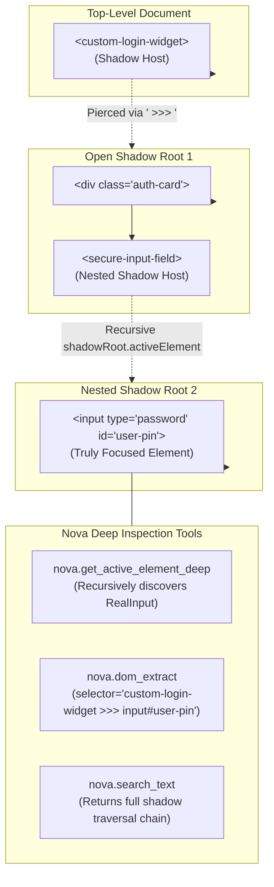

# Deep Element Traversal, Geometry & Shadow Boundaries

> [!NOTE]
> Modern enterprise portals—such as Salesforce Lightning, ServiceNow, Workday, and interfaces built with Lit, Shoelace, or Web Components—encapsulate their internal UI within Shadow DOM trees. Standard DOM queries stop at the host element, leaving autonomous agents unable to inspect focused inputs or extract component properties. Nova AI Workspace resolves this through deep Shadow-Root traversal, native read-only property extraction ([`nova.dom_extract`](../../../mcp-reference/tools/dom-and-reading/nova-dom-extract.md)), visual text searching ([`nova.search_text`](../../../mcp-reference/tools/dom-and-reading/nova-search-text.md)), and spatial coordinate metrics ([`nova.get_element_rect`](../../../mcp-reference/tools/dom-and-reading/nova-get-element-rect.md)).

---

## 1. Overview & Architectural Role

When an element resides inside an open Shadow Root:
1. `document.querySelector('input.form-control')` returns `null` because standard selectors cannot penetrate shadow boundaries.
2. `document.activeElement` reports only the top-level custom element host (e.g. `<salesforce-input-field>`) rather than the actual `<input>` currently receiving keystrokes.
3. Evaluating ad-hoc JavaScript via `eval` to traverse `.shadowRoot` manually introduces security vulnerabilities, triggers Content Security Policy (CSP) errors, and risks executing side effects.

Nova introduces native host-level traversals and the ` >>> ` combinator to pierce these barriers safely:



---

## 2. Comprehensive Documentation Index

For exhaustive technical implementations, property definitions, and coordinate calculation algorithms, consult the specialized architecture guides:

```
public/docs/core-features/dom-perception/element-inspection/
├── README.md                                 # This domain hub
├── shadow-dom-and-deep-focus/
│   └── README.md                             # Shadow DOM piercing, get_active_element_deep, >>> combinator, 16 typed properties
└── geometry-and-visual-search/
    └── README.md                             # nova.search_text, get_element_rect center points, and get_layout_metrics
```

| Architecture Guide | Focus & Key Concepts | Primary Components |
| :--- | :--- | :--- |
| **[Shadow DOM Piercing & Deep Focus Resolution](shadow-dom-and-deep-focus/README.md)** | Piercing open Shadow Roots, innermost focus discovery (`nova.get_active_element_deep`), `shadowChain` hierarchy, the ` >>> ` combinator across selectors, and safe strongly-typed native property extraction (`nova.dom_extract`) across 16 properties without JS execution. | `McpServer.DomExtract`<br>`DeepActiveElementResolver`<br>`ShadowCombinator`<br>`nova.get_active_element_deep` |
| **[Geometry, Viewport Metrics & Visual Text Search](geometry-and-visual-search/README.md)** | Visual text search in live DOM (`nova.search_text`), selector synthesis with Shadow DOM paths, exact element bounding client geometry (`nova.get_element_rect`), automated center coordinate calculation, and layout/visual viewport metrics (`nova.get_layout_metrics`). | `nova.search_text`<br>`nova.get_element_rect`<br>`nova.get_layout_metrics`<br>`ViewportMetrics` |

---

## 3. Core Operational Invariants for Autonomous Agents

When inspecting elements and measuring spatial geometry, agents should adhere to the following principles:

1. **Verify Innermost Focus Prior to Typing:**
   In component-based editors (ProseMirror, Lexical, Monaco, or custom Web Components), always invoke [`nova.get_active_element_deep`](../../../mcp-reference/tools/dom-and-reading/nova-get-active-element-deep.md) to confirm that the real `<textarea>` or `contenteditable` node is focused before sending keystrokes.
2. **Use `nova.dom_extract` Instead of Script Evaluation:**
   Never use `nova.eval` to iterate through DOM elements or read properties. `nova.dom_extract` runs natively on the host, respects CSP `script-src 'none'` headers, and returns strongly-typed results in a fraction of the time.
3. **Calculate Clicks from Exact Bounding Centers:**
   When performing physical pointer clicks via mouse coordinates, query [`nova.get_element_rect`](../../../mcp-reference/tools/dom-and-reading/nova-get-element-rect.md) to retrieve the pre-computed `center.x` and `center.y` coordinates, ensuring pointer events land securely within the element hitbox.

---

## Related Documentation

* [DOM Perception & Structured Reading Overview](../README.md)
* [Shadow DOM Piercing & Deep Focus Resolution](shadow-dom-and-deep-focus/README.md)
* [Geometry, Viewport Metrics & Visual Text Search](geometry-and-visual-search/README.md)
* [Multimodal Fusion Perception Architecture](../multimodal-perception/README.md)
* [Semantic Landmark Reading & Tabular Extraction](../semantic-reading/README.md)
* [Browser Interaction Architecture](../../browser-interaction/README.md)
* [Tool Reference: `nova.dom_extract`](../../../mcp-reference/tools/dom-and-reading/nova-dom-extract.md)
* [Tool Reference: `nova.get_active_element_deep`](../../../mcp-reference/tools/dom-and-reading/nova-get-active-element-deep.md)
* [Tool Reference: `nova.search_text`](../../../mcp-reference/tools/dom-and-reading/nova-search-text.md)
* [Tool Reference: `nova.get_element_rect`](../../../mcp-reference/tools/dom-and-reading/nova-get-element-rect.md)
* [Tool Reference: `nova.get_layout_metrics`](../../../mcp-reference/tools/dom-and-reading/nova-get-layout-metrics.md)
