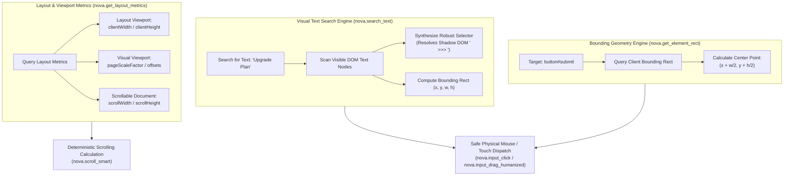

# Geometry, Viewport Metrics & Visual Text Search

> [!NOTE]
> Autonomous agents navigating dynamic web applications frequently need to locate elements based on visible human-readable text, calculate precise physical click coordinates, or measure viewport layout dimensions. The **Geometry & Visual Search** subsystem—comprising [`nova.search_text`](../../../../mcp-reference/tools/dom-and-reading/nova-search-text.md), [`nova.get_element_rect`](../../../../mcp-reference/tools/dom-and-reading/nova-get-element-rect.md), and [`nova.get_layout_metrics`](../../../../mcp-reference/tools/dom-and-reading/nova-get-layout-metrics.md)—provides exact spatial grounding, layout calculations, and text-based selector synthesis.

---

## 1. Architectural Challenge: Spatial Grounding

In standard browser automation, agents struggle with three major spatial hurdles:
1. **Unstable or Obfuscated Selectors:** Modern web frameworks (Tailwind, styled-components, CSS modules) generate dynamic class names like `.css-1r8y8j` that change with every build. Finding a button by visible text like *"Upgrade Plan"* requires brittle, slow XPath queries.
2. **Sub-Pixel & Centering Calculation Errors:** Clicking an element requires exact viewport coordinates. Guessing coordinates or failing to account for element padding causes clicks to hit borders or miss interactive hitboxes.
3. **Pinch-to-Zoom & Viewport Distortion:** Mobile emulation, responsive breakpoints, and browser zoom alter the relationship between physical device pixels, CSS layout pixels, and visual viewport coordinates.

Nova resolves this by providing native C# coordinate and search engines:



---

## 2. Visual Text Search & Selector Synthesis (`nova.search_text`)

When an agent needs to locate an element based on human-readable text (such as finding where *"Upgrade Plan"* or *"Confirm Booking"* appears on a busy page), [`nova.search_text`](../../../../mcp-reference/tools/dom-and-reading/nova-search-text.md) searches the live DOM and returns actionable interaction data:

```json
{
  "targetId": "tab-101",
  "text": "Upgrade Plan",
  "exactMatch": true,
  "visibleOnly": true
}
```

### Result Schema:

```json
{
  "targetId": "tab-101",
  "result": {
    "ok": true,
    "matchCount": 1,
    "matches": [
      {
        "index": 0,
        "text": "Upgrade Plan",
        "tagName": "BUTTON",
        "selector": "div.pricing-card.enterprise >>> button.cta-button",
        "shadowPath": ["pricing-card", "cta-button"],
        "visible": true,
        "rect": {
          "x": 420.0,
          "y": 680.0,
          "width": 180.0,
          "height": 44.0
        }
      }
    ]
  }
}
```

### Key Advantages:
* **Actionable CSS Selector:** Synthesizes a stable selector targeting the matched element, automatically incorporating the ` >>> ` combinator if the node is nested inside a Shadow Root.
* **Immediate Bounding Rect:** Returns `rect` coordinates so the agent can dispatch a click without executing a separate geometry call.
* **Visibility Confirmation:** Filters out hidden elements (`display: none`, `visibility: hidden`, opacity 0) when `visibleOnly: true` is set.

---

## 3. Exact Element Bounding Geometry (`nova.get_element_rect`)

Autonomous mouse dispatch requires sub-pixel coordinate accuracy:

```json
{
  "targetId": "tab-101",
  "selector": "button#checkout-button"
}
```

### Coordinate Output:

```json
{
  "targetId": "tab-101",
  "result": {
    "ok": true,
    "rect": {
      "x": 150.5,
      "y": 320.0,
      "width": 240.0,
      "height": 48.0,
      "top": 320.0,
      "right": 390.5,
      "bottom": 368.0,
      "left": 150.5
    },
    "center": {
      "x": 270.5,
      "y": 344.0
    },
    "inViewport": true
  }
}
```

Nova automatically computes the exact `center` coordinates (`x + width/2`, `y + height/2`), providing the exact target point for humanized mouse movements via [`nova.input_click`](../../../browser-interaction/README.md) and [`nova.input_drag_humanized`](../../../browser-interaction/README.md).

---

## 4. Layout & Viewport Metrics (`nova.get_layout_metrics`)

To calculate accurate scroll distances or handle responsive viewports, agents inspect the document geometry via [`nova.get_layout_metrics`](../../../../mcp-reference/tools/dom-and-reading/nova-get-layout-metrics.md):

```json
{
  "targetId": "tab-101",
  "result": {
    "layoutViewport": {
      "pageX": 0,
      "pageY": 1200,
      "clientWidth": 1280,
      "clientHeight": 800
    },
    "visualViewport": {
      "offsetX": 0,
      "offsetY": 0,
      "pageScaleFactor": 1.0,
      "clientWidth": 1280,
      "clientHeight": 800
    },
    "contentSize": {
      "scrollWidth": 1280,
      "scrollHeight": 4500
    }
  }
}
```

### Operational Uses:
1. **Scroll Percentage Calculation:** By comparing `layoutViewport.pageY + clientHeight` with `contentSize.scrollHeight`, an agent determines exactly what percentage of the document has been traversed.
2. **Zoom & Scale Awareness:** `pageScaleFactor` indicates whether the page is zoomed, ensuring pointer coordinates are correctly scaled before dispatch.
3. **Viewport Bounds Checking:** Confirms whether an element's `y` coordinate falls within `[pageY, pageY + clientHeight]`.

---

## 5. Practical Agent Invocation Examples

### Searching for a Button by Human Text

```json
{
  "targetId": "tab-101",
  "text": "Accept All Cookies",
  "exactMatch": false,
  "visibleOnly": true
}
```

### Querying Exact Geometry Before Mouse Drag

```json
{
  "targetId": "tab-101",
  "selector": "div.slider-handle"
}
```

### Checking Viewport Dimensions Before Scrolling

```json
{
  "targetId": "tab-101"
}
```

---

## Related Documentation

* [Deep Element Traversal & Geometry Hub](../README.md)
* [Shadow DOM Piercing & Deep Focus Resolution](../shadow-dom-and-deep-focus/README.md)
* [Browser Interaction Architecture](../../../browser-interaction/README.md)
* [Multimodal Fusion Perception Architecture](../../multimodal-perception/README.md)
* [Tool Reference: `nova.search_text`](../../../../mcp-reference/tools/dom-and-reading/nova-search-text.md)
* [Tool Reference: `nova.get_element_rect`](../../../../mcp-reference/tools/dom-and-reading/nova-get-element-rect.md)
* [Tool Reference: `nova.get_layout_metrics`](../../../../mcp-reference/tools/dom-and-reading/nova-get-layout-metrics.md)
