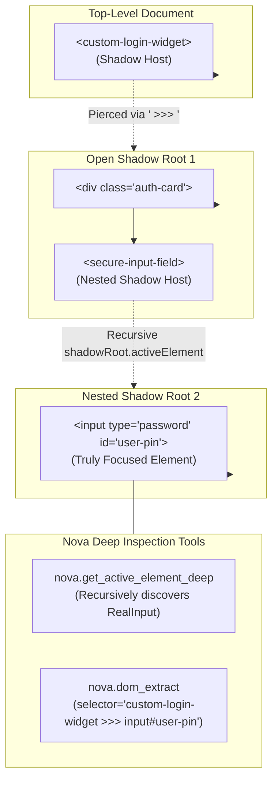

# Shadow DOM Piercing & Deep Focus Resolution

> [!NOTE]
> Modern enterprise web applications—including Salesforce Lightning, ServiceNow, Workday, and interfaces built with Lit, Shoelace, or native Web Components—encapsulate their internal UI within open Shadow Roots. Standard DOM selectors stop at the host boundary, leaving autonomous agents blind to focused inputs, buttons, and component properties. Nova AI Workspace resolves this through native Shadow-Root traversal, innermost focus discovery ([`nova.get_active_element_deep`](../../../../mcp-reference/tools/dom-and-reading/nova-get-active-element-deep.md)), the ` >>> ` shadow combinator, and strongly-typed native property extraction ([`nova.dom_extract`](../../../../mcp-reference/tools/dom-and-reading/nova-dom-extract.md)).

---

## 1. The Shadow DOM Encapsulation Barrier

When a web component attaches an open Shadow Root (`element.attachShadow({ mode: 'open' })`):
1. **Selector Invisibility:** `document.querySelector('input.form-control')` returns `null` because standard CSS selectors cannot penetrate shadow boundaries.
2. **Top-Level Focus Masking:** `document.activeElement` reports only the top-level custom element host (e.g. `<salesforce-input-field>`) rather than the actual `<input>` or `<textarea>` receiving keyboard focus.
3. **Evaluation Vulnerabilities:** Attempting to evaluate ad-hoc JavaScript snippets via `eval` to traverse `.shadowRoot` manually introduces security risks, fails under strict Content Security Policies (CSP), and can trigger side effects.

Nova provides native, host-level traversals and the ` >>> ` combinator to pierce these barriers safely:



---

## 2. Innermost Focus Resolution (`nova.get_active_element_deep`)

When an agent needs to verify where text input will be delivered, standard browser APIs fail in component architectures:

* Standard `document.activeElement`: Returns `<my-text-editor>` (the custom element wrapper).
* `nova.get_active_element_deep`: Recursively traverses:
  ```
  document.activeElement
    └── .shadowRoot.activeElement
          └── .shadowRoot.activeElement (Innermost <textarea>)
  ```

### Sample Response:

```json
{
  "targetId": "tab-101",
  "result": {
    "ok": true,
    "focused": true,
    "tagName": "TEXTAREA",
    "id": "composer-input",
    "className": "ProseMirror focused",
    "role": "textbox",
    "ariaLabel": "Send a message...",
    "shadowChain": [
      "chat-workspace",
      "message-composer",
      "rich-editor"
    ],
    "rect": {
      "x": 320,
      "y": 740,
      "width": 800,
      "height": 120
    }
  }
}
```

* **`shadowChain`:** Details the exact component hierarchy traversed to reach the focused element.
* **`rect`:** Provides absolute client viewport coordinates for precise mouse click or focus confirmation.

---

## 3. The ` >>> ` Shadow Piercing Combinator

Nova's query engine supports the ` >>> ` combinator across all selector-based tools (`nova.dom_extract`, `nova.click_selector`, `nova.type_selector`, `nova.read_text`):

```css
salesforce-account-view >>> contacts-table >>> tr.active >>> button.edit-btn
```

### Traversal Semantics:
1. Locates the custom element matching the left-hand selector (`salesforce-account-view`).
2. Traverses into its open `.shadowRoot`.
3. Evaluates the right-hand selector (`contacts-table`) within that shadow tree.
4. Chains recursively through arbitrary shadow depth until the target element is reached.

---

## 4. Safe Strongly-Typed Extraction (`nova.dom_extract`)

When inspecting hundreds of elements (such as product links in an e-commerce catalog or user rows in an administrative grid), evaluating arbitrary JavaScript loops via `nova.eval` is slow, error-prone, and blocked by strict CSP headers.

[`nova.dom_extract`](../../../../mcp-reference/tools/dom-and-reading/nova-dom-extract.md) executes a native, read-only extraction pipeline over all elements matching a CSS selector:

```json
{
  "targetId": "tab-101",
  "selector": "div.product-grid >>> a.product-link",
  "properties": ["text", "href", "rect", "ariaLabel"],
  "maxItems": 50,
  "visibleOnly": true
}
```

### The 16 Extractable Properties:

| Property | Type | Description |
| :--- | :--- | :--- |
| `text` | `string` | Trimmed visible inner text of the element. |
| `value` | `string` | Current form value (for `<input>`, `<textarea>`, `<select>`). |
| `checked` | `boolean` | Checked status for checkboxes and radio buttons. |
| `selected` | `boolean` | Selected state for `<option>` items. |
| `disabled` | `boolean` | Whether the interactive element is disabled. |
| `href` | `string` | Resolved absolute hyperlink destination for `<a>` tags. |
| `src` | `string` | Resolved URL for ``, `<video>`, `<audio>`, or `<iframe>`. |
| `title` | `string` | HTML `title` tooltip attribute. |
| `ariaLabel` | `string` | Computed accessible name or `aria-label` attribute. |
| `role` | `string` | Explicit ARIA role (e.g. `button`, `combobox`, `tab`). |
| `tagName` | `string` | Uppercase HTML tag name (`BUTTON`, `INPUT`, `A`). |
| `id` | `string` | Element's unique `id` attribute. |
| `className` | `string` | Raw CSS class string. |
| `rect` | `object` | Bounding client coordinates (`x`, `y`, `width`, `height`). |
| `dataset` | `object` | Parsed `data-*` attribute key-value pairs. |
| `placeholder` | `string` | Placeholder text for input controls. |

### Protection Invariants:
* **Zero Script Execution:** Executes entirely via browser-native DOM traversal without evaluating strings in the page context.
* **CSP Immune:** Functions normally on banking, defense, and healthcare portals with strict `Content-Security-Policy: script-src 'none'` headers.
* **Bounded Output:** Enforces `maxItems` and `maxChars` limits to prevent LLM context exhaustion.

---

## 5. Practical Agent Invocation Examples

### Verifying Innermost Focused Input

```json
{
  "targetId": "tab-101"
}
```

### Extracting Links Piercing Open Shadow DOM

```json
{
  "targetId": "tab-101",
  "selector": "app-sidebar >>> nav-menu >>> a.nav-item",
  "properties": ["text", "href", "ariaLabel"],
  "maxItems": 20
}
```

### Inspecting Input Values in a Web Component Form

```json
{
  "targetId": "tab-101",
  "selector": "user-profile-editor >>> input, textarea",
  "properties": ["id", "value", "disabled", "placeholder"]
}
```

---

## Related Documentation

* [Deep Element Traversal & Geometry Hub](../README.md)
* [Geometry & Visual Search Architecture](../geometry-and-visual-search/README.md)
* [Multimodal Fusion Perception Architecture](../../multimodal-perception/README.md)
* [Semantic Landmark Reading & Tabular Extraction](../../semantic-reading/README.md)
* [Tool Reference: `nova.get_active_element_deep`](../../../../mcp-reference/tools/dom-and-reading/nova-get-active-element-deep.md)
* [Tool Reference: `nova.dom_extract`](../../../../mcp-reference/tools/dom-and-reading/nova-dom-extract.md)
