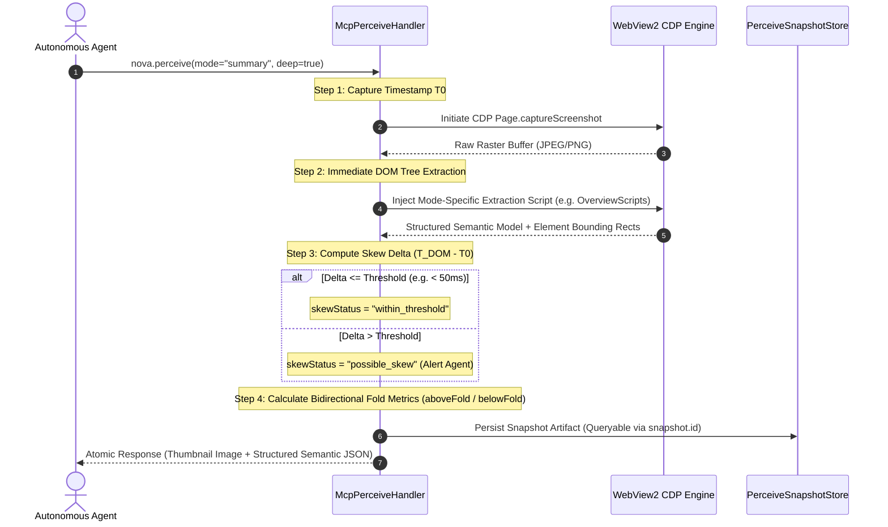

# Multimodal Fusion Perception & Spatial Vision

> [!NOTE]
> `nova.perceive` is Nova's flagship perception engine. Instead of requiring separate, disconnected round-trips for visual screenshots, accessibility trees, and DOM text dumps, `nova.perceive` coordinates visual pixels and structured DOM semantics in a single atomic snapshot. It introduces six operational perception modes, bidirectional fold accounting, delta-synchronized CTA tracking, and temporal skew detection.

---

## 1. The Multimodal Fusion Concept

Traditional browser automation treats vision and DOM parsing as isolated operations. An agent typically takes a screenshot, sends it to a vision model, then executes a separate DOM script to locate elements.

This decoupled workflow suffers from three structural flaws:
1. **Temporal De-synchronization:** On reactive single-page applications (SPAs), the DOM may mutate between the moment pixels are rasterized and the moment JavaScript extracts element positions.
2. **Double Latency & Bandwidth:** Two independent network round-trips occur for every page observation.
3. **Loss of Ground-Truth Mapping:** Vision models hallucinate pixel coordinates, while DOM scrapers lack understanding of visual hierarchy, element layering, and occlusion.

Nova solves this by fusing pixel rasterization and DOM tree inspection into a single **coordinated atomic snapshot**:



---

## 2. The Six Specialized Perception Modes

Rather than forcing the LLM to parse a monolithic representation for every operation, `nova.perceive` supports six tailored modes:

```
┌────────────────────────────────────────────────────────────────────────┐
│                        Six Perception Modes                            │
├───────────────────┬────────────────────────────────────────────────────┤
│ Mode              │ Primary Use Case & Returned Payload                │
├───────────────────┼────────────────────────────────────────────────────┤
│ summary (default) │ Post-navigation orientation: returns viewport,     │
│                   │ title, primary headings, landmarks, text sample,   │
│                   │ and scored Call-to-Actions (CTAs).                 │
├───────────────────┼────────────────────────────────────────────────────┤
│ state             │ High-frequency polling: caller chooses specific    │
│                   │ status families (url, title, activeElement,        │
│                   │ dialogs, frames, completeness, trustedState).      │
│                   │ Zero page-text dump; minimal token consumption.    │
├───────────────────┼────────────────────────────────────────────────────┤
│ form_analysis     │ Form completion & checkout: inspects all inputs,   │
│                   │ selects, textareas, contenteditable fields, and    │
│                   │ ARIA choice roles with semantic interaction hints. │
├───────────────────┼────────────────────────────────────────────────────┤
│ cta_detection_v3  │ Interactive decision-making: scored clickable      │
│                   │ elements with stable numeric handles (ctaRef) and  │
│                   │ delta-sync (sinceRev) saving ~80% tokens.          │
├───────────────────┼────────────────────────────────────────────────────┤
│ modals            │ Overlay auditing: extracts all open dialogs,       │
│                   │ cookie walls, drawer panels, and modal buttons.    │
├───────────────────┼────────────────────────────────────────────────────┤
│ full              │ Forensic diagnostics: returns truncated outerHTML, │
│                   │ scroll positions, active elements, and full DOM.   │
└───────────────────┴────────────────────────────────────────────────────┘
```

---

## 3. Bidirectional Fold Accounting & Virtualization

Standard scrapers compute content completeness simply by measuring distance to the bottom of the HTML document (`document.body.scrollHeight`).

On modern web applications, this metric fails completely:
* **Reverse-Scroll Chat Windows (ChatGPT, Claude, Slack, Teams):** The user or agent is positioned at the *bottom* of the scroll container. As you scroll *upwards*, past messages are dynamically loaded and rendered. Standard bottom-distance metrics report $0\text{ px}$, causing agents to believe no further history exists.
* **Virtualized Lists:** Modern table grids and feeds unmount DOM nodes that leave the visible viewport to conserve memory.

Nova introduces **bidirectional fold accounting** in `structuredContent.completeness`:

```json
{
  "completeness": {
    "aboveFoldPx": 1840,
    "belowFoldPx": 0,
    "viewportHeight": 900,
    "mechanismHint": "bidirectional",
    "riskTier": "medium",
    "unrenderedContentLikely": true
  }
}
```

* **`aboveFoldPx`:** The quantity of unrendered or virtualized content existing *above* the current viewport. In chat interfaces, a non-zero value alerts the agent that previous conversation context exists and requires reverse scrolling.
* **`belowFoldPx`:** The quantity of unrendered content existing *below* the visible viewport.
* **`mechanismHint`:** Classifies the page's content expansion mechanism:
  * `"scrollable"`: Standard infinite document scrolling.
  * `"loadMoreControl"`: Page uses a *"Load More"* or *"Show More"* button.
  * `"pagination"`: Numbered pagination controls detected.
  * `"bidirectional"`: Dynamic scroll container expanding in both directions.

---

## 4. CTA Detection v3: Stable Handles & Delta Sync

In interactive workflows, an agent needs to identify what elements can be clicked. Naive extraction returns hundreds of non-interactive `<div>` and `<span>` tags, flooding the context window.

Nova's **CTA Detection v3** pipeline addresses this:

### A. Prominence Scoring & Handle Resolution
Every clickable candidate (button, link, input submit, or ARIA `button`/`link`/`tab`) is evaluated for:
* Visual prominence (bounding box dimensions, color contrast, viewport centering).
* Semantic role and accessibility label.
* Interactive state (enabled vs. disabled).

Elements receive a compact numeric handle: `ctaRef` (e.g. `1`, `2`, `3`). Agents can reference these handles directly in subsequent interactions.

### B. Delta Mode (`sinceRev`)
When an agent clicks an element on a live page (e.g. opening a dropdown menu or expanding a tab), rescanning all 50 CTAs on the page is wasteful.

By passing `sinceRev: <previousRevision>`, Nova activates **delta synchronization**:
* Elements with identical fingerprints between revisions are omitted.
* Only added, removed, or mutated CTAs are returned.
* **Outcome:** Reduces token consumption by up to **80%** during multi-step browser interactions.

---

## 5. Temporal Skew Synchronization (`perceiveTiming`)

On complex single-page applications, UI animations, React re-renders, and WebSocket updates mutate the DOM continuously. If a screenshot is captured at millisecond 0 and the DOM is scanned at millisecond 150, the coordinates in the DOM response may point to elements that were displaced by a banner that opened during the interval.

Nova monitors and reports capture latency in `perceiveTiming`:
* `screenshotDurationMs`: Time required to capture and encode the raster image.
* `domExtractionDurationMs`: Time required to execute the semantic extraction probe.
* `skewStatus`:
  * `"within_threshold"`: Capture and extraction occurred within the safe synchronization window.
  * `"possible_skew"`: Page mutations or high CPU load caused a discrepancy between visual pixels and extracted DOM nodes. The agent is advised to re-verify critical coordinates.

---

## 6. Frame Traversal & Cross-Origin Isolation

Modern web pages frequently embed iframes from third-party payment gateways, identity providers, or advertising networks.

When `deep: true` is supplied to `nova.perceive`:
1. **Same-Origin Interactive Frames:** Nova traverses same-origin frames, populates their interactive elements with their Chrome DevTools Protocol (CDP) `frameId`, and includes them in the unified element inventory.
2. **Opaque Cross-Origin Frames:** Cross-origin frames (such as third-party authentication dialogs) are isolated for security. Nova lists them in `opaqueFrames[]` with their bounding geometry, classified provider, and sanitized URL, preventing untrusted scripts from poisoning top-level perception data.
3. **Targeted Sub-Frame Interaction:** If cross-origin operation is permitted by policy (`cross_origin_operable`), agents can target tools like `nova.read_text` or `nova.click_selector` directly to the embedded `frameId`.

---

## 7. Persistent Snapshot Caching (`nova.perceive_snapshot_query`)

Executing a full `nova.perceive` call captures both raster image bytes and semantic DOM models. In multi-step analysis, an agent may need to ask follow-up questions about the page (e.g., *"What were the exact row values in table 2?"* or *"What was the placeholder on input #email?"*).

Running `nova.perceive` again incurs unnecessary latency and triggers another rasterization pass.

Instead, every perceive call registers a persistent snapshot artifact in `PerceiveSnapshotStore`:
```json
{
  "snapshot": {
    "id": "snap-987654321",
    "capturedUtc": "2026-10-17T06:55:00Z"
  }
}
```

Agents can query this cached snapshot offline via [`nova.perceive_snapshot_query`](../../../mcp-reference/tools/dom-and-reading/nova-perceive-snapshot-query.md):
* **Zero Runtime Execution:** Reads directly from host memory without running JavaScript on the page.
* **Instantaneous Response:** Query results return in under 5 milliseconds.
* **Zero Visual Distortion:** Guarantees that follow-up inspection reflects the exact state captured at `snap-987654321`, regardless of whether the live page has since refreshed or navigated away.

---

## Related Documentation

* [DOM Perception & Structured Reading Overview](../README.md)
* [Semantic Landmark Reading & Tabular Extraction](../semantic-reading/README.md)
* [Deep Element Traversal & Geometry](../element-inspection/README.md)
* [Tool Reference: `nova.perceive`](../../../mcp-reference/tools/dom-and-reading/nova-perceive.md)
* [Tool Reference: `nova.perceive_snapshot_query`](../../../mcp-reference/tools/dom-and-reading/nova-perceive-snapshot-query.md)
