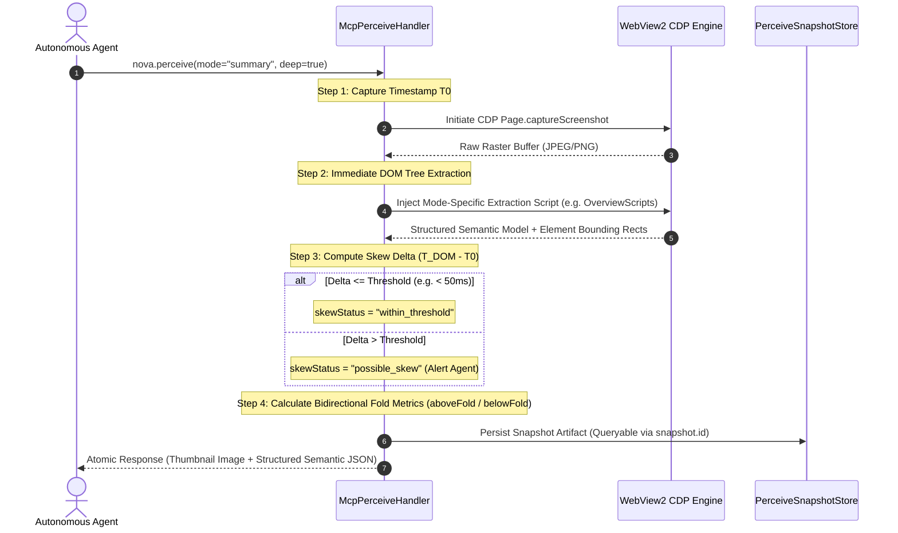

# Multimodal Fusion Perception & Spatial Vision

> [!NOTE]
> `nova.perceive` is Nova's flagship perception engine. Instead of requiring separate, disconnected round-trips for visual screenshots, accessibility trees, and DOM text dumps, `nova.perceive` coordinates visual pixels and structured DOM semantics in a single atomic snapshot. It introduces six operational perception modes, bidirectional fold accounting, delta-synchronized CTA tracking, and temporal skew detection.

---

## 1. Overview & Architectural Role

Traditional browser automation treats vision and DOM parsing as isolated operations. An agent typically takes a screenshot, sends it to a vision model, then executes a separate DOM script to locate elements.

This decoupled workflow suffers from three structural flaws:
1. **Temporal De-synchronization:** On reactive single-page applications (SPAs), the DOM may mutate between the moment pixels are rasterized and the moment JavaScript extracts element positions.
2. **Double Latency & Bandwidth:** Two independent network round-trips occur for every page observation.
3. **Loss of Ground-Truth Mapping:** Vision models hallucinate pixel coordinates, while DOM scrapers lack understanding of visual hierarchy, element layering, and occlusion.

Nova solves this by fusing pixel rasterization and DOM tree inspection into a single **coordinated atomic snapshot**:



---

## 2. Comprehensive Documentation Index

For exhaustive technical implementations, fold accounting schemas, and snapshot query recipes, consult the specialized architecture guides:

```
public/docs/core-features/dom-perception/multimodal-perception/
├── README.md                                 # This domain hub
├── fusion-pipeline-and-modes/
│   └── README.md                             # Fusion pipeline, perceiveTiming, skew detection, and 6 perception modes
└── fold-metrics-and-snapshots/
    └── README.md                             # Bidirectional fold metrics, CTA delta sync, and snapshot caching
```

| Architecture Guide | Focus & Key Concepts | Primary Components |
| :--- | :--- | :--- |
| **[Multimodal Fusion Pipeline & Perception Modes](fusion-pipeline-and-modes/README.md)** | Single-phase pixel + DOM fusion pipeline, temporal capture skew synchronization (`perceiveTiming`), `skewStatus` thresholds, and the 6 specialized perception modes (`summary`, `state`, `form_analysis`, `cta_detection_v3`, `modals`, `full`). | `McpPerceiveHandler`<br>`perceiveTiming`<br>`skewStatus`<br>`mode="summary"`<br>`mode="state"` |
| **[Fold Metrics, Virtualization & Snapshot Caching](fold-metrics-and-snapshots/README.md)** | Bidirectional fold accounting (`aboveFoldPx`/`belowFoldPx`), handling reverse-scroll chat windows and virtualized feeds, CTA prominence scoring with stable handles (`ctaRef`), delta synchronization (`sinceRev`), cross-origin frame isolation (`opaqueFrames[]`), and persistent offline snapshot caching (`nova.perceive_snapshot_query`). | `completeness`<br>`aboveFoldPx`<br>`belowFoldPx`<br>`cta_detection_v3`<br>`PerceiveSnapshotStore`<br>`nova.perceive_snapshot_query` |

---

## 3. Core Operational Invariants for Autonomous Agents

When perceiving web applications through Nova, agents should adhere to the following principles:

1. **Leverage Specialized Modes to Conserve Context:**
   Never invoke `mode: "full"` unless conducting deep forensic debugging. For initial page orientation, use `mode: "summary"`. For rapid polling during asynchronous operations, use `mode: "state"` with `responseDetail: "essential"` to reduce token consumption by up to **95%**.
2. **Account for Bidirectional Fold Metrics in Chat Feeds:**
   In chat applications or reverse-scroll interfaces, never rely on bottom distance alone. If `completeness.aboveFoldPx` is non-zero, past message history exists above the viewport and requires reverse scrolling to inspect.
3. **Use Offline Snapshot Queries for Follow-Up Inspection:**
   When performing detailed analysis across multiple fields on a complex page, save the returned `snapshot.id` and use [`nova.perceive_snapshot_query`](../../../mcp-reference/tools/dom-and-reading/nova-perceive-snapshot-query.md). This eliminates redundant browser rasterization and returns results in under 5 milliseconds.

---

## Related Documentation

* [DOM Perception & Structured Reading Overview](../README.md)
* [Multimodal Fusion Pipeline & Perception Modes](fusion-pipeline-and-modes/README.md)
* [Fold Metrics, Virtualization & Snapshot Caching](fold-metrics-and-snapshots/README.md)
* [Semantic Landmark Reading & Tabular Extraction](../semantic-reading/README.md)
* [Deep Element Traversal & Geometry](../element-inspection/README.md)
* [Tool Reference: `nova.perceive`](../../../mcp-reference/tools/dom-and-reading/nova-perceive.md)
* [Tool Reference: `nova.perceive_snapshot_query`](../../../mcp-reference/tools/dom-and-reading/nova-perceive-snapshot-query.md)
