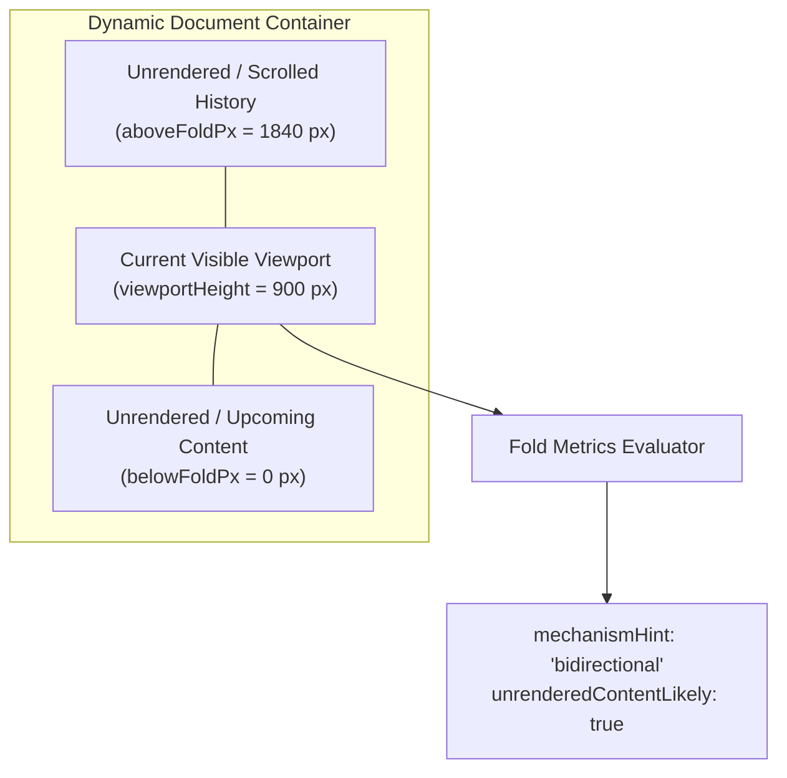
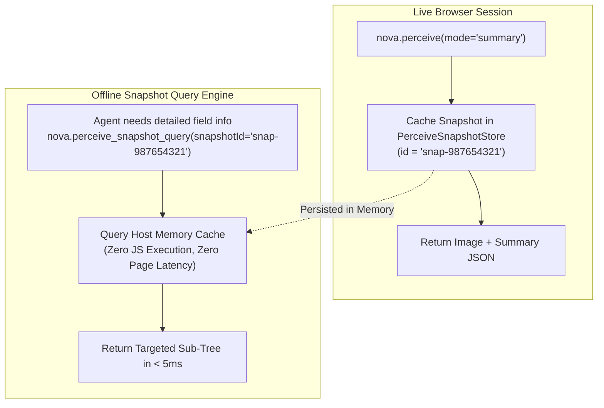

# Fold Metrics, Virtualization & Snapshot Caching

> [!NOTE]
> Autonomous agents navigating complex web applications frequently encounter virtualized feeds, reverse-scroll chat streams, embedded third-party frames, and multi-step analytical tasks. Standard browser scrapers fail to account for content that exists above the visible viewport or re-trigger expensive rasterization passes for every follow-up question. This guide details Nova's **bidirectional fold accounting**, **CTA delta synchronization**, **cross-origin frame isolation**, and **persistent snapshot caching** (`nova.perceive_snapshot_query`).

---

## 1. Bidirectional Fold Accounting & Virtualization

Standard browser automation frameworks measure document completeness using a single linear metric: distance to the bottom of the HTML document (`document.body.scrollHeight - window.scrollY`).

In modern web platforms, this metric produces catastrophic false assumptions:

```
┌────────────────────────────────────────────────────────────────────────┐
│                   Linear Scroll Metric Failure Modes                   │
├──────────────────────────────────┬─────────────────────────────────────┤
│ Web Application Pattern          │ Impact on Linear Scrapers           │
├──────────────────────────────────┼─────────────────────────────────────┤
│ Reverse-Scroll Chat Interfaces   │ The user is at the bottom of the    │
│ (ChatGPT, Claude, Slack, Teams)  │ feed. Linear scrapers report 0 px   │
│                                  │ remaining, falsely concluding no    │
│                                  │ prior conversation history exists.  │
├──────────────────────────────────┼─────────────────────────────────────┤
│ Virtualized Infinite Feeds       │ DOM nodes outside the viewport are  │
│ (X/Twitter, LinkedIn, DataGrids) │ unmounted from the DOM. A scraper   │
│                                  │ reading the DOM only sees 10 items. │
├──────────────────────────────────┼─────────────────────────────────────┤
│ Dual-Direction Scroll Containers │ Feeds expand dynamically in both    │
│ (Financial charts, logs)         │ directions as new entries stream in.│
└──────────────────────────────────┴─────────────────────────────────────┘
```

Nova solves this through **bidirectional fold metrics** reported in `structuredContent.completeness`:

```json
{
  "completeness": {
    "aboveFoldPx": 1840,
    "belowFoldPx": 0,
    "viewportHeight": 900,
    "mechanismHint": "bidirectional",
    "riskTier": "medium",
    "unrenderedContentLikely": true
  }
}
```



### Metric Definitions:

* **`aboveFoldPx`:** The pixel height of scrollable or unrendered content existing *above* the current viewport. In chat interfaces, a non-zero value alerts the agent that previous conversation context exists and requires reverse scrolling.
* **`belowFoldPx`:** The pixel height of scrollable content existing *below* the visible viewport.
* **`mechanismHint`:** Classifies the page's dynamic expansion mechanism:
  * `"scrollable"`: Standard infinite document scrolling.
  * `"loadMoreControl"`: Page uses a *"Load More"* or *"Show More"* button.
  * `"pagination"`: Numbered pagination controls detected.
  * `"bidirectional"`: Dynamic scroll container expanding in both directions.
* **`unrenderedContentLikely`:** Set to `true` when DOM node counts or scroll container dimensions indicate virtualized components exist outside view.

---

## 2. CTA Detection v3: Stable Handles & Delta Sync

Autonomous decision-making requires knowing what controls can be clicked without flooding the context window with hundreds of non-interactive `<div>` or `<span>` tags.

### A. Prominence Scoring & Handle Resolution
Nova's **CTA Detection v3** engine scores candidate interactive elements (buttons, links, inputs, ARIA `button`/`link`/`tab`) based on:
1. **Visual Prominence:** Bounding box dimensions, color contrast, and viewport centering.
2. **Semantic Role:** Accessible names, ARIA roles, and standard HTML button semantics.
3. **Interactive State:** Whether the element is enabled, disabled, or occluded.

Each scored control receives a compact, stable handle: `ctaRef: 1`, `ctaRef: 2`, `ctaRef: 3`. Agents can reference these handles directly in subsequent actions.

### B. Delta Mode (`sinceRev`)
During multi-step workflows (e.g. opening a dropdown menu or expanding a sidebar), rescanning every element on the page is wasteful.

By passing `sinceRev: <previousRevision>`, Nova activates **delta synchronization**:
* Elements with identical fingerprints between revisions are excluded.
* Only newly added, removed, or mutated controls are returned in the payload.
* **Outcome:** Reduces token consumption by up to **80%** during multi-step browser interactions.

---

## 3. Frame Traversal & Cross-Origin Isolation

Modern enterprise web portals frequently embed third-party iframes for payment processing (Stripe, Adyen), authentication (Okta, Auth0), or embedded customer widgets.

When `deep: true` is passed to `nova.perceive`:

1. **Same-Origin Interactive Frames:** Nova traverses same-origin frames, populates their interactive elements with their Chrome DevTools Protocol (CDP) `frameId`, and merges them into the unified element inventory.
2. **Opaque Cross-Origin Frames:** Cross-origin frames are isolated for security. Nova records them in `opaqueFrames[]`:
   ```json
   {
     "opaqueFrames": [
       {
         "frameId": "frame-stripe-payment-38491",
         "url": "https://js.stripe.com/v3/elements-inner-card.html",
         "provider": "stripe",
         "rect": { "x": 100, "y": 450, "width": 400, "height": 60 }
       }
     ]
   }
   ```
   This prevents untrusted third-party iframe scripts from injecting rogue elements into the agent's top-level perception model.
3. **Targeted Sub-Frame Interaction:** If cross-origin interaction is permitted by system security policy (`cross_origin_operable`), agents can target tools like `nova.click_selector` directly to the embedded `frameId`.

---

## 4. Persistent Snapshot Caching (`nova.perceive_snapshot_query`)

Executing a full `nova.perceive` call captures both raster image bytes and semantic DOM models. In multi-step analysis, an agent often needs to ask follow-up questions about the page (e.g., *"What were the exact row values in table 2?"* or *"What was the placeholder on input #email?"*).

Running `nova.perceive` again incurs unnecessary latency and triggers another rasterization pass.

Instead, every perceive call registers a persistent snapshot artifact in `PerceiveSnapshotStore`:

```json
{
  "snapshot": {
    "id": "snap-987654321",
    "capturedUtc": "2026-10-17T06:55:00Z"
  }
}
```



### Architectural Guarantees of Snapshot Queries:

1. **Zero Runtime Execution:** Queries read directly from host C# memory without executing JavaScript in the web browser.
2. **Instantaneous Response:** Query results return in under **5 milliseconds**.
3. **Zero Visual Distortion:** Guarantees that follow-up inspection reflects the exact state captured at `snap-987654321`, even if the live web page has refreshed, navigated away, or unmounted components.

---

## 5. Practical Agent Invocation Examples

### Querying Form Fields from a Cached Snapshot

```json
{
  "snapshotId": "snap-987654321",
  "queryType": "form_fields"
}
```

### Querying Specific Element Selectors from Snapshot

```json
{
  "snapshotId": "snap-987654321",
  "queryType": "selector",
  "selector": "div.billing-details input"
}
```

### Delta CTA Perception Using `sinceRev`

```json
{
  "targetId": "tab-101",
  "mode": "cta_detection_v3",
  "sinceRev": 14
}
```

---

## Related Documentation

* [Multimodal Fusion Perception Hub](../README.md)
* [Multimodal Fusion Pipeline & Perception Modes](../fusion-pipeline-and-modes/README.md)
* [Semantic Landmark Reading & Tabular Extraction](../../semantic-reading/README.md)
* [Deep Element Traversal & Geometry](../../element-inspection/README.md)
* [Tool Reference: `nova.perceive`](../../../../mcp-reference/tools/dom-and-reading/nova-perceive.md)
* [Tool Reference: `nova.perceive_snapshot_query`](../../../../mcp-reference/tools/dom-and-reading/nova-perceive-snapshot-query.md)
