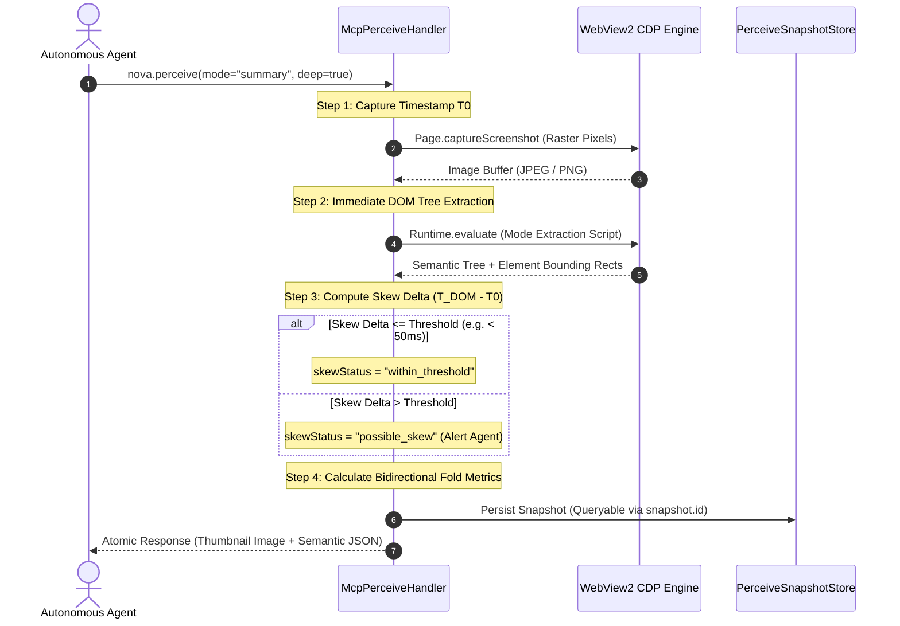

# Multimodal Fusion Pipeline & Perception Modes

> [!NOTE]
> `nova.perceive` is Nova's primary sensory interface for autonomous web agents. Instead of requiring separate, decoupled round-trips for visual screenshots and DOM trees, `nova.perceive` coordinates raster pixels and structured DOM semantics in a single atomic snapshot. This guide details the fusion pipeline, temporal skew synchronization, and the six specialized perception modes.

---

## 1. The Multimodal Fusion Architecture

Traditional browser automation treats vision and DOM parsing as disjointed, asynchronous tasks:
1. An agent captures a screenshot and sends it to a vision model.
2. The vision model predicts where an element is located in pixels.
3. The agent attempts to query the DOM or execute an ad-hoc click script at those coordinates.

In dynamic Single Page Applications (SPAs), this decoupled approach leads to **temporal de-synchronization**: by the time the DOM script executes, React re-renders, CSS transitions, or banner injections have shifted elements, causing clicks to hit empty space or wrong controls.

Nova eliminates this latency and alignment drift through a **single-phase multimodal fusion pipeline**:



---

## 2. Temporal Capture Skew Synchronization (`perceiveTiming`)

When rendering complex dashboards with heavy client-side JavaScript, UI animations and WebSocket streams can displace elements between raster capture and DOM extraction.

Nova quantifies this interval and reports telemetry in `perceiveTiming`:

```json
{
  "perceiveTiming": {
    "screenshotDurationMs": 28,
    "domExtractionDurationMs": 14,
    "totalDurationMs": 42,
    "skewStatus": "within_threshold"
  }
}
```

### Skew Status Definitions:

* **`within_threshold`:** The pixel capture and DOM extraction occurred within the safe synchronization window (typically $< 50\text{ ms}$). Bounding rectangles in the DOM response are guaranteed to match the visual pixels.
* **`possible_skew`:** Heavy CPU load, garbage collection, or long-running frame animations delayed DOM extraction. The agent is alerted that high-precision coordinate clicks should be re-verified using [`nova.get_element_rect`](../../../../mcp-reference/tools/dom-and-reading/nova-get-element-rect.md).

---

## 3. The Six Specialized Perception Modes

Rather than forcing the agent to process a monolithic, token-heavy payload for every question, `nova.perceive` provides six specialized extraction modes:

```
┌────────────────────────────────────────────────────────────────────────┐
│                        Six Perception Modes                            │
├───────────────────┬────────────────────────────────────────────────────┤
│ Mode              │ Primary Use Case & Returned Payload                │
├───────────────────┼────────────────────────────────────────────────────┤
│ summary (default) │ Post-navigation orientation: returns viewport,     │
│                   │ title, primary headings, landmarks, text sample,   │
│                   │ and scored Call-to-Actions (CTAs).                 │
├───────────────────┼────────────────────────────────────────────────────┤
│ state             │ High-frequency polling: caller chooses specific    │
│                   │ status families (url, title, activeElement,        │
│                   │ dialogs, frames, completeness, trustedState).      │
│                   │ Zero page-text dump; minimal token consumption.    │
├───────────────────┼────────────────────────────────────────────────────┤
│ form_analysis     │ Form completion & checkout: inspects all inputs,   │
│                   │ selects, textareas, contenteditable fields, and    │
│                   │ ARIA choice roles with semantic interaction hints. │
├───────────────────┼────────────────────────────────────────────────────┤
│ cta_detection_v3  │ Interactive decision-making: scored clickable      │
│                   │ elements with stable numeric handles (ctaRef) and  │
│                   │ delta-sync (sinceRev) saving ~80% tokens.          │
├───────────────────┼────────────────────────────────────────────────────┤
│ modals            │ Overlay auditing: extracts all open dialogs,       │
│                   │ cookie walls, drawer panels, and modal buttons.    │
├───────────────────┼────────────────────────────────────────────────────┤
│ full              │ Forensic diagnostics: returns truncated outerHTML, │
│                   │ scroll positions, active elements, and full DOM.   │
└───────────────────┴────────────────────────────────────────────────────┘
```

---

## 4. Deep Dive into Core Modes

### A. Mode: `summary` (Default Orientation)
Used immediately after navigating to a new URL or when getting oriented on an unfamiliar screen:
* **Viewport Dimensions & Scroll Offset:** Physical resolution, CSS pixels, and scroll coordinates.
* **Document Hierarchy:** Page `<title>`, top-level headings (`h1`–`h3`), and landmark structure.
* **Scored Call-to-Actions:** The top prominent buttons and navigation links.
* **Token Footprint:** Typically 500–1,200 tokens.

### B. Mode: `state` (Lightweight Status Polling)
Designed for agent polling loops (e.g. waiting for a progress bar, checking if a dialog opened, or confirming an active element):
* Suppresses all page body text and headings.
* Returns only requested status families:
  ```json
  {
    "mode": "state",
    "statusFamilies": ["url", "activeElement", "dialogs"]
  }
  ```
* **Token Footprint:** Extremely compact (50–150 tokens), allowing frequent polling without depleting LLM context limits.

### C. Mode: `form_analysis` (Form & Checkout Preparation)
Tailored specifically for form filling, login surfaces, and configuration dashboards:
* Enumerates all interactive form fields (`input`, `select`, `textarea`, `[contenteditable]`, and ARIA roles like `combobox`, `radio`, `checkbox`).
* Identifies field labels via `<label for>`, `aria-label`, `aria-labelledby`, and placeholder text.
* Highlights validation constraints: `required`, `pattern`, `minlength`, `maxlength`, `disabled`, and current `:invalid` state.
* Maps choice options for `<select>` dropdowns and radio groups.

### D. Mode: `cta_detection_v3` (Interactive Decision Making)
Focuses exclusively on actionable controls:
* Evaluates all clickable candidates for visual prominence, contrast, viewport centering, and interactive state.
* Assigns compact numeric handles (`ctaRef: 1`, `ctaRef: 2`) for easy agent invocation.
* Supports delta-synchronization (`sinceRev`) to return only elements that changed since the last action.

### E. Mode: `modals` (Overlay & Blocker Auditing)
Extracts all top-level modal dialogs, cookie consent banners (CMPs), and floating drawer panels:
* Identifies backdrop elements and scrim layers.
* Lists confirm/dismiss button selectors inside the active modal.
* Alerts the agent whether the main viewport is currently blocked from interaction.

### F. Mode: `full` (Forensic Diagnostics)
Used during debugging or comprehensive audit sweeps:
* Returns structured DOM trees, truncated outerHTML, full stylesheet references, and complete accessibility trees.

---

## 5. Practical Agent Invocation Examples

### Default Summary Perception with Shadow DOM Piercing

```json
{
  "targetId": "tab-101",
  "mode": "summary",
  "deep": true
}
```

### High-Frequency State Polling

```json
{
  "targetId": "tab-101",
  "mode": "state",
  "responseDetail": "essential",
  "statusFamilies": ["url", "dialogs", "activeElement"]
}
```

### Form Analysis for Checkout Automation

```json
{
  "targetId": "tab-101",
  "mode": "form_analysis",
  "deep": true
}
```

---

## Related Documentation

* [Multimodal Fusion Perception Hub](../README.md)
* [Fold Metrics, Virtualization & Snapshots](../fold-metrics-and-snapshots/README.md)
* [Semantic Landmark Reading & Tabular Extraction](../../semantic-reading/README.md)
* [Deep Element Traversal & Geometry](../../element-inspection/README.md)
* [Tool Reference: `nova.perceive`](../../../../mcp-reference/tools/dom-and-reading/nova-perceive.md)
