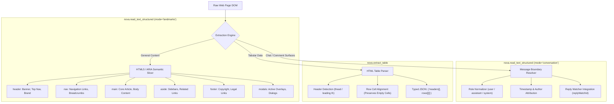

# Semantic Landmark Reading & Tabular Extraction

> [!NOTE]
> Extracting text by dumping the entire HTML body or reading flat `innerText` is one of the most common causes of LLM context exhaustion. It jumbles legal disclaimers, cookie notices, and sidebar navigation links with core article content. Nova AI Workspace provides **semantic reading engines**—[`nova.read_text_structured`](../../../mcp-reference/tools/dom-and-reading/nova-read-text-structured.md), [`nova.extract_table`](../../../mcp-reference/tools/dom-and-reading/nova-extract-table.md), and [`nova.read_text`](../../../mcp-reference/tools/dom-and-reading/nova-read-text.md)—that partition page text by HTML5 landmark regions, parse conversation streams with author roles, and transform complex HTML tables into clean structured JSON.

---

## 1. Overview & Architectural Role

When an agent executes `document.body.innerText` or downloads raw HTML, three major deficiencies occur:
1. **Context Window Pollution:** In a typical news article or web dashboard, 70% of all text belongs to navigation bars, footer links, privacy policies, and related recommendations. Only 30% is the actual content the agent needs.
2. **Loss of Message Semantics:** In chat surfaces (such as ChatGPT, Slack, or Jira comments), flat text flattens message boundaries, making it impossible to reliably determine who said what, when it was sent, or which role authored a turn.
3. **Tabular Fragmentation:** Standard text scrapers break HTML tables into unaligned string fragments where rows and columns lose their horizontal and vertical alignment.

Nova solves this by parsing documents into structured, scoped semantic regions and tabular grids:



---

## 2. Comprehensive Documentation Index

For exhaustive technical implementations, conversation parsing mechanics, and tabular extraction schemas, consult the specialized architecture guides:

```
public/docs/core-features/dom-perception/semantic-reading/
├── README.md                                 # This domain hub
├── landmark-and-conversation-reading/
│   └── README.md                             # HTML5/ARIA landmark slicing, conversation mode, reply-watch continuation, clean markdown
└── tabular-data-extraction/
    └── README.md                             # Native C# table parser, header auto-detection, empty cell alignment, bounds
```

| Architecture Guide | Focus & Key Concepts | Primary Components |
| :--- | :--- | :--- |
| **[Landmark-Scoped & Conversational Reading](landmark-and-conversation-reading/README.md)** | Partitioning page text by WAI-ARIA and HTML5 landmarks (`header`, `nav`, `main`, `aside`, `footer`, `modals`), token reduction up to 75%, per-region character caps (`maxCharsPerRegion`), Shadow DOM piercing via ` >>> `, conversational message extraction (`mode: "conversation"`), and clean Markdown extraction (`nova.read_text`). | `McpServer.ReadTextStructured`<br>`LandmarkExtractor`<br>`ConversationProjector`<br>`nova.read_text` |
| **[Tabular Data Extraction Engine](tabular-data-extraction/README.md)** | Native C# HTML table parser (`nova.extract_table`), automatic column header discovery (`<thead>` / leading `<th>`), synthetic column fallbacks, row cell alignment with empty cell preservation (`""`), cell normalization, and container-scoped table extraction. | `TableExtractor`<br>`nova.extract_table`<br>`headers[]`<br>`rows[][]`<br>`maxCellChars` |

---

## 3. Core Operational Invariants for Autonomous Agents

When reading web documents and extracting tabular data through Nova, agents should adhere to the following rules:

1. **Target `regions.main` for Article Comprehension:**
   When reading articles, reports, or documentation, pass only `regions.main` to the reasoning prompt. Discarding `header`, `nav`, and `footer` saves significant token budget and prevents the model from being distracted by unrelated links.
2. **Use Conversation Mode for Multi-Turn Chat Feeds:**
   Never parse chat interfaces with flat text scrapers. Use `mode: "conversation"` in `nova.read_text_structured` to receive structured message arrays with explicit `role`, `author`, and `timestamp` fields.
3. **Always Rely on `nova.extract_table` for Structured Grids:**
   Never write ad-hoc JavaScript `eval` snippets to scrape HTML tables. `nova.extract_table` handles cell alignment, empty cell preservation, and cell bounds natively in host C#, guaranteeing valid JSON grids.

---

## Related Documentation

* [DOM Perception & Structured Reading Overview](../README.md)
* [Landmark-Scoped & Conversational Reading](landmark-and-conversation-reading/README.md)
* [Tabular Data Extraction Engine](tabular-data-extraction/README.md)
* [Multimodal Fusion Perception Architecture](../multimodal-perception/README.md)
* [Deep Element Traversal & Geometry](../element-inspection/README.md)
* [Tool Reference: `nova.read_text_structured`](../../../mcp-reference/tools/dom-and-reading/nova-read-text-structured.md)
* [Tool Reference: `nova.extract_table`](../../../mcp-reference/tools/dom-and-reading/nova-extract-table.md)
* [Tool Reference: `nova.read_text`](../../../mcp-reference/tools/dom-and-reading/nova-read-text.md)
